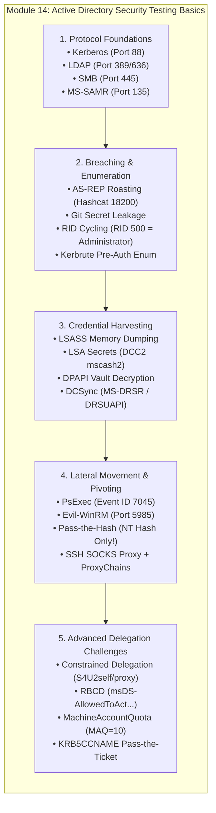

# Comprehensive Assessment Guide: Active Directory Security Testing Basics Recap
**Curriculum Track:** Jr Penetration Tester | **Module 14:** Active Directory Security Testing Basics

---

## 1. Recap Overview

The **Topic Transition Recap** (Canonical ID: `6afe01d5f306fc3f65928080`) serves as the culminating knowledge evaluation for Module 14 of the Jr Penetration Tester path. This assessment validates theoretical mastery and operational comprehension across all phases of Active Directory penetration testing covered in the preceding 9 rooms and challenge labs:
1. **Active Directory Architecture & Fundamentals:** Forest, domain, tree, and organizational unit (OU) structures; Active Directory objects and schema.
2. **Authentication Protocol Mechanics:** Kerberos v5 (TGT, TGS, AS-REQ/REP, TGS-REQ/REP) and NTLM challenge-response handshakes.
3. **Breaching & Initial Enumeration:** AS-REP Roasting, credential hunting in Git history, Kerberos pre-auth enumeration via Kerbrute, and SAM database RID cycling.
4. **Credential Harvesting & Memory Extraction:** In-memory LSASS dumping, SAM & LSA Secrets extraction (DCC2 / MS-Cache v2), DPAPI vault decryption, and DRSUAPI DCSync replication.
5. **Lateral Movement & Network Pivoting:** Remote command execution via PsExec and Evil-WinRM, Pass-the-Hash (PtH), and SSH Dynamic SOCKS pivoting via ProxyChains.
6. **Advanced Kerberos Delegation Abuse:** Constrained Delegation (S4U2self / S4U2proxy) and Resource-Based Constrained Delegation (RBCD) via Machine Account Quota (MAQ) exploitation.

This assessment achieved a verified perfect score of **48 / 48 points (100% on the first attempt)**.

---

## 2. Tested Competencies & Learning Objectives

The assessment interrogates six fundamental Active Directory technical concepts:
- **Core Distinction between NT Hashes and Net-NTLMv2:** Recognizing why Net-NTLMv2 hashes captured over the network cannot be passed in Pass-the-Hash attacks and must instead be cracked offline or relayed.
- **Git Version Control Credential Hygiene:** Understanding that removing a secret in a subsequent commit does not purge it from historical git commit trees.
- **Role of the Lightweight Directory Access Protocol (LDAP):** Identifying LDAP as the primary protocol for searching and querying directory objects, users, groups, and attributes.
- **Hashcat Kerberos Cracking Modes:** Differentiating between mode `18200` (AS-REP Roasting) and mode `13100` (Kerberoasting).
- **Well-Known Relative Identifiers (RIDs):** Knowing that `RID 500` is architecturally assigned to the built-in `Administrator` account in Windows domains.
- **Linux Kerberos Credential Cache (`KRB5CCNAME`):** Identifying the environment variable utilized by Linux tools (Impacket, MIT Kerberos) to specify the active `.ccache` ticket file for Pass-the-Ticket attacks.

---

## 3. Comprehensive Module 14 Conceptual Map

---

## 4. Technical Analysis of Evaluated Questions

### Question 1: Pass-the-Hash vs. Net-NTLMv2 Network Hashes
- **Prompt:** *"Pass-the-Hash attacks work with Net-NTLMv2 hashes captured from network traffic."*
- **Verified Answer:** **`False`**
- **Technical Analysis:**
  - Pass-the-Hash (PtH) exclusively operates with raw NT hashes ($\text{MD4}(\text{UTF-16LE}(\text{Password}))$) extracted from memory (LSASS) or disk databases (SAM, `ntds.dit`).
  - Net-NTLMv2 hashes are challenge-response protocol artifacts generated during an active network handshake. The response is cryptographically bound to a dynamic, random server nonce ($\text{ServerChallenge}$). It cannot be passed to a different service and must instead be cracked offline (Hashcat mode `5600`) or relayed in real-time (NTLM Relay).

### Question 2: Credential Exposure in Version Control
- **Prompt:** *"Deleting a password from a config file in the newest commit fully removes it from the repository."*
- **Verified Answer:** **`False`**
- **Technical Analysis:**
  - Git operates as an immutable object store. Committing a credential writes an immutable blob into `.git/objects/`.
  - Modifying or deleting the file in a subsequent commit updates the working tree, but the exposed secret remains permanently readable in the repository history (`git log -p`). Remediating exposed credentials requires immediate password rotation and history rewriting with tools like `git-filter-repo`.

### Question 3: Functional Role of LDAP
- **Prompt:** *"Which service does LDAP provide in an Active Directory environment?"*
- **Verified Answer:** **`Querying directory objects such as users and groups`**
- **Technical Analysis:**
  - LDAP (RFC 4511) is the directory query protocol operating on TCP ports 389 and 636.
  - It provides a standardized directory information tree (DIT) allowing systems and operators to query users, groups, computers, organizational units, and schema attributes. Network file transfer is handled by SMB, while remote shell execution is handled by WinRM and RPC.

### Question 4: Hashcat Mode for AS-REP Roasting
- **Prompt:** *"Which Hashcat mode is used specifically for cracking AS-REP hashes?"*
- **Verified Answer:** **`18200`**
- **Technical Analysis:**
  - Hashcat mode **`18200`** (`Kerberos 5, etype 23, AS-REP`) is dedicated to cracking hashes harvested from user accounts with Kerberos pre-authentication disabled (`UF_DONT_REQUIRE_PREAUTH`).
  - Hashcat mode **`13100`** is dedicated to cracking Kerberos TGS-REP tickets (Kerberoasting).
  - Mode **`1000`** is for raw NTLM hashes; mode **`7500`** is for AS-REQ pre-authentication timestamps.

### Question 5: Well-Known Relative Identifier RID 500
- **Prompt:** *"In a Windows domain, which account is identified by the well-known RID 500?"*
- **Verified Answer:** **`Administrator`**
- **Technical Analysis:**
  - In Windows Security Identifier (SID) structures, the Relative Identifier (RID) represents the account index within the domain.
  - `RID 500` is architecturally assigned to the built-in `Administrator` account, `RID 501` to `Guest`, `RID 502` to `krbtgt`, and `RID 512` to `Domain Admins`.
  - User-created accounts are assigned RIDs $\ge 1000$.

### Question 6: Linux Kerberos Credential Cache Environment Variable
- **Prompt:** *"Which environment variable tells Kerberos-aware Linux tooling which credential cache file to use?"*
- **Verified Answer:** **`KRB5CCNAME`**
- **Technical Analysis:**
  - In Linux environments, MIT Kerberos and penetration testing toolkits (such as Impacket and Evil-WinRM) inspect the **`KRB5CCNAME`** environment variable to locate active `.ccache` credential files.
  - Exporting `export KRB5CCNAME=/path/to/ticket.ccache` allows operators to execute Pass-the-Ticket attacks (e.g., `psexec.py -k -no-pass`) without supplying plaintext passwords or hashes.

---

## 5. Verified Assessment Questions Matrix

| # | Assessment Question | Question Type | Verified Solution | Awarded Points | Status |
|:---:|---|:---:|---|:---:|:---:|
| **1** | Pass-the-Hash attacks work with Net-NTLMv2 hashes captured from network traffic. | Boolean | **False** | 8 / 8 | Verified & Confirmed |
| **2** | Deleting a password from a config file in the newest commit fully removes it from the repository. | Boolean | **False** | 8 / 8 | Verified & Confirmed |
| **3** | Which service does LDAP provide in an Active Directory environment? | Single-Choice | **Querying directory objects such as users and groups** | 8 / 8 | Verified & Confirmed |
| **4** | Which Hashcat mode is used specifically for cracking AS-REP hashes? | Single-Choice | **18200** | 8 / 8 | Verified & Confirmed |
| **5** | In a Windows domain, which account is identified by the well-known RID 500? | Single-Choice | **Administrator** | 8 / 8 | Verified & Confirmed |
| **6** | Which environment variable tells Kerberos-aware Linux tooling which credential cache file to use? | Single-Choice | **KRB5CCNAME** | 8 / 8 | Verified & Confirmed |

**Total Cumulative Score:** **48 / 48 Points (100%)**.

---

## 6. Comprehensive Active Directory Defensive Strategies

| Defense Dimension | Technical Hardening Control | Telemetry & Audit Mechanisms |
|---|---|---|
| **Kerberos Hardening** | Enforce pre-authentication domain-wide; enforce passphrases $\ge 25$ characters for service accounts with SPNs. | Monitor DC Security Log for **Event ID 4768** (Pre-Auth Type = 0) and **Event ID 4769**. |
| **Credential Guard & PPL** | Enable `RunAsPPL` and deploy Windows Credential Guard to isolate LSASS memory inside a hypervisor container. | Alert on Sysmon **Event ID 10** (`PROCESS_VM_READ` access to `lsass.exe`). |
| **Local Password Hygiene** | Implement **Windows LAPS** to generate unique, auto-rotating passwords across all member endpoints. | Audit administrative authentications across multiple endpoints for password reuse. |
| **Source Code Protection** | Integrate automated secret scanning tools (Gitleaks, TruffleHog) into CI/CD pipelines to prevent credential commits. | Monitor developer pushes for exposed API keys and credentials. |
| **Neutralize RBCD Attacks** | Configure `ms-DS-MachineAccountQuota = 0` domain-wide to prevent unprivileged computer account registration. | Monitor Security Log for **Event ID 4741** (*A computer account was created*). |
| **Tiered Administration** | Adhere strictly to the Microsoft Enterprise Access Model; isolate Tier-0 identities from Tier-1 and Tier-2 systems. | Alert immediately on interactive logons by Domain Admins on non-Domain Controller systems. |

---

## 7. Key Takeaways & Operational Rules of Thumb

> **Rule of Thumb 1:** Pass the NT hash, crack or relay the Net-NTLMv2 hash. Never attempt to pass on-the-wire challenge-response captures.
>
> **Rule of Thumb 2:** Active Directory security is an identity game, not an exploit game. Attackers compromise enterprise domains by abusing standard administrative protocols, unmanaged delegation settings, and cached memory credentials.
>
> **Rule of Thumb 3:** Zero-out the Machine Account Quota (`MAQ=0`) and deploy Windows LAPS. These two defensive configurations neutralize over 70% of lateral movement and delegation attack vectors in enterprise environments.
