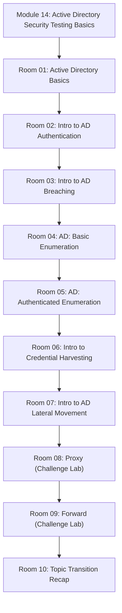

# Module Documentation: Module 14 — Active Directory Security Testing Basics

---

## 1. Overview & Educational Objectives

**Module 14: Active Directory Security Testing Basics** marks the major pedagogical shift from single-host penetration testing to **enterprise infrastructure assessment**. In enterprise corporate networks, over 90% of Fortune 1000 organizations deploy **Microsoft Active Directory Domain Services (AD DS)** as their primary identity, authentication, and policy enforcement backbone.

Compromising a single host is rarely an end-state; rather, that host serves as the initial launching pad to discover, breach, elevate privileges, and move laterally across the entire directory service.

### Primary Learning Domains:
1. **Active Directory Architecture:** Core components (Objects, Schema, Organizational Units, Domains, Trees, Forests, Global Catalogs, and Domain Controllers).
2. **Network Authentication Protocols:** Deep inspection of **Kerberos** (Ticket Granting Service, PAC validation, AS-REQ/AS-REP, TGS-REQ/TGS-REP) and **NTLM** (Negotiate, Challenge, Authenticate, NetNTLMv1/v2 hash structures).
3. **Domain Breaching & Initial Access:** User enumeration via Kerberos pre-authentication (`Kerbrute`), password spraying methodologies that evade lockout policies, default account discovery, and coerce authentication attacks.
4. **Domain Reconnaissance & Enumeration:** Unauthenticated enumeration (LDAP, SMB Null Sessions, RPC) transitioning to comprehensive authenticated enumeration via **PowerView**, **SharpHound**, and **BloodHound** graph analysis.
5. **Credential Harvesting:** Interrogating memory via LSASS dumping, extracting SAM and SYSTEM hives, LSA secrets, DPAPI master keys, and Active Directory database parsing (`NTDS.dit`).
6. **Lateral Movement & Pivoting:** Exploiting Windows administrative protocols (WinRM, PsExec, WMI, DCOM), Pass-the-Hash (PtH), Pass-the-Ticket (PtT), and Overpass-the-Hash.
7. **Hands-On Adversarial Challenge Labs:** Two multi-tiered, realistic domain compromise challenges: `Proxy` and `Forward`, bridging initial low-privilege foothold to full Domain Controller domination.
8. **Topic Transition Recap:** Module synthesis, defensive detections, Event ID correlation, and domain hardening.

---

## 2. Module 14 Curriculum Map

---

## 3. Methodological Commitments
* **14-Section Framework** across all room documentation (`README_AR.md`, `README_EN.md`, `TASKS.md`, `ADDITIONAL-NOTES.md`, `REFERENCES.md`).
* **7-Stage Task Methodology (Stages A to G)** for every task file (`TASKS/TASK-XX.md`).
* **100% Live Verified Parity** with the user's completed account.
