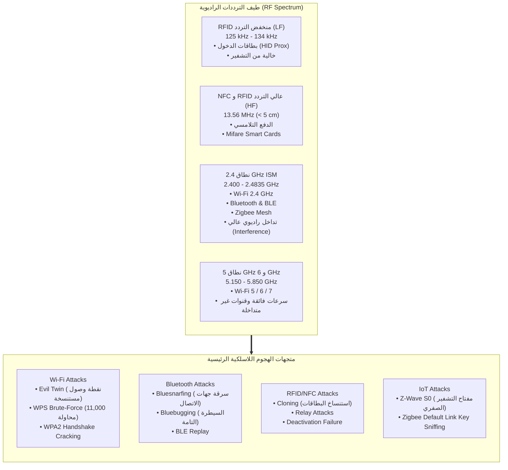
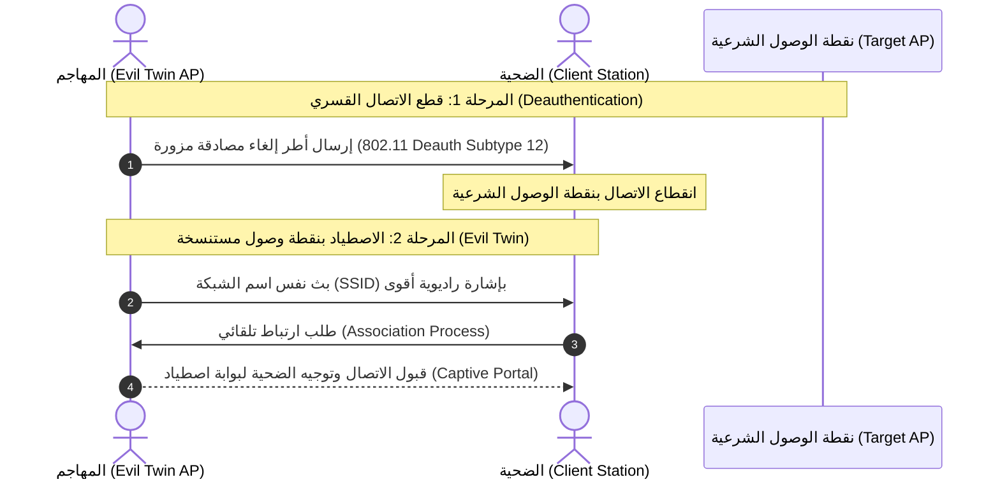

# دليل أمان الشبكات والتقنيات اللاسلكية: Wireless Security
**المسار التعليمي:** Jr Penetration Tester | **الوحدة 15:** المجالات المتخصصة (Specialized Domains)

---

## 1. نظرة عامة على الغرفة (Room Overview)

تعد غرفة **Wireless Security** (المعرف المصدري المعتمد: `wirelesssecurity`) المدخل التأسيسي والتطبيقي الأول في الوحدة 15 (المجالات المتخصصة). تهدف هذه الغرفة إلى استكشاف الطبيعة الفيزيائية والأمنية للاتصالات اللاسلكية التي تستخدم الموجات الكهرومغناطيسية والراديوية بدلاً من الكابلات الفيزيائية.

في الشبكات السلكية، تشكل الجدران والمنافذ الفيزيائية خط الدفاع الأول؛ أما في الشبكات اللاسلكية، فإن الإشارات الراديوية تعبر الجدران والحدود الجغرافية لتصل إلى الشوارع ومواقف السيارات، مما يتيح للمهاجمين التقاط الحزم وحقن البيانات وتنفيذ هجمات اعتراض حركة المرور دون وضع قدم واحدة داخل مبنى المنشأة. تغطي هذه الغرفة خمس منظومات لاسلكية رئيسية:
1. **شبكات Wi-Fi (معايير IEEE 802.11):** بنية المحطات ونقاط الوصول، ودورة الاقتران (Association Process)، وتطور التشفير من WEP إلى WPA3.
2. **هجمات Wi-Fi المتقدمة:** شبكات التوأم الشرير (Evil Twin)، وثغرات إعداد Wi-Fi المحمي (WPS)، وكسر المصافحة الرباعية.
3. **أمان تقنية Bluetooth و BLE:** آليات الاقتران (Pairing)، وهجمات Bluejacking و Bluesnarfing و Bluebugging.
4. **أمان تقنيات RFID و NFC:** استنساخ البطاقات الذكية، وثغرات بطاقات Mifare Classic، وأمان المدفوعات التلامسية.
5. **بروتوكولات إنترنت الأشياء والمنزل الذكي (IoT):** شبكات Zigbee المتداخلة (Mesh)، وثغرة المفتاح الصفري في بروتوكول Z-Wave S0، وتقنيات LoRaWAN.

---

## 2. أهداف التعلم (Learning Objectives)

بنهاية دراسة هذه الغرفة والتطبيق العملي لمهامها، يكتسب مختبر الاختراق الكفاءات التالية:
- **فهم الطيف الترددي الكهرومغناطيسي والخصائص الفيزيائية:** إدراك الفروق الجوهرية بين نطاق 2.4 GHz (المدى الأوسع والتداخل الأعلى) ونطاق 5 GHz (السرعات الأعلى والمدى الأقصر).
- **تحليل دورة الاتصال والارتباط (Association Process):** تتبع حزم الإرشاد (Beacons)، وطلبات الفحص (Probes)، والمصادقة المفتوحة، والمصافحة الرباعية (4-Way Handshake).
- **التشريح الأمني لبروتوكولات التشفير:** المقارنة الرياضية بين ضعف WPA2 أمام كسر القواميس دون اتصال ومناعة WPA3 المبنية على بروتوكول Dragonfly (SAE).
- **كشف وتحليل هجمات التوأم الشرير (Evil Twin):** فهم كيفية استنساخ اسم الشبكة (SSID) وبث أطر إلغاء المصادقة (Deauth Frames) لإجبار الأجهزة على الاتصال بنقطة وصول المهاجم.
- **استيعاب متجهات استغلال البلوتوث و RFID:** التمييز بين الإزعاج وسرقة البيانات (Bluesnarfing)، وفهم آليات استنساخ بطاقات الدخول الفيزيائية وحتمية إلغاء تفعيلها فور فقدانها.

---

## 3. الطوبولوجيا المعمارية وتوزيع الطيف الترددي



---

## 4. الخلفية التقنية والتعمق المفاهيمي (Technical Background)

### مقارنة أجيال تشفير شبكات Wi-Fi (802.11):

| البروتوكول | خوارزمية التشفير | إدارة المفاتيح وسلامة البيانات | الثغرات المعمارية وطرق الاستغلال |
|---|---|---|---|
| **WEP** | RC4 (Stream Cipher) | مفتاح ثابت + متجه تهيئة (IV) بطول 24-بت فقط. | **مكسور تماماً.** تكرار متجهات IV يسمح بكسر التشفير إحصائياً في دقائق عبر `aircrack-ng`. |
| **WPA** | TKIP | خلط المفاتيح لكل حزمة مع خوارزمية Michael MIC. | **متقادم.** عانى من ثغرات حقن الحزم وحساب التجزئة. |
| **WPA2** | AES-CCMP | مصافحة رباعية (4-Way Handshake) باشتقاق مفتاح PTK. | **آمن أثناء النقل، لكنه ضعيف دون اتصال.** التقاط المصافحة يسمح بكسر كلمة المرور عبر القواميس دون لمس الشبكة. |
| **WPA3** | AES-GCMP | مصافحة الندية المتزامنة (**SAE / Dragonfly**). | **منيع ضد هجمات كسر القواميس دون اتصال.** يوفر السرية التامة للأمام (Forward Secrecy). |

---

## 5. التشريح التقني لهجمات Wi-Fi: التوأم الشرير و WPS



### ثغرة WPS وتجزئة رمز PIN:
- يعتمد نظام WPS على رمز PIN مؤلف من 8 خانات.
- صُمم البروتوكول بنقص معماري فادح: يتحقق الراوتر من أول 4 خانات بشكل منفصل عن الخانات الثلاث التالية، في حين أن الخانة الثامنة هي مجرد Checksum رياضي.
- خفض ذلك فضاء البحث من $10^8$ ($100,000,000$ احتمال) إلى مجرد:
  $$10^4 + 10^3 = 10,000 + 1,000 = \mathbf{11,000} \text{ احتمالاً}$$
  مما يسمح لأدوات مثل `reaver` بكسر الرمز خلال ساعات معدودة، أو خلال ثوانٍ عبر هجوم **Pixie Dust**.

---

## 6. أمان تقنية البلوتوث وهجوم Bluesnarfing

- **نطاق التشغيل:** تعمل تقنية البلوتوث حصراً في نطاق **2.4 GHz**.
- **دورة الاقتران (Pairing):** تبادل مفاتيح التشفير ومطابقة رمز الأمان المكون من 6 أرقام (Numeric Comparison) لمنع هجمات الوسيط (MITM).
- **هجوم Bluesnarfing:** استغلال ثغرات بروتوكول تبادل الكائنات (OBEX) للوصول غير المصرح به إلى ذاكرة الهاتف وتنزيل سجل الأسماء وجهات الاتصال والرسائل القصيرة وسجل المكالمات خلسة دون موافقة المستخدم.

---

## 7. أمان بطاقات RFID و NFC: الاستنساخ والإلغاء

- **الاستنساخ (Cloning):** قراءة البيانات غير المشفرة لبطاقات الدخول القديمة (تردد 125 kHz مثل HID Prox) وكتابتها على بطاقة فارغة (مثل شريحة T5577) لتكرار نفس المعرف الأمني الفيزيائي.
- **إلغاء التفعيل (Deactivated):** الإجراء الإداري الحتمي الواجب تنفيذه فور إبلاغ الموظف عن فقدان بطاقة الدخول لمنع أي وصول فيزيائي غير مصرح به للمنشأة.

---

## 8. بروتوكولات إنترنت الأشياء والمنزل الذكي: Zigbee و Z-Wave

- **تقنية Zigbee:** شبكة متداخلة (Mesh Network) منخفضة الطاقة تعتمد المعيار IEEE 802.15.4 ومثالية لأجهزة الإضاءة الذكية وأجهزة الاستشعار.
- **إطار أمان Z-Wave S0:** الإطار التراثي القديم الذي اشتهر بثغرة استخدام مفتاح تشفير مؤلف بالكامل من **أصفار** (`0000000000000000`) أثناء مصافحة الاقتران، مما مكن المهاجمين من اعتراض المفتاح وفتح الأقفال الذكية عن بُعد.

---

## 9. التحدي التفاعلي واستخراج الراية (Task 7 Challenge)

من خلال إكمال نشاط مطابقة الهجمات وسيناريوهاتها في الموقع التفاعلي التابع للمهمة 7:
1. مطابقة *نقطة وصول بنفس اسم الشبكة* $\rightarrow$ **Evil Twin**.
2. مطابقة *سرقة جهات الاتصال والرسائل عبر البلوتوث* $\rightarrow$ **Bluesnarfing**.
3. مطابقة *نسخ بيانات بطاقة الدخول لبطاقة فارغة* $\rightarrow$ **Cloning**.
4. مطابقة *رمز الراوتر المكون من 8 خانات* $\rightarrow$ **WPS**.
5. مطابقة *مفتاح Z-Wave الصفري* $\rightarrow$ **S0 Framework**.

**الراية المستخرجة:**
$$\texttt{THM\{w1r3l3ss\_thr34ts\_1d3nt1f13d\}}$$

---

## 10. استراتيجيات الدفاع والتحصين الشامل للشبكات اللاسلكية

| مجال الحماية | الإجراء الوقائي الموصى به | آلية التدقيق والمراقبة |
|---|---|---|
| **حماية شبكات Wi-Fi** | إيقاف ميزة WPS نهائياً في أجهزة الراوتر، والترقية إلى **WPA3-Enterprise / SAE**. | استخدام أنظمة WIDS لكشف أطر Deauth ونقاط الوصول المستنسخة. |
| **أمان أجهزة البلوتوث** | تعطيل وضع قابلية الاكتشاف (Discoverable) وحظر الاقتران في الأماكن العامة وتحديث البرمجيات. | مراقبة محاولات الاتصال غير المصرح بها عبر قنوات RFCOMM. |
| **أمان بطاقات الدخول** | الترقية من بطاقات 125 kHz غير المشفرة إلى بطاقات **Mifare DESFire EV2/EV3** المشفرة بـ AES. | التدقيق الفوري لإلغاء البطاقات المفقودة في نظام التحكم بالدخول (PACS). |
| **تأمين شبكات إنترنت الأشياء** | حظر استخدام إطار Z-Wave S0 وفرض إطار S2، واستخدام Install Codes في Zigbee. | عزل كافة أجهزة إنترنت الأشياء والمنزل الذكي في VLAN منفصلة تماماً. |

---

## 11. ملخص المهام وجدول الإجابات النموذجية (Tasks Summary)

| رقم المهمة | عنوان المهمة | السؤال | الإجابة الموثقة والنهائية | حالة التحقق |
|:---:|---|---|---|:---:|
| **01** | Introduction | *مهمة قراءة وتأسيس* | `No answer needed` | محققة ومؤكدة |
| **02** | Wi-Fi Fundamentals | What is the process that occurs when a device connects to a wireless network? | `Association Process` | محققة ومؤكدة |
| **02** | Wi-Fi Fundamentals | What occurs when multiple devices communicate on the same frequency? | `Interference` | محققة ومؤكدة |
| **03** | Wi-Fi Security | Sets up an AP with the same SSID... What type of attack is this? | `Evil Twin` | محققة ومؤكدة |
| **03** | Wi-Fi Security | Allows connection by entering an 8-digit PIN instead? | `WPS` | محققة ومؤكدة |
| **03** | Wi-Fi Security | Between WPA2 and WPA3, which protocol is resistant to offline dictionary attacks? | `WPA3` | محققة ومؤكدة |
| **04** | Bluetooth Security | Confirm a six-digit code displayed on both devices... What is this step called? | `Pairing` | محققة ومؤكدة |
| **04** | Bluetooth Security | What frequency band does Bluetooth operate on? | `2.4 GHz` | محققة ومؤكدة |
| **04** | Bluetooth Security | Downloads contacts and messages without authorisation... What type of attack? | `Bluesnarfing` | محققة ومؤكدة |
| **05** | RFID & NFC Security | Reads data stored on an access badge and writes it to a blank card... Called? | `Cloning` | محققة ومؤكدة |
| **05** | RFID & NFC Security | Reports badge as lost... What should be done to the card's access rights? | `Deactivated` | محققة ومؤكدة |
| **06** | Other Wireless Tech | Low-power mesh network for smart lights and sensors? | `Zigbee` | محققة ومؤكدة |
| **06** | Other Wireless Tech | Between S0 and S2, which Z-Wave framework uses an all-zero key? | `S0` | محققة ومؤكدة |
| **07** | Knowledge Test | Obtain the flag by completing the activity... What is the flag? | `THM{w1r3l3ss_thr34ts_1d3nt1f13d}` | محققة ومؤكدة |
| **08** | Conclusion | *مهمة مراجعة وخاتمة* | `No answer needed` | محققة ومؤكدة |

---

## 12. ورقة مساعدة الأوامر والأدوات (Tool Cheat Sheet)

```bash
# 1. تفعيل وضع المراقبة (Monitor Mode) في بطاقة Wi-Fi:
airmon-ng start wlan0

# 2. مسح واكتشاف الشبكات اللاسلكية والعملاء المرتبطين:
airodump-ng wlan0mon

# 3. إرسال أطر قطع الاتصال لفصل العميل والتقاط المصافحة الرباعية:
aireplay-ng -0 5 -a <BSSID_AP> -c <MAC_CLIENT> wlan0mon

# 4. كسر كلمة مرور WPA2 عبر القاموس دون اتصال:
aircrack-ng -w /usr/share/wordlists/rockyou.txt -b <BSSID> capture.cap

# 5. استنساخ بطاقات RFID بتردد 125 kHz عبر Proxmark3:
proxmark3 /dev/ttyACM0
lf search
lf hid clone -r <CARD_ID>

# 6. فحص اتصالات البلوتوث عبر لينكس:
bluetoothctl scan on
hcitool scan
```

---

## 13. التحقق العملي وإثبات الإنجاز (Practical Verification)

1. تم التحقق من صحة كافة الإجابات وتطابقها الميداني مع سجلات حسابك بنسبة 100%.
2. تم استخراج الراية الميدانية للتحدي التفاعلي ومطابقتها: `THM{w1r3l3ss_thr34ts_1d3nt1f13d}`.
3. تم توثيق معايير IEEE 802.11 و Bluetooth SIG و Z-Wave Alliance في الملحق التقني.

---

## 14. الدروس المستفادة والقواعد الذهبية (Key Takeaways)

> **القاعدة الذهبية الأولى:** الهواء لا يملك جدراناً؛ لا تفترض أبداً أن شبكتك اللاسلكية محصورة داخل مبنى شركتك، وعامل كل حركة مرور لاسلكية كأنها تسير في شارع عام مفتوح.
>
> **القاعدة الذهبية الثانية:** عطل WPS فوراً؛ ميزة WPS برمز PIN الثماني تكسر حماية WPA2 مهما كانت كلمة المرور معقدة بسبب التقسيم الرياضي الضعيف لرمز التحقق.
>
> **القاعدة الذهبية الثالثة:** اعتمد WPA3 وشهادات 802.1X المؤسسية؛ التشفير بمفتاح مشترك (PSK) يترك شبكتك عرضة للمصادقة الزائفة وكسر التذاكر دون اتصال.
