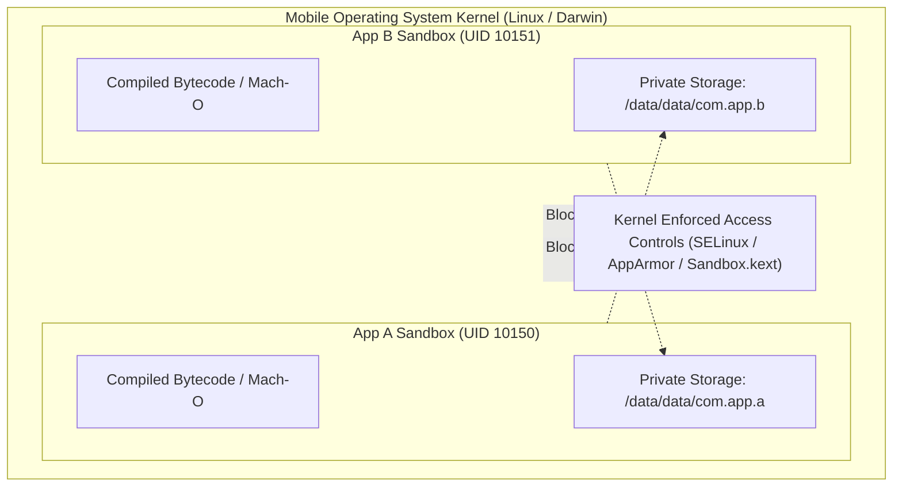

# Task 02: How Mobile Applications Work

## Stage A: Original Task Content & Educational Context
Mobile applications do not run as loose files in a filesystem; they are distributed as compiled, compressed archives:
- **Android Packages (`.apk` / `.aab`):** A ZIP archive containing compiled Dalvik/ART bytecode (`classes.dex`), native shared libraries (`lib/`), resources (`res/`, `resources.arsc`), assets (`assets/`), and the essential configuration file: `AndroidManifest.xml`.
- **iOS Packages (`.ipa`):** A ZIP archive containing a `Payload/` folder with the `<AppName>.app` bundle, including the Mach-O binary, pre-compiled assets, frameworks, and configuration file: `Info.plist`.

### The Manifest / Configuration File
Every mobile app must provide a central declaration file defining its metadata:
- Package / Bundle identifier.
- Minimum and target OS version.
- Hardware and software permissions requested (e.g., Camera, Location, Contacts, Internet).
- Declared application components (Activities, Services, Broadcast Receivers, Content Providers).
- Security attributes (e.g., `android:debuggable`, `android:allowBackup`, `android:exported`).

### The Application Sandbox Model
Both Android and iOS enforce strict operating system isolation:
- Each application runs under its own unique, unprivileged operating system User ID (UID on Android, Sandbox Container on iOS).
- An application cannot directly access the private data directories (`/data/data/<package_name>` on Android or `/var/mobile/Containers/Data/Application/<UUID>` on iOS) of another application without explicit permissions or shared UID configurations.
- Inter-process communication (IPC) must pass through controlled OS brokered mechanisms (Intents, Content Providers, Binder on Android; URL schemes, App Groups on iOS).

### Component Exposure: Internal vs. Exported
A fundamental security surface in mobile applications is whether components can be invoked by other apps on the device:
- **Internal / Private:** Intended only for internal app navigation.
- **Exported (`android:exported="true"`):** Accessible to any external application on the device. If an exported component lacks permission guards or input validation, malicious apps can trigger unauthorized actions or bypass authentication screens.

---

## Stage B: Independent Thinking & OpSec Considerations
1. **Architectural Assessment:** Always deconstruct the package archive into its raw components before jumping into code.
2. **Attack Surface Identification:** On Android, any Activity, Service, or Broadcast Receiver marked `exported="true"` or containing an `<intent-filter>` without explicit `android:exported="false"` is accessible to third-party apps via `am start` (Activity Manager).
3. **Sandbox Escape Risks:** Testing permissions requires determining if application data leaks outside the sandbox through world-readable files, shared storage (`/sdcard`), or insecure logging mechanisms.

---

## Stage C: Guided Hints (Tiered Progression)
- **Q1 Tier 1 Hint:** What is the overarching term for files like `AndroidManifest.xml` that define app metadata and permissions?
- **Q1 Tier 2 Hint:** It is an 8-letter common noun meaning a public declaration or inventory of contents.
- **Q2 Tier 1 Hint:** What design pattern runs each app in an isolated box so it cannot harm other apps?
- **Q2 Tier 2 Hint:** Think of a children's play area filled with sand where toys are kept inside.

---

## Stage D: Complete Practical Solution & Technical Deep Dive
### Inspecting an Android Package Archive:
An APK file is a standard ZIP archive. You can inspect its structure using standard CLI tools:
```bash
# Unzip APK package
unzip -l target_app.apk

# Decompile using apktool to convert binary XML into human-readable text
apktool d target_app.apk -o decompiled_app/

# Inspect AndroidManifest.xml
cat decompiled_app/AndroidManifest.xml
```

### Manifest Component Declarations:
```xml
<manifest xmlns:android="http://schemas.android.com/apk/res/android"
    package="com.example.app">
    
    <!-- Requested Permissions -->
    <uses-permission android:name="android.permission.INTERNET" />
    <uses-permission android:name="android.permission.ACCESS_FINE_LOCATION" />

    <application
        android:debuggable="false"
        android:allowBackup="false">
        
        <!-- Private Component -->
        <activity android:name=".MainActivity" android:exported="false" />
        
        <!-- Exported Component (Potential Attack Surface) -->
        <activity android:name=".AdminPortalActivity" android:exported="true" />
    </application>
</manifest>
```

### The Sandbox Boundary:


---

## Stage E: Final Answer & Key Values
- **Question 1:** *What is the generic term for the file inside a mobile application package that declares the application's permissions and component configuration?*
  - **Answer:** `Manifest`
- **Question 2:** *What security model does a mobile operating system use to isolate applications from one another?*
  - **Answer:** `Sandbox`

---

## Stage F: Practical Verification & Proof of Work
1. The term `Manifest` refers generically to `AndroidManifest.xml` in Android and the application manifest/configuration in mobile architectures.
2. The term `Sandbox` accurately denotes the kernel-level isolation boundary isolating mobile apps. Both answers verified and confirmed on the TryHackMe platform.

---

## Stage G: Key Educational Takeaway
The mobile operating system assumes mutual distrust between applications by enforcing strict sandboxing per UID. Flaws arise when applications intentionally or mistakenly poke holes through their sandbox via over-permissive exported components, world-readable files, or insecure inter-process communication.
