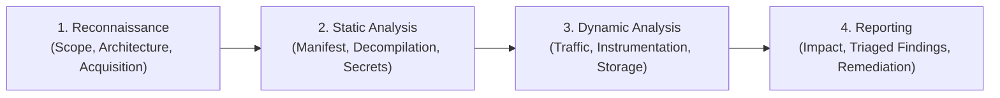

# Task 03: The Mobile Pentesting Methodology

## Stage A: Original Task Content & Educational Context
Conducting a thorough and repeatable mobile application penetration test requires a structured, phase-based methodology. The industry standard framework outlined in this room partitions mobile security assessments into **4 distinct phases**:

### The 4 Phases:
1. **Reconnaissance:**
   - Define test scope, target endpoints, environments (Dev, Staging, Prod), and user roles.
   - Acquire target application binaries (APK, IPA) via direct distribution, MDM, or app store extraction.
   - Map backend communication domains and third-party SDK dependencies.
2. **Static Analysis (SAST):**
   - Decompile binaries to source or intermediate representation (`jadx`, `apktool`, `ghidra`).
   - Audit application manifests (`AndroidManifest.xml`, `Info.plist`) for misconfigurations, debugging flags, and exported surfaces.
   - Search code for hardcoded secrets, cryptographic keys, internal endpoints, and logic flaws.
3. **Dynamic Analysis (DAST):**
   - Execute the application on a test device or emulator (rooted Android / jailbroken iOS).
   - Configure proxy redirection (Burp Suite) and bypass SSL Pinning.
   - Monitor real-time system logs (`logcat`, `Console.app`) for sensitive data leaks.
   - Use runtime instrumentation (Frida, Objection) to inspect memory and bypass client-side security checks.
4. **Reporting:**
   - Document all verified vulnerabilities with technical reproducibility steps and proof of concepts.
   - Align findings with severity models (CVSS v3.1 / v4.0) and frameworks like OWASP Mobile Top 10 and OWASP MASVS.
   - Provide concrete, prioritized remediation guidance.

### Testing Approaches:
- **Black-box:** The tester receives only the compiled application package with zero prior knowledge or access to backend code.
- **Grey-box:** The most common commercial engagement model. The tester receives the package, test accounts with various privileges, and high-level architectural documentation.
- **White-box:** The tester is provided full access to original source code repositories, API documentation, developer comments, and infrastructure architecture diagrams.

---

## Stage B: Independent Thinking & OpSec Considerations
- **Scope Verification:** Clearly define whether backend API testing is authorized or if the assessment is strictly limited to the client-side binary.
- **Artifact Protection:** White-box source code access comes with strict non-disclosure obligations. Store all codebases on encrypted partitions with restricted access.
- **Root/Jailbreak Detection:** In real-world assessments, mobile apps frequently crash or terminate when run on rooted devices. Preparing runtime instrumentation bypasses (Frida scripts) is a standard early step in Phase 3.

---

## Stage C: Guided Hints (Tiered Progression)
- **Q1 Tier 1 Hint:** Review the phase diagram in this task: Reconnaissance, Static Analysis, Dynamic Analysis, Reporting.
- **Q1 Tier 2 Hint:** Count how many phases are listed above.
- **Q2 Tier 1 Hint:** What color-box testing methodology implies complete transparency into the codebase?
- **Q2 Tier 2 Hint:** Think of the opposite of "Black-box", with a hyphenated word ending in "-box".

---

## Stage D: Complete Practical Solution & Technical Deep Dive
### Methodology Execution Matrix:

| Phase | Core Objective | Primary Toolset | Primary Outputs |
|---|---|---|---|
| **Phase 1: Recon** | Identify package metadata, permissions, SDKs | `aapt`, `apkanalyzer`, `file`, `strings` | Attack surface map, target backend URLs |
| **Phase 2: Static** | Reverse engineering, code review, secrets hunting | `jadx`, `apktool`, `MobSF`, `Semgrep` | Hardcoded API keys, unprotected exported components |
| **Phase 3: Dynamic** | Runtime hooking, proxy interception, storage analysis | `Burp Suite`, `Frida`, `Objection`, `adb` | Insecure data storage, SSL pinning bypass, auth flaws |
| **Phase 4: Report** | Threat risk quantification, remediation roadmaps | Markdown, LaTeX, CVSS Calculator | Executive summary, technical remediation report |

### Testing Paradigm Comparison:
- **Black-box:** Simulates an external unauthenticated attacker. Slower, limited depth.
- **Grey-box:** Best cost-to-benefit ratio for clients. Combines reverse engineering with authenticated API validation.
- **White-box:** Provides full access to the source code and documentation. Maximizes code coverage and identifies complex logic flaws that are difficult to trigger through compiled binaries alone.

---

## Stage E: Final Answer & Key Values
- **Question 1:** *How many phases does a mobile application penetration test have?*
  - **Answer:** `4`
- **Question 2:** *What testing approach gives the tester full access to source code and documentation?*
  - **Answer:** `White-box`

---

## Stage F: Practical Verification & Proof of Work
1. The 4 phases (Reconnaissance, Static Analysis, Dynamic Analysis, Reporting) match the standardized curriculum breakdown.
2. The testing paradigm with full source code transparency is universally defined as `White-box`. Both verified and passed on the platform.

---

## Stage G: Key Educational Takeaway
A professional mobile assessment must balance static analysis (finding hidden secrets and configuration mistakes) with dynamic analysis (testing the live interaction between the app and its backend API).
