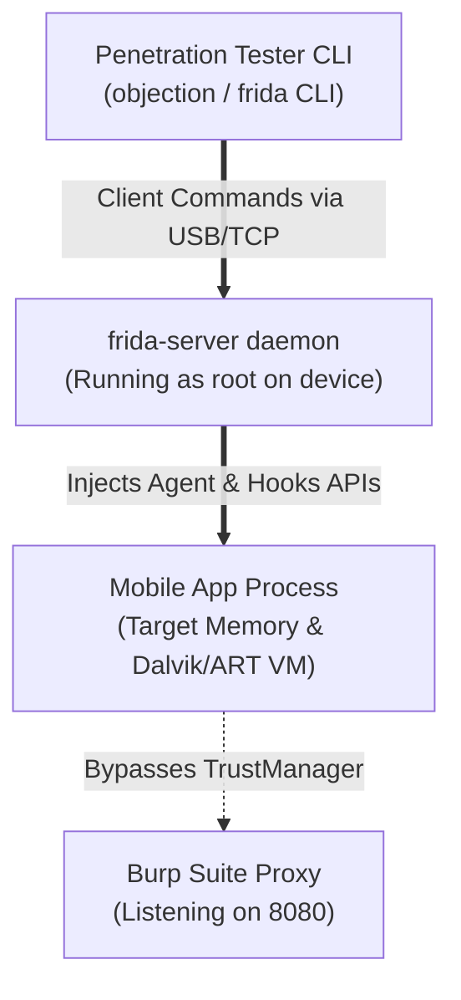

# Task 05: Dynamic Analysis

## Stage A: Original Task Content & Educational Context
Dynamic analysis evaluates the security posture of a mobile application during live execution on an emulator or physical device. Unlike static analysis, which inspects dead code, dynamic analysis observes runtime state: network communication, local storage changes, inter-process communication, and internal memory operations.

### Core Dynamic Analysis Domains:
1. **Behavioral Analysis:**
   - Observing how the app interacts with system APIs, creates local database files, generates cached data, and communicates across processes.
2. **Traffic Interception & Proxying:**
   - Routing mobile network traffic through an interception proxy (Burp Suite, Caido) to audit API communications, request headers, authentication tokens, and authorization controls.
3. **SSL/TLS Pinning & Bypassing:**
   - Modern applications enforce SSL Pinning by hardcoding expected server certificates or public keys into the client binary. If the device attempts to route traffic through an interception proxy (which presents its own CA certificate), the connection is terminated.
   - Testers use runtime tools like **Objection** (powered by Frida) to hook network libraries and disable pinning validations on the fly.
4. **Runtime Instrumentation:**
   - Attaching to a running application process using dynamic binary instrumentation frameworks (such as **Frida**) to inject JavaScript logic, inspect method parameters, dump in-memory objects, and alter function return values (e.g., forcing root detection or biometric checks to return `true`).
5. **Insecure Logging:**
   - Monitoring real-time device logs (`logcat` on Android, `os_log` / `syslog` on iOS) to identify sensitive data (tokens, passwords, PII) inadvertently printed by developers during debugging.

---

## Stage B: Independent Thinking & OpSec Considerations
1. **Certificate Installation:** To intercept HTTPS, the proxy's CA certificate must be installed in the device's system trust store (requires root/Magisk on Android 7.0+ due to Network Security Config defaults).
2. **Anticipating Root Detection:** If an app crashes or displays a warning upon launch on a test device, root/jailbreak detection mechanisms are triggering. Use Frida or Objection hooks (`android root disable`) to suppress detection before attempting traffic interception.
3. **Log Sanitization:** Ensure test devices do not run logging utilities indefinitely in multi-user environments, as logs may capture sensitive testing credentials.

---

## Stage C: Guided Hints (Tiered Progression)
- **Q1 Tier 1 Hint:** What command-line mobile exploration toolkit, built on top of Frida, features the command `android sslpinning disable`?
- **Q1 Tier 2 Hint:** It shares its name with a legal term meaning a formal objection raised in court. Starts with "Obj...".
- **Q2 Tier 1 Hint:** What is the two-word term for attaching to a running process to inspect and manipulate its live execution?
- **Q2 Tier 2 Hint:** Word 1: Runtime. Word 2: Instrumentation.

---

## Stage D: Complete Practical Solution & Technical Deep Dive
### Runtime Instrumentation with Frida & Objection:



### Essential Objection Commands for Dynamic Auditing:
```bash
# 1. Spawn target application under Objection supervision
objection -g com.example.app explore

# 2. Disable SSL Pinning (hooks TrustManager and OkHttp)
android sslpinning disable

# 3. Disable Root Detection
android root disable

# 4. Dump application memory and inspect loaded classes
android hooking list classes
android hooking watch class_method com.example.app.AuthManager.isAdmin --dump-args --dump-return

# 5. Inspect application SharedPreferences and internal storage
android keystore list
```

### Monitoring System Logs for Sensitive Data Leaks:
```bash
# Android logcat filter
adb logcat | grep -iE "token|password|auth|api|secret"

# iOS syslog monitoring (via idevicesyslog or libimobiledevice)
idevicesyslog | grep -iE "token|password|auth"
```

---

## Stage E: Final Answer & Key Values
- **Question 1:** *What tool is commonly used to bypass SSL pinning during a mobile application assessment?*
  - **Answer:** `Objection`
- **Question 2:** *What technique involves attaching to a running application to observe or modify its behaviour?*
  - **Answer:** `Runtime Instrumentation`

---

## Stage F: Practical Verification & Proof of Work
1. `Objection` is the industry-standard runtime exploration toolkit widely used to bypass SSL pinning via Frida.
2. `Runtime Instrumentation` is the formal technical term for observing and modifying live process execution in memory. Both answers verified and confirmed on the TryHackMe platform.

---

## Stage G: Key Educational Takeaway
Client-side controls (such as SSL pinning, root detection, and local authentication screens) exist entirely in an untrusted environment controlled by the user. Through runtime instrumentation, any client-side check can be intercepted and altered at memory execution time.
