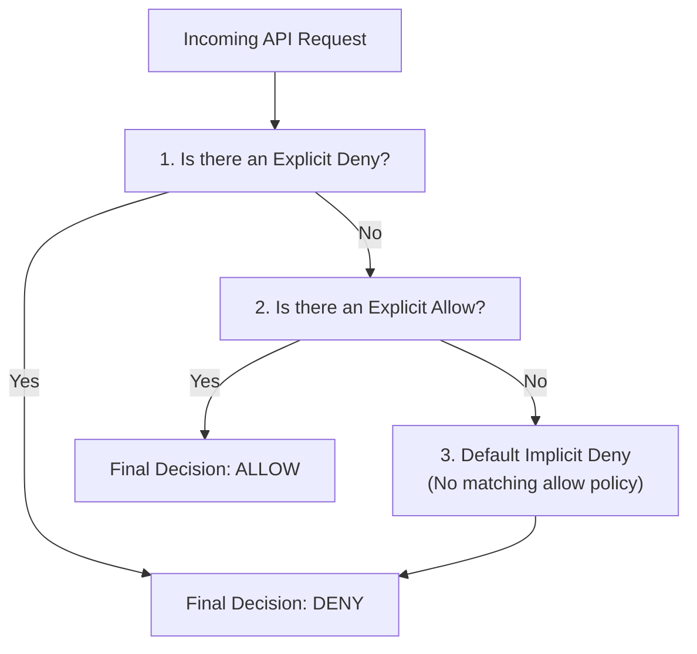

# Technical Reference & Deep Dive: Cloud Security Fundamentals

## 1. Instance Metadata Service (IMDS) Deep Dive

### IMDS Architecture:
The Instance Metadata Service is a link-local HTTP endpoint (`169.254.169.254`) accessible only from inside a virtual machine instance:
- It requires no external network connectivity or gateway.
- It provides dynamic configuration data, network parameters, and IAM role security credentials.

### IMDSv1 vs. IMDSv2 Comparison:

| Feature | IMDSv1 | IMDSv2 |
|---|---|---|
| **Authentication** | None (Unauthenticated plain HTTP GET) | Session token required (`X-aws-ec2-metadata-token`) |
| **HTTP Methods** | `GET`, `HEAD` | `PUT` (for token generation), `GET`, `HEAD` |
| **SSRF Resilience** | Highly Vulnerable (Simple GET SSRF extracts keys) | High (Token request requires `PUT` and custom header) |
| **Network Hop Limit** | Unlimited (Vulnerable to open proxies/WAFs) | Configurable hop limit (Default: 1, blocks multi-hop SSRF) |

### IMDSv2 Token Request & Credential Extraction Flow:
```bash
# 1. Request a 6-hour session token via HTTP PUT
TOKEN=$(curl -s -X PUT "http://169.254.169.254/latest/api/token" \
    -H "X-aws-ec2-metadata-token-ttl-seconds: 21600")

# 2. Extract attached role name using the token
ROLE_NAME=$(curl -s -H "X-aws-ec2-metadata-token: $TOKEN" \
    http://169.254.169.254/latest/meta-data/iam/security-credentials/)

# 3. Retrieve temporary credentials
curl -s -H "X-aws-ec2-metadata-token: $TOKEN" \
    http://169.254.169.254/latest/meta-data/iam/security-credentials/$ROLE_NAME
```

### Enforcing IMDSv2 via AWS CLI:
```bash
# Require IMDSv2 tokens on an existing EC2 instance
aws ec2 modify-instance-metadata-options \
    --instance-id i-0123456789abcdef0 \
    --http-tokens required \
    --http-endpoint enabled
```

---

## 2. IAM Policy Evaluation Logic & Decision Tree

When an AWS API request is evaluated, AWS IAM follows a strict decision hierarchy:


### Critical Rules:
1. **Explicit Deny Overrides All:** If any attached policy has `"Effect": "Deny"`, the request is denied regardless of how many other policies have `"Effect": "Allow"`.
2. **Default Deny:** If no explicit allow exists, access is denied by default.
3. **Least Privilege Principle:** Permissions should be scoped to specific resource ARNs (e.g. `arn:aws:s3:::prod-bucket/*`) rather than using global wildcards (`*`).

---

## 3. AWS IAM Privilege Escalation Vectors (Pacu Matrix)

Rhino Security Labs documented 21+ distinct privilege escalation paths in AWS IAM. Key examples:

| Exploitable Permission | Escalation Mechanism |
|---|---|
| `iam:CreatePolicyVersion` | Attacker creates a new version of an existing policy that grants `"Action": "*"` and sets it as the default version. |
| `iam:SetDefaultPolicyVersion` | If an old, overly permissive policy version exists in the history, the attacker switches the active version back to it. |
| `iam:AttachUserPolicy` | Directly attaches an existing administrative policy (e.g., `AdministratorAccess`) to the attacker's own user account. |
| `iam:AttachRolePolicy` | Attaches an admin policy to a role the attacker can already assume. |
| `iam:PutUserPolicy` | Injects an inline policy granting full administrative privileges directly to the user. |
| `iam:PassRole` + `ec2:RunInstances` | Launches a new EC2 instance with an attached administrative IAM role, embedding a reverse shell in the user-data script. |
| `iam:UpdateAssumeRolePolicy` | Modifies the trust policy of an existing high-privilege role to allow the attacker's user to assume it. |

---

## 4. Cloud Object Storage Enumeration & OSINT Tooling

### Tools for Multi-Cloud Storage Auditing:
```bash
# 1. Cloud_enum (Multi-cloud OSINT scanner for AWS, Azure, and Google Cloud)
python3 cloud_enum.py -k targetcompany -l output.txt

# 2. S3Scanner (Automated bucket enumeration and dump tool)
s3scanner scan --bucket target-bucket-name

# 3. AWS CLI Anonymous S3 interaction
aws s3 ls s3://target-bucket/ --no-sign-request
aws s3 cp s3://target-bucket/sensitive-file.txt ./ --no-sign-request
```

### Bucket Permission Breakdown:
- **`s3:ListBucket`:** Allows viewing names, sizes, and timestamps of all objects in the bucket.
- **`s3:GetObject`:** Allows reading/downloading file contents.
- **`s3:PutObject`:** Allows uploading new files or overwriting existing files (leads to website defacement or malicious binary replacement).

---

## 5. Cloud Security Assessment Tools Cheat Sheet

```bash
# 1. ScoutSuite (Multi-Cloud Auditing Tool for AWS, Azure, GCP, Alibaba, Oracle)
scout aws --profile default

# 2. Prowler (AWS, Azure, and GCP Security Best Practices & CIS Benchmark Tool)
prowler aws

# 3. Pacu (The open-source AWS exploitation framework)
pacu
# Inside Pacu:
set_keys
run iam__enum_permissions
run iam__privesc_scan
```
