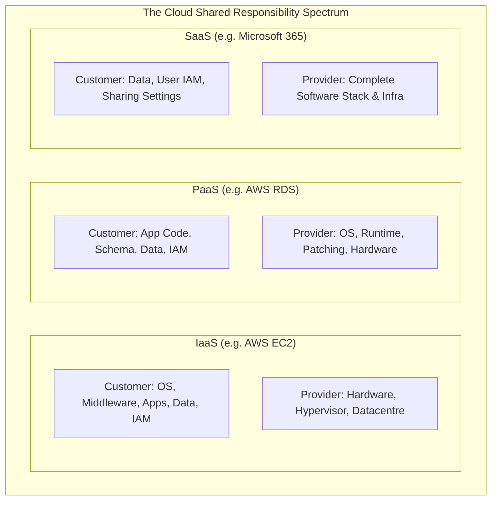

# Task 02: Cloud Service and Deployment Models

## Stage A: Original Task Content & Educational Context
Cloud computing organizes offerings into three standardized service models and several deployment architectures. Defining these boundaries determines who is legally and technically responsible for securing each layer of the technology stack—a concept formalized as the **Shared Responsibility Model**.

### Cloud Service Models:
1. **Infrastructure as a Service (IaaS):**
   - The provider manages the physical datacentre, servers, power, cooling, virtualization hypervisors, and core physical networking.
   - The customer manages the guest operating system, system updates, middleware, runtimes, database instances, network firewalls, application code, and data.
   - *Examples:* Amazon EC2, Microsoft Azure Virtual Machines, Google Compute Engine.
   - *Analogy:* Renting an unfurnished apartment.
2. **Platform as a Service (PaaS):**
   - The provider manages the physical hardware, hypervisor, OS, security patching, runtimes, and scaling engines.
   - The customer manages application code, configurations, database schema, and access credentials.
   - *Examples:* AWS Elastic Beanstalk / RDS, Azure App Service / Azure SQL, Google App Engine / Cloud SQL.
   - *Analogy:* Renting a furnished apartment.
3. **Software as a Service (SaaS):**
   - The provider manages the entire technology stack end to end: hardware, OS, platform, software code, and infrastructure scaling.
   - The customer manages user identities, access control permissions, and data stored within the service.
   - *Examples:* Microsoft 365, Google Workspace, Salesforce, Dropbox.
   - *Analogy:* Staying in a fully serviced hotel room.

### The Shared Responsibility Matrix:

| Layer | IaaS | PaaS | SaaS |
|---|---|---|---|
| **Physical Datacentre & Hardware** | Provider | Provider | Provider |
| **Virtualization & Hypervisor** | Provider | Provider | Provider |
| **Network Configuration (SGs / VPC)** | Customer | Shared | Provider |
| **Operating System & Patching** | Customer | Provider | Provider |
| **Runtime & Middleware** | Customer | Provider | Provider |
| **Application Code** | Customer | Customer | Provider |
| **Data & Access Governance** | Customer | Customer | Customer |
| **Identities & IAM Policies** | Customer | Customer | Customer |

---

## Stage B: Independent Thinking & OpSec Considerations
1. **Targeting Customer Layers:** Penetration testers should focus their testing efforts on the customer-managed portions of the stack (misconfigured S3 buckets, exposed API keys, unpatched web application code, over-permissive IAM roles) rather than attempting to attack the cloud provider's underlying hypervisor.
2. **Provider Boundary Restrictions:** Cloud service agreements strictly prohibit testing shared provider infrastructure (e.g., hypervisor breakout, multi-tenant denial of service). Breaching these boundaries violates provider acceptable use policies.

---

## Stage C: Guided Hints (Tiered Progression)
- **Q1 Tier 1 Hint:** What 4-letter acronym describes renting raw virtual machines and storage disks where you manage the OS?
- **Q1 Tier 2 Hint:** Infrastructure as a Service abbreviation: I...S.
- **Q2 Tier 1 Hint:** Between the Customer and the Cloud Provider, who maintains the physical security guards and server cages at the datacentre?
- **Q2 Tier 2 Hint:** One word starting with "P": Provider.

---

## Stage D: Complete Practical Solution & Technical Deep Dive
### Model Security Analysis:
- In **IaaS**, if a virtual machine is running an unpatched Linux kernel or has an SSH port exposed with default credentials, the fault and remediation responsibility rest 100% on the **Customer**.
- In **PaaS**, if the underlying PHP or Node.js runtime has a zero-day vulnerability in the container engine, the **Provider** is responsible for patching it, but if the developer writes vulnerable SQL queries, the **Customer** remains responsible for the resulting SQL injection.
- Across all models (IaaS, PaaS, SaaS), **Data security** and **Identity management** remain the sole responsibility of the **Customer**.

---

## Stage E: Final Answer & Key Values
- **Question 1:** *A company runs its own web stack on a cloud virtual machine but does not manage the physical hardware. Which service model describes this arrangement?*
  - **Answer:** `IaaS`
- **Question 2:** *In the Shared Responsibility Model, who is always responsible for securing the physical datacentre and hardware?*
  - **Answer:** `Provider`

---

## Stage F: Practical Verification & Proof of Work
1. Virtual machines (EC2, Azure VM, GCE) where customers install their own web stack represent Infrastructure as a Service (`IaaS`).
2. Physical security, cooling, and hardware maintenance are managed exclusively by the cloud `Provider`. Both answers verified on the TryHackMe platform.

---

## Stage G: Key Educational Takeaway
Never assume the cloud provider protects your data or application logic. The Shared Responsibility Model mandates that customers secure their own configuration, data access, and identities. Almost all high-profile cloud breaches exploit failures in the customer's half of the model.
