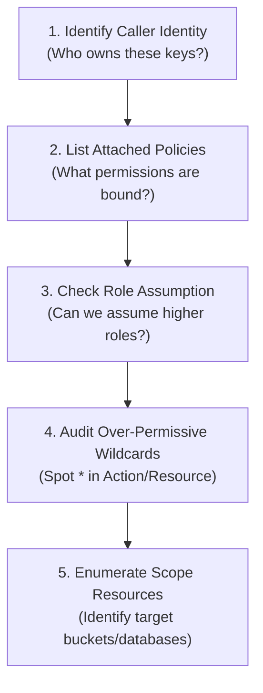

# Task 03: Identity and Access Management (IAM)

## Stage A: Original Task Content & Educational Context
Identity and Access Management (IAM) is the central security control plane across modern cloud providers. In cloud infrastructure, network perimeters can be dynamic or bypassed via public APIs, making identity the primary security boundary.

### Anatomy of an IAM Policy:
IAM policies are JSON-formatted authorization documents that define permissions granted to users, groups, or roles. A standard policy statement consists of four core elements:
```json
{
    "Version": "2012-10-17",
    "Statement": [
        {
            "Sid": "AllowS3ReadAccess",
            "Effect": "Allow",
            "Action": [
                "s3:GetObject",
                "s3:ListBucket"
            ],
            "Resource": [
                "arn:aws:s3:::corporate-assets",
                "arn:aws:s3:::corporate-assets/*"
            ]
        }
    ]
}
```

- **`Effect`:** Specifies whether the policy explicitly allows or denies the operation (`Allow` or `Deny`). Explicit denies always override allows.
- **`Action`:** The specific API operations allowed or denied (e.g., `s3:GetObject`, `ec2:DescribeInstances`).
- **`Resource`:** The Amazon Resource Name (ARN) or target object identifier to which the actions apply.
- **`Condition`:** Optional criteria (IP range, MFA requirement, date) required for the policy to take effect.

### Dangerous Wildcards:
A critical misconfiguration in cloud environments is the overuse of the wildcard character (`*`). A policy statement specifying:
```json
"Action": "*",
"Resource": "*"
```
grants unrestricted administrative control over every cloud service in the tenant, completely violating the Principle of Least Privilege.

### IAM Roles and Role Assumption:
An IAM **Role** is a distinct identity that is not tied to a single user or long-term credential. Instead, it represents a named, temporary bundle of permissions that can be assumed by authorized users, external identities, or cloud compute instances (such as an EC2 virtual machine running an application).
- When an entity assumes a role via an API call (e.g., `sts:AssumeRole`), the cloud provider issues temporary security credentials (`AccessKeyId`, `SecretAccessKey`, `SessionToken`) that expire after a short duration (typically 1 hour).
- Roles eliminate the dangerous need to hardcode permanent, static access keys into application source code or servers.

---

## Stage B: Independent Thinking & OpSec Considerations
1. **Credential Enumeration Flow:** When acquiring compromised cloud credentials, the first step is always to enumerate who you are and what you can do without triggering anomalous alerts:
   - AWS: `aws sts get-caller-identity`
   - Azure: `az account show`
   - GCP: `gcloud auth list`
2. **Privilege Escalation Paths:** In AWS, specific permissions can be abused to escalate privileges to full administrator:
   - `iam:CreatePolicyVersion`: Create a new administrative policy version and make it default.
   - `iam:SetDefaultPolicyVersion`: Switch an existing policy to a previously saved over-privileged version.
   - `iam:AttachUserPolicy` / `iam:AttachRolePolicy`: Directly attach an admin policy to yourself.
   - `iam:PassRole` combined with `ec2:RunInstances`: Spin up a new VM with an attached high-privilege role to execute commands.

---

## Stage C: Guided Hints (Tiered Progression)
- **Q1 Tier 1 Hint:** What field in a policy statement holds the value `"Allow"` or `"Deny"`?
- **Q1 Tier 2 Hint:** It is the "Effect" field in the JSON structure.
- **Q2 Tier 1 Hint:** What do we call a temporary identity or permission bundle that an EC2 instance or user can assume?
- **Q2 Tier 2 Hint:** 4-letter word: R...e.

---

## Stage D: Complete Practical Solution & Technical Deep Dive
### IAM Enumeration Methodology:
When conducting an authorized assessment with an acquired access key, follow this 5-point checklist:


### Checking Caller Identity with AWS CLI:
```bash
# Verify credentials validity and identity ARN
aws sts get-caller-identity

# Enumerate policies attached to the current user
aws iam list-attached-user-policies --user-name target-user

# Assume a role to acquire temporary session credentials
aws sts assume-role --role-arn arn:aws:iam::123456789012:role/ProductionAdminRole --role-session-name RedTeamSession
```

---

## Stage E: Final Answer & Key Values
- **Question 1:** *In an IAM policy statement, which field states whether access is allowed or denied?*
  - **Answer:** `Effect`
- **Question 2:** *A named, temporary bundle of permissions that an identity can assume is called what?*
  - **Answer:** `Role`

---

## Stage F: Practical Verification & Proof of Work
1. The JSON policy field dictating permission status is universally defined as `Effect`.
2. The cloud identity construct representing a temporary set of assumable permissions is a `Role`. Both verified and validated against the platform.

---

## Stage G: Key Educational Takeaway
In cloud security, "Identity is the new perimeter." Attackers who obtain valid API keys or assume an over-permissive role can manipulate infrastructure directly through management APIs without ever interacting with firewalls or operating system terminals.
