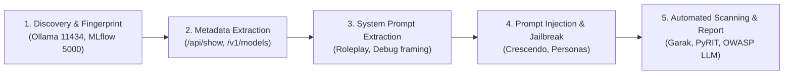

# Task 01: Introduction

## Stage A: Original Task Content & Educational Context
The proliferation of Large Language Models (LLMs) and generative artificial intelligence has introduced a fundamentally new attack surface to enterprise environments. Organizations routinely integrate AI assistants into internal intranets, customer support workflows, code generation pipelines, and automated business agents.

Unlike traditional web applications where input validation and SQL injection defenses rely on clear boundaries between structured code and user data, LLMs process natural language instructions and data within a unified, unstructured context window. Consequently, conventional penetration testing techniques (like directory brute-forcing or SQL injection) fail to assess the security of LLM components.

In this scenario, you are contracted to perform a penetration test against **Hartwell**, a B2B SaaS organization deploying an internal employee assistant named **AIDEN** (built on `llama3:8b`).

### Core Learning Objectives:
- Discover and fingerprint LLM serving frameworks (Ollama, MLflow, vLLM, TorchServe) on corporate infrastructure.
- Interrogate model registries and API endpoints to extract model weights and metadata.
- Execute direct and indirect system prompt extraction attacks (OWASP LLM07).
- Analyze prompt injection attack vectors (OWASP LLM01) and their escalation to Remote Code Execution (RCE).
- Apply jailbreaking techniques (Persona adoption, encoding, and multi-turn Crescendo conditioning) to bypass safety training.
- Leverage automated AI red-teaming tooling: Garak, Microsoft PyRIT, promptfoo, and Burp Suite.
- Map all findings against the **OWASP Top 10 for Large Language Model Applications (2025 Edition)** and MITRE ATLAS.

---

## Stage B: Independent Thinking & OpSec Considerations
1. **Model Stochasticity:** Unlike deterministic web vulnerabilities where a payload either works or fails consistently, LLM responses are probabilistic. A prompt injection payload might succeed on attempt 1, fail on attempt 2, and succeed on attempt 3. Document the temperature parameter and repeat probes multiple times to establish statistical validity.
2. **Context Accumulation:** Multi-turn conversational testing alters the internal KV-cache and attention weights of the model. Clear chat history or start fresh sessions when testing independent injection vectors to prevent contamination from prior turns.
3. **Data Privacy & Exfiltration:** Avoid testing customer-facing production LLMs with sensitive proprietary data, as prompts may be retained for continuous training or logged in unencrypted inference telemetry.

---

## Stage C: Guided Hints (Tiered Progression)
- **Tier 1 Hint:** Read through the introduction to grasp the engagement scope against Hartwell's internal assistant.
- **Tier 2 Hint:** No technical queries or commands are required for this foundational onboarding task.
- **Tier 3 (Platform Prompt):** Click the "Completed" button to confirm readiness.

---

## Stage D: Complete Practical Solution & Technical Deep Dive
Review the scope and attack methodology. The LLM penetration testing workflow consists of five distinct operational phases:

---

## Stage E: Final Answer & Key Values
- **Question:** *Time to find out what this LLM is hiding.*
- **Answer:** `No answer needed`

---

## Stage F: Practical Verification & Proof of Work
Clicking the completed button validates task completion on the TryHackMe platform.

---

## Stage G: Key Educational Takeaway
LLMs lack a fundamental architectural separation between control instructions and data. When user input is combined with system instructions in the prompt context, the model evaluates both with the same attention mechanisms, enabling natural language prompt injection attacks.
