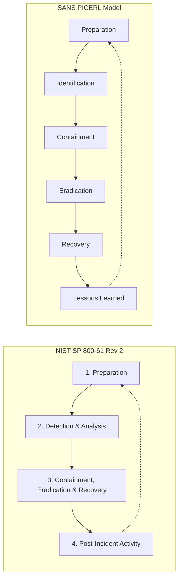

# Technical Reference & Deep Dive: The Blue Team Perspective

## 1. High-Value Windows Security Event IDs Reference Table

| Event ID | Channel | Description | Adversary Technique / Threat Context |
|---|---|---|---|
| **4624** | Security | An account was successfully logged on. | Track authentication mechanisms via `LogonType`: Type 2 (Interactive Console), Type 3 (Network / SMB), Type 10 (Remote Desktop RDP). |
| **4625** | Security | An account failed to log on. | Password spraying, brute-force attacks, or failed Kerberoasting attempts. |
| **4672** | Security | Special privileges assigned to new logon. | Admin rights allocation (e.g. `SeDebugPrivilege`, `SeImpersonatePrivilege`). |
| **4688** | Security | A new process has been created. | Process execution tracing; detects parent-child anomalies (e.g., `w3wp.exe` $\rightarrow$ `cmd.exe`). Requires command-line auditing. |
| **4697** | Security | A service was installed in the system. | Service-based persistence or lateral movement (PsExec). |
| **4698** | Security | A scheduled task was created. | Scheduled task persistence (e.g., Schtasks, Cobalt Strike beacons). |
| **4720** | Security | A user account was created. | Rogue account creation for persistence (T1136). |
| **4732** | Security | A member was added to a security-enabled local group. | Privilege escalation (adding user to local `Administrators` group). |
| **4738** | Security | A user account was modified. | Password resets, account unlocking, or Kerberos delegation changes. |
| **7045** | System | A service was installed in the system. | System log equivalent of 4697; captured in Sysinternals and default Windows configs. |
| **1102** | Security | The audit log was cleared. | Anti-forensics / log tampering (T1070.001). Recorded immediately before buffer purge. |

---

## 2. Splunk Search Processing Language (SPL) Cheat Sheet

```spl
# 1. Base Search & Scope Filtering
index=botsv1 sourcetype=WinEventLog:Security host=webresearch

# 2. Aggregation & Counting
index=botsv1 sourcetype=iis
| stats count by c_ip, cs_method
| sort -count

# 3. Field Extraction using Regular Expressions (rex)
index=botsv1 sourcetype=stream:http
| rex field=uri "id=(?<user_id>\d+)"
| table _time, src_ip, user_id

# 4. Outlier & Threshold Filtering
index=botsv1 sourcetype=iis sc_status=404
| stats count by c_ip
| where count > 100
| sort -count

# 5. Timechart Analysis (Events per hour)
index=botsv1 sourcetype=suricata
| timechart span=1h count by alert.severity

# 6. Combining Multiple Event Codes (Authentication Audit)
index=botsv1 sourcetype=WinEventLog:Security (EventCode=4624 OR EventCode=4625)
| eval Status=if(EventCode==4624, "SUCCESS", "FAILED")
| stats count by Account_Name, Status
```

---

## 3. Incident Response Framework Comparison



| Phase Focus | NIST SP 800-61 Rev 2 | SANS PICERL | Core Operational Activities |
|---|---|---|---|
| **Before Incident** | Preparation | Preparation | Policies, runbooks, EDR/SIEM deployment, security drills. |
| **Detection** | Detection and Analysis | Identification | Alert triage, log correlation, establishing forensic scope and timeline. |
| **Stopping Spread** | Containment, Eradication & Recovery | Containment | Isolating network segments, disabling compromised accounts, blocking IPs. |
| **Eliminating Foothold** | Containment, Eradication & Recovery | Eradication | Removing malware, deleting backdoors, closing vulnerable ingress routes. |
| **Restoring Business** | Containment, Eradication & Recovery | Recovery | Restoring from clean backups, rotating all credentials, system validation. |
| **Post-Incident** | Post-Incident Activity | Lessons Learned | Root cause analysis post-mortem, updating detection rules and playbooks. |

---

## 4. David Bianco's Pyramid of Pain & Detection Engineering

```
              / \
             /   \
            / TTPs\            Tough (Forces adversary to re-architect operations)
           /-------\
          /  Tools  \          Challenging (Forces modifying or rewriting exploit code)
         /-----------\
        / Network/Host\        Annoying (Forces changing C2 profiles, URIs, user agents)
       /   Artifacts   \
      /-----------------\
     /   Domain Names    \     Simple (Forces registering new DNS domains)
    /---------------------\
   /     IP Addresses      \   Easy (Forces acquiring new VPS / proxies)
  /-------------------------\
 /        Hash Values        \ Trivial (1-byte recompile generates brand new hash)
/-----------------------------\
```

### Engineering Detection Rules by Layer:
1. **Hash / IP / Domain:** Feed into automated blocklists and Threat Intelligence Platforms (TIPs) via STIX/TAXII. High volume, short operational lifespan.
2. **Artifacts:** Sigma rules and YARA signatures detecting specific malicious strings, headers, and registry paths.
3. **Tools:** EDR behavioral heuristics detecting execution characteristics of offensive frameworks (e.g., Mimikatz LSASS access patterns, Cobalt Strike named pipes).
4. **TTPs:** Hunting for abnormal process relationships (e.g., `svchost.exe` without `-k`, `cmd.exe` spawned by `w3wp.exe`, LSASS memory dumping via `comsvcs.dll`).

---

## 5. MITRE ATT&CK Enterprise Matrix (14 Tactics)

1. **TA0043: Reconnaissance** (Gathering victim intelligence)
2. **TA0042: Resource Development** (Establishing infrastructure, purchasing domains)
3. **TA0001: Initial Access** (Gaining initial foothold: Phishing, Public Exploits)
4. **TA0002: Execution** (Running malicious code: Command Shells, PowerShell)
5. **TA0003: Persistence** (Maintaining presence: Registry Run Keys, Scheduled Tasks)
6. **TA0004: Privilege Escalation** (Gaining elevated access: Token Manipulation)
7. **TA0005: Defense Evasion** (Avoiding detection: Log Clearing, Process Injection)
8. **TA0006: Credential Access** (Stealing credentials: OS Credential Dumping)
9. **TA0007: Discovery** (Mapping environment: Network Service Scanning)
10. **TA0008: Lateral Movement** (Moving through network: Remote Services, SMB/PsExec)
11. **TA0009: Collection** (Gathering target data: Archive Collected Data)
12. **TA0011: Command and Control** (Communicating with compromised systems)
13. **TA0010: Exfiltration** (Stealing data: Exfiltration Over C2 Channel)
14. **TA0040: Impact** (Manipulating, interrupting, or destroying systems: Defacement)
