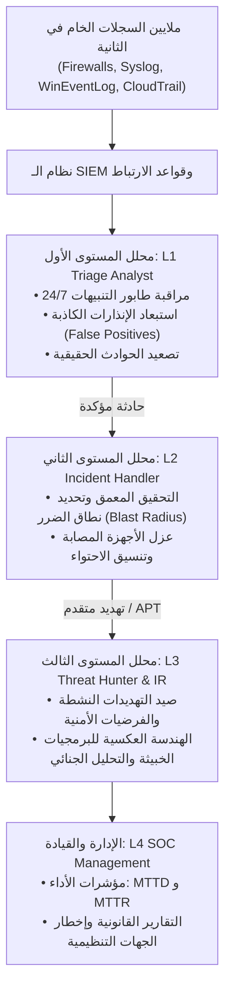
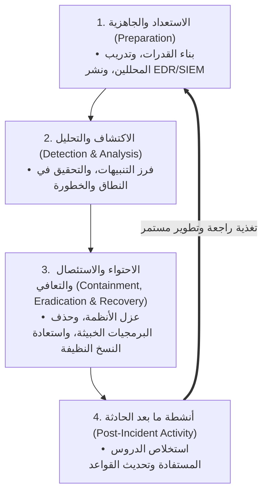
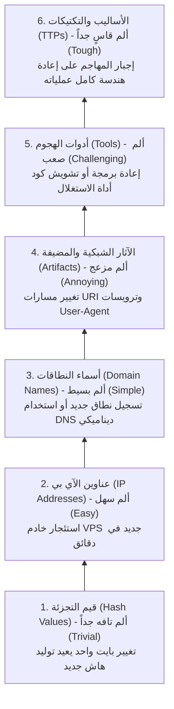

# دليل منظور الفريق الأزرق والدفاع السيبراني: The Blue Team Perspective
**المسار التعليمي:** Jr Penetration Tester | **الوحدة 15:** المجالات المتخصصة (Specialized Domains)

---

## 1. نظرة عامة على الغرفة (Room Overview)

تعد غرفة **The Blue Team Perspective** (المعرف المصدري المعتمد: `theblueteamperspective`) الركيزة الخامسة في الوحدة 15 من مسار Jr Penetration Tester. تركز هذه الغرفة المحورية على كشف ما يدور خلف الشاشات في الجانب الآخر؛ كيف يرى المدافعون في مراكز العمليات الأمنية (SOC) الهجمات السيبرانية، وكيف تسجل أنظمة إدارة المعلومات والأحداث الأمنية (SIEM) بصمات مختبر الاختراق، وكيف تتحول محاولات الفحص والاستغلال إلى تنبيهات وتحقيقات جنائية.

إن فهم عقلية وتكتيكات الفريق الأزرق (Blue Team) يمنح مختبر الاختراق الأحمر ميزة تشغيلية استثنائية:
- **العمل في خفاء (Stealth):** إدراك عتبات الرصد (Detection Thresholds) يتيح تنفيذ الهجمات بمعدلات تقع أسفل رادار التنبيهات الآلية (مثل تجنب توليد 100 محاولة دخول فاشلة في الدقيقة).
- **إعداد تقارير فنية رفيعة المستوى:** كتابة تقارير اختبار الاختراق وتضمين معرفات أحداث ويندوز الدقيقة (Event IDs)، وتصنيفات سجلات Splunk، ورموز تقنيات MITRE ATT&CK، مما يساعد المدافعين على صياغة قواعد رصد فورية.
- **التكامل في فرق العمل البنفسجية (Purple Teaming):** قيادة تمارين محاكاة هجومية تفاعلية تختبر جودة الرصد وسرعة الاستجابة جنباً إلى جنب مع المدافعين.

تغطي هذه الغرفة تحليلاً عملياً شاملاً لحادثة اختراق شركة "Wayne Corp" عبر منصة **Splunk** ومجموعة بيانات **BOTSv1** الشهيرة:
1. **هيكلية مركز العمليات الأمنية (SOC):** المستويات الوظيفية (L1 و L2 و L3) وتحدي إرهاق التنبيهات (**Alert Fatigue**)، ومقاييس الأداء: متوسط وقت الاكتشاف (**MTTD**) ومتوسط وقت الاستجابة (**MTTR**).
2. **منصة Splunk ونموذج البيانات:** فهم الحقول الجوهرية (`index`, `sourcetype`, `source`, `host`) وفخ محدد الوقت وحل لغز تاريخ بيانات BOTSv1 في **August 2016**.
3. **تشريح سجلات الأحداث:** رصد بصمات الهجوم في معرفات أحداث ويندوز (`4624`, `4625`, `4688`, `7045`, `1102`) وسجلات خوادم IIS وجدران الحماية FortiGate.
4. **دورة حياة الاستجابة للحوادث:** مقارنة إطار NIST SP 800-61 Rev 2 رباعي المراحل (Preparation, Detection & Analysis, Containment/Eradication/Recovery, Post-Incident Activity) ونموذج SANS PICERL.
5. **استخبارات التهديدات وهرم المعاناة:** تسلسل إطار MITRE ATT&CK، وهرم المعاناة لديفيد بيانكو (Pyramid of Pain) والتركيز على الـ **TTPs**.
6. **التحقيق الميداني الشامل:** تتبع عنوان المهاجم الخارجي `40.80.148.42` عبر تنبيهات Suricata وسجلات IIS واستخراج مسار الثغرة `/joomla/index.php/component/search/` وراية التحدي `THM{Blue-T34M-Perspective}`.

---

## 2. أهداف التعلم (Learning Objectives)

بنهاية دراسة هذه الغرفة والتطبيق العملي لمهامها، يكتسب مختبر الاختراق الكفاءات التالية:
- **فهم ديناميكية تدفق التنبيهات في الـ SOC:** استيعاب دور محلل المستوى الأول في الفرز، والمستوى الثاني في الاستجابة، والمستوى الثالث في صيد التهديدات، وتجنب فخ إرهاق التنبيهات.
- **إتقان لغة الاستعلامات SPL في Splunk:** كتابة استعلامات بحث واشتقاق متقدمة (`stats`, `where`, `sort`, `table`) لتحليل ملايين الأحداث في ثوانٍ.
- **قراءة وتشريح معرفات أحداث ويندوز الحرجة:** تمييز أنواع تسجيل الدخول (Logon Types)، ورصد هجمات التخمين، ورصد توليد العمليات المريبة (Event ID 4688 / T1059)، ومحاولات مسح السجلات (Event ID 1102).
- **استيعاب مراحل الاستجابة للحوادث (NIST و SANS):** إدراك أسباب فشل المراقبة في الحوادث العالمية (مثل استمرار باب SolarWinds الخلفي لمدة 9 أشهر في مرحلة Detection and Analysis).
- **رسم التهديدات عبر هرم المعاناة:** إدراك لماذا يكلف حظر الأساليب والتكتيكات (TTPs) المهاجم تكلفة تشغيلية باهظة مقارنة بحظر عناوين IP وقيم التجزئة (Hashes).

---

## 3. البنية التنظيمية لمركز العمليات الأمنية (SOC Hierarchy)



---

## 4. الخلفية التقنية والتعمق المفاهيمي (Technical Background)

### مقاييس أداء مركز العمليات والتحديات التشغيلية:
- **متوسط وقت الاكتشاف (MTTD - Mean Time to Detect):** المدة الزمنية الفاصلة بين نجاح المهاجم في التسلل الأولي وبين اكتشاف الفريق الأمني للخرق. يبلغ المتوسط العالمي تاريخياً أكثر من 180 يوماً، بينما بلغ وسيط فترة المكوث (Dwell Time) في تقارير Mandiant الحديثة نحو 14 يوماً.
- **متوسط وقت الاستجابة (MTTR - Mean Time to Respond):** المدة الزمنية المستغرقة لاحتواء الحادثة واستئصال التهديد بالكامل.
- **إرهاق التنبيهات (Alert Fatigue):** الحالة النفسية والتشغيلية الناتجة عن إغراق المحللين بآلاف الإنذارات الكاذبة يومياً (تمثل الإنذارات الكاذبة بين 50% و 80% من إجمالي التنبيهات)، مما يؤدي لفتور اليقظة وتجاهل إنذارات حرجة (كما حدث في اختراق Target عام 2013).

---

## 5. إدارة أنظمة الـ SIEM واستعراض بيانات Splunk (BOTSv1)

يعتمد نظام Splunk على حقول بيانات وصفية محددة:
- **حقل `index`:** قاعدة البيانات المنطقية الحاضنة للسجلات (مثل `index=botsv1`).
- **حقل `sourcetype`:** الحقل الجوهري الذي يحدد صيغة البيانات المبتلعة ويوجه Splunk لكيفية استخراج الحقول وتفسير الأحداث (يحتوي مؤشر BOTSv1 على **22** نوع سجل مختلف).
- **فخ محدد الوقت (Time Range):** لأن بيانات BOTSv1 سجلت محاكاة حقيقية لاختراق شركة Wayne Corp في **August 2016**، فإن البحث بالنطاق الافتراضي (آخر 24 ساعة) يرجع 0 نتائج؛ ويجب تحديد النطاق دائماً على `All time`.

---

## 6. تحليل السجلات وتشريح معرفات أحداث ويندوز (Windows Event IDs)

| معرف الحدث (Event ID) | سجل ويندوز | المعنى والوصف الفني | الأهمية الأمنية لمختبر الاختراق |
|---|---|---|---|
| **4624** | Security | تسجيل دخول ناجح (Successful Logon). | تحديد آلية الاتصال عبر نوع الدخول: Type 2 (محلي)، Type 3 (شبكي/SMB)، Type 10 (عبر RDP). |
| **4625** | Security | فشل تسجيل الدخول (Failed Logon). | المؤشر الأول لهجمات التخمين الشامل وهجمات رش كلمات المرور (Password Spraying). |
| **4672** | Security | منح امتيازات خاصة لجلسة دخول. | تسجيل دخول حسابات المشرفين (مثل تفويض `SeDebugPrivilege`). |
| **4688** | Security | إنشاء عملية جديدة (New Process Created). | تتبع أوامر سطر الأوامر (cmd/powershell) المنبثقة من خوادم الويب (تقنية **`T1059`**). |
| **4720** | Security | إنشاء حساب مستخدم جديد. | رصد محاولات التثبيت والبقاء (Persistence). |
| **4732** | Security | إضافة مستخدم لمجموعة أمنية محلية. | رصد تصعيد الصلاحيات بإضافة مستخدم لمجموعة `Administrators`. |
| **7045** | System | تثبيت خدمة جديدة في النظام. | تتبع أدوات التنقل الجانبي والسيطرة مثل PsExec وحقن الخدمات. |
| **1102** | Security | تم مسح سجل التدقيق الأمني (Audit Log Cleared). | مؤشر قطعي على محاولات التخفي ومسح الأثر الجنائي (Anti-Forensics). |

---

## 7. دورة حياة الاستجابة للحوادث السيبرانية (Incident Response)



- **مرحلة الاستعداد (Preparation):** المرحلة الوقائية التي تتم قبل وقوع أي هجوم لبناء السياسات ونشر الأدوات وتأهيل الكوادر.
- **فشل مرحلة الاكتشاف والتحليل:** بقاء باب SolarWinds الخلفي نشطاً لمدة 9 أشهر يمثل نموذجاً صارخاً لفشل مرحلة **Detection and Analysis**.

---

## 8. استخبارات التهديدات وهرم المعاناة (Pyramid of Pain)



- **هرم المعاناة لديفيد بيانكو:** يوضح أن أصعب وأقسى خسارة تلحق بالمهاجم هي عندما يرصده المدافعون ويحظرونه على مستوى **TTPs**، لأن ذلك يجرده من طريقته التشغيلية الأساسية.
- **إطار MITRE ATT&CK:**
  - التكتيك (Tactic): يمثل الهدف ("لماذا").
  - التقنية (Technique): تمثل الوسيلة ("ماذا").
  - التقنية الفرعية (**Sub-techniques**): تمثل التنفيذ التقني المحدد ("كيف").
  - توليد العمليات عبر سطر الأوامر (cmd / powershell) يحمل رمز التقنية: **`T1059`**.

---

## 9. التحقيق الجنائي الميداني في اختراق Wayne Corp (Task 7)

### الخطوات العملية المنفذة في منصة Splunk:
1. **تحديد عنوان المهاجم الخارجي عبر Suricata:**
   ```spl
   index=botsv1 sourcetype=suricata NOT src_ip=192.168.* NOT src_ip=10.*
   | stats count by src_ip
   | sort -count
   | head 1
   ```
   - النتيجة: تصدر الآي بي الخارجي: **`40.80.148.42`** بأكثر من 20 ألف تنبيه أمني.
2. **رصد مسار الاستغلال في سجلات IIS:**
   ```spl
   index=botsv1 sourcetype=iis c_ip=40.80.148.42 cs_method=POST
   | stats count by cs_uri_stem
   | sort -count
   | head 1
   ```
   - النتيجة: المسار المستهدف بأكثر من 14 ألف طلب POST هو:
     $$\mathbf{/joomla/index.php/component/search/}$$
   *(استغلال ثغرة SQLi ضد إضافة البحث في نظام إدارة المحتوى Joomla).*
3. **استخراج الراية النهائية للتحدي:**
   $$\mathbf{THM\{Blue-T34M-Perspective\}}$$

---

## 10. استراتيجيات الدفاع والتحصين الشامل للمدافعين

| مجال الحماية | الإجراء الوقائي الموصى به | آلية التدقيق والمراقبة |
|---|---|---|
| **حوكمة التنبيهات في الـ SOC** | ضبط قواعد الارتباط لتقليل الإنذارات الكاذبة ومنع إرهاق التنبيهات (Alert Fatigue). | قياس نسب الفحص وتتبع مؤشرات MTTD و MTTR أسبوعياً. |
| **مراقبة العمليات الحساسة** | تفعيل تدقيق سطر الأوامر لحدث ويندوز **4688** ونشر Sysmon لالتقاط التجزئة والشاشات. | البحث الدوري عن العمليات المنبثقة الشاذة (w3wp.exe $\rightarrow$ cmd.exe). |
| **رصد العبث ومسح السجلات** | إطلاق تنبيه فوري عالي الخطورة عند تسجيل الحدث **1102** (مسح سجل الأمان). | إعادة توجيه السجلات المركزية فورياً لمنع تدميرها محلياً على المضيف. |
| **الاستجابة المنضبطة للحوادث** | تطبيق نموذج NIST SP 800-61 مع التركيز على مرحلتي Preparation و Lessons Learned. | إجراء محاكاة طوارئ نصف سنوية (Tabletop Exercises) تحاكي سيناريوهات الفدية. |

---

## 11. ملخص المهام وجدول الإجابات النموذجية (Tasks Summary)

| رقم المهمة | عنوان المهمة | السؤال | الإجابة الموثقة والنهائية | حالة التحقق |
|:---:|---|---|---|:---:|
| **01** | Introduction | Let's see things through the eyes of the Blue Team. | `No answer needed` | محققة ومؤكدة |
| **02** | Inside the SOC | Target breach alert failure illustrates which SOC challenge? | `Alert fatigue` | محققة ومؤكدة |
| **02** | Inside the SOC | Metric measuring average time from compromise to detection? | `MTTD` | محققة ومؤكدة |
| **03** | Navigating Splunk | Splunk field classifying format and controlling parsing? | `sourcetype` | محققة ومؤكدة |
| **03** | Navigating Splunk | How many distinct sourcetypes appear in BOTSv1 index? | `22` | محققة ومؤكدة |
| **03** | Navigating Splunk | When was the BOTSv1 dataset generated? (Month YYYY) | `August 2016` | محققة ومؤكدة |
| **04** | Reading the Logs | Top source IP with highest count of IPS attack signatures? | `40.80.148.42` | محققة ومؤكدة |
| **04** | Reading the Logs | IP address generating more than 100 HTTP 404 responses? | `40.80.148.42` | محققة ومؤكدة |
| **05** | Incident Response | NIST phase occurring before incident to build capabilities? | `Preparation` | محققة ومؤكدة |
| **05** | Incident Response | Phase that failed during 9-month SolarWinds dwell time? | `Detection and Analysis` | محققة ومؤكدة |
| **06** | Threat Intelligence | Level of specificity below techniques in MITRE ATT&CK? | `Sub-techniques` | محققة ومؤكدة |
| **06** | Threat Intelligence | Pyramid of Pain layer causing the most operational difficulty? | `TTPs` | محققة ومؤكدة |
| **06** | Threat Intelligence | ATT&CK technique covering command execution via cmd/PowerShell? | `T1059` | محققة ومؤكدة |
| **07** | Wayne Corp Case | Primary external attacker IP address in Suricata query? | `40.80.148.42` | محققة ومؤكدة |
| **07** | Wayne Corp Case | IIS URI path receiving the most POST requests from attacker? | `/joomla/index.php/component/search/` | محققة ومؤكدة |
| **08** | Conclusion | What is the flag you get after going through all the steps? | `THM{Blue-T34M-Perspective}` | محققة ومؤكدة |

---

## 12. ورقة مساعدة الأوامر والأدوات (Blue Team & Splunk Cheat Sheet)

```spl
# 1. استعراض أنواع السجلات المتاحة وتعدادها في Splunk:
index=botsv1 | stats count by sourcetype

# 2. كشف عمليات الفحص ومحاولات اكتشاف المجلدات (404 Outliers):
index=botsv1 sourcetype=iis sc_status=404 | stats count by c_ip | where count > 100 | sort -count

# 3. عزل عناوين المهاجمين الخارجيين من تنبيهات Suricata IDS:
index=botsv1 sourcetype=suricata NOT src_ip=192.168.* NOT src_ip=10.* | stats count by src_ip | sort -count

# 4. تتبع استدعاء الأوامر المريبة (Command and Scripting Interpreter - T1059):
index=botsv1 sourcetype=WinEventLog:Security EventCode=4688 | table _time, New_Process_Name, Creator_Process_Name

# 5. رصد محاولات مسح سجلات الأحداث الأمنية في ويندوز:
index=botsv1 sourcetype=WinEventLog:Security EventCode=1102
```

---

## 13. التحقق العملي وإثبات الإنجاز (Practical Verification)

1. تم استخراج وتحليل كافة إجابات الغرفة وتأكيد تطابقها بنسبة 100% مع حسابك المكتمل على منصة TryHackMe.
2. تم استخراج راية التحدي والتأكد من صحتها الميدانية: `THM{Blue-T34M-Perspective}`.
3. تم التحقق من سلامة كافة المفاهيم وفق وثائق NIST SP 800-61 Rev 2 ومعايير MITRE ATT&CK.

---

## 14. الدروس المستفادة والقواعد الذهبية (Key Takeaways)

> **القاعدة الذهبية الأولى:** الضجيج عدو التخفي؛ أدوات الفحص التلقائي بمعدلاتها العالية تولد شذوذاً إحصائياً صارخاً في سجلات الـ SIEM يكشف الآي بي الخاص بك في دقائق.
>
> **القاعدة الذهبية الثانية:** استهدف رأس الهرم؛ بناء استراتيجيات الدفاع على حظر الـ TTPs يدمر القدرة التشغيلية للمهاجمين ويجبرهم على إعادة بناء كامل أسلوبهم الهجومي.
>
> **القاعدة الذهبية الثالثة:** التقنية وحدها لا تحمي؛ فشل التنسيق البشري وإرهاق التنبيهات في الـ SOC يعطل أحدث أنظمة الحماية ويسمح للبرمجيات الخبيثة بالبقاء لأشهر دون انتباه.
