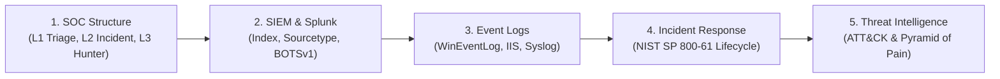

# Task 01: Introduction

## Stage A: Original Task Content & Educational Context
Every time a penetration tester runs an Nmap port scan, launches a directory brute-force attack via Gobuster, or injects a SQL payload into a login form, digital artifacts are left behind. Packets hit firewalls, web servers write access logs, Intrusion Detection Systems (IDS) trigger alerts, and Security Operations Center (SOC) dashboards illuminate.

Penetration testers who understand defensive operations possess significant operational advantages:
- **Evasion & Stealth:** Understanding detection thresholds allows testers to stay under the radar (e.g., throttling credential testing to 2 requests per minute instead of triggering rate-based SIEM alert thresholds).
- **High-Impact Reporting:** Writing penetration test reports that include exact Windows Event IDs, log sourcetypes, and MITRE ATT&CK technique IDs empowers defensive teams to build precise detection rules rather than generic patches.
- **Collaborative Purple Teaming:** Bridging the gap between Red Team (offensive simulation) and Blue Team (defensive detection and response) during collaborative purple team exercises.

### Operational Definitions:
- **Red Team:** Simulates real-world adversary tactics, techniques, and procedures (TTPs) to identify security weaknesses and demonstrate operational business impact.
- **Blue Team:** Defends the enterprise, monitors telemetry, investigates security alerts, and executes Incident Response (IR) and digital forensics.
- **Purple Team:** A collaborative operational model where red and blue operators work side by side to measure, test, and improve defensive detections in real time.

---

## Stage B: Independent Thinking & OpSec Considerations
1. **Log Awareness:** In red team operations, assume everything you do is recorded. If an attack fails, the attempt is almost certainly logged in a SIEM.
2. **Noise Discipline:** The louder your tool defaults (e.g., Nikto default user-agents, Nmap `-T4` aggressive timing), the higher the probability of immediate L1 analyst triage and IP-level containment.

---

## Stage C: Guided Hints (Tiered Progression)
- **Tier 1 Hint:** Read the introduction to understand why penetration testers must learn the blue team perspective.
- **Tier 2 Hint:** No technical queries or inputs are required for this foundational onboarding task.
- **Tier 3 (Platform Prompt):** Click the "Completed" button to confirm readiness.

---

## Stage D: Complete Practical Solution & Technical Deep Dive
Review the scope of the room. The defensive assessment workflow explored in this room progresses through five core capabilities:

---

## Stage E: Final Answer & Key Values
- **Question:** *Let's see things through the eyes of the Blue Team.*
- **Answer:** `No answer needed`

---

## Stage F: Practical Verification & Proof of Work
Clicking the completed button validates task completion on the TryHackMe platform.

---

## Stage G: Key Educational Takeaway
A skilled penetration tester knows how to break in; an elite penetration tester understands the defensive telemetry their attacks generate and knows how to help defenders detect and neutralize real-world adversaries.
