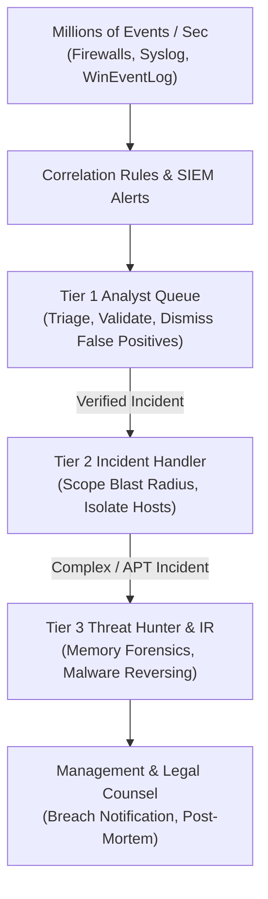

# Task 02: Inside the SOC: How Defenders Operate

## Stage A: Original Task Content & Educational Context
The Security Operations Center (SOC) is the command hub responsible for continuous monitoring, detection, and initial response to cybersecurity incidents. Understanding how human analysts prioritize, investigate, and escalate alerts reveals why breaches occur even when automated detection software functions properly.

### Case Study: Target Corporation (2013)
On November 30, 2013, FireEye network security monitoring appliances inside Target's corporate network generated automated alerts detecting BlackPOS memory-scraping malware installed on Point-of-Sale (POS) terminals. The security appliance had an auto-deletion feature that was intentionally disabled by IT staff. The alert appeared in the centralized console monitored by Target's outsourced SOC team in Bangalore, India. However, the analysts failed to escalate the alert to the Minneapolis security headquarters.

The malware remained active inside Target's network for 18 days, exfiltrating 40 million credit card records and personal identifiable information (PII) of 70 million individuals, resulting in over $162 million in breach costs, regulatory fines, and the resignation of Target's CEO and CIO. This catastrophic failure illustrated that technological detection without effective human triage and operational vigilance is useless.

### The Hierarchical SOC Tier Structure:
- **Tier 1 (L1 - Triage Analyst):** The frontline defense. Monitors alert queues 24/7/365, conducts initial contextual review, filters out obvious false positives, and escalates confirmed suspicious anomalies to Tier 2.
- **Tier 2 (L2 - Incident Handler):** Deep-dive technical investigation. Determines the blast radius, correlates host and network logs, scopes affected endpoints, and coordinates tactical containment and evidence preservation.
- **Tier 3 (L3 - Threat Hunter / Senior Specialist):** Proactive threat hunting. Formulates hypotheses to find stealthy adversaries operating without active alert triggers, performs reverse malware engineering, conducts memory forensics, and authors advanced detection signatures.
- **Tier 4 (L4 - SOC Management & Engineering):** Oversees team operations, metric reporting, SIEM/SOAR platform architecture, and regulatory compliance.

### Core SOC Performance Metrics:
- **Mean Time to Detect (MTTD):** The average duration from an attacker's initial breach/foothold to the moment the organization's defenders identify the intrusion. (Industry average historically exceeds 180 days; median dwell time is ~14 days).
- **Mean Time to Respond / Remediate (MTTR):** The average duration from initial detection to complete threat containment and eradication.

### The Phenomenon of Alert Fatigue:
Enterprise SOCs ingest millions of log events daily, generating thousands of automated alerts. Studies show that between 50% and 80% of generated security alerts are false positives, and less than 40% of all generated alerts are ever manually reviewed by an analyst. This continuous barrage of low-fidelity alerts causes severe psychological desensitization known as **alert fatigue**, leading analysts to overlook critical, high-impact alerts.

---

## Stage B: Independent Thinking & OpSec Considerations
1. **Exploiting Alert Fatigue:** Attackers exploit alert fatigue by generating minor, noisy alerts in one part of an enterprise to distract L1 analysts while quietly executing high-value exfiltration through another channel.
2. **Detection Thresholds:** Setting up brute-force attacks at 100 attempts per second triggers automated correlation rules and locks accounts immediately. Spreading credential attempts over days (low and slow password spraying) remains below alert thresholds.

---

## Stage C: Guided Hints (Tiered Progression)
- **Q1 Tier 1 Hint:** What psychological and operational condition occurs when SOC analysts are overwhelmed by thousands of false alerts?
- **Q1 Tier 2 Hint:** Two words: Alert ... (fatigue).
- **Q2 Tier 1 Hint:** What 4-letter acronym represents Mean Time to Detect?
- **Q2 Tier 2 Hint:** M... T... T... D...

---

## Stage D: Complete Practical Solution & Technical Deep Dive
### The SOC Escalation Pipeline:

---

## Stage E: Final Answer & Key Values
- **Question 1:** *Target's security tools detected the breach in 2013, but the alert was never escalated. What SOC challenge does this failure best illustrate?*
  - **Answer:** `Alert fatigue`
- **Question 2:** *What metric measures the average time between an attacker's initial compromise and the organization's detection of the breach?*
  - **Answer:** `MTTD`

---

## Stage F: Practical Verification & Proof of Work
1. The Target 2013 case study is universally cited in cybersecurity curricula as the classic example of `Alert fatigue`.
2. The standard KPI for measuring duration between compromise and detection is `MTTD` (Mean Time to Detect). Both verified on the platform.

---

## Stage G: Key Educational Takeaway
Automated detection tools do not stop breaches; human processes and operational rigor do. When designing attacks or evaluating defenses, recognize that human analysts overwhelmed by noisy alerts are the most vulnerable component of the detection pipeline.
