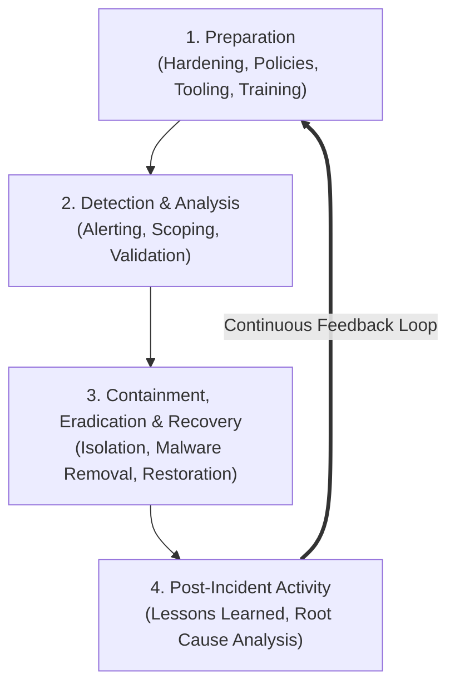

# Task 05: When Things Go Wrong: The Incident Response Lifecycle

## Stage A: Original Task Content & Educational Context
When a breach occurs, organizations cannot improvise defense; they must execute a coordinated, standardized Incident Response (IR) plan. The two most widely adopted operational frameworks in cybersecurity are **NIST SP 800-61 Rev 2** and the **SANS PICERL Model**.

### The NIST SP 800-61 Rev 2 Four-Phase Lifecycle:
1. **Preparation:**
   - The foundation of all defense, executed *before* an incident occurs.
   - Developing policies, incident handling procedures, communication plans, and runbooks.
   - Deploying monitoring tools (EDR, SIEM, IDS), configuring audit logging, and conducting tabletop simulation exercises.
2. **Detection and Analysis:**
   - Identifying that an adverse event has taken place and assessing its scope and severity.
   - Triaging alerts, correlating log streams, determining the attack vector, and establishing an initial forensic timeline.
3. **Containment, Eradication, and Recovery:**
   - *Containment:* Halting attacker lateral movement and exfiltration (e.g., isolating endpoints from the network, disabling compromised user accounts, blocking IP addresses).
   - *Eradication:* Removing malware, deleting backdoors, closing vulnerable ingress routes, and purging rogue accounts.
   - *Recovery:* Restoring compromised systems from clean backups, rotating all credentials, and returning systems to production with enhanced monitoring.
4. **Post-Incident Activity (Lessons Learned):**
   - Conducting a post-mortem review within two weeks of closure.
   - Documenting what occurred, why it succeeded, and what controls failed.
   - Feeding lessons learned directly back into Phase 1 (Preparation) to harden defenses against future attacks.

### SANS PICERL Model Mapping:
- **P**reparation $\rightarrow$ Preparation
- **I**dentification $\rightarrow$ Detection and Analysis
- **C**ontainment $\rightarrow$ Containment, Eradication, and Recovery
- **E**radication $\rightarrow$ Containment, Eradication, and Recovery
- **R**ecovery $\rightarrow$ Containment, Eradication, and Recovery
- **L**essons Learned $\rightarrow$ Post-Incident Activity

### Incident Response Failure Case Study: SolarWinds SUNBURST (2020)
In the SolarWinds supply chain attack, Russian state actors (APT29 / Cozy Bear) inserted a backdoor into Orion software updates. The backdoor was pushed to over 18,000 corporate and government networks and remained active inside victim environments for approximately **9 months** before FireEye identified anomalous multi-factor authentication (MFA) token registrations. This multi-month dwell time represented a catastrophic failure of the **Detection and Analysis** phase.

---

## Stage B: Independent Thinking & OpSec Considerations
1. **Understanding Defender Containment Playbooks:** Once defenders detect an active intrusion, their first action is Containment (isolating the machine, revoking Kerberos tickets, killing C2 sessions). Red teams must establish redundant, out-of-band persistence mechanisms to avoid total eviction.
2. **Forensic Evidence Preservation:** Defenders follow strict chain-of-custody protocols during Detection and Analysis. Any command executed by an attacker modifies file timestamps (MACB) and volatility memory, creating permanent evidence.

---

## Stage C: Guided Hints (Tiered Progression)
- **Q1 Tier 1 Hint:** What is the first phase of the NIST incident response lifecycle that focuses on tools, policies, and training before attacks happen?
- **Q1 Tier 2 Hint:** One word: Preparation.
- **Q2 Tier 1 Hint:** If an advanced persistent threat (APT) operates inside a network for 9 months without anyone noticing, which phase failed to identify the attack?
- **Q2 Tier 2 Hint:** "Detection and ...".

---

## Stage D: Complete Practical Solution & Technical Deep Dive
### The NIST SP 800-61 Rev 2 Circular Lifecycle:

---

## Stage E: Final Answer & Key Values
- **Question 1:** *In the NIST SP 800-61 Rev 2 lifecycle, which phase occurs before any incident is detected and focuses on building capability through policies, tools, and training?*
  - **Answer:** `Preparation`
- **Question 2:** *The SolarWinds SUNBURST backdoor remained undetected for approximately 9 months. Which phase of the NIST SP 800-61 Rev 2 IR lifecycle failed during this time?*
  - **Answer:** `Detection and Analysis`

---

## Stage F: Practical Verification & Proof of Work
1. The pre-incident phase in NIST SP 800-61 Rev 2 is universally defined as `Preparation`.
2. Undetected malicious dwell time represents a direct failure of `Detection and Analysis`. Both verified on the platform.

---

## Stage G: Key Educational Takeaway
Incident response is not a linear checklist; it is an iterative feedback loop. The effectiveness of an organization's detection and containment is dictated by the thoroughness of its preparation and post-incident lessons learned.
