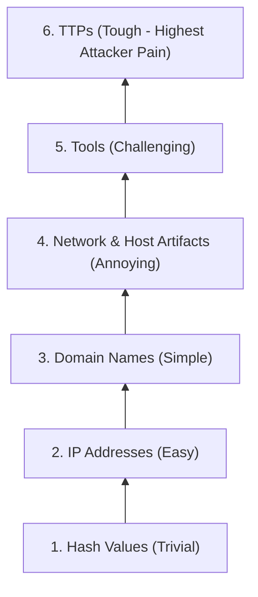

# Task 06: Know Your Enemy: Threat Intelligence Basics

## Stage A: Original Task Content & Educational Context
Cyber Threat Intelligence (CTI) is the systematic collection, evaluation, and application of knowledge about adversaries, their motives, capabilities, and infrastructure. Two foundational frameworks structure modern threat intelligence: the **MITRE ATT&CK Matrix** and David Bianco's **Pyramid of Pain**.

### The MITRE ATT&CK Framework Hierarchy:
The Enterprise ATT&CK matrix organizes real-world adversary behavior into a 4-tier hierarchical taxonomy:
1. **Tactics (14 in Enterprise):** The adversary's operational objective (the **"Why"**). Examples: Initial Access (TA0001), Execution (TA0002), Persistence (TA0003), Credential Access (TA0006).
2. **Techniques:** The general method or mechanism used to achieve the tactical goal (the **"What"**). Examples: Command and Scripting Interpreter (T1059), Brute Force (T1110).
3. **Sub-techniques:** The specific technological implementation of a technique (the **"How"**). Examples: PowerShell (T1059.001), Windows Command Shell (T1059.003), Password Guessing (T1110.001).
4. **Procedures:** Documented, real-world implementations utilized by specific threat groups or malware strains (e.g., how FIN7 executes PowerShell scripts via scheduled tasks).

### David Bianco's Pyramid of Pain:
The Pyramid of Pain models the operational cost and difficulty inflicted on an adversary when defenders detect and deny specific indicator types:
- **Hash Values (Base - Trivial):** MD5/SHA256 hashes. Changing a single byte in a payload changes its hash completely. Cost to attacker: Seconds.
- **IP Addresses (Easy):** External C2 or scanning IPs. Fast-flux hosting, VPNs, and VPS re-provisioning make changing IPs effortless. Cost to attacker: Minutes.
- **Domain Names (Simple):** Dynamic DNS and domain generation algorithms (DGAs). Cost to attacker: A few dollars and hours.
- **Network / Host Artifacts (Annoying):** Specific URI paths, User-Agent strings, registry keys, and file naming conventions. Changing them requires reconfiguring tools.
- **Tools (Challenging):** Open-source or custom exploit tools (e.g., Mimikatz, BloodHound, Impacket). When signatures detect a tool's core binary, the attacker must re-write or heavily obfuscate it.
- **TTPs (Peak - Tough):** Tactics, Techniques, and Procedures (e.g., using Pass-the-Hash or Kerberoasting). Detecting and blocking an adversary at the TTP level forces them to invent fundamentally new operational tradecraft or abandon the campaign entirely.

### ATT&CK Mapping Exercise:
In the BOTSv1 dataset, querying Windows Event ID 4688 (Process Creation) reveals web server processes (`w3wp.exe`) spawning interactive command shells (`cmd.exe` and `powershell.exe`). This behavior maps directly to MITRE ATT&CK technique:
$$\mathbf{T1059} \text{ (Command and Scripting Interpreter)}$$

---

## Stage B: Independent Thinking & OpSec Considerations
1. **Operating at the TTP Layer:** As a penetration tester, do not rely on static payloads whose hash or domain is known. Build attack workflows that alter artifact signatures while demonstrating realistic adversary TTPs.
2. **Detection Engineering:** Defenders prioritize alerting on parent-child process anomalies (e.g., Microsoft Word or IIS spawning PowerShell) because blocking the TTP (T1059) neutralizes an entire class of malware regardless of file hashes.

---

## Stage C: Guided Hints (Tiered Progression)
- **Q1 Tier 1 Hint:** What is the 3rd tier of specificity below Tactics and Techniques in MITRE ATT&CK?
- **Q1 Tier 2 Hint:** "Sub-techniques".
- **Q2 Tier 1 Hint:** What indicator type sits at the very peak of David Bianco's Pyramid of Pain?
- **Q2 Tier 2 Hint:** An acronym: TTPs (Tactics, Techniques, and Procedures).
- **Q3 Tier 1 Hint:** What is the 4-digit MITRE ATT&CK ID for Command and Scripting Interpreter?
- **Q3 Tier 2 Hint:** T1059.

---

## Stage D: Complete Practical Solution & Technical Deep Dive
### David Bianco's Pyramid of Pain:


### Windows Event ID 4688 Query in Splunk:
```spl
index=botsv1 sourcetype=WinEventLog:Security EventCode=4688
| table _time, New_Process_Name, Creator_Process_Name, Process_Command_Line
| where like(New_Process_Name, "%cmd.exe") OR like(New_Process_Name, "%powershell.exe")
```
This query reveals command shell execution spawned by non-standard parent processes, mapping directly to technique **`T1059`**.

---

## Stage E: Final Answer & Key Values
- **Question 1:** *In the MITRE ATT&CK framework, tactics represent the adversary's goal (the "why"), and techniques represent the method (the "what"). What is the third level of specificity below techniques?*
  - **Answer:** `Sub-techniques`
- **Question 2:** *On the Pyramid of Pain, which layer represents the indicator type that causes the most operational difficulty for an attacker when defenders detect and block it?*
  - **Answer:** `TTPs`
- **Question 3:** *In the BOTSv1 dataset, you queried Event ID 4688 (new process creation) and observed cmd.exe and powershell.exe being spawned by unusual parent processes. Which ATT&CK technique covers adversaries executing commands through scripting interpreters like cmd.exe and PowerShell? (Answer Format: TXXXX)*
  - **Answer:** `T1059`

---

## Stage F: Practical Verification & Proof of Work
1. `Sub-techniques` represents the granular 3rd layer introduced in ATT&CK v7.
2. `TTPs` occupies the apex of the Pyramid of Pain.
3. Technique `T1059` corresponds to Command and Scripting Interpreter. All three verified on the platform.

---

## Stage G: Key Educational Takeaway
Threat intelligence bridges raw log alerts to strategic defense. Defenders who hunt based on TTPs and sub-techniques force adversaries to invest massive time and financial resources to re-engineer attacks.
