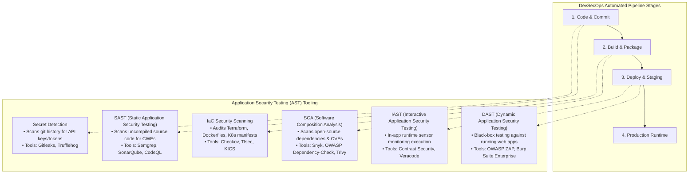

# Technical Reference & Deep Dive: DevSecOps Basics

## 1. Automated Security Testing Tool Taxonomy (AST)

Modern DevSecOps pipelines integrate multiple complementary categories of automated testing:



### AST Comparative Analysis:

| Testing Technology | Execution Mechanism | Ideal Pipeline Stage | Primary Target Flaws |
|---|---|---|---|
| **SAST** (Static) | Analyzes Abstract Syntax Trees (AST) of source code without running it. | Commit / Pull Request (Shift-Left) | SQL Injection, XSS, insecure crypto, hardcoded secrets. |
| **SCA** (Composition) | Compares `package.json`, `pom.xml`, or `requirements.txt` against CVE databases. | Build Stage | Vulnerable third-party open-source libraries (e.g. Log4Shell). |
| **Secret Detection** | Regular expressions and Shannon entropy checks across git commits. | Pre-commit / Pre-receive hooks | AWS access keys, GitHub personal tokens, private RSA keys. |
| **DAST** (Dynamic) | Probes running web application endpoints over HTTP/S with test payloads. | Staging Deployment | Authentication bypasses, server misconfigurations, live SSRF. |
| **IaC Scanning** | Validates declarative cloud templates against security benchmarks. | Pull Request | S3 public read policies, unencrypted EBS volumes, `0.0.0.0/0` SGs. |

---

## 2. Infrastructure as Code (IaC) Scanning Cheat Sheet

```bash
# 1. Scanning Terraform directories using Checkov
checkov -d ./terraform/ --framework terraform

# 2. Scanning Dockerfiles for insecure root user and excessive privileges
checkov -f Dockerfile --framework dockerfile

# 3. Scanning with tfsec (Fast, localized Terraform scanner)
tfsec ./terraform/

# 4. Scanning for leaked credentials across git history with Gitleaks
gitleaks detect --source . --verbose
```

---

## 3. Secure CI/CD Pipeline Configuration (GitHub Actions Example)

```yaml
name: DevSecOps CI Pipeline

on:
  push:
    branches: [ main, develop ]
  pull_request:
    branches: [ main ]

jobs:
  security-audit:
    runs-on: ubuntu-latest
    steps:
      - name: Checkout Code Repository
        uses: actions/checkout@v4
        with:
          fetch-depth: 0

      # Step 1: Secret Scanning
      - name: Gitleaks Secret Scan
        uses: gitleaks/gitleaks-action@v2
        env:
          GITHUB_TOKEN: ${{ secrets.GITHUB_TOKEN }}

      # Step 2: Static Application Security Testing (SAST)
      - name: Semgrep SAST Scan
        run: |
          python3 -m pip install semgrep
          semgrep scan --config auto --error

      # Step 3: Software Composition Analysis (SCA)
      - name: Snyk Dependency Audit
        uses: snyk/actions/node@master
        env:
          SNYK_TOKEN: ${{ secrets.SNYK_TOKEN }}

      # Step 4: Infrastructure as Code (IaC) Scan
      - name: Checkov IaC Audit
        uses: bridgecrewio/checkov-action@master
        with:
          directory: terraform/
          framework: terraform
          soft_fail: false
```

---

## 4. Software Development Lifecycle Evolution Matrix

| Feature | Waterfall | Agile | DevOps | DevSecOps |
|---|---|---|---|---|
| **Delivery Cycle** | 6 to 18 months | 2 to 4 weeks (Sprints) | Continuous (Daily / Hourly) | Continuous & Secure |
| **Team Structure** | Siloed (Dev, QA, Ops separated) | Cross-functional Scrum teams | Unified Dev & Ops | Unified Dev, Sec & Ops |
| **Security Role** | Late manual gatekeeping | Security sprints / tail-end | Often bypassed for speed | Shifted Left, automated |
| **Infrastructure** | Manual bare-metal configuration | Virtualized / Early cloud | IaC, Automated pipelines | Policy-as-Code, Secure IaC |
| **Testing Scope** | Manual end-of-cycle QA | Automated unit/integration tests | Automated CI/CD testing | Integrated SAST, DAST, SCA, Secrets |
| **Cultural Focus** | Process and documentation | Responding to change | Building trust & velocity | Shared responsibility & empathy |
