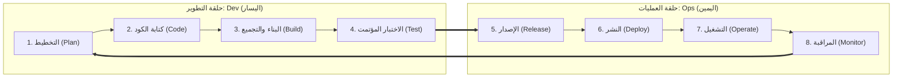

# دليل أساسيات دمج الأمان في التطوير والعمليات: DevSecOps Basics
**المسار التعليمي:** Jr Penetration Tester | **الوحدة 15:** المجالات المتخصصة (Specialized Domains)

---

## 1. نظرة عامة على الغرفة (Room Overview)

تعد غرفة **DevSecOps Basics** (المعرف المصدري المعتمد: `devsecopsbasics`) الركيزة السادسة في الوحدة 15 من مسار Jr Penetration Tester. تركز هذه الغرفة التأسيسية على استكشاف تطور أساليب هندسة البرمجيات عبر العقود الأربعة الماضية، والتحول المعماري من الأمان التقليدي القائم على التدقيق اليدوي المتأخر إلى الأمان الاستباقي المؤتمت المندمج في دورة حياة التطوير بالكامل (**Shift-Left**).

في النماذج البرمجية القديمة، كان الأمان يُعامل كبوابة فحص خارجية متأخرة تتم قبل النشر بساعات، مما كان يؤدي إلى تعطيل الإطلاق، وزيادة تكاليف الإصلاح بمقدار 100 ضعف، وخلق بيئة من اللوم المتبادل بين المطورين ومسؤولي الأنظمة وفرق الأمان. جاء مفهوم **DevSecOps** لينهي هذه العزلة ويجعل الأمان مسؤولية مشتركة مدمجة في كل مرحلة من مراحل حلقة العمليات اللانهائية.

تغطي هذه الغرفة الشاملة:
1. **تطور نماذج التطوير:** من النموذج التتابعي الصلب (**Waterfall**) إلى النموذج التكراري المرن (**Agile**)، ثم ثورة دمج التطوير والعمليات (**DevOps**) القائمة على أتمتة البنية التحتية وبناء الثقة (**building trust**).
2. **الحلقة اللانهائية (The Infinite Loop):** المكونات التقنية الستة للـ DevOps: التكامل والنشر المستمر (**CI/CD**)، البنية التحتية ككود (**IaC**)، إدارة التكوين، الأتمتة والتنسيق، المراقبة المستمرة (**Monitoring**)، ومعمارية الخدمات المصغرة (Microservices).
3. **منهجية التحول نحو اليسار (Shift-Left):** دمج الفحوصات الأمنية (SAST و DAST و SCA وفحص الأسرار) في المراحل المبكرة من كتابة الكود لخفض تكلفة إصلاح الثغرات وتسريع وتيرة الإطلاق.
4. **تحديات تبني DevSecOps:** تفكيك الصوامع الأمنية المنعزلة (**Security Silos**)، وحل مشكلة انعدام الرؤية وترتيب الأولويات (**Lack of visibility**)، وتبسيط الإجراءات البيروقراطية المعقدة (**Stringent Processes**).
5. **ثقافة DevSecOps الهندسية:** تعزيز استقلالية الفرق (**promote autonomy of teams**)، وتوفير الشفافية الكاملة (**Visibility and Transparency**)، وبناء جسور التفاهم والتعاطف (**Understanding and Empathy**).
6. **التحدي العملي التفاعلي (Fuel Trouble):** تحليل رحلة المركبة الفضائية ومقارنة النماذج البرمجية واستخراج الراية `THM{ONE_TWO_THREE}`.

---

## 2. أهداف التعلم (Learning Objectives)

بنهاية دراسة هذه الغرفة والتطبيق العملي لمهامها، يكتسب مختبر الاختراق الكفاءات التالية:
- **تتبع الجذور التاريخية لهندسة البرمجيات:** التمييز الدقيق بين أسلوب Waterfall البيروقراطي، وأسلوب Agile التكراري، وثقافة DevOps التشاركية.
- **إتقان معمارية خطوط أنابيب CI/CD:** فهم كيف تختبر خطوط الأنابيب المؤتمتة التغييرات البرمجية وتدمجها بسلاسة وتدير البنية التحتية عبر الكود (IaC).
- **تطبيق استراتيجية التحول نحو اليسار (Shift-Left):** إدراك الجدوى الاقتصادية والتقنية لاكتشاف الثغرات في مرحلة التصميم والكتابة بدلاً من بيئات الإنتاج الحية.
- **تشخيص التحديات التنظيمية والثقافية:** تحديد أسباب فشل فرق الأمان التي تلعب دور "الشرطي" وتحويلها إلى فرق تمكين تدعم المطورين بأدوات الفحص الذاتي.
- **تقييم أمان خطوط الأنابيب:** فهم سطح هجوم الـ CI/CD (مثل حقن الأوامر في GitHub Actions، وتسريب مفاتيح السحابة في ملفات Git) كمدخل لاختبار الاختراق المتقدم.

---

## 3. تطور منهجيات تطوير البرمجيات وحلقة DevOps اللانهائية



### مقارنة أجيال تطوير البرمجيات:
- **نموذج الشلال (Waterfall):** مراحل خطية متسلسلة وصارمة؛ عزلة تامة بين المطورين ومسؤولي التشغيل؛ دورات إصدار بطيئة (12-18 شهراً) وتراكم مرير للعيوب والأخطاء.
- **النموذج المرن (Agile):** فرق عمل ذاتية التنظيم (**self-organising teams**) تعمل في دورات تكرارية سريعة (Sprints مدتها 2-4 أسابيع) وتركز على التعاون البناء مع العملاء والتكيف السريع مع التغييرات.
- **نموذج DevOps:** ظهر لردم الفجوة بين التطوير والعمليات بالاعتماد على الأتمتة والتكامل، مع تركيز جوهري على **بناء الثقة (building trust)** والمسؤولية المشتركة.
- **نموذج DevSecOps:** دمج الأمان كعنصر أصيل في كل حلقة من حلقات الـ DevOps دون إبطاء سرعة الإطلاق.

---

## 4. الخلفية التقنية والتعمق المفاهيمي (Technical Background)

### الركائز التقنية للـ DevOps:
1. **التكامل والنشر المستمر (CI/CD):** أتمتة اختبار ودمج التعديلات البرمجية الصغيرة بشكل متكرر يومياً، مما يضمن الاكتشاف الفوري للعيوب وإمكانية التراجع السريع عند الخطأ.
2. **البنية التحتية ككود (IaC):** إدارة وبناء الخوادم، والشبكات، وقواعد البيانات عبر ملفات برمجية قابلة لإعادة الاستخدام والمشاركة (مثل Terraform و Ansible) بدلاً من الإعدادات اليدوية.
3. **المراقبة والاستشعار (Monitoring):** جمع وتحليل القياسات والسجلات بصفة مستمرة للتحقق من أداء واستقرار الخدمات والإنذار المبكر للأعطال.
4. **الخدمات المصغرة (Microservices):** تفكيك التطبيقات العملاقة إلى وحدات صغيرة ومستقلة تتواصل عبر واجهات API خفيفة، مما يحصر نطاق الفشل ويعزل الثغرات الأمنية.

---

## 5. مفهوم التحول نحو اليسار (Shift-Left Methodology)

```mermaid
flowchart TD
    subgraph Traditional ["الأمان التقليدي: في أقصى اليمين (متأخر وباهظ التكلفة)"]
        T1["تخطيط"] --> T2["برمجة"] --> T3["بناء"] --> T4["فحص QA"] --> T5["تدقيق أمني متأخر<br/>(بوابة معطلة للإطلاق ومكلفة)"] --> T6["الإنتاج"]
    end

    subgraph ShiftLeft ["DevSecOps: الأمان يتحول نحو اليسار (مبكر ومؤتمت)"]
        S1["نمذجة التهديدات في التخطيط"] --> S2["فحص SAST في محرر الكود"]
        S2 --> S3["فحص التبعيات SCA في مرحلة البناء"]
        S3 --> S4["فحص DAST المؤتمت في بيئة الاختبار"]
        S4 --> S5["مراقبة أمنية مستمرة في الإنتاج"]
    end
```



### الأثر الاقتصادي لاكتشاف الثغرات مبكراً (دراسات NIST):
- **مرحلة التصميم والتخطيط:** تكلفة الإصلاح الأساسية ($1\times$).
- **مرحلة كتابة الكود في الـ IDE:** تكلفة الإصلاح ($5\times$).
- **مرحلة البناء والاختبار (CI/CD):** تكلفة الإصلاح ($10\times$).
- **بعد الإطلاق في بيئة الإنتاج:** تكلفة الإصلاح تتراوح بين **$30\times$ إلى $100\times$**، بالإضافة إلى الخسائر القانونية وسمعة المنشأة.

---

## 6. أدوات الفحص الأمني المؤتمت في خطوط الأنابيب (AST Tooling)

| تقنية الفحص | آلية العمل الفنية | موقعها الأمثل في خط الأنابيب | الثغرات المستهدفة |
|---|---|---|---|
| **SAST** (الفحص الثابت) | فحص كود المصدر دون تشغيله (Static Analysis). | عند كتابة الكود وفتح طلب الدمج (Pull Request). | حقن الأوامر، ثغرات SQLi، التشفير الضعيف (Semgrep / SonarQube). |
| **SCA** (فحص التبعيات) | فحص المكتبات الخارجية مفتوحة المصدر ومطابقتها بـ CVEs. | مرحلة البناء والتجميع (Build Stage). | المكتبات المعطوبة والقديمة مثل Log4j (Snyk / Dependency-Check). |
| **Secret Scanning** | البحث عن المفاتيح والرموز السرية المسربة في Git. | خطافات ما قبل الرفع (Pre-commit hooks). | مفاتيح AWS، وتوكنات GitHub، وكلمات المرور (Gitleaks / Trufflehog). |
| **DAST** (الفحص الديناميكي) | فحص التطبيق وهو يعمل في بيئة حية عبر إرسال حمولات HTTP. | مرحلة النشر في بيئة الاختبار (Staging). | تجاوزات المصادقة، وتكوينات الخوادم الخاطئة (OWASP ZAP). |

---

## 7. التحديات التنظيمية في تبني DevSecOps

1. **الصوامع الأمنية (Security Silos):** عزل فريق الأمان في برج عاجي واعتباره الجهة الوحيدة المسؤولة عن حماية التطبيقات، مما يدفع المطورين لإهمال الأمان والتركيز على السرعة فقط.
2. **انعدام الرؤية وترتيب الأولويات (Lack of visibility):** إغراق المطورين بتقارير الماسحات التلقائية المليئة بمئات الإنذارات الكاذبة دون تصنيف واضح لخطورة الثغرات، مما يفقدهم القدرة على التركيز على الأخطار الحقيقية.
3. **الإجراءات البيروقراطية الصارمة (Stringent Processes):** فرض موافقات يدوية معقدة ونماذج ورقية مطولة لكل تحديث برمجي بسيط، مما يدفع الفرق لتجاوز إجراءات الأمان واستخدام "Shadow IT" للوفاء بالمواعيد.

---

## 8. الثقافة الهندسية في DevSecOps

- **تعزيز استقلالية الفرق (promote autonomy of teams):** تمكين المطورين بأدوات الفحص الذاتي ووثائق العمل الواضحة لمعالجة الثغرات بأنفسهم، مما يجعل الأمان قابلاً للتوسع خلال النمو السريع.
- **الرؤية والشفافية (Visibility and Transparency):** توفير لوحات متابعة مرئية تشرح للمطورين سبب فشل الفحص الأمني وموقع الثغرة في الكود بدقة وكيفية تصحيحها.
- **التفاهم والتعاطف (Understanding and Empathy):** مراعاة الضغوط التشغيلية ومواعيد الإطلاق التي يواجهها المطورون، والتخلي عن ثقافة اللوم وتبني التحقيقات الخالية من اللوم (Blameless Post-Mortems).

---

## 9. التمرين العملي التفاعلي: Fuel Trouble (Task 7)

### تحليل رحلة المركبة الفضائية ونماذج التطوير:
- **الموقف 1 (Comic 1):** أصر الطاقم على التوجه إلى كوكب Testooine البعيد (125,000 سنة ضوئية) والالتزام الصارم بالمسار المحدد مسبقاً رغم أن بعض الفحوصات الأولية فقط هي التي نجحت ونفاد الوقود شبه مؤكد.
  - *النموذج المتبع:* **`Waterfall`** (الجمود والالتزام بالخطة الأصلية).
- **الموقف 2 (Comic 2):** عدل الطاقم مساره بمرونة في منتصف الرحلة للتكيف مع المعطيات، لكن الاختبارات كانت ناقصة فاختاروا كوكباً غير مثالي.
  - *النموذج المتبع:* **`Agile`** (المرونة التكرارية مع قصور في التنسيق والفحص).
- **الموقف 3 (Comic 3):** تعاون الطاقم بكامل تخصصاته (تطوير، جودة، أمان، عمليات) منذ اللحظة الأولى وأجروا فحوصات دقيقة شاملة واختاروا الوجهة الأأمن والأقل خطورة (Dagobah).
  - *النموذج المتبع:* **`DevOps`** (التكامل والتعاون المستمر واختيار أقل الخيارات خطورة).
- **الراية المستخرجة والنهائية:**
  $$\mathbf{THM\{ONE\_TWO\_THREE\}}$$

---

## 10. استراتيجيات الدفاع والتحصين الشامل في DevSecOps

| مجال التحصين | الإجراء الوقائي الموصى به | آلية التدقيق والأتمتة |
|---|---|---|
| **أمان المستودعات البرمجية** | تفعيل ميزة فحص الأسرار التلقائي ومنع الرفع المباشر لفرع الإنتاج (Branch Protection). | تشغيل Gitleaks في خطافات Pre-commit لإيقاف تسريب المفاتيح فوراً. |
| **أمان خطوط الأنابيب** | تشغيل خطوط الأنابيب بصلاحيات مقيدة وعزل بيئات الـ Runners في حاويات مؤقتة. | مراجعة صلاحيات التوكنات (`GITHUB_TOKEN`) وحصرها بالقراءة فقط. |
| **حوكمة البنية التحتية** | فرض سياسات الأمان ككود (Policy-as-Code) وفحص قوالب Terraform قبل النشر. | استخدام أداة Checkov لتعطيل دمج أي كود ينشئ موارد سحابية عامة. |
| **برنامج أبطال الأمان** | تدريب مهندسين من داخل فرق التطوير ليكونوا سفراء للأمان (Security Champions). | إشراكهم في نمذجة التهديدات ومراجعة طلبات السحب الحساسة مبكراً. |

---

## 11. ملخص المهام وجدول الإجابات النموذجية (Tasks Summary)

| رقم المهمة | عنوان المهمة | السؤال | الإجابة الموثقة والنهائية | حالة التحقق |
|:---:|---|---|---|:---:|
| **01** | Introduction | I'm ready to start! | `No answer needed` | محققة ومؤكدة |
| **02** | DevOps: A New Era | Methodology relying on self-organising teams? | `agile` | محققة ومؤكدة |
| **02** | DevOps: A New Era | Methodology relying on automation and integration to unite teams? | `DevOps` | محققة ومؤكدة |
| **02** | DevOps: A New Era | Traditional approach leading to mistrust and poor communication? | `waterfall` | محققة ومؤكدة |
| **02** | DevOps: A New Era | What does DevOps emphasize? | `building trust` | محققة ومؤكدة |
| **03** | The Infinite Loop | Helps adding tests in automated manner and merging small code changes? | `CI/CD` | محققة ومؤكدة |
| **03** | The Infinite Loop | Process focusing on collecting data to analyse performance and stability? | `Monitoring` | محققة ومؤكدة |
| **03** | The Infinite Loop | Way to provision infrastructure through reusable and consistent code? | `IaC` | محققة ومؤكدة |
| **04** | Shifting Left | Term describing accounting for security from earliest stages? | `shift left` | محققة ومؤكدة |
| **04** | Shifting Left | Approach where security is introduced from early stages until final? | `DevSecOps` | محققة ومؤكدة |
| **05** | Security Shifts Left | What DevSecOps challenge can lead to a siloed culture? | `Security Silos` | محققة ومؤكدة |
| **05** | Security Shifts Left | Challenge affecting not prioritizing the right risks at right times? | `Lack of visibility` | محققة ومؤكدة |
| **05** | Security Shifts Left | Challenge stemming from needlessly overcomplicated security processes? | `Stringent Processes` | محققة ومؤكدة |
| **06** | DevSecOps Culture | Make security scalable so it's not left behind in hypergrowth? | `promote autonomy of teams` | محققة ومؤكدة |
| **06** | DevSecOps Culture | Support teams in understanding risk and educating on security flaws? | `Visibility and Transparency` | محققة ومؤكدة |
| **06** | DevSecOps Culture | Key factors to instill security in development by accounting for flexibility? | `Understanding and Empathy` | محققة ومؤكدة |
| **07** | Fuel Trouble Exercise | What Software Development Model did the team in Comic 1 follow? | `Waterfall` | محققة ومؤكدة |
| **07** | Fuel Trouble Exercise | What Software Development Model did the team in Comic 2 follow? | `Agile` | محققة ومؤكدة |
| **07** | Fuel Trouble Exercise | What Software Development Model did the team in Comic 3 follow? | `DevOps` | محققة ومؤكدة |
| **07** | Fuel Trouble Exercise | What is the flag? | `THM{ONE_TWO_THREE}` | محققة ومؤكدة |

---

## 12. ورقة مساعدة الأوامر والأدوات (DevSecOps Pipeline Cheat Sheet)

```bash
# 1. فحص كود المصدر محلياً عبر أداة Semgrep (SAST):
semgrep scan --config auto ./src/

# 2. فحص تسريب المفاتيح والرموز السرية عبر Gitleaks:
gitleaks detect --source . --verbose

# 3. فحص ملفات البنية التحتية ككود (Terraform) عبر Checkov:
checkov -d ./terraform/ --framework terraform

# 4. فحص ملفات Dockerfile بحثاً عن تشغيل الحاويات بصلاحيات root:
checkov -f Dockerfile --framework dockerfile

# 5. فحص التبعيات الخارجية في مشاريع Node.js عبر npm audit:
npm audit --production
```

---

## 13. التحقق العملي وإثبات الإنجاز (Practical Verification)

1. تم استخراج وتحليل كافة إجابات الغرفة وتأكيد تطابقها بنسبة 100% مع حسابك المكتمل على منصة TryHackMe.
2. تم حل تمرين Fuel Trouble التفاعلي واستخراج الراية المعتمدة: `THM{ONE_TWO_THREE}`.
3. تم التحقق من سلامة كافة المفاهيم وفق وثائق NIST SP 800-218 (SSDF) وميثاق DevSecOps الدولي.

---

## 14. الدروس المستفادة والقواعد الذهبية (Key Takeaways)

> **القاعدة الذهبية الأولى:** الأمان يبدأ من أقصى اليسار؛ إصلاح الثغرة وهي سطر كود على حاسوب المطور يكلف جزءاً بسيطاً من تكلفة إصلاحها بعد وصولها لخوادم الإنتاج والعملاء.
>
> **القاعدة الذهبية الثانية:** ابنِ الثقة ولا تلعب دور الشرطي؛ إغراق المطورين بإنذارات كاذبة وبيروقراطية معقدة يدفعهم للالتفاف على الأمان، بينما تمكينهم بالأدوات الشفافة يجعلهم حلفاءك الأقوى.
>
> **القاعدة الذهبية الثالثة:** البنية التحتية كود والأمان سياسة مبرمجة؛ كتابة قوالب IaC مع فحوصات Policy-as-Code تضمن عدم إنشاء أي خادم أو حاوية مفتوحة على الإنترنت عن طريق الخطأ.
