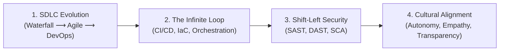

# Task 01: Introduction

## Stage A: Original Task Content & Educational Context
The methodology of building, testing, and delivering software has undergone profound transformations over the last four decades. From the rigid, bureaucratic software delivery lifecycles of the 1970s and 1980s to modern continuous cloud deployments, the way developers write and deploy code directly impacts organizational security posture and penetration testing engagements.

In traditional software development, security was treated as an external afterthought—a final, manual gatekeeping phase conducted days or hours before production release. If security testing uncovered critical vulnerabilities, releases were blocked, leading to severe friction, missed business deadlines, and organizational finger-pointing.

**DevSecOps** reconciles this tension by integrating automated security practices directly into every stage of the software delivery pipeline, shifting security from a bottleneck at the end to a shared responsibility embedded from the beginning.

### Core Learning Objectives:
- Trace the historical evolution of software development models: Waterfall $\rightarrow$ Agile $\rightarrow$ DevOps $\rightarrow$ DevSecOps.
- Understand the core architectural practices comprising the modern DevOps **Infinite Loop** ($\infty$): CI/CD, Infrastructure as Code (IaC), Configuration Management, Orchestration, Monitoring, and Microservices.
- Deconstruct the **Shift-Left** methodology and analyze how early vulnerability detection drastically reduces remediation costs.
- Analyze the primary operational challenges facing DevSecOps adoptions: Security Silos, Lack of Visibility & Prioritization, and Stringent Processes.
- Cultivate a true DevSecOps engineering culture rooted in team autonomy, radical transparency, and cross-discipline empathy.
- Solve the interactive capstone exercise (*Fuel Trouble*) and extract the verification flag.

---

## Stage B: Independent Thinking & OpSec Considerations
1. **Pipeline Exploitation as an Initial Access Vector:** For penetration testers and red teamers, modern CI/CD pipelines represent high-value attack surfaces. Compromising source code repositories (GitHub, GitLab), pipeline runners (Jenkins, GitHub Actions), or artifact registries grants attackers direct access to production secrets, API tokens, and automatic software deployment mechanisms.
2. **Shift-Left Awareness in Penetration Testing:** Penetration testing in a DevSecOps enterprise differs from legacy black-box assessments. Instead of testing static production releases once a year, testers frequently test staging environments integrated with automated pull-request triggers, validating that automated pipeline scanners (SAST, SCA) do not suffer from blind spots.

---

## Stage C: Guided Hints (Tiered Progression)
- **Tier 1 Hint:** Read the introduction to understand the foundational objectives and context of DevSecOps.
- **Tier 2 Hint:** No technical queries or inputs are required for this foundational onboarding task.
- **Tier 3 (Platform Prompt):** Click the "Completed" button to proceed.

---

## Stage D: Complete Practical Solution & Technical Deep Dive
Review the roadmap. The DevSecOps engineering progression spans four interconnected domains:

---

## Stage E: Final Answer & Key Values
- **Question:** *I'm ready to start!*
- **Answer:** `No answer needed`

---

## Stage F: Practical Verification & Proof of Work
Clicking completed verifies task completion on the TryHackMe platform.

---

## Stage G: Key Educational Takeaway
DevSecOps is not merely a collection of automated scanning tools; it is an organizational and cultural paradigm that makes security an inherent, continuous quality of software engineering rather than an external obstacle.
