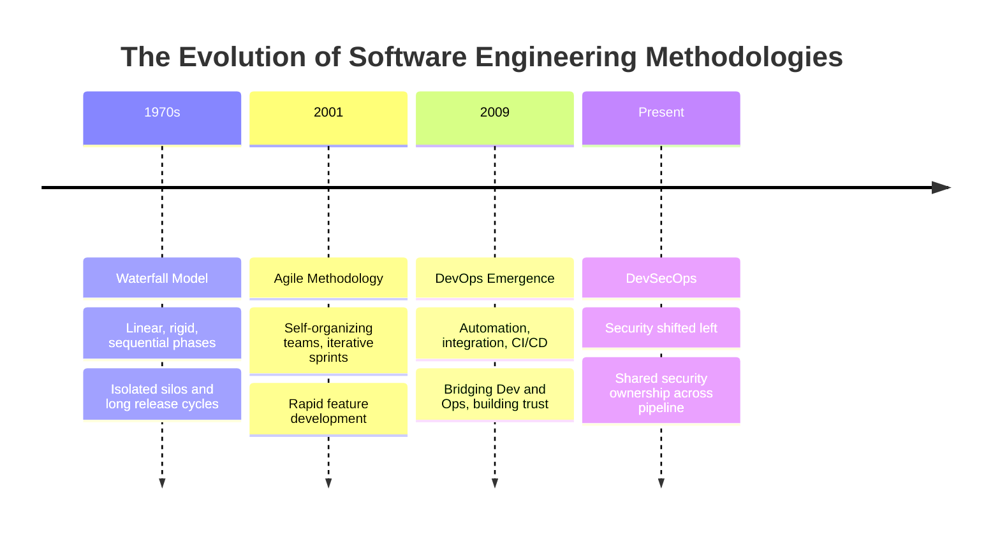

# Task 02: DevOps: A New Era

## Stage A: Original Task Content & Educational Context
To appreciate DevSecOps, one must understand the operational failures of the software methodologies that preceded it.

### The Waterfall Model (1970s):
The Waterfall approach organized software delivery into rigid, linear phases:
$$\text{Requirements} \longrightarrow \text{Design} \longrightarrow \text{Implementation} \longrightarrow \text{Verification (QA)} \longrightarrow \text{Maintenance}$$
- **Operational Reality:** Development teams wrote code for months or years in isolation before handing it over to Quality Assurance (QA), who subsequently tossed compiled releases over the wall to System Administrators / Operations to deploy and maintain on bare-metal servers.
- **Failures:** High communication friction, zero feedback loops, prolonged release cycles (12–18 months), massive backlogs of defects, and mutual mistrust between developers (incentivized to ship new features) and operations engineers (incentivized to maintain system stability).

### The Agile Revolution (Early 2000s):
In 2001, seventeen software leaders drafted the *Agile Manifesto*, establishing four core values:
1. Individuals and interactions over processes and tools.
2. Working software over comprehensive documentation.
3. Customer collaboration over contract negotiation.
4. Responding to change over following a plan.
- **Key Characteristics:** Replaced monolithic lifecycles with cross-functional, **self-organising teams** delivering working software in rapid 2-to-4-week iterations ("sprints").
- **Limitations:** While Agile unified developers and product managers, Operations and Infrastructure remained isolated downstream, struggling to keep pace with rapid deployment demands.

### The Emergence of DevOps (2008–2009):
Coined from discussions between Andrew Clay Shafer and Patrick Debois (formalized at the inaugural *DevOpsDays* conference in Ghent, Belgium in 2009), **DevOps** emerged to bridge the divide between Development ("Dev") and Operations ("Ops").
- **Core Philosophy:** DevOps relies heavily on **automation and integration** to break down silos, unite previously fractured teams, and drive profound cultural change.
- **The Core Emphasis:** DevOps fundamentally emphasizes **building trust**, shared accountability, and mutual empathy across all engineering disciplines.

### Declarative vs. Imperative Infrastructure:
- **Imperative (Procedural):** The operator issues step-by-step commands instructing the system *how* to reach a desired state (e.g., shell scripts running `apt update && apt install apache2`). Error-prone and difficult to reproduce.
- **Declarative:** The engineer defines *what* the final desired end-state should look like (e.g., Terraform or Kubernetes manifests), and the automation platform independently figures out the state transitions required to achieve that target state.

---

## Stage B: Independent Thinking & OpSec Considerations
1. **Speed vs. Governance:** DevOps dramatically accelerates release velocity (from annual releases to multiple deployments per day). However, rapid releases without embedded security controls propagate vulnerabilities into production at machine speed.
2. **Infrastructure Drift:** In organizations lacking declarative Infrastructure as Code (IaC), manual hotfixes applied during outages create "configuration drift," resulting in unpatched production servers differing from test environments.

---

## Stage C: Guided Hints (Tiered Progression)
- **Q1 Tier 1 Hint:** What software development methodology introduced in the early 2000s relies on self-organizing teams and rapid sprints?
- **Q1 Tier 2 Hint:** One word starting with "A": agile.
- **Q2 Tier 1 Hint:** What methodology combines development and operations through automation and integration?
- **Q2 Tier 2 Hint:** DevOps.
- **Q3 Tier 1 Hint:** What sequential, top-down project management model created isolated silos and mistrust in the 1970s?
- **Q3 Tier 2 Hint:** Think of falling water: waterfall.
- **Q4 Tier 1 Hint:** What two-word cultural quality does DevOps emphasize to unite fractured teams?
- **Q4 Tier 2 Hint:** "building ...".

---

## Stage D: Complete Practical Solution & Technical Deep Dive
### Methodology Evolution Timeline:

---

## Stage E: Final Answer & Key Values
- **Question 1:** *What methodology relies on self-organising teams that focus on constructive collaboration?*
  - **Answer:** `agile`
- **Question 2:** *What methodology relies on automation and integration to drive cultural change and unite teams?*
  - **Answer:** `DevOps`
- **Question 3:** *What traditional approach to project management led to mistrust and poor communication between development teams?*
  - **Answer:** `waterfall`
- **Question 4:** *What does DevOps emphasize?*
  - **Answer:** `building trust`

---

## Stage F: Practical Verification & Proof of Work
1. `agile` is defined by self-organizing teams and adaptive collaboration.
2. `DevOps` unites teams through automation and integration.
3. `waterfall` is the traditional sequential approach that created silos.
4. DevOps places primary cultural emphasis on `building trust`. All verified on the platform.

---

## Stage G: Key Educational Takeaway
DevOps is not a job title or a software tool; it is a collaborative culture founded on building trust between engineers and operators, powered by automation to enable rapid, reliable software delivery.
