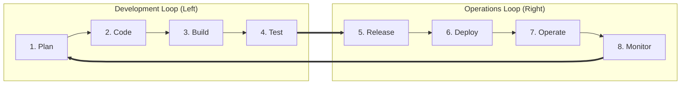

# Task 03: The Infinite Loop

## Stage A: Original Task Content & Educational Context
DevOps is visualized as an **infinite loop** ($\infty$), representing an unbroken, continuous cycle of engineering activities:
$$\text{Plan} \longrightarrow \text{Code} \longrightarrow \text{Build} \longrightarrow \text{Test} \longrightarrow \text{Release} \longrightarrow \text{Deploy} \longrightarrow \text{Operate} \longrightarrow \text{Monitor} \longrightarrow \text{(Feeds back to Plan)}$$

### Core Technical Pillars of the DevOps Loop:
1. **Continuous Integration & Continuous Deployment (CI/CD):**
   - **Continuous Integration (CI):** Developers commit small, incremental code changes to a shared repository multiple times daily. Automated build pipelines immediately compile the code and execute automated test suites (unit tests, integration tests) to detect defects early.
   - **Continuous Deployment (CD):** Once changes pass all automated quality gates, they are automatically deployed directly to production environments (or staged for one-click release).
2. **Infrastructure as Code (IaC):**
   - Managing and provisioning virtual machines, cloud networks, storage buckets, and firewall rules through machine-readable definition files (e.g., Terraform, Ansible, Vagrant, AWS CloudFormation) rather than manual GUI configuration.
   - Ensures immutable, reproducible, and version-controlled environments across development, testing, and production.
3. **Configuration Management:**
   - Tracking and enforcing desired system states across fleets of servers, preventing configuration drift and unauthorized modifications.
4. **Orchestration:**
   - Automating complex multi-tier workflows, container scaling, and self-healing across distributed clusters (e.g., Kubernetes orchestrating container pod lifecycles).
5. **Monitoring & Observability:**
   - Continuously collecting metrics, traces, and system logs to evaluate the real-time performance, availability, and stability of services, triggering automated remediation or alerting operators before outages occur.
6. **Microservices Architecture:**
   - Decoupling monolithic software applications into loosely coupled, independently deployable services communicating over lightweight APIs.

---

## Stage B: Independent Thinking & OpSec Considerations
1. **Attacking CI/CD Workflows:** The CI/CD engine is the factory floor of modern software. If an attacker gains write access to a GitHub repository or compromises a CI runner token, they can inject malicious code directly into production releases (e.g., SolarWinds SUNBURST attack).
2. **IaC Security Scanning:** Penetration testers should audit IaC templates (`.tf`, Dockerfiles) using static scanners (such as Checkov or Tfsec) to identify exposed S3 buckets, hardcoded AWS keys, or `0.0.0.0/0` security group rules before infrastructure is ever provisioned.

---

## Stage C: Guided Hints (Tiered Progression)
- **Q1 Tier 1 Hint:** What 4-letter acronym describes the automated pipeline that merges small code changes and runs tests automatically?
- **Q1 Tier 2 Hint:** CI/... (Continuous Integration / Continuous Deployment).
- **Q2 Tier 1 Hint:** What operational activity collects telemetry and performance data to ensure systems remain stable?
- **Q2 Tier 2 Hint:** One word starting with "M": Monitoring.
- **Q3 Tier 1 Hint:** What 3-letter acronym denotes managing and provisioning infrastructure through code?
- **Q3 Tier 2 Hint:** Infrastructure as Code abbreviation: IaC.

---

## Stage D: Complete Practical Solution & Technical Deep Dive
### The DevOps Infinite Loop Architecture:

### Pillar Summary Matrix:

| DevOps Pillar | Core Technology | Primary Security Benefit |
|---|---|---|
| **CI/CD** | Jenkins, GitHub Actions, GitLab CI | Automates security regression testing on every pull request. |
| **IaC** | Terraform, Ansible, OpenTofu | Eliminates human error; allows programmatic security policy enforcement. |
| **Monitoring** | Prometheus, Grafana, Datadog | Real-time anomaly detection and operational health tracking. |
| **Microservices** | Docker, Kubernetes, Envoy | Limits failure domains and isolates security blast radiuses. |

---

## Stage E: Final Answer & Key Values
- **Question 1:** *What helps in adding tests in an automated manner and deals with the frequent merging of small code changes?*
  - **Answer:** `CI/CD`
- **Question 2:** *What process focuses on collecting data to analyse the performance and stability of services?*
  - **Answer:** `Monitoring`
- **Question 3:** *What is a way to provision infrastructure through reusable and consistent pieces of code?*
  - **Answer:** `IaC`

---

## Stage F: Practical Verification & Proof of Work
1. `CI/CD` is the pipeline discipline automating testing and code merging.
2. `Monitoring` is the operational discipline tracking service performance.
3. `IaC` (Infrastructure as Code) provisions infrastructure via code. All verified on the platform.

---

## Stage G: Key Educational Takeaway
The infinite loop links development and operations into an unbroken feedback cycle. By utilizing CI/CD and IaC, organizations transition from slow, error-prone manual deployments to repeatable, automated software delivery.
