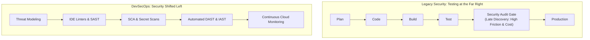

# Task 04: Shifting Left

## Stage A: Original Task Content & Educational Context
In traditional software delivery models, security was evaluated at the far right of the timeline—just prior to production deployment or during post-release annual penetration tests. This legacy approach created massive organizational bottlenecks:
- **Cost Exponential:** A defect identified during the planning/design phase costs minimal effort to fix (modifying an architecture diagram or API specification). That same defect discovered in production costs up to **100 times more** to remediate, requiring emergency hotfixes, database schema migrations, regression testing, and customer breach notifications.
- **Velocity Friction:** When a security team discovers critical vulnerabilities days before a scheduled go-live, they must either block the release (angering executive leadership and business stakeholders) or allow vulnerable software into production (incurring unacceptable technical debt and breach risk).

### The "Shift Left" Paradigm:
The term **Shift Left** refers to the practice of moving security practices, automated testing, and compliance validation earlier ("to the left") along the software development timeline—beginning at requirements gathering, architecture design, and the developer's local integrated development environment (IDE).

### Defining DevSecOps:
**DevSecOps** is the comprehensive development approach where security is systematically integrated from the earliest planning stages through coding, building, testing, deploying, and operating in an unbroken, automated feedback loop.

---

## Stage B: Independent Thinking & OpSec Considerations
1. **Developer Tooling Integration:** Security tests that run only in nightly builds or separate security portals are ignored by developers. Successful shift-left implementations place immediate feedback directly inside the developer's workflow: pre-commit Git hooks, IDE linters, and pull-request comments that fail fast with actionable fix advice.
2. **False Positive Thresholds:** If automated shift-left security scanners (such as SAST tools) generate high false-positive rates, developers quickly disable the checks or bypass CI/CD gates. High-fidelity rules must take precedence over raw check volume.

---

## Stage C: Guided Hints (Tiered Progression)
- **Q1 Tier 1 Hint:** What two-word directional term describes moving security earlier in the timeline?
- **Q1 Tier 2 Hint:** "shift ...".
- **Q2 Tier 1 Hint:** What 9-letter term blends Development, Security, and Operations into a unified lifecycle?
- **Q2 Tier 2 Hint:** DevSecOps.

---

## Stage D: Complete Practical Solution & Technical Deep Dive
### Traditional Security vs. Shift-Left DevSecOps:

### The Relative Cost of Bug Remediation (NIST Study):
- **Planning / Design Phase:** $1\times$ baseline cost.
- **Coding Phase:** $5\times$ baseline cost.
- **Build / Integration Testing:** $10\times$ baseline cost.
- **Post-Release / Production:** **$30\times$ to $100\times$** baseline cost (plus potential regulatory fines and brand damage).

---

## Stage E: Final Answer & Key Values
- **Question 1:** *What term is it used to describe accounting for security from the earliest stages in a development lifecycle?*
  - **Answer:** `shift left`
- **Question 2:** *What is the development approach where security is introduced from the early stages of a development lifecycle until the final stages?*
  - **Answer:** `DevSecOps`

---

## Stage F: Practical Verification & Proof of Work
1. `shift left` is the universally recognized term for moving security upstream in the SDLC.
2. `DevSecOps` is the formal engineering paradigm introducing security across all stages. Both verified on the platform.

---

## Stage G: Key Educational Takeaway
Shifting left is both an engineering practice and a financial imperative. Identifying security flaws at the code and commit stage minimizes remediation costs, prevents project delays, and keeps production deployments secure.
