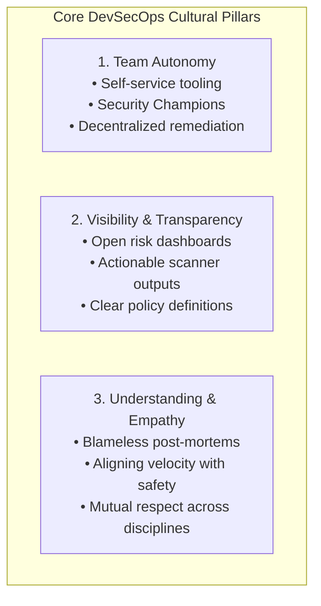

# Task 06: DevSecOps Culture

## Stage A: Original Task Content & Educational Context
Technology and automation alone cannot create DevSecOps; lasting transformation requires establishing a healthy, collaborative engineering culture based on three foundational principles:

### 1. Promoting Team Autonomy:
- **The Reality of Engineering Ratios:** In modern enterprises and high-growth startups, developers outnumber security staff by 50:1 or 100:1. If every code release requires manual sign-off by a dedicated security engineer, security becomes a crippling bottleneck that is inevitably bypassed.
- **The Cultural Shift:** To make security scalable during hypergrowth, organizations must **promote autonomy of teams**. This means providing development squads with self-service automated tools, clear security standards, runbooks, and delegated authority to identify, evaluate, and remediate security vulnerabilities independently.

### 2. Visibility and Transparency:
- **Demystifying Risk:** Security cannot operate as an opaque "black box" that issues arbitrary rejections.
- **Actionable Feedback:** When an automated pipeline check fails (e.g., an automated SAST rule flags an SQL injection risk or hardcoded secret), the system must provide **Visibility and Transparency**. Developers should be provided with transparent dashboards, direct links to the failing line of code, clear vulnerability descriptions, and practical code snippets showing how to fix the issue.

### 3. Understanding and Empathy:
- **Aligning Competing Incentives:** Developers are measured on shipping functional features rapidly and maintaining system uptime; security professionals are measured on mitigating organizational risk.
- **Collaborative Respect:** A successful culture requires **Understanding and Empathy**. Security teams must understand the technical constraints, sprint deadlines, and operational pressures faced by developers. Conversely, developers must empathize with the legal, financial, and reputational consequences of security breaches. Building processes that account for flexibility and mutual respect ensures long-term collaboration.

---

## Stage B: Independent Thinking & OpSec Considerations
1. **Blameless Post-Mortems:** When an incident occurs in a DevSecOps culture, the investigation focuses on *how* the system permitted the mistake (missing automated checks, ambiguous documentation, poor defaults) rather than punishing the individual developer who wrote the line of code.
2. **Security as a Quality Metric:** Frame security findings not as personal failures, but as standard software defects (bugs) that are tracked, prioritized, and resolved through the same Jira/GitLab backlog as feature requests.

---

## Stage C: Guided Hints (Tiered Progression)
- **Q1 Tier 1 Hint:** How do you scale security when developers vastly outnumber security engineers? By promoting what quality in teams?
- **Q1 Tier 2 Hint:** "promote autonomy of teams".
- **Q2 Tier 1 Hint:** What two qualities ensure developers understand why a build failed and can see the risk clearly?
- **Q2 Tier 2 Hint:** "Visibility and ...".
- **Q3 Tier 1 Hint:** What two empathetic qualities allow security and engineering to understand each other's pressures?
- **Q3 Tier 2 Hint:** "Understanding and ...".

---

## Stage D: Complete Practical Solution & Technical Deep Dive
### The Cultural Pillars of DevSecOps:

---

## Stage E: Final Answer & Key Values
- **Question 1:** *How can you make security scalable so it's not left behind when start ups face hypergrowth or in large corporations?*
  - **Answer:** `promote autonomy of teams`
- **Question 2:** *How can you support teams in understanding risk and educating on security flaws?*
  - **Answer:** `Visibility and Transparency`
- **Question 3:** *What are key factors to successfully instill security in the development process by accounting for flexibility?*
  - **Answer:** `Understanding and Empathy`

---

## Stage F: Practical Verification & Proof of Work
1. `promote autonomy of teams` allows security to scale horizontally.
2. `Visibility and Transparency` empowers engineers to prioritize and remediate risks.
3. `Understanding and Empathy` bridges the gap between velocity and security. All verified on the platform.

---

## Stage G: Key Educational Takeaway
A mature DevSecOps culture replaces bureaucratic gatekeeping with team empowerment. When developers are given the tools, training, and autonomy to take ownership of security, security becomes an intrinsic part of the engineering identity.
