# Technical Reference & Deep Dive: Specialized Domains Synthesis

## 1. Cross-Domain Security Synthesis (Module 15)

Module 15 broadened the penetration tester's operational scope beyond standard web and network boundaries into six specialized domains:
1. **Wireless & Physical Security:** Radio frequency boundaries (Wi-Fi 802.11, Bluetooth 2.4 GHz, NFC 13.56 MHz, RFID 125 kHz). Air is an untrusted medium.
2. **Mobile Application Security:** Local client architecture (Android APK / iOS IPA), OS kernel sandboxing per UID, and runtime instrumentation (Frida / Objection).
3. **Cloud Security Fundamentals:** Identity-driven infrastructure, Shared Responsibility Models, link-local metadata exploitation (IMDSv1 SSRF), and wildcard IAM policies.
4. **LLM Pentesting:** Natural language prompt injection (Direct & Indirect), safety alignment jailbreaks (Crescendo, Base64 encoding), and agentic RCE escalation.
5. **The Blue Team Perspective:** Defensive telemetry (Splunk, Windows Event IDs 4624/4625/4688/1102), SOC triage fatigue, and climbing David Bianco's Pyramid of Pain to deny adversary TTPs.
6. **DevSecOps Basics:** Shifting security left into automated CI/CD pipelines, Infrastructure as Code (IaC) auditing, and breaking down cultural silos.

---

## 2. Advanced Multi-Domain Attack Chaining Scenarios

In enterprise penetration tests and red team engagements, initial compromises in specialized domains routinely chain into complete corporate takeover:

```mermaid
flowchart TD
    subgraph Scenario1 ["Attack Chain 1: Mobile ⟶ Cloud ⟶ Production"]
        Mob["1. Decompile Mobile APK<br/>(Hardcoded Secrets in Java)"] --> CloudKey["2. Harvest Staging AWS Key<br/>(Over-permissive S3 Policy)"]
        CloudKey --> Bucket["3. Access Open Cloud Bucket<br/>(Download Production DB Backup)"]
    end

    subgraph Scenario2 ["Attack Chain 2: Wireless ⟶ Web ⟶ LLM ⟶ RCE"]
        Wifi["1. Wi-Fi Evil Twin / Deauth<br/>(Intercept Internal Portal Traffic)"] --> SSRF["2. Intercept Internal LLM API<br/>(Port 11434 /api/show)"]
        SSRF --> PromptInj["3. Execute Prompt Injection<br/>(LangChain exec sink CVE-2023-29374)"]
        PromptInj --> Shell["4. Internal Server Shell (RCE)"]
    end

    subgraph Scenario3 ["Attack Chain 3: CI/CD Pipeline ⟶ SOC Evasion"]
        Git["1. Compromise GitHub Actions Token<br/>(Workflow Injection)"] --> IaC["2. Deploy Backdoored Terraform<br/>(Open SG 0.0.0.0/0)"]
        IaC --> SOC["3. Throttle Actions below SOC Alert Thresholds<br/>(Evade Event ID 4688 Alerts)"]
    end
```

---

## 3. Transition to Module 16: Python Scripting Basics

Having mastered specialized attack vectors and defensive telemetry, the penetration tester reaches the crucial threshold where manual point-and-click tools and off-the-shelf scanners are no longer sufficient. 

Real-world penetration testing requires writing custom automation, automating network socket communication, parsing proprietary API responses, crafting targeted exploit payloads, and scripting custom brute-force engines. Module 16 transitions the student into **Python Scripting Basics**, covering:
- Python core syntax, data structures, and script architecture.
- Network socket programming and banner grabbing.
- Automated web scraping and HTTP request handling (`requests`).
- Authoring custom penetration testing scripts for reconnaissance, password spraying, and exploit delivery.
