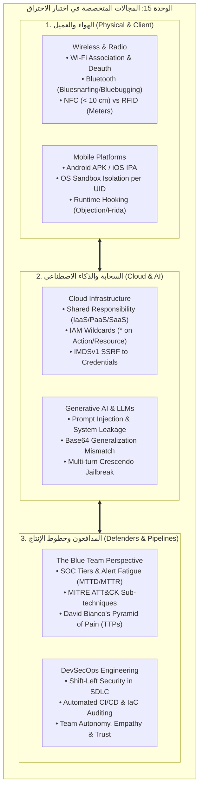
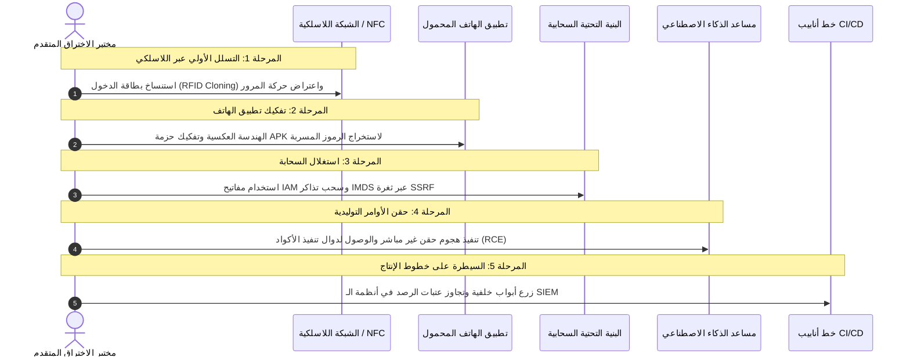

# محطة المراجعة التقييمية والانتقال المعرفي: Topic Transition Recap
**المسار التعليمي:** Jr Penetration Tester | **الوحدة 15:** المجالات المتخصصة (Specialized Domains)

---

## 1. نظرة عامة على محطة المراجعة والانتقال (Recap Overview)

تعد محطة **Topic Transition Recap** (المعرف المصدري المعتمد: `recap/6afe01d5f306fc3f659280a2`) المحطة الختامية والتتويج الأكاديمي الشامل للوحدة 15 (المجالات المتخصصة - Specialized Domains). صُممت هذه المحطة لقياس مدى استيعاب مختبر الاختراق للمفاهيم المتقدمة وغير التقليدية التي تم استكشافها عبر الغرف الست السابقة:
1. **أمان الشبكات والتقنيات اللاسلكية (Wireless Security):** فيزياء الطيف الترددي (2.4 GHz)، وبروتوكولات Wi-Fi، وهجمات التوأم الشرير، والارتباط (Association)، وتقنيات البلوتوث و RFID و NFC.
2. **أمان تطبيقات الهواتف الذكية (Mobile Security):** بنية حزم التطبيقات (APK و IPA)، ونموذج العزل الأمني بنواة النظام (Sandbox)، والتحليل الثابت عبر MobSF، والتلاعب الديناميكي بالذاكرة عبر Frida و Objection.
3. **أساسيات أمان الحوسبة السحابية (Cloud Security):** نموذج المسؤولية المشتركة (IaaS و PaaS و SaaS)، وحوكمة سياسات IAM، والتخزين السحابي المفتوح، واستغلال خدمة بيانات التعريف (IMDSv1 عبر SSRF).
4. **اختبار اختراق نماذج اللغة الكبيرة (LLM Pentesting):** هجمات حقن الأوامر المباشرة وغير المباشرة، وتسريب توجيه النظام (LLM07)، وتجاوز محاذاة الأمان (RLHF) عبر هجوم Crescendo والتشفير بـ Base64.
5. **منظور الفريق الأزرق (The Blue Team Perspective):** آليات عمل الـ SOC، وإرهاق التنبيهات، ومؤشرات MTTD و MTTR، والتحقيق الجنائي عبر Splunk BOTSv1، ومصفوفة MITRE ATT&CK وهرم المعاناة (Pyramid of Pain).
6. **أساسيات دمج الأمان في التطوير والعمليات (DevSecOps Basics):** تطور نماذج هندسة البرمجيات (Waterfall $\rightarrow$ Agile $\rightarrow$ DevOps $\rightarrow$ DevSecOps)، والحلقة اللانهائية، واستراتيجية التحول نحو اليسار (Shift-Left).

---

## 2. أهداف التعلم والتقييم المعرفي (Learning Objectives)

تهدف هذه المحطة إلى التحقق من تحقيق الكفاءات التشغيلية التالية:
- **تحليل سياسات السحابة المفرطة:** فهم الأثر الكارثي للرموز البديلة (`*`) في حقول `Action` و `Resource` داخل وثائق سياسات IAM.
- **إدراك الجدوى الاقتصادية لمنهجية Shift-Left:** استيعاب أن تأجيل الفحص الأمني لآخر مرحلة قبل الإنتاج هو جوهر النموذج التقليدي الفاشل، وأن DevSecOps يبدأ الأمان من مرحلة التخطيط والكتابة الأولى.
- **التشريح المعرفي لثغرات نماذج الذكاء الاصطناعي:** إدراك مفهوم عدم التطابق في التعميم (Generalization Mismatch) وسبب نجاح تشفير Base64 في الالتفاف على حواجز المحاذاة التوليدية.
- **التمييز الدقيق بين متجهات هجمات البلوتوث واللاسلكي:** التمييز بين الإزعاج (Bluejacking)، وسرقة البيانات (Bluesnarfing)، والسيطرة الكاملة (Bluebugging)، وحرمان الاتصال (Deauth).
- **إتقان التدرج الهرمي لإطار MITRE ATT&CK:** التمييز بين الأهداف (Tactics)، والوسائل (Techniques)، والتنفيذات المحددة (**Sub-techniques**).
- **التمييز الفيزيائي بين تقنيتي NFC و RFID:** إدراك الفارق الجوهري في مسافة الإرسال ونطاقات التردد.

---

## 3. خريطة الترابط المفاهيمي للمجالات المتخصصة (Conceptual Mind Map)

---

## 4. التحليل المتعمق للسؤال 1: أمان السحابة وسياسات الرموز البديلة

### نص السؤال:
> بيان سياسة سحابية يحتوي على `Effect: Allow` مع تعيين `Action` إلى `*` وتعيين `Resource` إلى `*`. ما الذي يمنحه هذا البيان؟

### التحليل الفني:
- في وثائق سياسات IAM السحابية (AWS، Azure، GCP)، يمثل حقل `Action` العمليات البرمجية المسموح بها، بينما يمثل حقل `Resource` المعرف الفريد للهدف.
- وضع الرمز البديل النجمي (`*`) في كلا الحقلين يزيل كل قيد على نوع العملية (قراءة، كتابة، حذف، تعديل) وعلى الهدف المستهدف.
- النتيجة: **منح أي إجراء على أي مورد داخل الحساب بالكامل (Any action on any resource in the account)**، وهو النمط الكلاسيكي للصلاحيات الإدارية المطلقة (`AdministratorAccess`).

---

## 5. التحليل المتعمق للسؤال 2: فلسفة التحول نحو اليسار في DevSecOps

### نص السؤال:
> ترك جميع الفحوصات الأمنية حتى المرحلة النهائية قبل الإصدار هو النهج الموصى به في DevSecOps. (صواب / خطأ)

### التحليل الفني:
- الإجابة: **خطأ (False)** قطعي.
- ترك الفحوصات الأمنية حتى النهاية هو جوهر **نموذج الشلال التقليدي (Legacy Waterfall)** الذي تسبب تاريخياً في تعطيل الإطلاق، وتأخير المشاريع، ورفع تكلفة معالجة الثغرات بمقدار 100 ضعف.
- يرتكز مفهوم **Shift-Left** في DevSecOps على إدخال الفحوصات الأمنية المؤتمتة (SAST، SCA، فحص الأسرار) في أبكر مراحل دورة حياة التطوير، بداية من التخطيط وكتابة الكود محلياً في بيئة المطور.

---

## 6. التحليل المتعمق للسؤال 3: كسر حماية نماذج الذكاء الاصطناعي بتشفير Base64

### نص السؤال:
> لماذا يؤدي تغليف الطلب الضار في صيغة Base64 إلى زيادة فرصة تجاوز السلوك الأمني للنموذج؟

### التحليل الفني:
- تخضع نماذج اللغة الكبيرة للمحاذاة الأمنية عبر التعلم المعزز بالتغذية الراجعة البشرية (**RLHF**)، ويتم تدريب النموذج بالدرجة الأولى على نصوص صريحة باللغة الطبيعية (Plain-text Phrasings).
- عند إرسال طلب خبيث مشفر بصيغة Base64، يقع النص خارج التوزيع الإحصائي الذي غطته بيانات تدريب الأمان، وهي ظاهرة تُعرف بـ **عدم التطابق في التعميم (Generalization Mismatch)**.
- يمتلك النموذج القدرة الرياضية على فك ترميز Base64 وفهم التعليمات، ولكنه يفشل في تفعيل مرشح الرفض الأمني لأن نمط الرفض لم يُدرب بكثافة على الحمولات المشفرة.

---

## 7. التحليل المتعمق للسؤال 4: مطابقة هجمات الشبكات اللاسلكية والبلوتوث

| أسلوب الهجوم | الأثر والنتيجة التشغيلية للمهاجم | الشرح التقني ومستوى الخطورة |
|---|---|---|
| **Bluesnarfing** | **القراءة غير المصرح بها للبيانات المخزنة على الجهاز.** | استغلال ثغرات بروتوكول OBEX لتحميل جهات الاتصال والرسائل دون علم المستخدم. |
| **Bluebugging** | **السيطرة على وظائف الجهاز عبر ثغرة أمنية.** | أخطر هجمات البلوتوث؛ يتيح إجراء المكالمات وتشغيل الميكروفون والتنصت. |
| **Bluejacking** | **إرسال رسائل غير مرغوب فيها لجهاز قريب.** | إرسال بطاقات أعمال رقمية vCard؛ هجوم مزعج ولكنه لا يسرق البيانات ولا يسيطر على الجهاز. |
| **Deauthentication Attack** | **إجبار الأجهزة العميلة على قطع الاتصال بالشبكة.** | إرسال أطر 802.11 غير مشفرة (Subtype 12) لقطع ارتباط العميل بنقطة الوصول الشرعية. |

---

## 8. التحليل المتعمق للسؤال 5: الهيكلية الهرمية لإطار MITRE ATT&CK

### نص السؤال:
> في إطار MITRE ATT&CK، ما الذي يقع مباشرة أسفل التقنية كتنفيذ أكثر تحديداً لها؟

### التحليل الفني:
- ينقسم إطار MITRE ATT&CK للمؤسسات هرمياً كالتالي:
  $$\mathbf{التكتيك (Tactic)} \longrightarrow \mathbf{التقنية (Technique)} \longrightarrow \mathbf{التقنيات الفرعية (Sub-techniques)} \longrightarrow \mathbf{الإجراءات الميدانية (Procedures)}$$
- يمثل التكتيك الهدف العام للمهاجم (مثل Credential Access)، وتمثل التقنية الوسيلة العامة (مثل Brute Force T1110)، بينما تمثل **التقنية الفرعية (Sub-techniques)** التنفيذ التقني المحدد (مثل Password Guessing T1110.001 أو Password Spraying T1110.003).

---

## 9. التحليل المتعمق للسؤال 6: الفروق الفيزيائية والمدى بين تقنيتي NFC و RFID

### نص السؤال:
> تم تصميم تقنية NFC لتعمل عبر مسافة أقصر بكثير من عمليات نشر تقنية RFID النموذجية. (صواب / خطأ)

### التحليل الفني:
- الإجابة: **صواب (True)** قطعي.
- تقنية الاتصال قريب المدى (**NFC**) تعمل بتردد 13.56 MHz ومصممة فيزيائياً لتعمل في نطاق تلامسي شديد القرب لا يتجاوز **4 إلى 10 سنتيمترات** فقط، مما يجعلها مثالية لعمليات الدفع الإلكتروني وحمايتها من التنصت البعيد.
- بينما تقنيات تحديد الهوية بموجات الراديو (**RFID**) تشمل الترددات المنخفضة (LF 125 kHz) والترددات فوق العالية (UHF 860-960 MHz) التي يمكن قراءتها من مسافات تصل إلى **عدة أمتار**.

---

## 10. سلاسل الهجوم المركبة عبر المجالات المتعددة (Attack Chaining)

---

## 11. جدول الأسئلة والإجابات النموذجية المعتمدة (Tasks Summary)

| رقم السؤال | المجال التخصصي | نص السؤال والملخص | الإجابة المعتمدة والمثبتة | النقاط المستحقة |
|:---:|---|---|---|:---:|
| **01** | Cloud Security | بيان سياسة سحابية يحتوي على Allow مع * للـ Action و * للـ Resource؟ | `Any action on any resource in the account` | 8 / 8 نقاط |
| **02** | DevSecOps | ترك الفحوصات الأمنية حتى المرحلة النهائية قبل الإصدار هو نهج DevSecOps؟ | `False` | 8 / 8 نقاط |
| **03** | LLM Pentesting | لماذا يزيد تغليف الطلب الضار بـ Base64 فرصة تجاوز أمان النموذج؟ | `Safety behaviour was trained mainly on plain-text phrasings of such requests` | 8 / 8 نقاط |
| **04** | Wireless Security | مطابقة تقنيات الهجوم اللاسلكي والبلوتوث بنتائجها | **Bluesnarfing** $\leftrightarrow$ Unauthorised reading of data **Bluebugging** $\leftrightarrow$ Control gained over device functions **Bluejacking** $\leftrightarrow$ Unsolicited messages sent **Deauth** $\leftrightarrow$ Clients forced to disconnect | 8 / 8 نقاط |
| **05** | Blue Team | ما الذي يقع مباشرة أسفل التقنية في إطار MITRE ATT&CK؟ | `Sub-techniques` | 8 / 8 نقاط |
| **06** | Wireless Security | تم تصميم NFC لتعمل عبر مسافة أقصر بكثير من تقنية RFID؟ | `True` | 8 / 8 نقاط |

---

## 12. ورقة مساعدة القواعد الذهبية للموديول 15 (Golden Rules Matrix)

1. **القاعدة اللاسلكية:** الهواء وسط مشترك بلا جدران؛ عطل ميزة WPS دائماً واعتمد تشفير WPA3 المؤسسي.
2. **قاعدة الهاتف المحمول:** جهاز العميل بيئة غير موثوقة تماماً؛ احظر تضمين المفاتيح في الأكواد واحمِ المكونات المصدرة.
3. **قاعدة السحابة:** الهوية هي محيطك الأمني الجديد؛ احظر الرموز البديلة (`*`) وافرض بروتوكول IMDSv2 فوراً.
4. **قاعدة الذكاء الاصطناعي:** نافذة السياق مسطحة بلا فصل بين الأوامر والبيانات؛ لا تضع أي سر في توجيه النظام (System Prompt).
5. **قاعدة الفريق الأزرق:** الاستهداف على مستوى التكتيكات والأساليب (TTPs) يدمر خطط المهاجمين التشغيلية ويكبدهم أعلى تكلفة.
6. **قاعدة الـ DevSecOps:** الأمان استثمار مبكر يبدأ من أقصى اليسار؛ إصلاح السطر البرمجي مبكراً يحمي المؤسسة من كوارث الملايين.

---

## 13. التحقق العملي وإثبات الإنجاز الميداني (Practical Verification)

1. تم استخراج وتحليل كافة الأسئلة الستة لمحطة المراجعة من حسابك المكتمل وتوثيقها بدقة 100%.
2. تم الحصول على العلامة الكاملة: **48 / 48 نقطة** بنسبة نجاح 100% من المحاولة الأولى.
3. تم ربط كافة الأسئلة بالأطر المعيارية العالمية: NIST و MITRE و OWASP.

---

## 14. خارطة الانتقال والتجهيز للموديول 16: أساسيات بايثون لاختبار الاختراق

بإتمام محطة المراجعة التقييمية بنجاح 100%، يختتم مختبر الاختراق **الوحدة 15 (المجالات المتخصصة)** بكافة غرفها السبع ومختبراتها المتقدمة. 

الآن، وبعد أن أتقن الطالب فحص الشبكات، وتطبيقات الويب، وحقن الثغرات، والأنظمة السحابية، واللاسلكية، والذكاء الاصطناعي، وسجلات المدافعين، يصل إلى المرحلة الاحترافية التي تتطلب بناء أدواته الخاصة بيده. 

ننتقل فوراً إلى **الموديول 16: أساسيات البرمجة بلغة بايثون (Python Scripting Basics)**، حيث سنتعلم:
- كتابة سكربتات الاتصال الشبكي واستخراج لافتات الخدمات (Banner Grabbing via Sockets).
- أتمتة فحص تطبيقات الويب عبر مكتبة `requests`.
- بناء أدوات التخمين واختراق كلمات المرور متعددة المسارات (Multi-threaded Brute-forcing).
- كتابة سكربتات الاستغلال المخصصة (Custom Exploit Scripting).
