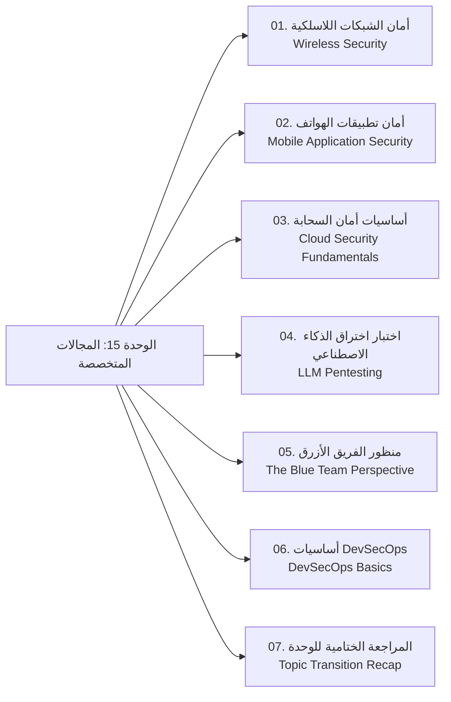

# الوحدة 15: المجالات المتخصصة في الأمن السيبراني (Specialized Domains)
**المسار التعليمي:** Jr Penetration Tester | **الوحدة 15:** المجالات المتخصصة

---

## 1. نظرة عامة على الوحدة (Module Overview)

مع التطور المتسارع للبنى التحتية التكنولوجية، لم يعد اختبار الاختراق مقتصراً على الشبكات التقليدية وتطبيقات الويب؛ بل توسع ليشمل بيئات متقدمة ومعقدة تشكل عصب المنظومات الرقمية الحديثة.

تفتح **الوحدة 15: المجالات المتخصصة (Specialized Domains)** الأبواب أمام ستة مسارات أمنية تخصصية بالغة الأهمية:
1. **أمان الشبكات اللاسلكية (Wireless Security):** بروتوكولات الاتصال الراديوي 802.11، وتطور تشفير Wi-Fi، وهجمات Evil Twin، وتقنيات Bluetooth، و RFID/NFC، وشبكات إنترنت الأشياء (IoT).
2. **أمان تطبيقات الهواتف الذكية (Mobile Application Security):** معماريات Android و iOS، والهندسة العكسية لملفات APK/IPA، واستخدام أدوات التفتيش الديناميكي مثل Frida و Objection.
3. **أساسيات أمان الحوسبة السحابية (Cloud Security Fundamentals):** نماذج المسؤولية المشتركة في AWS و Azure و GCP، وثغرات الهوية وإدارة الوصول (IAM)، وسوء تكوين خدمات التخزين السحابي (S3 Buckets)، وخدمات البيانات الوصفية (Metadata IMDS).
4. **اختبار اختراق نماذج اللغة الكبيرة والذكاء الاصطناعي (LLM Pentesting):** معايير OWASP لأمان نماذج الذكاء الاصطناعي التوليدي، وهجمات Prompt Injection المباشرة وغير المباشرة، وتسميم بيانات التدريب.
5. **منظور الفريق الأزرق والدفاع السيبراني (The Blue Team Perspective):** مراكز العمليات الأمنية (SOC)، وهندسة الكشف عبر أنظمة SIEM، والتحليل الجنائي للذاكرة والشبكات، والتكامل البنفسجي (Purple Teaming).
6. **أساسيات دمج الأمان في دورة التطوير (DevSecOps Basics):** ثقافة التحول نحو اليسار (Shift-Left)، والأتمتة الأمنية في مسارات CI/CD، وفحوصات SAST و DAST و SCA ومنع تسريب الأسرار.
7. **المراجعة الختامية للوحدة (Topic Transition Recap):** تقييم شامل للتأكد من استيعاب كافة المفاهيم الميدانية والنظرية للوحدة.

---

## 2. هيكلية الغرف والمختبرات المعتمدة في الوحدة

