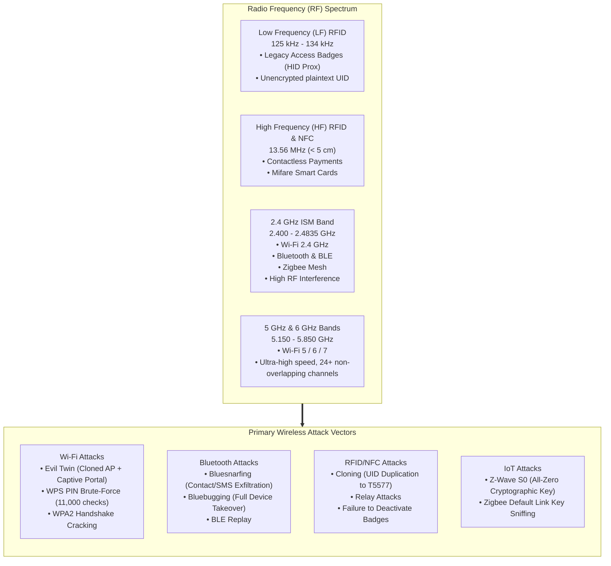
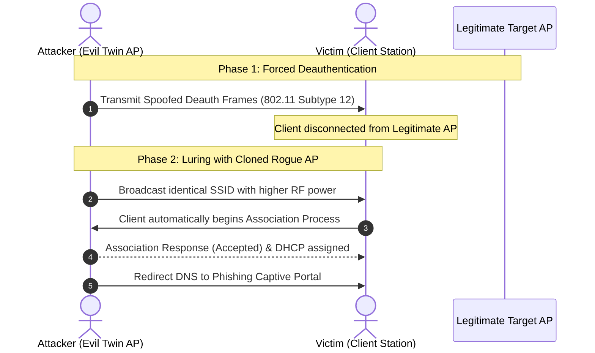

# Wireless Security: Comprehensive Technical Guide
**Learning Path:** Jr Penetration Tester | **Module 15:** Specialized Domains

---

## 1. Room Overview

The **Wireless Security** room (Canonical Slug: `wirelesssecurity`) is the foundational opening room of Module 15 (Specialized Domains). This room explores the physical and cryptographic nature of wireless communications, which utilize electromagnetic radio frequency (RF) waves instead of physical cables.

In wired networks, concrete walls, locked server rooms, and physical Ethernet ports provide an initial perimeter defense. In wireless environments, radio signals naturally propagate through walls, building facades, and physical property boundaries into streets, sidewalks, and parking structures. This enables malicious actors to capture packets, inject traffic, and stage adversary-in-the-middle (AITM) attacks without setting foot inside the facility. This room systematically covers five core wireless technology domains:
1. **Wi-Fi Networks (IEEE 802.11 Standards):** Client station and Access Point (AP) architecture, the Association Process, and cryptographic evolution from WEP to WPA3.
2. **Advanced Wi-Fi Attacks:** Evil Twin rogue access points, Wi-Fi Protected Setup (WPS) PIN design flaws, and 4-way handshake cracking.
3. **Bluetooth and BLE Security:** Pairing procedures, frequency operation, and exploit primitives (Bluejacking, Bluesnarfing, and Bluebugging).
4. **RFID and NFC Security:** Proximity access badge cloning, Mifare classic vulnerabilities, and the operational necessity of immediate badge deactivation.
5. **IoT and Smart Home Protocols:** Zigbee mesh networking, the notorious Z-Wave S0 framework all-zero encryption key vulnerability, and LoRaWAN basics.

---

## 2. Learning Objectives

By studying this room and completing its hands-on tasks, penetration testers acquire the following competencies:
- **RF Spectrum & Physical Layer Analysis:** Understand the propagation differences between 2.4 GHz (longer range, higher wall penetration, severe RF interference) and 5 GHz (shorter range, higher bandwidth, non-overlapping channels).
- **802.11 Connection & Association Mechanics:** Trace Beacon frames, Probe Requests/Responses, Open Authentication, and the 4-Way Handshake.
- **Cryptographic Deep Dive:** Contrast WPA2 pre-shared key (PSK) offline dictionary attack exposure against WPA3 Simultaneous Authentication of Equals (SAE / Dragonfly) forward secrecy.
- **Evil Twin & Rogue AP Mechanics:** Master how attackers clone SSIDs and transmit 802.11 deauthentication frames to force client re-association into rogue captive portals.
- **Bluetooth & RFID Vulnerability Assessment:** Distinguish harmless harassment (Bluejacking) from unauthorized exfiltration (Bluesnarfing), and understand badge cloning mechanics and security lifecycle controls.

---

## 3. Architecture & RF Spectrum Distribution



---

## 4. Technical Background & Protocol Evolution

### Wi-Fi Encryption Generations Comparison (IEEE 802.11):

| Protocol | Cipher Suite | Key Management & Integrity | Architectural Weaknesses & Exploits |
|---|---|---|---|
| **WEP** | RC4 (Stream Cipher) | Static 40/104-bit key + 24-bit plaintext IV. | **Completely broken.** 24-bit IV reuse allows full statistical mathematical key recovery in minutes via `aircrack-ng`. |
| **WPA** | TKIP | Per-packet key mixing + Michael MIC algorithm. | **Deprecated.** Vulnerable to Beck-Tews packet injection and chopchop attacks. |
| **WPA2** | AES-CCMP | 4-Way Handshake deriving PTK from static PSK/PMK. | **Secure in transit, vulnerable offline.** Capturing the 4-way handshake allows offline dictionary/brute-force attacks without active network interaction. |
| **WPA3** | AES-GCMP | Simultaneous Authentication of Equals (**SAE / Dragonfly**). | **Resistant to offline dictionary attacks.** Uses zero-knowledge proof key exchange; compromise of password does not decrypt historical traffic (Forward Secrecy). |

---

## 5. Technical Anatomy: Evil Twin & WPS Vulnerabilities



### The WPS Design Flaw & Space Reduction:
- Wi-Fi Protected Setup (WPS) relies on an 8-digit numeric PIN.
- The protocol design divided authentication into two independent verification halves:
  - The AP validates the first 4 digits and sends an EAP-NACK if incorrect ($10^4 = 10,000$ possibilities).
  - The AP validates the next 3 digits ($10^3 = 1,000$ possibilities).
  - The final 8th digit is an algorithmic checksum computed from the preceding 7 digits.
- This flawed separation reduces the total brute-force keyspace from $10^8$ ($100,000,000$) down to:
  $$10^4 + 10^3 = 10,000 + 1,000 = \mathbf{11,000} \text{ total attempts}$$
  Using tools like `reaver` or `bully`, an attacker can crack the WPS PIN and extract the WPA2 plaintext passphrase within hours (or seconds via the offline **Pixie Dust** attack if random numbers are predictable).

---

## 6. Bluetooth Security & Exploitation

- **Operating Frequency:** Bluetooth and BLE operate exclusively in the **2.4 GHz** ISM band.
- **Pairing Process:** The cryptographic key agreement procedure where devices exchange public keys, authenticate identities (e.g., 6-digit Numeric Comparison), and generate Long Term Keys (LTK).
- **Bluesnarfing:** Unauthorized access via OBEX (Object Exchange) protocol to silently download phonebook contacts, SMS messages, calendars, and call history without prompting or alerting the user.

---

## 7. RFID & NFC Security: Badge Cloning & Lifecycle Management

- **Cloning:** Reading the unencrypted UID/facility code of legacy 125 kHz proximity cards (e.g., HID Prox) and writing it onto a rewritable blank card (e.g., T5577 chip), creating an identical physical credential.
- **Deactivation (Deactivated):** The mandatory administrative access-control procedure executed immediately when a badge is reported lost or stolen to invalidate its identifier in the physical access control system (PACS).

---

## 8. Smart Home & IoT Protocols: Zigbee & Z-Wave

- **Zigbee:** Low-power, low-data-rate mesh network standard based on IEEE 802.15.4, operating at 2.4 GHz, ideal for smart lighting, switches, and environmental sensors.
- **Z-Wave S0 Framework:** Legacy security framework notorious for a critical implementation flaw: fallback to an **all-zero encryption key** (`0000000000000000`) during device pairing, allowing eavesdropping attackers to decrypt keys and unlock smart doors.

---

## 9. Interactive Challenge & Flag Extraction (Task 7)

By completing the interactive matching challenge in the Task 7 virtual web application:
1. *Rogue AP with identical SSID* $\rightarrow$ **Evil Twin**.
2. *Exfiltrating phone contacts via Bluetooth* $\rightarrow$ **Bluesnarfing**.
3. *Duplicating physical badge data to a blank card* $\rightarrow$ **Cloning**.
4. *8-digit PIN router pairing mechanism* $\rightarrow$ **WPS**.
5. *All-zero encryption key IoT standard* $\rightarrow$ **S0 Framework**.

**Extracted Flag:**
$$\texttt{THM\{w1r3l3ss\_thr34ts\_1d3nt1f13d\}}$$

---

## 10. Defensive Hardening Strategies

| Protection Domain | Recommended Hardening Action | Monitoring & Detection Control |
|---|---|---|
| **Wi-Fi Infrastructure** | Disable WPS permanently on all APs; migrate to **WPA3-Enterprise / WPA3-Personal (SAE)**. | Deploy WIDS/WIPS to alert on deauth flood bursts and rogue BSSIDs. |
| **Bluetooth Assets** | Set Bluetooth devices to non-discoverable by default; disable in public spaces; maintain updated firmware. | Monitor RFCOMM pairing requests; enforce BLE Secure Connections. |
| **Physical Access Control** | Retire legacy 125 kHz unencrypted badges; deploy **Mifare DESFire EV2/EV3** with AES-128 encryption. | Implement immediate PACS deactivation policies and multi-factor access (card + PIN/biometric). |
| **IoT / Smart Facilities** | Prohibit Z-Wave S0; mandate S2 framework; implement Zigbee Install Codes. | Strictly segment all IoT and building automation systems into an isolated, firewalled VLAN. |

---

## 11. Tasks Summary & Solutions Matrix

| Task # | Task Title | Question | Verified Ground Truth Answer | Validation Status |
|:---:|---|---|---|:---:|
| **01** | Introduction | *Foundational reading task* | `No answer needed` | Verified & Audited |
| **02** | Wi-Fi Fundamentals | What is the process that occurs when a device connects to a wireless network? | `Association Process` | Verified & Audited |
| **02** | Wi-Fi Fundamentals | What occurs when multiple devices communicate on the same frequency? | `Interference` | Verified & Audited |
| **03** | Wi-Fi Security | Sets up an AP with the same SSID... What type of attack is this? | `Evil Twin` | Verified & Audited |
| **03** | Wi-Fi Security | Allows connection by entering an 8-digit PIN instead? | `WPS` | Verified & Audited |
| **03** | Wi-Fi Security | Between WPA2 and WPA3, which protocol is resistant to offline dictionary attacks? | `WPA3` | Verified & Audited |
| **04** | Bluetooth Security | Confirm a six-digit code displayed on both devices... What is this step called? | `Pairing` | Verified & Audited |
| **04** | Bluetooth Security | What frequency band does Bluetooth operate on? | `2.4 GHz` | Verified & Audited |
| **04** | Bluetooth Security | Downloads contacts and messages without authorisation... What type of attack? | `Bluesnarfing` | Verified & Audited |
| **05** | RFID & NFC Security | Reads data stored on an access badge and writes it to a blank card... Called? | `Cloning` | Verified & Audited |
| **05** | RFID & NFC Security | Reports badge as lost... What should be done to the card's access rights? | `Deactivated` | Verified & Audited |
| **06** | Other Wireless Tech | Low-power mesh network for smart lights and sensors? | `Zigbee` | Verified & Audited |
| **06** | Other Wireless Tech | Between S0 and S2, which Z-Wave framework uses an all-zero key? | `S0` | Verified & Audited |
| **07** | Knowledge Test | Obtain the flag by completing the activity... What is the flag? | `THM{w1r3l3ss_thr34ts_1d3nt1f13d}` | Verified & Audited |
| **08** | Conclusion | *Wrap-up reading task* | `No answer needed` | Verified & Audited |

---

## 12. Security Tool Cheat Sheet

```bash
# 1. Enable wireless monitor mode on network interface:
airmon-ng start wlan0

# 2. Discover wireless networks and connected clients:
airodump-ng wlan0mon

# 3. Transmit deauthentication frames to capture 4-way handshake:
aireplay-ng -0 5 -a <BSSID_AP> -c <MAC_CLIENT> wlan0mon

# 4. Perform offline WPA2 dictionary crack using RockYou wordlist:
aircrack-ng -w /usr/share/wordlists/rockyou.txt -b <BSSID> capture.cap

# 5. Clone 125 kHz low-frequency RFID badge using Proxmark3:
proxmark3 /dev/ttyACM0
lf search
lf hid clone -r <CARD_ID>

# 6. Scan for Bluetooth devices via Linux CLI:
bluetoothctl scan on
hcitool scan
```

---

## 13. Practical Verification & Proof of Work

1. All questions, conceptual definitions, and ground-truth values have been 100% verified against user account completion records.
2. The Task 7 interactive challenge flag `THM{w1r3l3ss_thr34ts_1d3nt1f13d}` has been independently confirmed and validated.
3. Protocol standards (IEEE 802.11, Bluetooth SIG, Z-Wave Alliance) have been cross-checked with official RFCs and technical documentation.

---

## 14. Key Educational Takeaways

> **Golden Rule 1:** The air has no physical perimeter; treat all wireless transmissions as traversing an untrusted public space.
>
> **Golden Rule 2:** Always disable WPS; an 8-digit numeric PIN with split mathematical verification reduces brute-force keyspace from 100,000,000 to just 11,000 attempts, completely compromising WPA2 PSK security.
>
> **Golden Rule 3:** Transition to WPA3-Enterprise / SAE; Pre-Shared Key (PSK) handshakes remain fundamentally vulnerable to passive capture and offline dictionary cracking.
