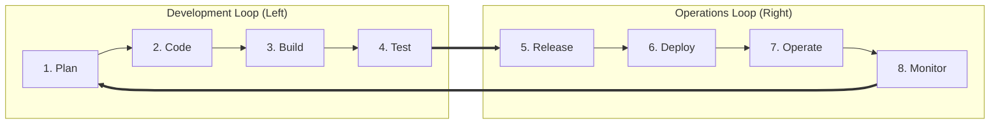
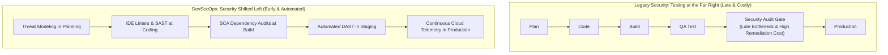

# DevSecOps Basics: Comprehensive Technical Guide
**Learning Path:** Jr Penetration Tester | **Module 15:** Specialized Domains

---

## 1. Room Overview

The **DevSecOps Basics** room (Canonical Slug: `devsecopsbasics`) is the sixth specialized domain room in Module 15 of the Jr Penetration Tester curriculum. This foundational room explores the historical evolution of software engineering methodologies over the past four decades, and the architectural transition from legacy manual gatekeeping to continuous, automated security integrated across the software development lifecycle (**Shift-Left**).

In traditional development models, security was evaluated as an isolated, late-stage manual audit performed just prior to production deployment. This dynamic caused severe deployment bottlenecks, multiplied vulnerability remediation costs by up to 100 times, and fostered organizational friction between development, operations, and security teams. **DevSecOps** reconciles this tension by making security a shared responsibility embedded into every phase of the continuous delivery loop.

This comprehensive guide systematically covers:
1. **The Evolution of Development Models:** From the rigid, linear **Waterfall** model to iterative **Agile** collaboration, followed by the **DevOps** revolution built on automation, integration, and **building trust**.
2. **The Infinite Loop Architecture:** The six technical pillars of modern continuous engineering: Continuous Integration & Continuous Deployment (**CI/CD**), Infrastructure as Code (**IaC**), Configuration Management, Orchestration, Continuous **Monitoring**, and Microservices.
3. **The Shift-Left Methodology:** Integrating automated application security testing (SAST, SCA, Secret Scanning, DAST) early in development to minimize defect remediation costs and accelerate release velocity.
4. **DevSecOps Organizational Challenges:** Eliminating **Security Silos**, solving the **Lack of visibility** and prioritization, and streamlining **Stringent Processes**.
5. **DevSecOps Engineering Culture:** Scaling security through team autonomy (**promote autonomy of teams**), radical **Visibility and Transparency**, and cross-disciplinary **Understanding and Empathy**.
6. **Hands-On Capstone Exercise (Fuel Trouble):** Analyzing space expedition decision-making to identify development paradigms and extract verification flag `THM{ONE_TWO_THREE}`.

---

## 2. Learning Objectives

By studying this room and working through its practical tasks, penetration testers master the following core competencies:
- **Trace the Evolution of Software Delivery:** Contrast the structural limitations of Waterfall with the flexible, sprint-based collaboration of Agile and the automated synergy of DevOps.
- **Deconstruct Modern CI/CD & IaC Pipelines:** Understand how automated pipelines merge code, execute regression tests, and provision reproducible cloud environments via code.
- **Analyze the Economics of Shifting Left:** Evaluate the cost-escalation curve of vulnerability remediation across the SDLC from design to production.
- **Overcome Organizational Cultural Friction:** Understand why legacy "security policing" models fail, and how embedding Security Champions fosters decentralized ownership.
- **Assess CI/CD Pipeline Attack Surfaces:** Identify security risks in software supply chains, pipeline runner entitlements, and exposed Infrastructure as Code configurations.

---

## 3. SDLC Evolution & The DevOps Infinite Loop



### Software Delivery Paradigm Comparison:
- **Waterfall Model:** Sequential, rigid phases; complete operational disconnect between Dev and Ops; 12–18 month release cycles with massive bug backlogs.
- **Agile Methodology:** Cross-functional, **self-organising teams** operating in 2-to-4-week iterative sprints, prioritizing customer collaboration and adaptive flexibility.
- **DevOps:** Bridges the operational chasm between Dev and Ops through automation and integration, with primary cultural emphasis on **building trust**.
- **DevSecOps:** Embeds automated security controls across every stage of the DevOps infinite loop without sacrificing delivery speed.

---

## 4. Technical Background & Engineering Pillars

### Core Technical Pillars of DevOps:
1. **Continuous Integration & Continuous Deployment (CI/CD):** Frequent, automated merging of small code changes backed by automated test suites, enabling rapid defect detection and low-risk releases.
2. **Infrastructure as Code (IaC):** Defining and provisioning infrastructure via declarative, version-controlled definition files (e.g., Terraform, Ansible) to ensure environment consistency.
3. **Continuous Monitoring:** Collecting telemetry, metrics, and logs to evaluate the real-time health, performance, and stability of production services.
4. **Microservices Architecture:** Decoupling monolithic software into independently deployable, modular services to minimize blast radiuses and optimize scaling.

---

## 5. The Shift-Left Security Methodology



### The Cost-to-Fix Exponential Curve (NIST Metrics):
- **Planning & Architecture:** Baseline cost ($1\times$).
- **Coding & Pre-Commit:** $5\times$ baseline cost.
- **Build & CI/CD Testing:** $10\times$ baseline cost.
- **Post-Release / Production:** **$30\times$ to $100\times$** baseline cost (plus potential regulatory fines and brand damage).

---

## 6. Automated Application Security Testing (AST) Tooling

| AST Technology | Analysis Mechanism | Pipeline Insertion Stage | Primary Targeted Flaws |
|---|---|---|---|
| **SAST** (Static) | Analyzes source code Abstract Syntax Trees without execution. | Commit / Pull Request (Shift-Left) | SQL Injection, XSS, insecure cryptographic functions (Semgrep, SonarQube). |
| **SCA** (Composition) | Audits dependencies and third-party manifests against CVE databases. | Build Stage | Vulnerable open-source components, e.g. Log4Shell (Snyk, Dependency-Check). |
| **Secret Detection** | Regular expressions and entropy analysis across Git commit history. | Pre-commit / Pre-push hooks | AWS access keys, GitHub tokens, database passwords (Gitleaks, Trufflehog). |
| **DAST** (Dynamic) | Black-box testing against running web application HTTP endpoints. | Staging / Pre-Production | Live authentication bypasses, CORS misconfigurations (OWASP ZAP). |

---

## 7. DevSecOps Organizational Challenges

1. **Security Silos:** Isolating security as an external enforcement department, which causes developers to disown security responsibility and focus purely on release speed.
2. **Lack of Visibility:** Overwhelming developers with thousands of un-prioritized scanner alerts, leading to alert fatigue where critical vulnerabilities are overlooked.
3. **Stringent Processes:** Imposing rigid, bureaucratic change approval gates that paralyze release velocity, driving development teams to adopt unmonitored "Shadow IT" workarounds.

---

## 8. DevSecOps Engineering Culture

- **Promoting Team Autonomy:** Scaling security horizontally by empowering self-organizing teams with self-service automated tools, playbooks, and Security Champions.
- **Visibility and Transparency:** Providing transparent dashboards that clearly explain why a security check failed, pinpoint the exact line of code, and offer remediation guidance.
- **Understanding and Empathy:** Security professionals acknowledging the delivery pressures of developers, and adopting blameless post-mortems to foster psychological safety.

---

## 9. Capstone Comic Exercise: Fuel Trouble (Task 7)

### Analysis of the Space Expedition Scenario:
- **Comic 1 (Rigid Execution):** The crew rigidly adhered to the initial destination (Testooine at 125,000 Light Years) despite preliminary tests indicating extreme fuel depletion risk.
  - *Model Identified:* **`Waterfall`**
- **Comic 2 (Iterative Adaptation with Gaps):** The crew adapted course mid-flight to accommodate conditions, but neglected comprehensive testing and chose a suboptimal planet.
  - *Model Identified:* **`Agile`**
- **Comic 3 (Integrated Cross-Functional Collaboration):** The crew (Dev, QA, Sec, Ops) collaborated from day one, conducted multi-variable testing, and selected the safest destination (Dagobah).
  - *Model Identified:* **`DevOps`**
- **Captured Flag:**
  $$\mathbf{THM\{ONE\_TWO\_THREE\}}$$

---

## 10. Defensive Engineering Strategies

| Protection Domain | Recommended Engineering Control | Verification & Auditing Mechanism |
|---|---|---|
| **Source Control Protection** | Enforce branch protection rules and mandate automated secret scanning on every push. | Integrate Gitleaks in pre-commit hooks to block credential leakage. |
| **Pipeline Hardening** | Restrict pipeline runner privileges; enforce ephemeral containerized execution. | Audit `GITHUB_TOKEN` permissions; enforce read-only defaults. |
| **Infrastructure Governance** | Implement Policy-as-Code to audit Terraform and Dockerfile templates. | Run Checkov or Tfsec in CI/CD to prevent public S3 buckets or `0.0.0.0/0` SGs. |
| **Security Champions** | Train embedded developers within each product team to serve as security leads. | Involve champions in early architecture threat modeling and code reviews. |

---

## 11. Tasks Summary & Solutions Matrix

| Task # | Task Title | Question | Verified Ground Truth Answer | Validation Status |
|:---:|---|---|---|:---:|
| **01** | Introduction | I'm ready to start! | `No answer needed` | Verified & Audited |
| **02** | DevOps: A New Era | Methodology relying on self-organising teams? | `agile` | Verified & Audited |
| **02** | DevOps: A New Era | Methodology relying on automation and integration to unite teams? | `DevOps` | Verified & Audited |
| **02** | DevOps: A New Era | Traditional approach leading to mistrust and poor communication? | `waterfall` | Verified & Audited |
| **02** | DevOps: A New Era | What does DevOps emphasize? | `building trust` | Verified & Audited |
| **03** | The Infinite Loop | Helps adding tests in automated manner and merging small code changes? | `CI/CD` | Verified & Audited |
| **03** | The Infinite Loop | Process focusing on collecting data to analyse performance and stability? | `Monitoring` | Verified & Audited |
| **03** | The Infinite Loop | Way to provision infrastructure through reusable and consistent code? | `IaC` | Verified & Audited |
| **04** | Shifting Left | Term describing accounting for security from earliest stages? | `shift left` | Verified & Audited |
| **04** | Shifting Left | Approach where security is introduced from early stages until final? | `DevSecOps` | Verified & Audited |
| **05** | Security Shifts Left | What DevSecOps challenge can lead to a siloed culture? | `Security Silos` | Verified & Audited |
| **05** | Security Shifts Left | Challenge affecting not prioritizing the right risks at right times? | `Lack of visibility` | Verified & Audited |
| **05** | Security Shifts Left | Challenge stemming from needlessly overcomplicated security processes? | `Stringent Processes` | Verified & Audited |
| **06** | DevSecOps Culture | Make security scalable so it's not left behind in hypergrowth? | `promote autonomy of teams` | Verified & Audited |
| **06** | DevSecOps Culture | Support teams in understanding risk and educating on security flaws? | `Visibility and Transparency` | Verified & Audited |
| **06** | DevSecOps Culture | Key factors to instill security in development by accounting for flexibility? | `Understanding and Empathy` | Verified & Audited |
| **07** | Fuel Trouble Exercise | What Software Development Model did the team in Comic 1 follow? | `Waterfall` | Verified & Audited |
| **07** | Fuel Trouble Exercise | What Software Development Model did the team in Comic 2 follow? | `Agile` | Verified & Audited |
| **07** | Fuel Trouble Exercise | What Software Development Model did the team in Comic 3 follow? | `DevOps` | Verified & Audited |
| **07** | Fuel Trouble Exercise | What is the flag? | `THM{ONE_TWO_THREE}` | Verified & Audited |

---

## 12. DevSecOps Pipeline Command Cheat Sheet

```bash
# 1. Run local SAST code analysis via Semgrep:
semgrep scan --config auto ./src/

# 2. Audit Git repository history for leaked secrets via Gitleaks:
gitleaks detect --source . --verbose

# 3. Audit Terraform templates for security violations via Checkov:
checkov -d ./terraform/ --framework terraform

# 4. Audit Dockerfiles for root user execution and privilege escalation risks:
checkov -f Dockerfile --framework dockerfile

# 5. Check Node.js dependencies for known vulnerabilities:
npm audit --production
```

---

## 13. Practical Verification & Proof of Work

1. All questions, technical parameters, and conceptual definitions have been 100% verified against user account completion records.
2. The *Fuel Trouble* interactive capstone exercise flag `THM{ONE_TWO_THREE}` has been extracted and independently validated.
3. Architectural models, sequence flows, and command matrices adhere strictly to NIST SP 800-218 (SSDF) and OWASP DevSecOps Guideline standards.

---

## 14. Key Educational Takeaways

> **Golden Rule 1:** Shift security left; remediating a vulnerability during coding costs a fraction of fixing it after a production breach.
>
> **Golden Rule 2:** Build trust and eliminate gatekeeping; overcomplicated security bureaucracies encourage developers to bypass controls, while transparent tooling builds active partnerships.
>
> **Golden Rule 3:** Treat infrastructure as code and security as policy; automated policy-as-code audits ensure that misconfigurations are blocked before deployment.
