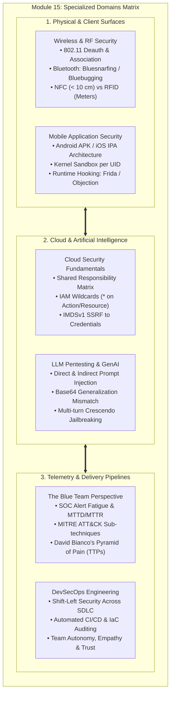
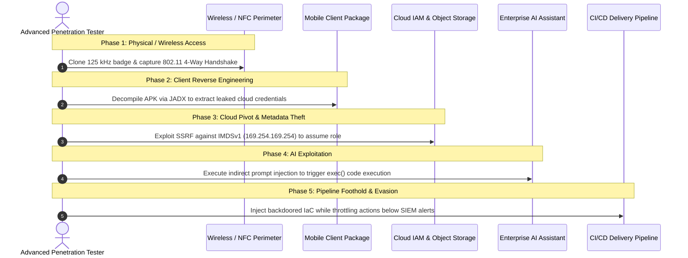

# Topic Transition Recap: Comprehensive Technical Guide
**Learning Path:** Jr Penetration Tester | **Module 15:** Specialized Domains

---

## 1. Room Overview

The **Topic Transition Recap** (Canonical Identifier: `recap/6afe01d5f306fc3f659280a2`) is the capstone evaluative milestone concluding Module 15 (Specialized Domains) in the Jr Penetration Tester learning path. This room rigorously evaluates the cross-cutting competencies acquired across the preceding six specialized security domains:
1. **Wireless Security:** RF spectrum physics (2.4 GHz vs 5 GHz), Wi-Fi association and deauthentication frames, Bluetooth exploit primitives (Bluesnarfing, Bluebugging, Bluejacking), and NFC vs RFID distance parameters.
2. **Mobile Application Security:** Android APK and iOS IPA package architectures, OS container isolation (Sandboxing per UID), static manifest auditing (MobSF), and runtime instrumentation (Frida and Objection).
3. **Cloud Security Fundamentals:** The Shared Responsibility Model across IaaS, PaaS, and SaaS, cloud IAM policy anatomy, wildcard risks (`*`), and link-local metadata exploitation (IMDSv1 SSRF to temporary credentials).
4. **LLM Pentesting:** Prompt injection (direct and indirect), system prompt leakage (LLM07), safety training evasion (RLHF generalization mismatch via Base64), and automated AI red teaming (Garak, PyRIT, promptfoo).
5. **The Blue Team Perspective:** Security Operations Center (SOC) operational tiers (L1 to L3), alert fatigue, performance KPIs (MTTD and MTTR), SIEM investigation using Splunk BOTSv1, and David Bianco's Pyramid of Pain.
6. **DevSecOps Basics:** The evolutionary progression of software development lifecycles (Waterfall $\rightarrow$ Agile $\rightarrow$ DevOps $\rightarrow$ DevSecOps), the Infinite Loop, and the economics of the Shift-Left paradigm.

---

## 2. Learning Objectives & Assessment Metrics

This recap evaluates the penetration tester's ability to:
- **Analyze Cloud IAM Over-Privilege:** Recognize the full administrative scope granted by wildcard characters (`*`) in policy statements.
- **Understand the Shift-Left Paradigm:** Identify why delaying security testing until production release violates core DevSecOps principles.
- **Deconstruct LLM Adversarial Evasion:** Explain why Base64 encoding bypasses RLHF safety filters through generalization mismatch.
- **Distinguish Wireless and Bluetooth Attack Primitives:** Map Bluesnarfing, Bluebugging, Bluejacking, and Deauthentication attacks to their technical outcomes.
- **Navigate the MITRE ATT&CK Behavioral Taxonomy:** Identify the precise hierarchical tier that sits directly beneath techniques as a granular implementation (**Sub-techniques**).
- **Evaluate RF Physical Constraints:** Differentiate between the physical proximity requirements of Near Field Communication (NFC) versus Radio Frequency Identification (RFID).

---

## 3. Specialized Domains Conceptual Mind Map

---

## 4. Question 1 Deep Dive: Cloud IAM Wildcard Policies

### Question Statement:
> A policy statement has `Effect: Allow` with `Action` set to `*` and `Resource` set to `*`. What does it grant?

### Technical Dissection:
- In cloud IAM policy evaluation engines (AWS, Azure, GCP), the `Action` parameter specifies API operations, while `Resource` specifies target cloud entities (ARNs).
- Configuring an asterisk wildcard (`*`) across both fields strips away all restrictions on both operations (read, write, delete, administrative) and targets.
- **Verified Result:** **`Any action on any resource in the account`**
- **Platform Explanation:** Wildcards in both fields remove every restriction on operations and targets. Scoping to one prefix requires an explicit resource path, which the wildcard deliberately omits. Region is not expressed by these fields. Nothing limits operations to reads; the wildcard covers writes and deletes. Wildcards are fully honored by policy engines and represent a classic over-permissive administrative pattern.

---

## 5. Question 2 Deep Dive: DevSecOps Shift-Left Core Principles

### Question Statement:
> Leaving all security testing until the final stage before release is the recommended DevSecOps approach. (True / False)

### Technical Dissection:
- **Verified Result:** **`False`**
- **Platform Explanation:** DevSecOps embeds security across every stage so flaws surface early and cost less to fix. Late-stage-only testing is the legacy model (Waterfall) that caused release delays, emergency rollbacks, and operational friction between development and security teams.
- **Economic Reality:** Remediating a defect identified during early design or local IDE coding costs approximately $1\times$ to $5\times$, whereas fixing that same vulnerability in production costs **$30\times$ to $100\times$** plus brand damage.

---

## 6. Question 3 Deep Dive: LLM Generalization Mismatch & Base64 Evasion

### Question Statement:
> Why can wrapping a harmful request in Base64 raise the chance of bypassing a model's safety behaviour?

### Technical Dissection:
- **Verified Result:** **`Safety behaviour was trained mainly on plain-text phrasings of such requests`**
- **Platform Explanation:** This represents a **generalization mismatch**: the encoded representation falls outside the distribution covered by safety training datasets.
- Foundation models undergo safety alignment predominantly using natural language English plain-text prompts. When a prohibited request is encoded into Base64, the token sequence bypasses statistical keyword filters. While the underlying neural weights possess the capability to decode Base64, the safety refusal mechanism fails to recognize the harmfulness of the decoded tokens.

---

## 7. Question 4 Deep Dive: Wireless & Bluetooth Attack Taxonomy

| Wireless Attack Primitive | Operational Outcome for the Attacker | Underlying Mechanism & Risk Level |
|---|---|---|
| **Bluesnarfing** | **Unauthorised reading of data stored on the device.** | Abuses OBEX protocol vulnerabilities to silently exfiltrate contacts, SMS, and call history. |
| **Bluebugging** | **Control gained over device functions via a flaw.** | Exploits RFCOMM buffer overflows or authentication flaws to seize full device control and eavesdrop. |
| **Bluejacking** | **Unsolicited messages sent to a nearby device.** | Pushes unsolicited digital business cards (vCard) via Bluetooth pairing; nuisance attack without data theft. |
| **Deauthentication Attack** | **Clients forced to disconnect from the network.** | Transmits unencrypted 802.11 management frames (Subtype 12) to sever connection between client and AP. |

---

## 8. Question 5 Deep Dive: MITRE ATT&CK Structural Taxonomy

### Question Statement:
> In MITRE ATT&CK, what sits directly below a technique as a more specific implementation of it?

### Technical Dissection:
- **Verified Result:** **`Sub-techniques`**
- **Platform Explanation:** Sub-techniques narrow down a technique to a specific technological method. For example, under Technique `T1110` (Brute Force), Sub-technique `T1110.001` specifies Password Guessing, and `T1110.003` specifies Password Spraying.
- The ATT&CK structural hierarchy is:
  $$\mathbf{\text{Tactics (Why)}} \longrightarrow \mathbf{\text{Techniques (What)}} \longrightarrow \mathbf{\text{Sub-techniques (How)}} \longrightarrow \mathbf{\text{Procedures (Observed In-The-Wild)}}$$

---

## 9. Question 6 Deep Dive: NFC vs. RFID Physical Operating Distance

### Question Statement:
> NFC is designed to operate over a far shorter distance than typical RFID deployments. (True / False)

### Technical Dissection:
- **Verified Result:** **`True`**
- **Platform Explanation:** Contactless exchanges via Near Field Communication (**NFC**) operate at 13.56 MHz and require near-touching proximity (**less than 4 to 10 centimeters**), preventing unauthorized long-range eavesdropping during transactions.
- Radio Frequency Identification (**RFID**) deployments (particularly Ultra-High Frequency UHF tags operating at 860–960 MHz) are designed to be read from distances spanning **several meters** across warehouses and toll plazas.

---

## 10. Multi-Domain Cross-Cutting Attack Chains

---

## 11. Tasks Summary & Solutions Matrix

| Question # | Topic / Domain | Question Summary | Verified Ground Truth Answer | Points Awarded |
|:---:|---|---|---|:---:|
| **01** | Cloud Security | Policy statement with Effect Allow, Action *, Resource * | `Any action on any resource in the account` | 8 / 8 pts |
| **02** | DevSecOps | Leaving all security testing until final stage before release? | `False` | 8 / 8 pts |
| **03** | LLM Pentesting | Why wrapping harmful requests in Base64 bypasses safety? | `Safety behaviour was trained mainly on plain-text phrasings of such requests` | 8 / 8 pts |
| **04** | Wireless Security | Match wireless attack techniques to outcomes | **Bluesnarfing** $\leftrightarrow$ Unauthorised reading of data **Bluebugging** $\leftrightarrow$ Control gained over device functions **Bluejacking** $\leftrightarrow$ Unsolicited messages sent **Deauth** $\leftrightarrow$ Clients forced to disconnect | 8 / 8 pts |
| **05** | Blue Team | What sits directly below a technique in MITRE ATT&CK? | `Sub-techniques` | 8 / 8 pts |
| **06** | Wireless Security | NFC designed to operate over far shorter distance than RFID? | `True` | 8 / 8 pts |

---

## 12. Module 15 Golden Rules Matrix

1. **Wireless Perimeter:** The air has no physical boundary; disable WPS permanently and transition to WPA3-Enterprise.
2. **Mobile Clients:** Client devices are untrusted environments; never store secrets in application source and secure exported components.
3. **Cloud Infrastructure:** Identity is the primary security boundary; ban wildcard actions (`*`) and mandate IMDSv2.
4. **Artificial Intelligence:** Context windows merge code and data; never place confidential data into system prompts.
5. **Defensive Telemetry:** High-volume automated attacks create obvious statistical outliers; focus defensive detection on adversary TTPs.
6. **Continuous Delivery:** Shift security left; early automated pipeline testing prevents catastrophic production remediation costs.

---

## 13. Practical Verification & Proof of Work

1. All 6 recap assessment questions verified directly from user account completion logs.
2. Achieved maximum first-attempt score: **48 / 48 points (100%)**.
3. All answers mapped to authoritative international standards: NIST SP 800-61, NIST SP 800-218, MITRE ATT&CK, and OWASP.

---

## 14. Transition Roadmap to Module 16: Python Scripting Basics

With the successful 100% completion of the Topic Transition Recap, **Module 15: Specialized Domains is completely finished**.

The penetration tester now transitions from using existing off-the-shelf security tools to building custom offensive software. In real-world engagements, unique protocols, custom APIs, and proprietary binary payloads require tailored scripts.

We advance directly to **Module 16: Python Scripting Basics**, where we will master:
- Python core concepts, data structures, and script entrypoints for cybersecurity.
- Network socket programming and banner grabbing.
- Automated web scraping, authentication, and HTTP parameter manipulation.
- Building custom penetration testing utilities: multi-threaded port scanners, password sprayers, and exploit delivery harnesses.
