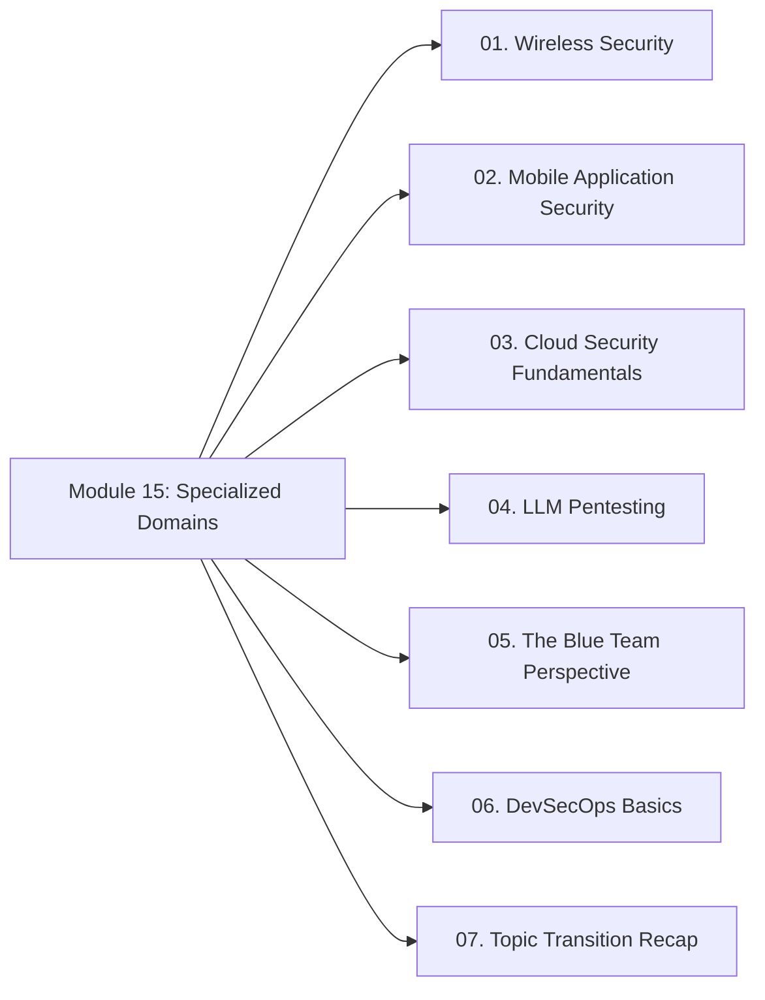

# Module 15: Specialized Domains
**Curriculum Track:** Jr Penetration Tester | **Module 15:** Specialized Domains

---

## 1. Module Overview

Modern penetration testing and red teaming require operators to think beyond conventional on-premises enterprise networks. Organizations increasingly rely on wireless infrastructures, cloud-native deployments, mobile applications, AI/LLM assistants, and continuous automated delivery pipelines.

**Module 15: Specialized Domains** bridges foundational penetration testing with the specialized fields shaping enterprise cybersecurity:
1. **Wireless Security:** Radio frequency physics, 802.11 standards, WEP/WPA/WPA2/WPA3 cryptographic evaluation, Bluetooth Classic/BLE vulnerabilities, RFID/NFC skimming and cloning, and IoT mesh networks (Zigbee, Z-Wave, LoRa).
2. **Mobile Application Security:** Architectural security models across Android (Linux/ART/sandboxing) and iOS (XNU/Darwin/Secure Enclave), APK/IPA reverse engineering, dynamic instrumentation with Frida, and sensitive data exposure auditing.
3. **Cloud Security Fundamentals:** Cloud deployment and service models (IaaS, PaaS, SaaS), the Shared Responsibility Model across hyperscalers (AWS, Azure, GCP), IAM privilege escalation, bucket/blob storage auditing, and cloud metadata service (IMDS) security.
4. **LLM Pentesting:** Security auditing for Large Language Models and Generative AI applications based on the OWASP Top 10 for LLMs, direct and indirect prompt injection, training data poisoning, and insecure plugin integrations.
5. **The Blue Team Perspective:** Defensive operations within Security Operations Centers (SOCs), SIEM log ingestion and correlation rule design, endpoint detection and response (EDR) telemetry, and Purple Team collaboration.
6. **DevSecOps Basics:** Shift-Left security culture, integrating automated security gates into CI/CD pipelines, Static Application Security Testing (SAST), Dynamic Application Security Testing (DAST), and Software Composition Analysis (SCA).
7. **Topic Transition Recap:** End-of-module assessment testing end-to-end technical comprehension across all specialized domains.

---

## 2. Module Navigation & Curriculum Layout

