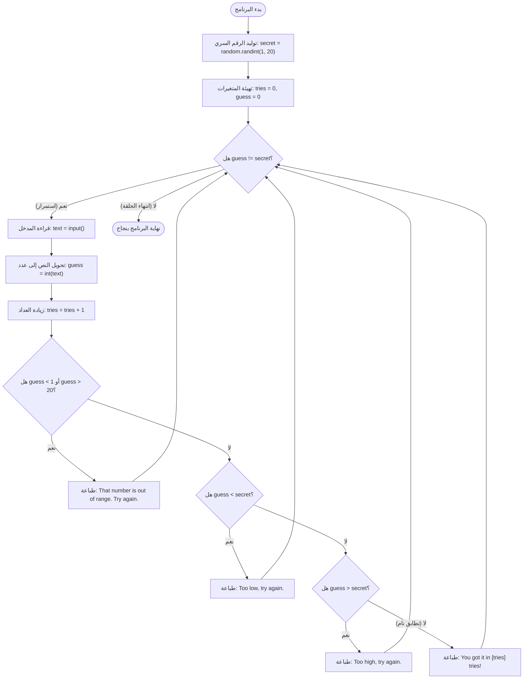

# غرفة عرض عملي تمهيدي لبايثون (Python: Simple Demo)

---

## 1. نبذة عن الغرفة وسياقها التعليمي والأمني (Room Overview & Security Context)
تُعد غرفة **Python: Simple Demo** البوابة التأسيسية للمسار البرمجي في مسار مختبر الاختراق المبتدئ (Jr Penetration Tester). تهدف هذه الغرفة إلى إزالة الغموض عن البرمجة الإجرائية من خلال مشروع تطبيقي كامل: **لعبة تخمين الأرقام (Guess the Number)**.

في بيئات الأمن الهجومي، لا يقتصر دور مختبر الاختراق على استخدام الأدوات المنشورة في مستودعات GitHub أو توزيعة Kali Linux؛ بل يحتاج في كثير من الأحيان إلى:
- كتابة سكربتات سريعة لاستغلال ثغرات غير نمطية (One-off Exploits).
- أتمتة إرسال واستقبال حزم الشبكة الخام أو طلبات HTTP المخصصة.
- معالجة مخرجات الأدوات واستخراج المؤشرات الحيوية وبيانات الاعتماد المخزنة.
تضع هذه الغرفة اللبنات الأولى لفهم كيفية تمثيل البيانات، واتخاذ القرارات الشرطية، وتكرار العمليات عبر الحلقات البرمجية.

---

## 2. الأهداف التعليمية والمخرجات العملية (Learning Objectives)
عند إتمام هذه الغرفة، سيكون الباحث الأمني قادراً على:
1. فهم دورة حياة تنفيذ برامج بايثون وآلية تشغيل السكربتات عبر المفسر.
2. استخدام المتغيرات لإدارة حالة البرنامج (State Management) وتخزين البيانات المؤقتة.
3. التمييز بين أنواع البيانات الأولية وإجراء التحويل القسري الآمن بين النصوص والأعداد (`Type Casting`).
4. بناء شجرات اتخاذ القرار المتفرعة باستخدام `if` و `elif` و `else`، وتطبيق مبدأ التحقق من الحدود.
5. استخدام حلقات الدوران غير المحددة (`while loops`) لتكرار تنفيذ الشيفرة حتى تحقق شرط التوقف.
6. فهم الفروق الجوهرية بين مولدات الأرقام شبه العشوائية (PRNG) والمولدات الآمنة تشفيرياً (CSPRNG).

---

## 3. المتطلبات المعمارية وتجهيز بيئة العمل (Prerequisites & Setup)
- **بيئة التشغيل:** نظام لينكس (Ubuntu 22.04 LTS) مجهز بمفسر `python3` (الإصدار 3.10 أو أحدث).
- **أدوات التحرير:** محرر نصوص أو بيئة تطوير متكاملة (VS Code أو Vim أو Nano).
- **الملفات المعملية:** تتوفر الشيفرات في المسار `/home/ubuntu/Python-Demo/` بملفات متدرجة (`guess_v1.py` إلى `guess_v4.py`).
- **التحقق من البيئة محلياً:**
  ```bash
  python3 --version
  which python3
  ```

---

## 4. المفاهيم النظرية العميقة والتحليل المعماري (Deep Theoretical Concepts)

### أ. معمارية محرك CPython ودورة التنفيذ:
لا ينفذ المعالج كود بايثون مباشرة، بل يمر بالمراحل التالية:
1. **التحليل النحوي والمعجمي (Lexical Analysis & Parsing):** تحويل الكود المصدري إلى شجرة بناء نحوي مجردة (AST).
2. **الترجمة إلى بايت كود (Bytecode Compilation):** توليد تعليمات بايت كود مستقلة عن المنصة وحفظها في مجلد `__pycache__`.
3. **آلة بايثون الافتراضية (PVM):** حلقة تقييم دورية في CPython تقرأ تعليمات البايت كود وتستدعي دوال مكتبة C المقابلة ونظام التشغيل.

### ب. تمثيل الكائنات في الذاكرة:
في بايثون، كل شيء هو كائن (`PyObject`). المتغيرات ليست حاويات تخزن القيم بل هي مؤشرات وأسماء تشير إلى كائنات في الذاكرة (Heap). الأعداد الصحيحة الصغيرة في المجال $[-5, 256]$ يتم تخزينها مؤقتاً في مصفوفة ثابتة عند إقلاع المفسر (Small Integer Caching) لتوفير استهلاك الذاكرة وتسريع المقارنات.

---

## 5. تحليل الكود وهندسة البرمجيات (Code Breakdown)
تتطور اللعبة عبر ثلاث مراحل برمجية متدرجة:

### المرحلة 1: تعريف الحالة والمدخلات (`guess_v1.py`):
```python
import random

secret = random.randint(1, 20)  # توليد رقم سري بين 1 و 20
tries = 0
guess = 0

print("I'm thinking of a number between 1 and 20")
text = input("Take a guess: ")
guess = int(text)  # تحويل النص المدخل إلى عدد صحيح
tries = tries + 1
```

### المرحلة 2: إضافة المنطق الشرطي وتحديد المسارات (`guess_v2.py`):
```python
if guess < 1 or guess > 20:
    print("That number is out of range. Try again.")
elif guess < secret:
    print("Too low, try again.")
elif guess > secret:
    print("Too high, try again.")
else:
    print("You got it in", tries, "tries!")
```

### المرحلة 3: تكرار المحاولات عبر حلقة الدوران (`guess_v3.py`):
```python
while guess != secret:
    text = input("Take a guess: ")
    guess = int(text)
    tries = tries + 1
    # المنطق الشرطي كما في المرحلة 2
```

---

## 6. خرائط التدفق ومخططات سير البيانات (Execution Flowcharts)



---

## 7. جدول المهام والحلول المعتمدة (Tasks & Verified Solutions Matrix)

| المهمة | عنوان المهمة | رقم السؤال | نص السؤال | الحل المعتمد | الشرح التقني والمفاهيمي |
|:---:|---|:---:|---|:---:|---|
| **01** | Introduction | Q1 | Let’s code our game! | `No answer needed` | إقرار البدء في المشروع البرمجي للغرفة. |
| **02** | Variables | Q1 | What is the name of the function we used to display text on the screen? | `print()` | دالة الطباعة القياسية التي تكتب على مجرى الإخراج القياسي `sys.stdout`. |
| **02** | Variables | Q2 | What is the name of the function that we used to convert user input to an integer? | `int()` | دالة التحويل القسري للأنواع التي تحول السلسلة النصية إلى عدد صحيح. |
| **03** | Conditional Statements | Q1 | How does Python write “else if”? | `elif` | الكلمة المفتاحية المعتمدة في بايثون لتمثيل تفريعات "وإلا إذا". |
| **03** | Conditional Statements | Q2 | What will the program display if the user’s input is 50? | `That number is out of range. Try again.` | يتحقق الشرط `guess > 20` أولاً مما يطلق رسالة الخروج عن النطاق المسموح. |
| **04** | Iterations | Q1 | What type of loop does this program use? | `while` | حلقة التكرار المشروط التي تستمر طالما أن الشرط المنطقي محقق (`guess != secret`). |
| **04** | Iterations | Q2 | What will the program display if the user makes the correct guess in 3 tries? | `You got it in 3 tries!` | تقوم دالة `print()` بدمج المعاملات مع مسافات تلقائياً عند الفصل بفواصل. |
| **05** | Conclusion | Q1 | I successfully ran my first game created in Python. | `No answer needed` | إقرار إتمام تشغيل اللعبة وفهم الأعمدة الثلاثة للبرمجة. |

---

## 8. الاعتبارات التشغيلية والأمنية لمختبري الاختراق (OpSec & Offensive Scripting)
1. **تجنب التعليق غير المنتهي (Avoid Deadlocks & Hangs):** عند كتابة سكربتات شبكية تعتمد على `while`، يجب دائماً وضع مهلة زمنية للاتصال (`socket.settimeout()`)، حتى لا يتجمد السكربت إلى ما لا نهاية في حال إسقاط الحزم بواسطة جدار الحماية (Firewall Drop/Blackhole).
2. **استخدام المولدات الآمنة تشفيرياً (CSPRNG):** خوارزمية `random` تعتمد على Mersenne Twister (MT19937) التي يمكن كشف حالتها الداخلية وإعادة توليد جميع القيم السابقة واللاحقة بعد مراقبة 624 قيمة متتالية. في العمليات الأمنية (توليد مفاتيح، رموز مصادقة، أسماء ملفات سرية)، يجب استخدام مكتبة `secrets` أو `os.urandom`.
3. **تغليف مخرجات السكربت:** في سيناريوهات اختبار الاختراق، يجب ألا يفشل السكربت الهجومي بصمت أو يطبع استثناءات تفضح الهجوم. يجب تسجيل المخرجات في ملفات سجلات منظمة بصيغة JSON أو CSV.

---

## 9. الثغرات الشائعة والبرمجة الدفاعية (Defensive Hardening)
السكربت التعليمي الموضح في الغرفة يعاني من عدة ثغرات وثغرات انهيار برمجية (Denial of Service):
1. **انهيار التحويل القسري (Crash on Invalid Literal):** إذا أدخل المستخدم حرفاً أو رمزاً خاصاً، سيفشل `int(text)` مسبباً استثناء `ValueError`.
2. **عدم معالجة الإيقاف القسري (Unhandled KeyboardInterrupt):** إنهاء السكربت بـ `Ctrl+C` يترك مكدس الأخطاء مكشوفاً على الشاشة.
3. **الدوران اللانهائي في غياب سقف المحاولات:** عدم تقييد المحاولات قد يسمح باستهلاك موارد المعالج.

### الشيفرة الدفاعية المحصنة:
```python
try:
    guess = int(raw_text)
except ValueError:
    print("[-] Invalid input: Please enter a decimal integer.")
    continue
except (KeyboardInterrupt, EOFError):
    print("\n[!] Execution terminated by user.")
    sys.exit(0)
```

---

## 10. التحليل المقارن (Comparative Analysis)

| الميزة | بايثون (Python) | باش (Bash) | سي / سي++ (C/C++) |
|---|---|---|---|
| **سرعة التطوير** | فائقة السرعة، تركيب نحوي واضح | سريعة للأوامر النظامية المباشرة | بطيئة، تتطلب إدارة يدوية للذاكرة |
| **الاعتماديات** | تتطلب وجود مفسر بايثون | متوفرة افتراضياً على جميع أنظمة يونكس | تترجم إلى ملفات ثنائية مستقلة بالكامل |
| **التعامل مع الشبكة** | مكتبات قوية ومتقدمة (`socket`, `requests`) | تعتمد على أدوات خارجية (`curl`, `nc`) | مآخذ توصيل نظامية منخفضة المستوى |
| **الاستخدام المثالي** | استغلال الثغرات، الأتمتة، فحص الويب | التفاعل مع النظام وإدارة الحزم | استغلال الذاكرة (Buffer Overflow) والبرمجيات الخبيثة |

---

## 11. تمارين عملية إضافية وسيناريوهات هجومية (Hands-on Exercises)
1. **تمرين 1: كتابة مستكشف منافذ بسيط (Simple TCP Port Checker):**
   استخدم مبادئ المهام السابقة لإنشاء سكربت يجرب الاتصال بمنفذ محدد:
   ```python
   import socket
   s = socket.socket(socket.AF_INET, socket.SOCK_STREAM)
   s.settimeout(1.0)
   res = s.connect_ex(('127.0.0.1', 80))
   if res == 0:
       print("[+] Port 80 is OPEN!")
   else:
       print("[-] Port 80 is CLOSED.")
   s.close()
   ```
2. **تمرين 2: محاكي تخمين كلمات المرور (Password Brute-Force Simulator):**
   تحويل حلقة `while` لتجربة قائمة من كلمات المرور ضد نص سري وحساب عدد المحاولات.

---

## 12. الأسئلة الشائعة وتصحيح المفاهيم المغلوطة (FAQ)
- **س: هل بايثون لغة مفسرة بالكامل أم مترجمة؟**
  - **ج:** بايثون لغة هجينة؛ تترجم الكود المصدري أولاً إلى بايت كود (`.pyc`) ثم تنفذه الآلة الافتراضية PVM.
- **س: لماذا لا نستخدم `eval()` لقراءة الأرقام كما كان شائعاً في بايثون 2؟**
  - **ج:** دالة `eval()` تنفذ أي كود بايثون مدخل، مما يفتح ثغرة تنفيذ أوامر عن بعد (RCE) كارثية. دائماً استخدم `int()` مع التحقق من الأخطاء.

---

## 13. مسرد المصطلحات التقنية (Technical Glossary)
- **Variable (المتغير):** اسم رمزي مرتبط بموقع في الذاكرة لتخزين قيمة قابلة للتعديل.
- **Type Casting (التحويل القسري للأنواع):** تحويل قيمة من نوع بيانات إلى آخر (مثل تحويل السلسلة النصية إلى عدد صحيح).
- **Control Flow (مسار التحكم):** الترتيب الذي تنفذ به الأوامر والتعليمات البرمجية بناءً على الشروط.
- **Indentation (الإزاحة البادئة):** المسافات البيضاء المستخدمة في بايثون لتحديد الكتل البرمجية والتبعيات النحوية.
- **CSPRNG:** مولد أرقام شبه عشوائية آمن تشفيرياً يستمد عشوائيته من إنتروبيا نواة النظام.

---

## 14. المراجع والمصادر التوثيقية (Authoritative References)
1. **Python Official Documentation:** Built-in Types & Control Flow (`https://docs.python.org/3/`).
2. **CPython Internals:** Anthony Shaw (Real Python Guide to Python Execution).
3. **PEP 8:** Style Guide for Python Code (`https://peps.python.org/pep-0008/`).
4. **TryHackMe Room:** Python: Simple Demo (`https://tryhackme.com/room/pythonsimpledemo`).
