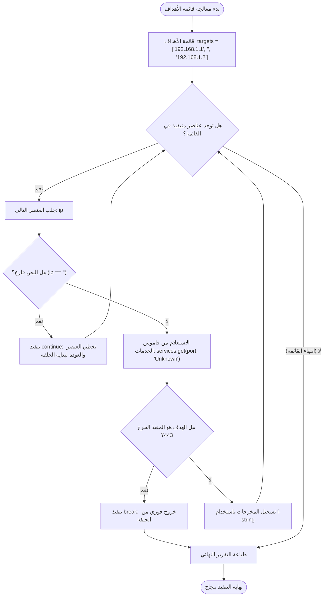

# غرفة المفاهيم الجوهرية للغة بايثون (Python: Core Concepts)

---

## 1. نبذة عن الغرفة وسياقها التعليمي والأمني (Room Overview & Security Context)
تُشكل غرفة **Python: Core Concepts** الركيزة الأساسية للتعامل مع البيانات المعقدة ومعالجة النصوص وهندسة تدفق البيانات في مسار مختبر الاختراق المبتدئ. بعد استيعاب الأساسيات البسيطة في الغرفة السابقة، ينتقل الباحث الأمني هنا إلى معالجة سيناريوهات واقعية تتطلب التعامل مع كميات ضخمة من البيانات؛ مثل تدقيق 10,000 اسم مستخدم تم جمعهم عبر استخبارات المصادر المفتوحة (OSINT) أو استعلامات بروتوكول LDAP في بيئات Active Directory.

في اختبار الاختراق العملي، تتطلب الأتمتة الناجحة القدرة على:
- تقطيع وتطهير النصوص (String Slicing & Sanitization) لاستخراج الترويسات ومسارات الويب.
- تنظيم الأهداف ومنافذ الخدمات في هياكل بيانات سريعة (Lists & Dictionaries).
- إجراء العمليات الحسابية المتقدمة مثل حساب فضاء المفاتيح التشفيرية ومحاذاة البايتات.
- التحكم في حلقات التكرار عبر شروط التوقف الفوري (`break`) وتجاوز المدخلات التالفة (`continue`).

---

## 2. الأهداف التعليمية والمخرجات العملية (Learning Objectives)
عند إتمام هذه الغرفة، سيكون الباحث الأمني قادراً على:
1. فحص أنواع البيانات ديناميكياً باستخدام دالة `type()` وفهم سلوك دوال الإدخال `input()`.
2. صياغة المخرجات النصية المتقدمة باستخدام نصوص f-strings وتنسيق تقارير الفحص الأمني.
3. معالجة النصوص واقتطاع الأجزاء المحددة باستخدام الفهرسة الصفرية والتجزئة (`Slicing`).
4. استخدام القوائم (`Lists`) لإدارة طوابير المهام، واستخدام القواميس (`Dictionaries`) للجداول المترابطة المعقدة بزمن وصول $O(1)$.
5. تطبيق المعاملات الحسابية المتخصصة: باقي القسمة (`%`)، والقسمة الصحيحة الأرضية (`//`)، والأسس (`**`).
6. التحكم الدقيق في حلقات الدوران باستخدام `for` مع المولد `range()` والتحكم بالتدفق عبر `break` و `continue`.

---

## 3. المتطلبات المعمارية وتجهيز بيئة العمل (Prerequisites & Setup)
- **النظام المعملي:** جهاز افتراضي بنظام Ubuntu Linux 22.04 LTS مزود بمفسر Python 3.10+ ومحرر VS Code.
- **مسار الملفات المعملية:** تتوفر السكربتات التوضيحية داخل المسار `/home/ubuntu/Core-Concepts/` (ومنها `fstrings_demo.py`).
- **أمر التحقق السريع من سطر الأوامر:**
  ```bash
  python3 -c "import sys; print(f'Python Version: {sys.version.split()[0]}')"
  ```

---

## 4. المفاهيم النظرية العميقة والتحليل المعماري (Deep Theoretical Concepts)

### أ. معمارية القواميس المدمجة في CPython (Compact Hash Tables):
منذ إصدار Python 3.6، اعتمد مفسر CPython معمارية الجداول المدمجة (Compact Dictionaries)، والتي تفصل بين مصفوفة الفهارس المبعثرة ومصفوفة الإدخالات المتراصة الكثيفة (Dense Entries Array). هذا التحول المعماري وفر ما بين 20% إلى 25% من الذاكرة وضمن بقاء ترتيب الإدخال (Insertion Order) محفوظاً عند التكرار عبر القاموس.

### ب. سلوك تجزئة النصوص في الذاكرة (String Slicing Mechanics):
السلاسل النصية في بايثون كائنات ثابتة غير قابلة للتعديل (`Immutable`). عند إجراء التجزئة `word[3:7]`، يقوم مفسر بايثون بحساب الطول المطلوب وتخصيص كائن نصي جديد بالكامل على الذاكرة العشوائية (Heap) ونسخ البايتات المحددة. وتتميز بايثون بعدم إطلاق استثناء `IndexError` عند التجزئة حتى لو تجاوزت الحدود، مما يجعل التجزئة درعاً برمجياً آمناً عند تحليل الترويسات الشبكية متغيرة الطول.

### ج. خوارزمية الترتيب Timsort:
عند استدعاء `.sort()` على القوائم، تستخدم بايثون خوارزمية Timsort الهجينة (التي تدمج بين الترتيب بالدمج والترتيب بالإدراج)، وتضمن استقرار الترتيب (Stability) وتعقيداً زمنياً أقصى قدره $O(n \log n)$، مع هبوط التعقيد إلى $O(n)$ في حال كانت البيانات مرتبة جزئياً مسبقاً.

---

## 5. تحليل الكود وهندسة البرمجيات (Code Breakdown)

### أ. فحص أنواع البيانات وتنسيق f-Strings (`fstrings_demo.py`):
```python
target_ip = "192.168.1.1"
open_ports = [22, 80, 443]

for p in open_ports:
    print(f"[+] Discovered open port: {p}")

port_count = len(open_ports)
print(f"Scan complete: {target_ip} has {port_count} open ports")
```

### ب. عمليات النصوص والقواميس الآمنة:
```python
# فحص طول النص وتقطيعه
domain = "TryHackMe"
category = domain[3:7]  # ينتج: "Hack"

# القواميس والاسترجاع الآمن
services = {22: "SSH", 80: "HTTP"}
banner = services.get(8080, "Unknown Service")  # يمنع انهيار السكربت بـ KeyError
```

### ج. التحكم في الحلقات وتفادي العمليات الزائدة:
```python
ports_to_scan = [21, 22, 80, 443, 8080]
for port in ports_to_scan:
    if port == 443:
        print(f"[+] Web service identified on port {port}. Stopping scan.")
        break  # خروج فوري للحفاظ على التخفي وتقليل الضجيج الشبكي
```

---

## 6. خرائط التدفق ومخططات سير البيانات (Execution Flowcharts)



---

## 7. جدول المهام والحلول المعتمدة (Tasks & Verified Solutions Matrix)

| المهمة | عنوان المهمة | رقم السؤال | نص السؤال | الحل المعتمد | الشرح التقني والمفاهيمي |
|:---:|---|:---:|---|:---:|---|
| **01** | Introduction | Q1 | Let's master Python's core concepts! | `No answer needed` | إقرار البدء في استيعاب المفاهيم الجوهرية. |
| **02** | Quick Review | Q1 | What built-in function reveals the data type of a value? | `type()` | الدالة المدمجة التي تفحص حقل `ob_type` في ترويسة كائن CPython. |
| **02** | Quick Review | Q2 | If a user types 3.14 at an input() prompt, what data type does Python store it as before any conversion? | `str` | دالة `input()` تقرأ دائماً المجرى القياسي كسلسلة نصية خام (`str`). |
| **02** | Quick Review | Q3 | On the attached VM, open and run fstrings_demo.py. What is the last line printed to the terminal? | `Scan complete: 192.168.1.1 has 3 open ports` | السطر الأخير الناتج عن تنسيق f-string بعد انتهاء حلقة فحص المنافذ. |
| **03** | Working with Strings | Q1 | What function returns the number of characters in a string? | `len()` | الدالة التي تعيد عدد العناصر أو المحارف في السلاسل والقوائم. |
| **03** | Working with Strings | Q2 | Given word = "TryHackMe", what does word[3:7] return? | `Hack` | التجزئة تشمل الفهارس [3, 4, 5, 6] وتستثني الفهرس النهائي 7. |
| **03** | Working with Strings | Q3 | What string method converts "ADMIN" to "admin"? | `.lower()` | الدالة التي تحول المحارف الإنجليزية الكبيرة إلى صغيرة في الذاكرة. |
| **04** | Lists and Dictionaries | Q1 | What method adds an element to the end of a list? | `.append()` | دالة إضافة عنصر إلى نهاية المصفوفة الديناميكية بتعقيد زمني $O(1)$. |
| **04** | Lists and Dictionaries | Q2 | Given services = {22: "SSH", 80: "HTTP"}, what does services[80] return? | `HTTP` | استرجاع القيمة المقترنة بالمفتاح `80` عبر جدول التجزئة. |
| **04** | Lists and Dictionaries | Q3 | What dictionary method lets you retrieve a value with a safe fallback if the key does not exist? | `.get()` | الطريقة الآمنة لاسترجاع القيم التي تتفادى استثناء `KeyError`. |
| **05** | Arithmetic and Operators | Q1 | What operator returns the remainder of a division? | `%` | معامل باقي القسمة (Modulus) المستخدم في الحسابات التشفيرية. |
| **05** | Arithmetic and Operators | Q2 | What does 10 // 3 evaluate to? | `3` | القسمة الأرضية التي تقرب الناتج إلى أقرب عدد صحيح أصغر. |
| **05** | Arithmetic and Operators | Q3 | What does 2 ** 10 evaluate to? | `1024` | معامل الأس التراكمي ($2^{10} = 1024$). |
| **06** | Loops: for and while | Q1 | What type of loop is best suited for iterating over each item in a list? | `for` | حلقة التكرار المخصصة للمصفوفات والمتتاليات التكرارية. |
| **06** | Loops: for and while | Q2 | What does range(3) produce? | `0, 1, 2` | المولد التسلسلي يبدأ من 0 ويتوقف قبل الحد الأقصى 3. |
| **06** | Loops: for and while | Q3 | What keyword immediately exits a loop? | `break` | الكلمة المفتاحية للقطع الفوري لحلقة التكرار وتخطي المتبقي. |
| **07** | Conclusion | Q1 | I have successfully completed the room! | `No answer needed` | إقرار استيعاب المفاهيم والانتقال للغرفة القادمة. |

---

## 8. الاعتبارات التشغيلية والأمنية لمختبري الاختراق (OpSec & Offensive Scripting)
1. **التعقيد الحسابي وفحص قوائم الكلمات الضخمة:** البحث في القوائم `list` يتم بتعقيد $O(n)$ الخطي، مما يجعل فحص قائمة من مليون كلمة أمراً بطيئاً جداً. تحويل القوائم إلى مجموعات `set` أو قواميس `dict` يجعل البحث فائق السرعة بزمن ثابت $O(1)$.
2. **الخروج المبكر (`break`) لتقليل الضجيج الأمني:** عند فحص نطاق شبكي للبحث عن خدمة معينة أو ثغرة محددة، فإن الاستمرار في الفحص بعد العثور على الهدف يولد تنبيهات غير ضرورية في أنظمة كشف التسلل (IDS/IPS). استخدام `break` يخفف البصمة التشغيلية للمهاجم.
3. **تطهير السجلات من محارف التحكم:** قوائم الكلمات قد تحتوي على محارف غير مرئية مثل `\r` أو `\x00`. استخدام `.strip()` يحمي السكربتات من التشويه وتلف الحزم الشبكية.

---

## 9. الثغرات الشائعة والبرمجة الدفاعية (Defensive Hardening)
- **ثغرة انهيار المفاتيح المفقودة (`KeyError`):** استدعاء `dict[key]` مباشرة عند معالجة بيانات قادمة من هدف خارجي يسقط السكربت إذا كان المفتاح غير موجود. **الحل:** استخدام `dict.get(key, default)`.
- **ثغرة تكرار السلاسل النصية غير الفعالة:** دمج النصوص داخل الحلقات باستخدام المعامل `+` يؤدي إلى تعقيد تربيعي $O(n^2)$ لأن السلاسل النصية غير قابلة للتعديل. **الحل:** تجميع النصوص في قائمة واستدعاء `''.join(list)`.

---

## 10. التحليل المقارن (Comparative Analysis)

| هيكل البيانات | الترتيب محفوظ؟ | قابل للتعديل؟ | سرعة البحث | الاستخدام المثالي في اختبار الاختراق |
|---|:---:|:---:|:---:|---|
| **السلسلة النصية (`str`)** | نعم | لا (Immutable) | $O(n)$ | تخزين مسارات الويب، حمولات الاستغلال، والترويسات |
| **القائمة (`list`)** | نعم | نعم (Mutable) | $O(n)$ | طوابير فحص المنافذ وقوائم عناوين IP المستهدفة |
| **القاموس (`dict`)** | نعم (3.7+) | نعم (Mutable) | **$O(1)$** | ربط المنافذ بأسماء الخدمات، وتخزين جلسات HTTP |
| **المجموعة (`set`)** | لا | نعم (Mutable) | **$O(1)$** | استبعاد التكرار في قوائم الكلمات وفحص الانتماء الفوري |

---

## 11. تمارين عملية إضافية وسيناريوهات هجومية (Hands-on Exercises)
1. **تمرين 1: محلل ترويسات HTTP الآمن:**
   كتابة سكربت يستخرج أسماء الترويسات وقيمها من استجابة خام باستخدام `.split(': ')` و `.strip()` وتخزينها في قاموس.
2. **تمرين 2: مولد فضاء عناوين الشبكة الفرعية:**
   استخدام حلقة `for` مع `range(1, 255)` لتوليد قائمة كاملة بجميع عناوين فئة C (`192.168.1.1` إلى `192.168.1.254`).

---

## 12. الأسئلة الشائعة وتصحيح المفاهيم المغلوطة (FAQ)
- **س: هل `range()` ينشئ قائمة كاملة بالأرقام في الذاكرة؟**
  - **ج:** لا؛ في بايثون 3، `range()` هو كائن متسلسل مقتصد يحسب الأرقام عند الطلب بذاكرة ثابتة $O(1)$، على عكس بايثون 2 حيث كان يولد قائمة كاملة.
- **س: لماذا لا يطلق التقطيع `word[10:20]` خطأ `IndexError`؟**
  - **ج:** صُممت التجزئة في بايثون لتكون متساهلة وتتعامل مع الحدود بأمان، بحيث تعيد ما يتوفر من محارف ضمن النطاق فقط.

---

## 13. مسرد المصطلحات التقنية (Technical Glossary)
- **f-String:** نمط تنسيق النصوص المدمج المباشر المدعوم منذ بايثون 3.6 لسرعته وأمانه.
- **Mutable (قابل للتعديل):** خاصية تسمح بتعديل محتويات الكائن في نفس موقعه بالذاكرة دون إعادة إنشائه (مثل القوائم).
- **Immutable (غير قابل للتعديل):** خاصية تمنع تعديل الكائن؛ وأي تعديل ينشئ كائناً جديداً في الذاكرة (مثل النصوص والأرقام).
- **KeyError:** استثناء يطلقه مفسر بايثون عند محاولة الوصول لمفتاح غير مسجل في القاموس عبر الأقواس المربعة.

---

## 14. المراجع والمصادر التوثيقية (Authoritative References)
1. **Python Official Documentation:** Built-in Data Structures (`https://docs.python.org/3/tutorial/datastructures.html`).
2. **PEP 498:** Formatted String Literals Specification.
3. **CPython Source Repository:** Dictionary and List Implementation Details.
4. **TryHackMe Room:** Python: Core Concepts (`https://tryhackme.com/room/pythoncoreconcepts`).
