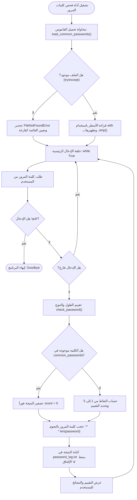

# غرفة بناء وتطوير السكربتات المتقدمة (Python: Building Scripts)

---

## 1. نبذة عن الغرفة وسياقها التعليمي والأمني (Room Overview & Security Context)
تُمثل غرفة **Python: Building Scripts** نقطة التحول المحورية من مجرد كتابة أوامر برمجية بسيطة إلى هندسة برمجيات أمنية متكاملة وقوية. في اختبارات الاختراق الواقعية، لا تكفي السكربتات الخطية التتابعية؛ بل يحتاج الباحث الأمني إلى بناء أدوات قادرة على:
- العمل ضمن بيئات غير متوقعة دون الانهيار المفاجئ (Unhandled Exceptions).
- قراءة وتوليد القواميس ومعالجة آلاف الأهداف عبر نظام الملفات.
- تجزئة المنطق البرمجي إلى دوال معيارية قابلة لإعادة الاستخدام والصيانة.
- توظيف المكتبات القياسية وحزم الطرف الثالث عبر `pip` لأتمتة المهام المعقدة.

تتوج الغرفة هذه المهارات ببناء مشروع عملي متكامل: **أداة تدقيق قوة كلمات المرور (Password Strength Checker)** التي تفحص أطوال كلمات المرور وتنوع محارفها، وتقارنها بقواميس التسريبات، وتسجل النتائج بسجلات محمية تحجب النصوص الحساسة.

---

## 2. الأهداف التعليمية والمخرجات العملية (Learning Objectives)
عند إتمام هذه الغرفة، سيكون الباحث الأمني قادراً على:
1. صياغة الدوال المعيارية (`def`) وتحديد المعاملات الإجبارية والافتراضية واستخدام `return`.
2. حماية الأدوات الهجومية من الانهيار باستخدام كتل `try` و `except` واعتراض أخطاء `ValueError` و `FileNotFoundError`.
3. إدارة الملفات وموار نظام التشغيل بأمان باستخدام مديري السياق (`with open`) وتجنب استنزاف واصفات الملفات (File Descriptors).
4. تنظيف ومعالجة أسطر الملفات واستبعاد محارف نهاية الأسطر (`\r\n`) باستخدام `.strip()`.
5. تثبيت واستدعاء المكتبات البرمجية عبر `pip` واستخدام حزم التشفير (`hashlib`) وثوابت النصوص (`string`).
6. تطوير أداة كاملة لفحص كلمات المرور وتطبيق معايير حجب البيانات الحساسة (Asterisk Masking) في السجلات.

---

## 3. المتطلبات المعمارية وتجهيز بيئة العمل (Prerequisites & Setup)
- **النظام المعملي:** جهاز افتراضي يعمل بتوزيعة Ubuntu Linux 22.04 LTS مجهز بمفسر Python 3.10+ ومحرر VS Code.
- **مسار الملفات المعملية:** تتوفر السكربتات في المسار `/home/ubuntu/Building-Scripts/` وتتضمن:
  - `functions_demo.py` (شرح الدوال)
  - `files_demo.py` (شرح الملفات وقراءة 58 كلمة مرور)
  - `imports_demo.py` (شرح التجزئة التشفيرية SHA-256)
  - `password_checker.py` (المشروع الكامل)
  - `common_passwords.txt` (قاموس كلمات المرور الشائعة)
- **التحقق من البيئة:**
  ```bash
  cd /home/ubuntu/Building-Scripts && ls -la
  ```

---

## 4. المفاهيم النظرية العميقة والتحليل المعماري (Deep Theoretical Concepts)

### أ. نطاقات المتغيرات وقاعدة LEGB في CPython:
يحدد مفسر CPython إمكانية الوصول إلى المتغيرات وفق قاعدة LEGB:
1. **Local [L]:** المتغيرات المعرفة داخل الدالة الحالية.
2. **Enclosing [E]:** نطاق الدوال الخارجية المحيطة (في حال الدوال المتداخلة).
3. **Global [G]:** المتغيرات المعرفة على مستوى الملف أو الوحدة البرمجية.
4. **Built-in [B]:** الكلمات المحجوزة والدوال المدمجة مسبقاً في بايثون (`print`, `len`, `int`).

### ب. بروتوكول مديري السياق (Context Management Protocol):
تحت الغطاء، تعتمد عبارة `with open(...) as f:` على استدعاء طريقتين سحريتين في بايثون:
- `__enter__()`: تهيئة المورد وإرجاع مقبض الملف إلى المتغير `f`.
- `__exit__()`: إغلاق مقبض الملف تلقائياً عبر استدعاء النظام `close(fd)` حتى في حال حدوث استثناء، مما يمنع تجاوز الحد الأقصى لواصفات الملفات في النظام (`ulimit -n`).

### ج. التجزئة التشفيرية SHA-256:
توفر مكتبة `hashlib` واجهة آمنة لخوارزمية SHA-256، التي تحول أي تدفق من البايتات إلى بصمة رقمية بطول 256 بت (64 حرفاً بالنظام الست عشري) مستحيلة العكس رياضياً، مع تمتعها بخاصية التغيير الجذري (Avalanche Effect).

---

## 5. تحليل الكود وهندسة البرمجيات (Code Breakdown)

### أ. دوال تسجيل النقاط والمعاملات الافتراضية:
```python
def check_length(password, min_length=8):
    return len(password) >= min_length

# استدعاء بالمعامل الافتراضي (8) أو بمعامل مخصص
print(check_length("secure"))     # False
print(check_length("secure", 4))  # True
```

### ب. القراءة الآمنة للملفات واستبعاد الأخطاء:
```python
def load_common_passwords(filepath):
    common = []
    try:
        with open(filepath, "r") as f:
            for line in f:
                common.append(line.strip().lower())
    except FileNotFoundError:
        print(f"[-] Warning: '{filepath}' not found.")
    return common
```

### ج. مشروع فحص كلمات المرور وحجب السجلات (`password_checker.py`):
```python
# فحص القوائم الشائعة وإلغاء النقاط فوراً
if password.lower() in common_list:
    score = 0
    feedback = ["This password is in the common-passwords list. Choose another."]

# تسجيل النتيجة مع حجب كلمة المرور الفعلية بالنجوم
with open("password_log.txt", "a") as log:
    log.write(f"Password: {'*' * len(password)} | Strength: {label} ({score}/5)\n")
```

---

## 6. خرائط التدفق ومخططات سير البيانات (Execution Flowcharts)



---

## 7. جدول المهام والحلول المعتمدة (Tasks & Verified Solutions Matrix)

| المهمة | عنوان المهمة | رقم السؤال | نص السؤال | الحل المعتمد | الشرح التقني والمفاهيمي |
|:---:|---|:---:|---|:---:|---|
| **01** | Introduction | Q1 | Let's build real scripts! | `No answer needed` | إقرار البدء في بناء السكربتات البرمجية المتكاملة. |
| **02** | Functions | Q1 | What keyword sends a value back from a function to the caller? | `return` | الكلمة المفتاحية المسؤولة عن تمرير القيمة المحسوبة وإنهاء تنفيذ الدالة. |
| **02** | Functions | Q2 | If a function is defined as `def scan(target, port=80):`, what value does `port` take if you call `scan("192.168.1.1")` without specifying a port? | `80` | القيمة الافتراضية المحددة في ترويسة تعريف الدالة عند غياب المعامل. |
| **02** | Functions | Q3 | On the VM, run functions_demo.py. What score does score_password return for the password "TryHackMe2025!"? | `5` | كلمة المرور حققت جميع الشروط الخمسة (طول 8، طول 12، أرقام، أحرف كبيرة، غير شائعة). |
| **03** | Error Handling | Q1 | What type of exception is raised when you attempt int("hello")? | `ValueError` | الاستثناء الناتج عن محاولة تحويل سلسلة نصية غير رقمية إلى عدد صحيح. |
| **03** | Error Handling | Q2 | What type of exception is raised when you try to open a file that does not exist? | `FileNotFoundError` | الاستثناء الفرعي من `OSError` عند فشل العثور على مسار الملف المطلوب. |
| **03** | Error Handling | Q3 | On the VM, open a Python terminal and type print(10 / 0). What is the name of the exception that Python raises? | `ZeroDivisionError` | الاستثناء الرياضي الناتج عن محاولة القسمة على الصفر في بايثون. |
| **04** | Reading and Writing Files | Q1 | What keyword introduces a context manager for safely opening files? | `with` | الكلمة المفتاحية المخصصة لمديري السياق لضمان الإغلاق التلقائي للملفات. |
| **04** | Reading and Writing Files | Q2 | What string method removes the trailing newline character from each line read from a file? | `.strip()` | الدالة النصية المسؤولة عن إزالة محارف البياض ونهايات الأسطر (`\r\n`). |
| **04** | Reading and Writing Files | Q3 | On the VM, run files_demo.py. How many passwords did it load from common_passwords.txt? | `58` | قام السكربت بتحميل 58 كلمة مرور بنجاح من الملف المرفق. |
| **05** | Libraries and Pip | Q1 | What is the name of Python's package manager used to install third-party libraries? | `pip` | مدير الحزم القياسي لتثبيت مكتبات بايثون من مستودع PyPI. |
| **05** | Libraries and Pip | Q2 | Which module from the standard library provides constants like ascii_uppercase, digits, and punctuation? | `string` | الوحدة القياسية التي توفر ثوابت محارف الأسكي والرموز والأرقام. |
| **05** | Libraries and Pip | Q3 | On the VM, run imports_demo.py. What is the first character of the SHA-256 hash it prints for the default input string? | `5` | المحرف الأول في الهاش الناتج هو `5` (`5e884898...`). |
| **06** | Putting It All Together | Q1 | In the check_password function, what score does the password receive if it is found in the common_passwords list? | `0` | تصفير النقاط فورياً عند تطابق الكلمة مع القاموس لحمايتها من هجمات التخمين. |
| **06** | Putting It All Together | Q2 | On the VM, run password_checker.py and enter the password TryHackMe!2025. What strength label does the program display? | `Strong` | حصلت الكلمة على الدرجة الكاملة 5/5 مما صنفها ككلمة مرور قوية (Strong). |
| **06** | Putting It All Together | Q3 | After running the checker with the password TryHackMe!2025, open password_log.txt on the VM. How many asterisks appear on that line? | `14` | طول النص 14 محرفاً، مما ولد 14 نجمة بالضبط (`**************`). |
| **07** | Conclusion | Q1 | I have successfully completed the room! | `No answer needed` | إقرار إتمام الغرفة واكتساب مهارات بناء السكربتات المتقدمة. |

---

## 8. الاعتبارات التشغيلية والأمنية لمختبري الاختراق (OpSec & Offensive Scripting)
1. **تجنب كشف مسارات الملفات الحساسة في السجلات:** في اختبارات الاختراق، يؤدي ترك السكربت ينهار دون معالجة إلى طباعة مكدس الأخطاء (Traceback) الذي يكشف أسماء المستخدمين ومسارات الأدوات للمدافعين. معالجة الأخطاء تضمن الصمت التشغيلي.
2. **حجب بيانات الاعتماد في السجلات (CWE-532):** تسجيل كلمات المرور بنصها الصريح في ملفات السجلات يُعد ثغرة أمنية فادحة. يجب دائماً حجب النصوص الحساسة أو تشفير السجلات.
3. **تجنب استنزاف موارد النظام (Resource Exhaustion):** عدم استخدام `with` قد يؤدي إلى فتح مئات الاتصالات والملفات دون إغلاقها، مما يمنع الأداة من فتح اتصالات شبكية جديدة بسبب تجاوز سقف واصفات الملفات.

---

## 9. الثغرات الشائعة والبرمجة الدفاعية (Defensive Hardening)
- **ثغرة المعاملات الافتراضية القابلة للتعديل (Mutable Default Arguments):** تمرير قائمة فارغة كمعامل افتراضي (`def add_ip(ip, targets=[])`) يجعل جميع الاستدعاءات تتشارك نفس القائمة في الذاكرة. **الحل:** استخدام `targets=None` وتهيئتها داخل الدالة.
- **ثغرة اعتراض إشارات النظام (Catching BaseException):** استخدام `except:` الشامل يعترض إشارة `Ctrl+C` ويمنع إيقاف السكربت من الطرفية. **الحل:** الاعتراض المحدد لـ `except Exception:` أو الاستثناءات الدقيقة.

---

## 10. التحليل المقارن (Comparative Analysis)

| الميزة | السكربتات الإجرائية البسيطة | السكربتات المعيارية المتقدمة (هذه الغرفة) |
|---|---|---|
| **الهيكلية** | أوامر خطية متتابعة | دوال متخصصة ومستقلة (`Functions`) |
| **إدارة الأخطاء** | تنهار فوراً عند أول استثناء | محمية بكتل `try / except` ومعالجة بديلة |
| **إدارة الملفات** | فتح يدوي بـ `open()` قد يسرب موارد | استخدام مديري السياق الآمنين `with open()` |
| **الاعتماديات** | مقتصرة على الأوامر الأساسية | مدعومة بالمكتبات القياسية وحزم `pip` |

---

## 11. تمارين عملية إضافية وسيناريوهات هجومية (Hands-on Exercises)
1. **تمرين 1: كتابة أداة فحص توافر خوادم الويب (Web Server Status Checker):**
   استخدام مكتبة `requests` ودوال معيارية لفحص قائمة عناوين URL مع معالجة استثناءات `requests.exceptions.ConnectionError`.
2. **تمرين 2: أداة فحص سلامة الملفات بالهاش (File Integrity Checker):**
   تطوير سكربت يقرأ الملفات بنمط البايتات (`"rb"`) ويحسب بصمة SHA-256 للملفات للتحقق من عدم التلاعب بها.

---

## 12. الأسئلة الشائعة وتصحيح المفاهيم المغلوطة (FAQ)
- **س: هل يكفي التحقق من الطول والرموز لضمان قوة كلمة المرور؟**
  - **ج:** لا؛ كلمة مثل `Password123!` تحقق جميع الشروط الصورية ولكنها موجودة في جميع قواميس الهجوم. مطابقة القواميس تلغي أي تقييم صوري.
- **س: لماذا يفضل استخدام `with` بدلاً من `f.close()`؟**
  - **ج:** لأن `f.close()` قد لا تُنفذ إطلاقاً إذا حدث خطأ برمجي قبل الوصول إليها، بينما يضمن `with` الإغلاق تحت كل الظروف.

---

## 13. مسرد المصطلحات التقنية (Technical Glossary)
- **Context Manager:** آلية في بايثون لضمان تخصيص وتحرير الموارد تلقائياً عبر عبارة `with`.
- **File Descriptor (واصف الملف):** مقبض عددي مجرد يديره نظام التشغيل للوصول إلى الملفات والمآخذ الشبكية.
- **LEGB:** ترتيب البحث عن المتغيرات في بايثون (المحلي، المحيط، العام، المدمج).
- **Shannon Entropy (إنتروبيا شانون):** المقياس الرياضي العشوائي لكمية المعلومات ومقاومة التخمين في كلمات المرور.

---

## 14. المراجع والمصادر التوثيقية (Authoritative References)
1. **Python Official Documentation:** Functions, Errors, and File I/O (`https://docs.python.org/3/`).
2. **NIST SP 800-63B:** Digital Identity Guidelines — Authentication & Lifecycle Management.
3. **PEP 668:** Externally Managed Environments.
4. **TryHackMe Room:** Python: Building Scripts (`https://tryhackme.com/room/pythonbuildingscripts`).
