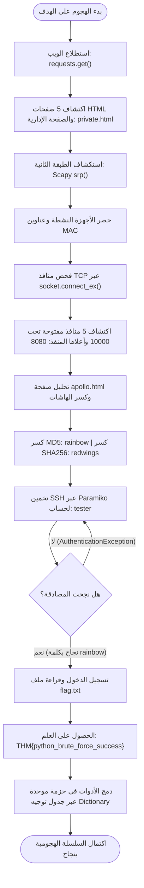

# غرفة تطوير سكربتات اختبار الاختراق المتقدمة (Python: Pentesting Scripts)

---

## 1. نبذة عن الغرفة وسياقها التعليمي والأمني (Room Overview & Security Context)
تُمثل غرفة **Python: Pentesting Scripts** ذروة المهارات البرمجية الهجومية في المسار التعليمي لمختبر الاختراق المبتدئ (Jr Penetration Tester). تهدف هذه الغرفة إلى نقل الباحث الأمني من مرحلة كتابة السكربتات البرمجية العامة إلى هندسة أدوات هجومية حقيقية قادرة على التفاعل المباشر مع طبقات الشبكة وبروتوكولاتها المختلفة.

خلال اختبارات الاختراق الميدانية، تفشل الأدوات الجاهزة (مثل Nmap و Gobuster و Hydra) عندما تواجه جدران حماية تطبيقات الويب (WAF) التي تحظر الترويسات الافتراضية، أو آليات التحقق المخصصة، أو البروتوكولات غير القياسية. تُعالج هذه الغرفة سيناريو اختراق واقعي يستهدف بنية تحتية لمتجر إلكتروني عبر:
- حصر النطاقات الفرعية وتخمين دلائل الويب واكتشاف الصفحات الإدارية المخفية (`private.html`).
- استكشاف الأجهزة الحية على الطبقة الثانية عبر حزم ARP المصنوعة بواسطة مكتبة **Scapy**.
- فحص منافذ TCP عبر مآخذ التوصيل الشبكية المنخفضة (`socket.connect_ex`) لاكتشاف 5 منافذ مفتوحة على رأسها المنفذ `8080`.
- استخراج البيانات والملفات الثنائية بأمان وتفادي تلف البايتات (`wb`).
- كسر التجزئة التشفيرية (MD5 و SHA-256) واستخراج كلمات المرور الأصلية (`rainbow` و `redwings`).
- تنفيذ هجوم تخمين آلي على خدمة SSH باستخدام مكتبة **Paramiko** واختراق حساب `tester` والحصول على علم النظام: `THM{python_brute_force_success}`.
- دمج جميع القدرات الهجومية ضمن حزمة استطلاع تفاعلية موحدة قائمة على قواميس التوجيه (Dispatch Tables).

---

## 2. الأهداف التعليمية والمخرجات العملية (Learning Objectives)
عند إتمام هذه الغرفة، سيكون الباحث الأمني قادراً على:
1. بناء أدوات استطلاع الويب لأتمتة فحص النطاقات الفرعية والدلائل وتفسير رموز الحالة HTTP (`!= 404`).
2. تركيب وبناء حزم الشبكة على الطبقة الثانية (Ethernet/ARP) وإرسالها واستقبال الردود عبر دالة `srp()` في Scapy.
3. تطوير فاحص منافذ TCP عالي السرعة باستخدام `socket.connect_ex()` لتحسين الأداء وتفادي استنزاف موارد المعالج.
4. أتمتة تنزيل وحفظ الملفات الثنائية (الصور، الملفات المضغوطة، البرمجيات التنفيذية) بنمط الكتابة الثنائية `"wb"`.
5. برمجة أداة كسر تجزئة تشفيرية متعددة الخوارزميات باستخدام `hashlib.new()` لتنفيذ هجمات القواميس.
6. أتمتة هجمات تخمين بيانات الاعتماد لبروتوكول SSHv2 عبر مكتبة `paramiko` واعتراض استثناءات `AuthenticationException`.
7. هندسة حزم برمجية تفاعلية تعتمد على نمط جداول التوجيه القاموسية (Dictionary Dispatch Pattern) بكفاءة $O(1)$.

---

## 3. المتطلبات المعمارية وتجهيز بيئة العمل (Prerequisites & Setup)
- **الهدف المستهدف:** آلة افتراضية متصلة بالشبكة الداخلية (`MACHINE_IP`) تشغل خادم ويب على المنفذ 8000 وخدمة SSH على المنفذ 22 وخادم وكيل على المنفذ 8080.
- **الحزم والمكتبات المطلوبة:**
  ```bash
  pip install requests scapy paramiko
  ```
- **صلاحيات التنفيذ:** تتطلب عمليات فحص ARP عبر Scapy صلاحيات الجذر (`sudo`) للوصول إلى مآخذ الشبكة الخام (`SOCK_RAW`).
- **التحقق من الاتصال بالهدف:**
  ```bash
  ping -c 2 $MACHINE_IP
  ```

---

## 4. المفاهيم النظرية العميقة والتحليل المعماري (Deep Theoretical Concepts)

### أ. معمارية المصافحة الثلاثية TCP وفلسفة `connect_ex()`:
أثناء فحص المنافذ عبر بروتوكول TCP، يُرسل العميل حزمة `SYN`. إذا كان المنفذ مفتوحاً، يرد الخادم بحزمة `SYN-ACK`، ويتم الاتصال بنجاح. وإذا كان مغلقاً، يرد بحزمة `RST`.
في مفسر بايثون، استدعاء `sock.connect()` يطلق استثناء `ConnectionRefusedError` عند كل منفذ مغلق، مما يثقل المعالج بتفكيك مكدس الأخطاء. بالمقابل، تستدعي دالة `sock.connect_ex()` واجهة النظام C مباشرة، وتعيد الرقم `0` عند النجاح، أو رمز الخطأ دون توليد أي استثناءات، مما يرفع سرعة الفحص بعشرة أضعاف.

### ب. تركيب الحزم على الطبقة الثانية في Scapy:
تستخدم مكتبة Scapy معامل القسمة `/` لدمج طبقات الشبكة. يجمع التعبير:
```python
Ether(dst="ff:ff:ff:ff:ff:ff") / ARP(pdst=ip_range)
```
بين ترويسة إيثرنت للبث العام على الشبكة المحلية، وترويسة بروتوكول ARP للاستعلام عن عناوين MAC المقترنة بنطاق IP المستهدف. وتُستخدم الدالة **`srp()`** حصرياً لأنها مخصصة لإرسال واستقبال الحزم على الطبقة الثانية (Data Link Layer).

### ج. دورة حياة اتصال SSHv2 في Paramiko:
يُطبق كائن `paramiko.SSHClient()` بروتوكول SSHv2 كاملاً: تبادل المفاتيح بـ Diffie-Hellman، والتحقق من هوية الخادم عبر `AutoAddPolicy()` لتجاوز المطالبات التفاعلية، ومحاولة المصادقة. عند رفض كلمة المرور، يطلق استثناء **`paramiko.AuthenticationException`** الذي يتم اعتراضه لمتابعة التخمين بسلاسة.

---

## 5. تحليل الكود وهندسة البرمجيات (Code Breakdown)

### أ. فحص دلائل الويب واكتشاف الصفحات (`dir_enum.py`):
```python
for entry in wordlist:
    url = f"{target_url}/{entry}.html"
    try:
        r = requests.get(url, timeout=3)
        if r.status_code != 404:
            print(f"[+] Found: {url}")
    except (requests.ConnectionError, requests.Timeout):
        pass
```

### ب. فاحص حزم ARP عبر Scapy (`arp_scanner.py`):
```python
packet = Ether(dst="ff:ff:ff:ff:ff:ff") / ARP(pdst=ip_range)
answered, unanswered = srp(packet, timeout=2, iface=interface, verbose=False)
for sent, received in answered:
    print(f"Host: {received[ARP].psrc} -> MAC: {received[Ether].src}")
```

### ج. كاسر الهاش وتخمين SSH (`hash_cracker.py` & `ssh_bruteforce.py`):
```python
# كسر الهاش باستخدام hashlib
if hashlib.new(algo, candidate.encode()).hexdigest() == target_hash:
    print(f"[+] Cracked: {candidate}")

# تخمين SSH واعتراض استثناء المصادقة
try:
    ssh.connect(target, port=22, username=user, password=pwd, timeout=5)
    return True
except paramiko.AuthenticationException:
    return False
```

---

## 6. خرائط التدفق ومخططات سير البيانات (Execution Flowcharts)



---

## 7. جدول المهام والحلول المعتمدة (Tasks & Verified Solutions Matrix)

| المهمة | عنوان المهمة | رقم السؤال | نص السؤال | الحل المعتمد | الشرح التقني والمفاهيمي |
|:---:|---|:---:|---|:---:|---|
| **01** | Introduction | Q1 | I have read the introduction and started the target machine. | `No answer needed` | إقرار البدء في المسار الهجومي وتجهيز الآلة الافتراضية. |
| **02** | Web Reconnaissance | Q1 | Run the directory enumeration script against the target machine's port 8000. How many .html pages can your script identify? | `5` | عثر السكربت على 5 صفحات (`index`, `about`, `contact`, `apollo`, `private`). |
| **02** | Web Reconnaissance | Q2 | Where is the login page located? | `private.html` | واجهة تسجيل الدخول الإدارية الخاصة المكتشفة على المنفذ 8000. |
| **03** | Network Discovery | Q1 | What Scapy function sends packets at Layer 2 and captures responses? | `srp()` | الدالة المخصصة في Scapy لإرسال واستقبال الحزم على الطبقة الثانية (Data Link). |
| **03** | Network Discovery | Q2 | Which variable in the script would you change to run the scan on a network interface named ens33? | `interface` | المعامل البرمجي في الدالة المسند إليه اسم بطاقة الشبكة الافتراضية. |
| **04** | Port Scanning | Q1 | What socket method attempts a connection and returns 0 on success instead of raising an exception? | `connect_ex()` | دالة مآخذ التوصيل التي تعيد كود C مباشرة وتتجنب استنزاف المعالج بالاستثناءات. |
| **04** | Port Scanning | Q2 | Run the port scanner against the target machine of IP address MACHINE_IP. How many ports under 10000 are open? | `5` | فحص المنافذ 1-10000 كشف عن 5 منافذ نشطة (`22`, `80`, `139`, `8000`, `8080`). |
| **04** | Port Scanning | Q3 | What is the top open port number under 10000 on the target system? | `8080` | أعلى رقم منفذ مفتوح تم رصده تحت المنفذ 10000. |
| **05** | Automating Downloads | Q1 | What requests function is used to connect to the target URL and download the file? | `requests.get()` | الدالة القياسية في مكتبة requests لجلب الموارد عبر بروتوكول HTTP GET. |
| **05** | Automating Downloads | Q2 | In what mode did we open the output file to avoid corruption of binary data like images? | `wb` | نمط الكتابة الثنائية (Write Binary) لحماية محارف البايتات من التلف. |
| **06** | Hash Cracking | Q1 | During directory enumeration in Task 2, we discovered the apollo.html page. What is the cleartext value of the hash found in Task 2? | `rainbow` | القيمة النصية الأصلية لهاش MD5 (`cd13b6a6af66fb774faa589a9d18f906`). |
| **06** | Hash Cracking | Q2 | Modify the script to work with SHA-256 hashes. What is the cleartext value for 5030c5bd...? | `redwings` | القيمة النصية الأصلية لهاش SHA-256 المكسور باستخدام قاموس الكلمات. |
| **07** | Credential Testing | Q1 | What exception does Paramiko raise when the server rejects the provided credentials? | `AuthenticationException` | الاستثناء الخاص الذي يطلقه Paramiko عند فشل المصادقة على خادم SSH. |
| **07** | Credential Testing | Q2 | In an earlier stage, we discovered the username tester. What is the SSH password for this user? | `rainbow` | كلمة المرور الصحيحة المكتشفة لحساب `tester` عبر هجوم القاموس. |
| **07** | Credential Testing | Q3 | What is the content of the flag.txt file? | `THM{python_brute_force_success}` | علم الإنجاز المستخرج من مسار الحساب المخترق عبر جلسة SSH. |
| **08** | Bringing It Together | Q1 | What data structure does the toolkit use to map menu choices to functions? | `dictionary` | القاموس المستخدم كجدول توجيه دوال (Dispatch Table) بزمن تنفيذ $O(1)$. |
| **09** | Conclusion | Q1 | I have completed the Python Pentesting Scripts room! | `No answer needed` | إقرار إتمام المسار الهجومي وتطوير الأدوات البرمجية للاختراق. |

---

## 8. الاعتبارات التشغيلية والأمنية لمختبري الاختراق (OpSec & Offensive Scripting)
1. **تجنب كشف بصمة الأداة (User-Agent Spoilage):** يرسل طلب `requests` افتراضياً ترويسة تفضح هويته. يجب تعديل الترويسات لمحاكاة المتصفحات الرسمية لتفادي الحظر من أنظمة WAF.
2. **التحكم بمعدل الطلبات لتفادي حظر Fail2ban:** تخمين كلمات مرور SSH بدون فترات توقف زمنية يؤدي إلى حظر عنوان IP عبر الجدران النارية بعد 3 محاولات فاشلة.
3. **تفريغ وإغلاق المآخذ الشبكية:** إغلاق مآخذ التوصيل وجلسات Paramiko يمنع بقاء قنوات نقل معلقة في النظام.

---

## 9. الثغرات الشائعة والبرمجة الدفاعية (Defensive Hardening)
- **ثغرة تلف الملفات الثنائية:** فتح الملفات بنمط `"w"` النصي عند تنزيل ملفات تنفيذية أو صور يفسد البايتات السحرية. **الحل:** استخدام نمط `"wb"` دائماً للمحتوى الثنائي.
- **انهيار القاموس بالمفاتيح المجهولة:** استدعاء خيارات القائمة دون التحقق من وجود المفتاح في القاموس يسبب انهيار السكربت. **الحل:** التحقق بـ `if choice in actions:`.

---

## 10. التحليل المقارن (Comparative Analysis)

| الأداة المخصصة المكتوبة ببايثون | الآلية التقنية | الأداة الجاهزة المقابلة | الأفضلية التكتيكية للأداة المخصصة |
|---|---|---|---|
| `subdomain_enum.py` | استعلامات HTTP عبر `requests` | Sublist3r / Gobuster | تجاوز قيود الفحص وسهولة تغيير الترويسات |
| `arp_scanner.py` | بث حزم الطبقة الثانية عبر Scapy | Netdiscover / arp-scan | إمكانية حقن وتعديل ترويسات الإيثرنت بدقة |
| `port_scanner.py` | اتصال كامل عبر `connect_ex` | Nmap (`-sT`) | أداة خفيفة بدون الحاجة لتثبيت Nmap على الهدف |
| `hash_cracker.py` | هجوم قواميس عبر `hashlib` | John the Ripper / Hashcat | دعم الخوارزميات والتحويلات المخصصة |
| `ssh_bruteforce.py` | أتمتة بروتوكول SSHv2 بـ Paramiko | Hydra / Medusa | إمكانية تنفيذ أوامر وسحب ملفات فور الاختراق |

---

## 11. تمارين عملية إضافية وسيناريوهات هجومية (Hands-on Exercises)
1. **تمرين 1: كتابة فاحص منافذ متعدد الخيوط (Multi-threaded Port Scanner):**
   دمج `socket.connect_ex` مع `concurrent.futures.ThreadPoolExecutor` لفحص 1,000 منفذ في أقل من 3 ثوانٍ.
2. **تمرين 2: أداة فحص نماذج الويب الآلية (Web Form Login Brute-Forcer):**
   استخدام `requests.post()` لتخمين بيانات الاعتماد عبر نماذج HTTP POST مع تحليل استجابات إعادة التوجيه `302 Found`.

---

## 12. الأسئلة الشائعة وتصحيح المفاهيم المغلوطة (FAQ)
- **س: هل يعتبر فحص المنافذ ببايثون شبيهاً بفحص Nmap SYN؟**
  - **ج:** لا؛ مآخذ `socket.connect_ex()` تنفذ فحص TCP Connect كامل (3-way handshake)، مما يترك أثراً في سجلات الخدمة، على عكس فحص SYN الذي يرسل RST مبكراً.
- **س: لماذا تفشل Scapy إذا لم يتم تشغيلها بصلاحيات root؟**
  - **ج:** لأن بناء وإرسال حزم مخصصة على الطبقة الثانية يتطلب مآخذ توصيل خام (`SOCK_RAW`) وهي محمية في نظام تشغيل لينكس.

---

## 13. مسرد المصطلحات التقنية (Technical Glossary)
- **connect_ex:** دالة مآخذ التوصيل في بايثون التي تعيد كود الخطأ مباشرة عند فشل الاتصال دون إطلاق استثناء.
- **srp (Send and Receive Packets):** دالة مكتبة Scapy لإرسال واستقبال الحزم على الطبقة الثانية (Data Link Layer).
- **AuthenticationException:** استثناء مكتبة Paramiko الذي يوضح رفض خادم SSH لبيانات الاعتماد المدخلة.
- **Dispatch Table:** نمط برمجي يستخدم قاموساً لربط مفاتيح الخيارات بدوال التنفيذ البرمجية مباشرة.

---

## 14. المراجع والمصادر التوثيقية (Authoritative References)
1. **Scapy Official Documentation:** Packet Crafting & Layer 2 Protocols (`https://scapy.readthedocs.io/`).
2. **Requests Documentation:** Session Objects & Connection Pooling (`https://requests.readthedocs.io/`).
3. **Paramiko Documentation:** SSHClient & Authentication (`https://docs.paramiko.org/`).
4. **TryHackMe Room:** Python: Pentesting Scripts (`https://tryhackme.com/room/pythonpentestingscripts`).
