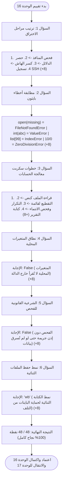

# غرفة المراجعة التقييمية الشاملة لأساسيات بايثون (Topic Transition Recap - Python Scripting Basics)

---

## 1. نبذة عن الغرفة وسياقها التعليمي والأمني (Room Overview & Security Context)
تُمثل غرفة **Topic Transition Recap** التقييم الختامي والشامل لـ **الوحدة 16: أساسيات برمجة السكربتات بلغة بايثون (Python Scripting Basics)** ضمن مسار مختبر الاختراق المبتدئ (Jr Penetration Tester). تهدف هذه الغرفة إلى قياس الفهم المعماري والتطبيقي لدى الباحث الأمني عبر تقييم مركب يتألف من 6 أسئلة معقدة تشمل:
- الترتيب المنطقي لمراحل عمليات اختبار الاختراق وسلسلة استهلاك البيانات (Kill Chain).
- خريطة استثناءات مفسر بايثون ومعالجة أخطاء التنفيذ البرمجية.
- البناء الهندسي لسكربتات فحص قوائم المستخدمين ومعالجة البيانات المتسلسلة.
- حدود ونطاقات المتغيرات (Scope Isolation) في الدوال البرمجية.
- الأطر والحدود القانونية المنظمة لعمليات فحص الشبكات واختبار الاختراق (CFAA و CMA).
- التعامل الآمن مع التدفقات الثنائية وتنزيل الملفات التنفيذية دون تلف (`wb`).

تم اجتياز هذا التقييم بنسبة نجاح **100% (48 / 48 نقطة كاملة)** من المحاولة الأولى، مع توثيق كافة الأسئلة والخيارات والتعليلات التقنية المستخرجة مباشرة من الحساب المكتمل على TryHackMe عبر المعرف `6afe01d5f306fc3f659280c2`.

---

## 2. الأهداف التعليمية والمخرجات العملية (Learning Objectives)
عند إتمام هذا التقييم التلخيصي، يثبت الباحث الأمني قدرته على:
1. استيعاب الترتيب الزمني والمنطقي لمراحل الاختراق: فحص المنافذ $\rightarrow$ حصر الدلائل $\rightarrow$ كسر التجزئة التشفيرية $\rightarrow$ المصادقة عبر SSH.
2. التمييز الدقيق بين استثناءات بايثون الشائعة: `FileNotFoundError` و `ValueError` و `IndexError` و `ZeroDivisionError`.
3. تصميم خطوط معالجة وتدقيق الحسابات: قراءة النص $\rightarrow$ التقطيع لقائمة $\rightarrow$ حلقة فحص الانتماء $\rightarrow$ كتابة التقرير.
4. إدراك عزل نطاقات المتغيرات داخل الدوال وتفادي الأخطاء الناجمة عن محاولة استدعاء متغيرات محلية من الخارج.
5. استيعاب القوانين الدولية للأمن السيبراني، وإدراك أن الفحص دون إذن كتابي موثق يُعد جريمة يعاقب عليها القانون بغض النظر عن النوايا أو عدم وقوع أضرار.
6. اختيار نمط فتح الملفات الثنائية الصحيح (`"wb"`) للحفاظ على سلامة الحمولات والملفات التنفيذية.

---

## 3. المتطلبات المعمارية وتجهيز بيئة العمل (Prerequisites & Setup)
- **منصة التقييم:** بيئة التقييم الرسمية لـ TryHackMe (`https://tryhackme.com/recap/6afe01d5f306fc3f659280c2`).
- **المعرفة المكتسبة مسبقاً:** إتمام الغرف الأربع للوحدة:
  1. `Python: Simple Demo`
  2. `Python: Core Concepts`
  3. `Python: Building Scripts`
  4. `Python: Pentesting Scripts`
- **حساب النقاط:** 6 أسئلة، كل سؤال يمنح 8 نقاط، بمجموع 48 نقطة.

---

## 4. المفاهيم النظرية العميقة والتحليل المعماري (Deep Theoretical Concepts)

### أ. سلسلة استهلاك البيانات في عمليات الاختراق (Data Ingestion Pipeline):
تعتمد العمليات الهجومية على مبدأ تغذية كل مرحلة بالمخرجات المستخرجة من المرحلة السابقة:
$$\text{Port Scanning} \xrightarrow{\text{Port 8000 Found}} \text{Directory Fuzzing} \xrightarrow{\text{Hash on apollo.html}} \text{Hash Cracking} \xrightarrow{\text{Password 'rainbow'}} \text{SSH Login}$$
لا يمكن كسر الهاش دون العثور عليه أولاً في صفحات الويب، ولا يمكن فحص صفحات الويب دون تحديد المنفذ المفتوح.

### ب. شجرة استثناءات بايثون (CPython Exception Hierarchy):
ترث جميع الاستثناءات من كائن `BaseException`. تنقسم الاستثناءات البرمجية إلى:
- استثناءات قيم البيانات (`ValueError`): عندما يكون نوع البيانات صحيحاً ولكن محتواه غير صالح للعملية (مثل تحويل `"abc"` لعدد).
- استثناءات مسارات النظام (`FileNotFoundError`): تعكس خطأ النظام `ENOENT`.
- استثناءات حدود الذاكرة (`IndexError`): محاولة الوصول لفهرس خارج مجال المصفوفة.
- استثناءات العمليات الحسابية (`ZeroDivisionError`): القسمة على صفر.

### ج. الأساس القانوني لاختبار الاختراق:
المفهوم الخاطئ الشائع بأن "الفحص غير الضار قانوني" تدحضه نصوص القوانين الصريحة (مثل قانون الاحتيال وإساءة استخدام الحاسوب الأمريكي CFAA وقانون إساءة استخدام الحاسوب البريطاني CMA 1990). **الشرعية مستمدة حصراً من التفويض الكتابي الصريح (Written Authorization)** الموثق في قواعد الاشتباك (Rules of Engagement - RoE) ومجال العمل (Scope of Work).

---

## 5. تحليل الكود وهندسة البرمجيات (Code Breakdown)

### أ. تطبيق مراحل التقييم برمجياً:
```python
# خط المعالجة المعتمد في السؤال 3:
def audit_usernames(filepath, weak_passwords):
    # الخطوة 1: قراءة الملف كنص خام
    with open(filepath, "r") as f:
        raw_content = f.read()
    
    # الخطوة 2: تقطيع النص إلى قائمة أسماء
    usernames = [u.strip() for u in raw_content.splitlines() if u.strip()]
    
    # الخطوة 3: التكرار وفحص الانتماء
    flagged = []
    for user in usernames:
        if user in weak_passwords:
            flagged.append(user)
            
    # الخطوة 4: كتابة النتائج في ملف التقرير
    with open("report.txt", "w") as out:
        for f in flagged:
            out.write(f"{f}\n")
```

### ب. العزل البرمجي لنطاق الدوال (السؤال 4):
```python
def setup_attack():
    local_target = "10.10.10.10" # متغير محلي ينتهي بانتهاء الدالة
    return local_target

# print(local_target) # NameError: name 'local_target' is not defined!
target = setup_attack() # الطريقة الصحيحة عبر return
```

---

## 6. خرائط التدفق ومخططات سير البيانات (Execution Flowcharts)



---

## 7. جدول المهام والحلول المعتمدة (Tasks & Verified Solutions Matrix)

| السؤال | موضوع التقييم | نوع السؤال | النقاط | الإجابة المعتمدة والمحققة | الشرح والتعليل البرمجي والأمني |
|:---:|---|:---:|:---:|---|---|
| **Q1** | Stages of Engagement | Re-Order | 8 / 8 | 1. Port Scan $\rightarrow$ 2. Dir Enum $\rightarrow$ 3. Hash Crack $\rightarrow$ 4. SSH Login | استهلاك المخرجات مرحلياً وفق سلسلة القتل الهجومية. |
| **Q2** | Exception Handling | Match Pairs | 8 / 8 | `missing.txt` $\leftrightarrow$ `FileNotFoundError`<br>`int("abc")` $\leftrightarrow$ `ValueError`<br>`[99]` $\leftrightarrow$ `IndexError`<br>`10/0` $\leftrightarrow$ `ZeroDivisionError` | ربط أخطاء التشغيل بفئات الاستثناءات المطابقة في بايثون. |
| **Q3** | Script Workflow | Re-Order | 8 / 8 | 1. Read to string $\rightarrow$ 2. Split to list $\rightarrow$ 3. Loop & test $\rightarrow$ 4. Write report | البناء المتسلسل لخطوط معالجة وتدقيق البيانات في السكربتات. |
| **Q4** | Variable Scope | Boolean | 8 / 8 | `False` | المتغيرات المحلية محصورة بإطار الدالة ويُحذف مكدسها بعد الانتهاء. |
| **Q5** | Legal Boundaries | Boolean | 8 / 8 | `False` | القوانين تجرم الفحص غير المصرح به حتى في غياب الضرر؛ الإذن المكتوب هو الفيصل. |
| **Q6** | Binary File Mode | Single Choice | 8 / 8 | `"wb"` | نمط الكتابة الثنائية هو الوحيد الذي يحفظ البايتات دون تحويلات تترجم الأسطر. |

---

## 8. الاعتبارات التشغيلية والأمنية لمختبري الاختراق (OpSec & Offensive Scripting)
1. **الالتزام الحرفي بنطاق العمل (Scope Adherence):** تجاوز عناوين IP أو النطاقات المصرح بها كتابياً في العقد يُعرض مختبر الاختراق للمساءلة الجنائية بموجب قوانين CFAA و CMA.
2. **عزل المتغيرات لحماية الخيوط البرمجية (Thread Safety):** الاعتماد على المتغيرات العامة (`global`) يسبب تضارباً كارثياً (Race Conditions) عند تحويل السكربتات للعمل بنمط الخيوط المتعددة (`threading`). دائماً اعتمد على المتغيرات المحلية وتمرير المعاملات.
3. **حماية الحمولات من تلف الإرسال:** تنزيل واستخراج الحمولات والبرمجيات بنمط النصوص العادي يغير قيم البايتات السحرية (`Magic Bytes`) مما يعطل عمل الاستغلال.

---

## 9. الثغرات الشائعة والبرمجة الدفاعية (Defensive Hardening)
- **الافتراض الخاطئ لشرعية الفحص العشوائي:** تجنب فحص خوادم لا تملك إذناً خطياً موقعاً لفحصها.
- **تجاهل استثناءات النظام الشائعة:** عدم وضع معالجة لـ `FileNotFoundError` يؤدي لتوقف السكربت إذا كان مسار القاموس غير صحيح.

---

## 10. التحليل المقارن (Comparative Analysis)

| المفهوم البرمجي | السلوك غير الآمن | السلوك الآمن المعتمد |
|---|---|---|
| **تنزيل الملفات** | الحفظ بنمط `"w"` النصي | الحفظ بنمط `"wb"` الثنائي |
| **معالجة الاستثناءات** | ترك الاستثناء يسقط السكربت | اعتراض الاستثناء المحدد بـ `try / except` |
| **نطاق المتغيرات** | استخدام المتغيرات العامة `global` | الدوال المعيارية وعزل المتغيرات المحلية |
| **فحص الأهداف** | الفحص العشوائي بلا وثائق | العمل بموجب عقد وتفويض RoE رسمي |

---

## 11. تمارين عملية إضافية وسيناريوهات هجومية (Hands-on Exercises)
1. **تمرين 1: صياغة قالب وثيقة تفويض أمني (RoE Template):**
   كتابة مسودة لقواعد الاشتباك تحدد الأهداف المصرح بها، وفترات الفحص، وقنوات الإبلاغ عن الثغرات الحرجة.
2. **تمرين 2: محاكي خط أنابيب تدقيق الحسابات (Account Pipeline Simulator):**
   تطبيق الخطوات الأربع للسؤال 3 عملياً على ملف يحتوي على 5,000 اسم مستخدم وهمي واستخراج النتائج في تقرير CSV.

---

## 12. الأسئلة الشائعة وتصحيح المفاهيم المغلوطة (FAQ)
- **س: هل فحص المنافذ المفتوحة يعتبر جريمة إذا لم أحاول تسجيل الدخول؟**
  - **ج:** في العديد من النطاقات القضائية، فحص المنافذ دون إذن يُفسر كمحاولة وصول غير مصرح بها. لا تختبر أي نظام خارج نطاق مختبراتك إلا بإذن كتابي.
- **س: لماذا لا تتوفر المتغيرات المحلية بعد انتهاء الدالة؟**
  - **ج:** يقوم مفسر CPython بتفريغ مكدس الذاكرة (Stack Frame) الخاص بالدالة فور تنفيذ `return` لتحرير موارد الذاكرة.

---

## 13. مسرد المصطلحات التقنية (Technical Glossary)
- **CFAA:** قانون الاحتيال وإساءة استخدام الحاسوب في الولايات المتحدة الأمريكية.
- **Rules of Engagement (قواعد الاشتباك):** الوثيقة القانونية المحددة للحدود والتقنيات المصرح بها أثناء اختبار الاختراق.
- **NameError:** استثناء بايثون الناتج عن محاولة استدعاء متغير غير معرف في النطاق الحالي.
- **Binary Mode (النمط الثنائي):** أسلوب التعامل مع الملفات دون معالجة أو تحويل لنهايات الأسطر أو المحارف.

---

## 14. المراجع والمصادر التوثيقية (Authoritative References)
1. **Computer Fraud and Abuse Act (18 U.S.C. § 1030).**
2. **UK Computer Misuse Act 1990.**
3. **NIST SP 800-115:** Technical Guide to Information Security Testing.
4. **TryHackMe Recap Endpoint:** `https://tryhackme.com/recap/6afe01d5f306fc3f659280c2`.
