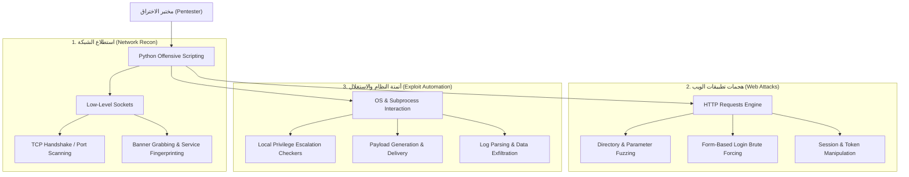

# الوحدة 16: أساسيات برمجة وتطوير السكربتات بلغة بايثون (Python Scripting Basics)

## نظرة عامة على الوحدة التعليمية
تُعد البرمجة وتطوير السكربتات (Scripting) حجر الزاوية لأي مختبر اختراق محترف وخبير أمني هجومي. على الرغم من أن الأدوات الجاهزة مثل Nmap و Metasploit و Burp Suite تقدم وظائف خارقة، إلا أن اختبارات الاختراق الواقعية تواجه دوماً سيناريوهات فريدة: بروتوكولات مخصصة، آليات مصادقة معقدة، ثغرات لم يُكتب لها استغلال مسبق، وحاجة ملحة لأتمتة المهام الروتينية لجمع المعلومات أو تجاوز الحمايات.

تبرز لغة **بايثون (Python)** بوصفها اللغة القياسية الأولى في مجال الأمن السيبراني واختبار الاختراق، بفضل بساطة تركيبها النحوي، وقوة مكتباتها القياسية والطرف الثالث، وسرعة كتابة وتجربة الشيفرات البرمجية واستغلال الثغرات (Rapid Exploit Prototyping).

تغطي هذه الوحدة مساراً تعليمياً متدرجاً ومتكاملاً يأخذك من المفاهيم التأسيسية للغة بايثون وصولاً إلى بناء أدوات هجومية احترافية:
1. **عرض عملي تمهيدي لبايثون (Python: Simple Demo):** فهم بيئة تشغيل بايثون، التفاعل عبر سطر الأوامر (REPL)، وتشغيل أول سكربت ومعالجة المدخلات والمخرجات البسيطة.
2. **المفاهيم الجوهرية للغة (Python: Core Concepts):** التعمق في هياكل البيانات (القوائم، المجموعات، القواميس)، بنى التحكم والشرط والدوران، الدوال، ومعالجة الأخطاء والاستثناءات.
3. **بناء السكربتات المتقدمة (Python: Building Scripts):** التعامل مع نظام الملفات، تمرير المعاملات البرمجية عبر سطر الأوامر (`argparse`)، والتفاعل مع أوامر النظام والعمليات الفرعية (`subprocess` و `os`).
4. **تطوير سكربتات اختبار الاختراق (Python: Pentesting Scripts):** برمجة أدوات هجومية واقعية: فاحص المنافذ (Port Scanner)، سحب البيانات التعريفية للخدمات (Banner Grabbing)، التخمين على نماذج الويب (HTTP Brute-forcing)، والتعامل مع بروتوكولات الشبكة عبر مآخذ التوصيل (Sockets).
5. **المراجعة التقييمية الشاملة (Topic Transition Recap):** تقييم نظري وعملي شامل يثبت استيعاب المفاهيم البرمجية والقدرة على تطبيقها في سيناريوهات أمنية حقيقية.

---

## فهرس غرف الوحدة والمواضيع المغطاة

| رقم الغرفة | اسم المجلد | الاسم البرمجي (Slug) | نوع الغرفة | الوصف الأكاديمي والعملي |
|:---:|---|---|:---:|---|
| **01** | `01-PYTHON-SIMPLE-DEMO` | `pythonsimpledemo` | معمل تطبيقي | مقدمة عملية لبيئة بايثون، المتغيرات، وأنماط الإدخال والإخراج الأساسية. |
| **02** | `02-PYTHON-CORE-CONCEPTS` | `pythoncoreconcepts` | معمل تطبيقي | هياكل البيانات، التحكم بالمسار، الدوال، التنسيق النصي، وإدارة الاستثناءات. |
| **03** | `03-PYTHON-BUILDING-SCRIPTS` | `pythonbuildingscripts` | معمل تطبيقي | هندسة السكربتات، معالجة ملفات النظام، تمرير المدخلات عبر CLI، وإدارة العمليات. |
| **04** | `04-PYTHON-PENTESTING-SCRIPTS` | `pythonpentestingscripts` | معمل تطبيقي | بناء أدوات الاختراق: برمجة السوكيت، فحص الشبكات، وأتمتة هجمات الويب وHTTP. |
| **05** | `05-TOPIC-TRANSITION-RECAP` | `recap` | تقييم شامل | تقييم شامل لمهارات البرمجة وأتمتة اختبار الاختراق والأدوات الهجومية. |

---

## البنية الهندسية للسكربتات الهجومية المتقدمة

---

## معايير الجودة الأكاديمية والعملية
تلتزم جميع غرف هذه الوحدة بالمعايير الصارمة التالية:
1. **هيكل الـ 14 قسماً المعتمد:** كل غرفة تمتلك توثيقاً كاملاً باللغتين العربية والإنجليزية.
2. **منهجية المراحل السبع للمهام (Stages A-G):** تفكيك كل مهمة وسؤال من المبادئ البرمجية والشبكية الأولى وتوضيح كيفية اشتقاق الإجابة برمجياً ومخبرياً.
3. **أكواد برمجية معلقة ومفصلة:** جميع السكربتات المكتوبة مدعمة بتعليقات توضيحية معمقة تشرح كل دالة، مأخذ توصيل (Socket)، وترويسة (Header).
