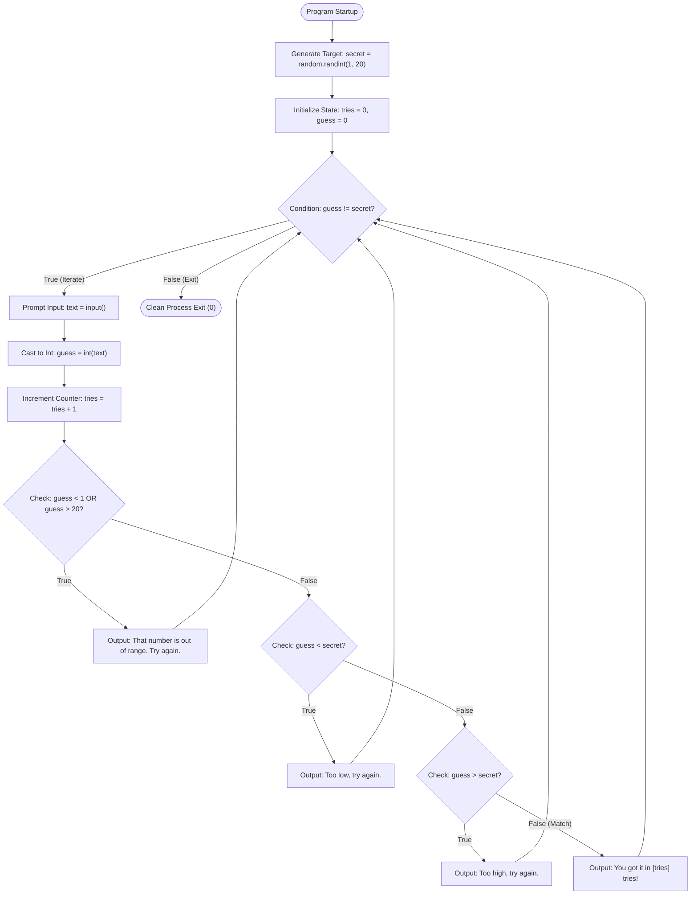

# Room 01: Python: Simple Demo — Comprehensive Technical Documentation

---

## 1. Room Overview & Security Context
The **Python: Simple Demo** room serves as the foundational programming entry point within the Jr Penetration Tester path on TryHackMe. The room demystifies imperative programming constructs by building an interactive command-line software project from scratch: **"Guess the Number"**.

In modern offensive security and penetration testing, practitioners cannot rely exclusively on pre-compiled third-party utilities. Real-world penetration tests regularly require:
- Prototyping custom one-off exploits for unpatched zero-day vulnerabilities.
- Automating low-level TCP/UDP socket communication and proprietary protocol handling.
- Engineering automated web fuzzers, credential stuffing engines, and data extraction pipelines.
This room establishes the fundamental mental models required to manipulate memory variables, evaluate multi-branch conditional trees, and manage iteration loops.

---

## 2. Learning Objectives & Practical Outcomes
Upon completing this room, security researchers and developers will be able to:
1. Explain the CPython runtime model, compilation into bytecode (`.pyc`), and PVM execution.
2. Initialize, track, and mutate program state using memory-backed variables.
3. Perform safe, explicit type casting between arbitrary user input strings (`str`) and numeric integers (`int`).
4. Construct branched decision logic using Python's `if`, `elif`, and `else` statements while enforcing input boundary validation.
5. Implement indefinite iteration loops using `while` controlled by inequality operators (`!=`).
6. Differentiate between insecure pseudorandom number generators (PRNG) and cryptographically secure random number generators (CSPRNG).

---

## 3. Architectural Prerequisites & Environment Setup
- **Target Lab OS:** Ubuntu Linux 22.04 LTS equipped with CPython 3.10+.
- **Development Tooling:** Visual Studio Code or command-line text editors (`nano`, `vim`).
- **Lab Files Location:** `/home/ubuntu/Python-Demo/` containing progressive script drafts (`guess_v1.py` through `guess_v4.py`).
- **Interpreter Verification:**
  ```bash
  python3 --version
  which python3
  ```

---

## 4. Deep Theoretical Concepts & Architectural Analysis

### A. The CPython Runtime Lifecycle:
Python does not compile directly to native machine code. Instead, CPython executes code through a two-stage pipeline:
1. **Source to Bytecode:** The source file is lexically analyzed, parsed into an Abstract Syntax Tree (AST), and compiled into intermediate virtual instructions known as bytecode (`.pyc` stored in `__pycache__`).
2. **Evaluation in PVM:** The Python Virtual Machine (an evaluation loop written in C, `ceval.c`) fetches bytecode opcodes sequentially and invokes the corresponding C routines.

### B. Dynamic Typing & Object References:
In Python, variables are names referencing objects allocated on the heap rather than direct fixed memory slots. The CPython runtime uses reference counting and a generational cyclic garbage collector for memory reclamation. CPython caches small integers in the range $[-5, 256]$ as global singletons to optimize performance and memory footprint.

---

## 5. Code Breakdown & Software Engineering

### Version 1: State Initialization & I/O (`guess_v1.py`)
```python
import random

secret = random.randint(1, 20)  # Random integer in [1, 20]
tries = 0
guess = 0

print("I'm thinking of a number between 1 and 20")
text = input("Take a guess: ")
guess = int(text)  # Type casting from str to int
tries = tries + 1
```

### Version 2: Multi-Branch Decision Logic (`guess_v2.py`)
```python
if guess < 1 or guess > 20:
    print("That number is out of range. Try again.")
elif guess < secret:
    print("Too low, try again.")
elif guess > secret:
    print("Too high, try again.")
else:
    print("You got it in", tries, "tries!")
```

### Version 3: Indefinite Iteration Loop (`guess_v3.py`)
```python
while guess != secret:
    text = input("Take a guess: ")
    guess = int(text)
    tries = tries + 1
    
    if guess < 1 or guess > 20:
        print("That number is out of range. Try again.")
    elif guess < secret:
        print("Too low, try again.")
    elif guess > secret:
        print("Too high, try again.")
    else:
        print("You got it in", tries, "tries!")
```

---

## 6. Flowcharts & Execution Lifecycles



---

## 7. Tasks & Verified Solutions Matrix

| Task # | Task Title | Question # | Question String | Verified Solution | Technical & Architectural Rationale |
|:---:|---|:---:|---|:---:|---|
| **01** | Introduction | Q1 | Let’s code our game! | `No answer needed` | Educational baseline and lab environment acknowledgment. |
| **02** | Variables | Q1 | What is the name of the function we used to display text on the screen? | `print()` | Built-in function writing formatted text objects to `sys.stdout`. |
| **02** | Variables | Q2 | What is the name of the function that we used to convert user input to an integer? | `int()` | Explicit type casting constructor coercing string representations into `PyLongObject`. |
| **03** | Conditional Statements | Q1 | How does Python write “else if”? | `elif` | Python keyword for chained multi-branch conditional statements. |
| **03** | Conditional Statements | Q2 | What will the program display if the user’s input is 50? | `That number is out of range. Try again.` | Boundary validation condition `guess > 20` evaluates to `True`, triggering the out-of-range handler. |
| **04** | Iterations | Q1 | What type of loop does this program use? | `while` | Indefinite iteration loop executing while the Boolean expression evaluates to `True`. |
| **04** | Iterations | Q2 | What will the program display if the user makes the correct guess in 3 tries? | `You got it in 3 tries!` | `print()` formats comma-separated arguments with default single-space delimiters. |
| **05** | Conclusion | Q1 | I successfully ran my first game created in Python. | `No answer needed` | Synthesis of variables, conditionals, and loops in imperative programming. |

---

## 8. OpSec & Offensive Scripting Considerations
1. **Preventing Execution Hangs (Network OpSec):** When applying `while` loops in offensive reconnaissance tools (e.g., port scanners, banner grabbers), always define explicit socket timeouts (`socket.settimeout()`) to prevent tool lockup when targeting firewalled hosts dropping packets silently.
2. **Cryptographic Randomness Risks:** The `random` library relies on the Mersenne Twister (MT19937) algorithm. Because it is non-cryptographic, an adversary observing 624 consecutive outputs can reverse the state vector and predict future token values. Offensive scripts generating encryption keys, session nonces, or staging URLs must use `secrets` or `os.urandom`.
3. **Silent Failure and Signal Trapping:** Offensive tools executing on remote targets should catch `KeyboardInterrupt` and exit cleanly without dumping verbose Python tracebacks into system terminal logs.

---

## 9. Common Vulnerabilities & Defensive Hardening

### Failure Vectors in Unhardened Scripts:
- **`ValueError` Crash:** Entering non-numeric strings (`"five"`) causes `int()` to crash ungracefully.
- **Infinite Loop:** Failing to update the evaluated state inside a `while` loop produces 100% CPU core consumption.
- **Type Coercion Hazards:** Relying on implicit behavior without input sanitization creates brittle security tooling.

### Hardened Defensive Implementation:
```python
try:
    guess = int(raw_text.strip())
except ValueError:
    print("[-] Non-numeric input detected. Please enter a valid integer.")
    continue
except (KeyboardInterrupt, EOFError):
    print("\n[!] User termination received. Cleaning up resources.")
    sys.exit(0)
```

---

## 10. Comparative Analysis: Language Selection for Security

| Feature | Python | Bash | C / C++ |
|---|---|---|---|
| **Development Speed** | Exceptionally rapid; clean, readable syntax | Fast for native shell pipeline commands | Slower; requires manual memory management |
| **Target Portability** | Requires CPython interpreter installed | Ubiquitous on Unix; absent on default Windows | Cross-compiles to standalone native PE/ELF |
| **Networking Capabilities** | Comprehensive standard & third-party libraries | Relies on external wrappers (`nc`, `curl`) | Raw low-level Berkeley sockets API |
| **Primary Offensive Use** | Exploit prototyping, fuzzing, web scanning | Post-exploitation enumeration scripts | Weaponized malware, rootkits, binary exploits |

---

## 11. Hands-on Extended Exercises & Offensive Scenarios
1. **Lab Exercise 1: Building a Minimalist TCP Port Probe:**
   Utilize the variable, conditional, and socket paradigms to check service availability:
   ```python
   import socket
   target_host = "127.0.0.1"
   target_port = 80
   sock = socket.socket(socket.AF_INET, socket.SOCK_STREAM)
   sock.settimeout(1.5)
   status = sock.connect_ex((target_host, target_port))
   if status == 0:
       print(f"[+] {target_host}:{target_port} is OPEN")
   else:
       print(f"[-] {target_host}:{target_port} is CLOSED (Code: {status})")
   sock.close()
   ```
2. **Lab Exercise 2: Binary Search Cracking Simulator:**
   Demonstrate the mathematical efficiency of binary search ($O(\log n)$) against linear searching ($O(n)$) in automated database exfiltration.

---

## 12. FAQ & Misconception Debunking
- **Q: Is Python an interpreted or compiled language?**
  - **A:** It is both. Source code is compiled to intermediate bytecode (`.pyc`), which is then interpreted by the Python Virtual Machine (PVM).
- **Q: Why avoid `eval()` for numeric conversions?**
  - **A:** `eval()` executes arbitrary code supplied in the input string, introducing catastrophic Remote Code Execution (RCE) vulnerabilities. Always use `int()` with defensive exception handling.

---

## 13. Technical Glossary
- **Bytecode:** Platform-independent intermediate machine instructions executed by the PVM.
- **Type Casting:** Converting an entity of one data type into another data type.
- **Mersenne Twister:** A pseudorandom number generator algorithm (MT19937) suitable for statistical modeling but insecure for cryptography.
- **CPython:** The reference implementation of the Python programming language written in C.
- **Indentation:** Whitespace characters used to delineate structural code blocks in Python.

---

## 14. Authoritative References & Further Reading
1. **Python Official Documentation:** Control Flow & Standard Library Functions (`https://docs.python.org/3/`).
2. **CPython Source Repository:** Evaluation Loop Implementation (`Python/ceval.c`).
3. **PEP 8:** Style Guide for Python Code (`https://peps.python.org/pep-0008/`).
4. **TryHackMe Official Room:** Python: Simple Demo (`https://tryhackme.com/room/pythonsimpledemo`).
