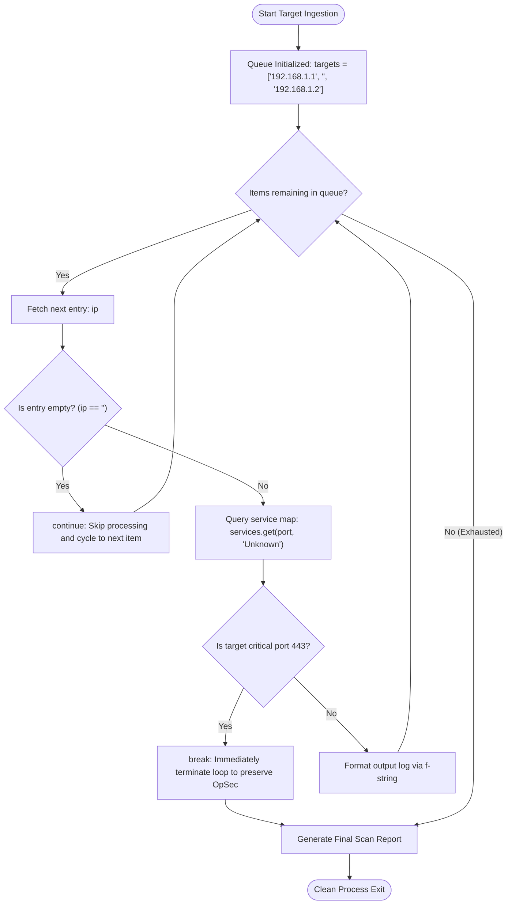

# Room 02: Python: Core Concepts — Comprehensive Technical Documentation

---

## 1. Room Overview & Security Context
The **Python: Core Concepts** room establishes the architectural foundations for scalable data handling, text manipulation, and execution control within the Jr Penetration Tester path on TryHackMe. Moving beyond basic procedural scripts, this room prepares security engineers to tackle real-world offensive scenarios—such as parsing 10,000 corporate usernames gathered during Active Directory reconnaissance or OSINT engagements.

In production penetration testing, successful automation demands:
- String slicing and sanitization for carving network banners, HTTP headers, and URL directory paths.
- Selecting appropriate collection structures (ordered mutable lists vs. $O(1)$ associative hash dictionaries) to prevent computational bottlenecks.
- Applying specialized arithmetic operators for cryptographic keyspace estimations and memory offset calculations.
- Enforcing loop control via early-exit mechanisms (`break`) to reduce network noise and defensive telemetry.

---

## 2. Learning Objectives & Practical Outcomes
Upon completing this room, security practitioners and developers will be able to:
1. Dynamically inspect data types with `type()` and explain standard input coercion semantics (`input()`).
2. Construct safe, performant terminal outputs and scan reports using formatted string literals (f-strings).
3. Slice, sanitize, and transform strings using zero-based indexing, negative offsets, and boundary-safe slicing.
4. Implement lists for work queues and dictionaries for high-speed associative mappings ($O(1)$ lookup).
5. Apply advanced arithmetic operators: modulus (`%`), floor division (`//`), and exponentiation (`**`).
6. Regulate iteration flow with `for` loops, sequence generators (`range()`), and control directives (`break`, `continue`).

---

## 3. Architectural Prerequisites & Environment Setup
- **Target OS:** Ubuntu Linux 22.04 LTS equipped with CPython 3.10+ and Visual Studio Code.
- **Lab Assets Path:** `/home/ubuntu/Core-Concepts/` containing demonstration scripts such as `fstrings_demo.py`.
- **CLI Verification:**
  ```bash
  python3 -c "import sys; print(f'CPython {sys.version.split()[0]} ready on {sys.platform}')"
  ```

---

## 4. Deep Theoretical Concepts & Architectural Analysis

### A. Compact Hash Tables in CPython 3.6+:
Modern CPython implements dictionaries as compact hash tables. Instead of allocating large, sparse 24-byte entries for every table slot, CPython decouples the sparse index array from a dense entries array. This architecture saves $20-25\%$ of memory and guarantees that iteration across `dict.keys()` or `dict.items()` preserves chronological insertion order.

### B. String Slicing Mechanics & Immutability:
Strings in Python are immutable unicode sequences (`PyUnicodeObject`). When executing a slice `word[3:7]`, CPython allocates a new unicode object on the heap and copies the requested bytes. Crucially, Python slicing is bounds-tolerant: slicing past the end of a string (`word[3:999]`) never raises an `IndexError`, making it inherently safe for parsing variable-length banners and raw packet payloads.

### C. Timsort Algorithm:
Python's built-in sorting method (`.sort()` and `sorted()`) employs Timsort, an adaptive, stable sorting algorithm combining merge sort and insertion sort. It achieves an optimal $O(n)$ time complexity on pre-ordered or partially sorted datasets and a guaranteed worst-case of $O(n \log n)$.

---

## 5. Code Breakdown & Software Engineering

### A. Dynamic Type Checking & f-String Formatting (`fstrings_demo.py`):
```python
target_ip = "192.168.1.1"
open_ports = [22, 80, 443]

for p in open_ports:
    print(f"[+] Discovered open port: {p}")

port_count = len(open_ports)
print(f"Scan complete: {target_ip} has {port_count} open ports")
```

### B. Safe Dictionary Lookup vs. Fatal Key Errors:
```python
services = {22: "SSH", 80: "HTTP"}

# Direct indexing: Throws KeyError if port 8080 is not present
# banner = services[8080]  # CRASH!

# Defensive lookup: Gracefully falls back to default string
banner = services.get(8080, "Unknown Service")  # Returns "Unknown Service"
```

### C. Sequence Iteration & Early Termination:
```python
targets = ["10.0.0.1", "10.0.0.2", "10.0.0.3"]
for ip in targets:
    if ip == "10.0.0.2":
        print(f"[+] Vulnerable target identified: {ip}. Terminating scan.")
        break  # Minimize operational footprint on target network
```

---

## 6. Flowcharts & Execution Lifecycles



---

## 7. Tasks & Verified Solutions Matrix

| Task # | Task Title | Question # | Question String | Verified Solution | Technical & Architectural Rationale |
|:---:|---|:---:|---|:---:|---|
| **01** | Introduction | Q1 | Let's master Python's core concepts! | `No answer needed` | Educational scenario acknowledgment and lab initialization. |
| **02** | Quick Review | Q1 | What built-in function reveals the data type of a value? | `type()` | Built-in inspection function dereferencing `ob_type` from the `PyObject` header. |
| **02** | Quick Review | Q2 | If a user types 3.14 at an input() prompt, what data type does Python store it as before any conversion? | `str` | `input()` unconditionally returns standard input as a raw string object. |
| **02** | Quick Review | Q3 | On the attached VM, open and run fstrings_demo.py. What is the last line printed to the terminal? | `Scan complete: 192.168.1.1 has 3 open ports` | Terminal output produced by the final interpolated f-string print call. |
| **03** | Working with Strings | Q1 | What function returns the number of characters in a string? | `len()` | Returns the element count of any sequence or collection object. |
| **03** | Working with Strings | Q2 | Given word = "TryHackMe", what does word[3:7] return? | `Hack` | Slicing includes indices [3, 4, 5, 6], excluding terminal index 7. |
| **03** | Working with Strings | Q3 | What string method converts "ADMIN" to "admin"? | `.lower()` | Returns a copy of the string converted to lowercase ASCII characters. |
| **04** | Lists and Dictionaries | Q1 | What method adds an element to the end of a list? | `.append()` | Appends an object to the dynamic array in amortized $O(1)$ time. |
| **04** | Lists and Dictionaries | Q2 | Given services = {22: "SSH", 80: "HTTP"}, what does services[80] return? | `HTTP` | Performs hash lookup for key `80` to return mapped value `"HTTP"`. |
| **04** | Lists and Dictionaries | Q3 | What dictionary method lets you retrieve a value with a safe fallback if the key does not exist? | `.get()` | Safe lookup method returning a default value instead of raising `KeyError`. |
| **05** | Arithmetic and Operators | Q1 | What operator returns the remainder of a division? | `%` | Modulus operator computing integer division remainder. |
| **05** | Arithmetic and Operators | Q2 | What does 10 // 3 evaluate to? | `3` | Floor division rounding down to nearest whole integer. |
| **05** | Arithmetic and Operators | Q3 | What does 2 ** 10 evaluate to? | `1024` | Exponentiation operator computing $2^{10} = 1024$. |
| **06** | Loops: for and while | Q1 | What type of loop is best suited for iterating over each item in a list? | `for` | Iterator-based sequence loop implementing the Python iterator protocol. |
| **06** | Loops: for and while | Q2 | What does range(3) produce? | `0, 1, 2` | Generates sequence starting at $0$ up to $stop-1$. |
| **06** | Loops: for and while | Q3 | What keyword immediately exits a loop? | `break` | Flow control statement terminating the nearest enclosing loop construct. |
| **07** | Conclusion | Q1 | I have successfully completed the room! | `No answer needed` | Mastery of foundational data structures and transition to script building. |

---

## 8. OpSec & Offensive Scripting Considerations
1. **Search Complexity in Massive Wordlists:** In-memory lookups using `item in target_list` execute in $O(n)$ linear time. When filtering 14-million-word dictionaries like `rockyou.txt`, using lists causes extreme CPU throttling. Converting wordlists into a `set` or using `dict` keys provides $O(1)$ constant-time lookups.
2. **Early Termination (`break`) to Minimize Telemetry:** In active reconnaissance, continuing to probe remaining ports or URLs after identifying the intended exploit vector generates unnecessary alerts across target SIEM and EDR solutions. Using `break` limits detection risk.
3. **Control Character Sanitization:** Wordlists extracted from compromised Windows hosts often contain carriage returns (`\r\n`). Applying `.strip()` prevents malformed HTTP requests and packet framing corruption.

---

## 9. Common Vulnerabilities & Defensive Hardening
- **Fatal `KeyError` Termination:** Direct bracket indexing (`dict[key]`) terminates tools abruptly when encountering unknown services or unanticipated JSON response keys. **Remediation:** Always implement `dict.get(key, fallback)`.
- **Quadratic String Concatenation:** Concatenating strings inside loops using `s += chunk` causes $O(n^2)$ memory reallocation because strings are immutable. **Remediation:** Accumulate strings in a `list` and join with `''.join(list)`.

---

## 10. Comparative Analysis: Data Structures Performance

| Structure | Ordered? | Mutable? | Lookup Complexity | Primary Security Use Case |
|---|:---:|:---:|:---:|---|
| **String (`str`)** | Yes | No (Immutable) | $O(n)$ | Payload staging, regex parsing, header matching |
| **List (`list`)** | Yes | Yes (Mutable) | $O(n)$ | Scanning queues, sequential IP ranges, raw output lines |
| **Dictionary (`dict`)** | Yes (3.7+) | Yes (Mutable) | **$O(1)$** | Service-to-port maps, session tokens, JSON configs |
| **Set (`set`)** | No | Yes (Mutable) | **$O(1)$** | De-duplicating subdomains, fast credential membership |

---

## 11. Hands-on Extended Exercises & Offensive Scenarios
1. **Exercise 1: Raw HTTP Header Parsing Utility:**
   Write a Python routine that ingests a multiline raw HTTP response string, splits by line breaks, strips whitespace, and parses headers into a dictionary.
2. **Exercise 2: Class C Subnet Generator:**
   Construct a script using `for` and `range(1, 255)` that outputs a formatted target list for Nmap ingestion (`192.168.1.1` to `192.168.1.254`).

---

## 12. FAQ & Misconception Debunking
- **Q: Does `range(3)` allocate an array of numbers in memory?**
  - **A:** No; in Python 3, `range()` is an immutable sequence object that computes elements on demand with $O(1)$ memory consumption.
- **Q: Why does `word[3:999]` not throw an `IndexError`?**
  - **A:** Python's slicing implementation is designed to be forgiving with boundary overshoots, gracefully returning all characters up to the string's length.

---

## 13. Technical Glossary
- **f-String:** Formatted string literal introduced in Python 3.6 for rapid, readable string interpolation.
- **Mutable:** An object whose in-memory state can be modified without creating a new instance.
- **Immutable:** An object whose state cannot be altered after creation.
- **KeyError:** Exception raised when a mapping key is not found in the set of existing keys.

---

## 14. Authoritative References & Further Reading
1. **Python Official Documentation:** Tutorial on Data Structures (`https://docs.python.org/3/tutorial/datastructures.html`).
2. **PEP 498:** Formatted String Literals Specification.
3. **CPython Source Repository:** Object implementations (`dictobject.c`, `listobject.c`).
4. **TryHackMe Official Room:** Python: Core Concepts (`https://tryhackme.com/room/pythoncoreconcepts`).
