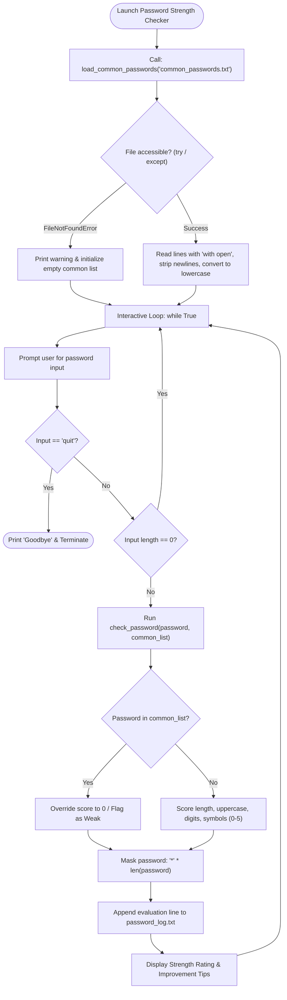

# Room 03: Python: Building Scripts — Comprehensive Technical Documentation

---

## 1. Room Overview & Security Context
The **Python: Building Scripts** room represents the pivotal graduation from writing simple procedural scripts to engineering resilient, production-grade security applications within the Jr Penetration Tester path on TryHackMe. In live penetration testing and red teaming, basic linear scripts fail when confronted with network timeouts, file access restrictions, or malformed data.

Professional security automation demands tools that can:
- Execute reliably in unstable target environments without crashing on unhandled runtime exceptions.
- Safely ingest large wordlists, credential dumps, and scan configurations without leaking operating system file descriptors.
- Encapsulate attack logic into modular, reusable, and unit-testable functions.
- Leverage Python’s extensive standard library and third-party package ecosystem via `pip`.

The room culminates in building a complete security utility: **The Password Strength Checker (`password_checker.py`)**, which evaluates password complexity, enforces known breach list overrides, and produces privacy-preserving masked audit logs.

---

## 2. Learning Objectives & Practical Outcomes
Upon completing this room, security researchers and engineers will be able to:
1. Define modular functions (`def`), manage positional and default parameters, and implement deterministic return values (`return`).
2. Shield offensive tools against crashes using structured exception handling (`try...except`), targeting specific exceptions like `ValueError` and `FileNotFoundError`.
3. Read and write filesystem data safely using context managers (`with open(...)`), preventing file descriptor exhaustion.
4. Cleanse and normalize streaming file lines using `.strip()` to eliminate trailing line-terminators (`\r\n`).
5. Manage and install dependencies using `pip`, and leverage standard modules like `string` and `hashlib` (SHA-256).
6. Engineer an interactive CLI password auditor enforcing dictionary breach overrides and credential log masking.

---

## 3. Architectural Prerequisites & Environment Setup
- **Target OS:** Ubuntu Linux 22.04 LTS equipped with CPython 3.10+ and Visual Studio Code.
- **Project Directory:** `/home/ubuntu/Building-Scripts/` containing:
  - `functions_demo.py` (Functions & scoring logic)
  - `files_demo.py` (File I/O demo loading 58 common passwords)
  - `imports_demo.py` (Cryptographic hashing & standard constants)
  - `password_checker.py` (The capstone security tool)
  - `common_passwords.txt` (Known breach wordlist)
- **Environment Verification:**
  ```bash
  cd /home/ubuntu/Building-Scripts && ls -la
  ```

---

## 4. Deep Theoretical Concepts & Architectural Analysis

### A. Variable Scope & The LEGB Resolution Rule:
CPython resolves variable references using the **LEGB Rule**:
1. **Local [L]:** Assigned within the active function body.
2. **Enclosing [E]:** Defined in static outer enclosing functions (closures).
3. **Global [G]:** Defined at the top level of the module file.
4. **Built-in [B]:** Pre-assigned names in the Python builtins module (`print`, `len`, `int`).

### B. The Context Manager Protocol (`__enter__` and `__exit__`):
Under the hood, `with open(...) as f:` implements the context manager protocol. When the block begins, CPython invokes `__enter__()` and binds the file handle to `f`. When the block terminates—even if interrupted by an unhandled exception or `sys.exit()`—CPython guarantees the execution of `__exit__()`, which invokes the underlying POSIX `close(fd)` system call, safeguarding the process against reaching `ulimit -n` descriptor exhaustion.

### C. Cryptographic Hashing Mechanics (SHA-256):
The `hashlib` module interfaces with native C implementations of SHA-256. Converting arbitrary byte sequences into fixed 256-bit (64-character hexadecimal) digests provides collision-resistant, one-way fingerprinting essential for verifying payload integrity and validating password hashes.

---

## 5. Code Breakdown & Software Engineering

### A. Modular Functions & Default Parameters:
```python
def check_length(password, min_length=8):
    return len(password) >= min_length

# Invoked with default parameter (8) or explicit override
print(check_length("secure"))     # False
print(check_length("secure", 4))  # True
```

### B. Defensive File Streaming & Exception Safety:
```python
def load_common_passwords(filepath):
    common = []
    try:
        with open(filepath, "r") as f:
            for line in f:
                common.append(line.strip().lower())
    except FileNotFoundError:
        print(f"[-] Warning: '{filepath}' not found. Skipping breach check.")
    return common
```

### C. Password Strength Checker with Privacy-Preserving Logging (`password_checker.py`):
```python
# Dictionary override: known common passwords receive 0 points immediately
if password.lower() in common_list:
    score = 0
    feedback = ["This password is in the common-passwords list. Choose another."]

# Append evaluation to audit log while masking cleartext credentials with asterisks
with open("password_log.txt", "a") as log:
    log.write(f"Password: {'*' * len(password)} | Strength: {label} ({score}/5)\n")
```

---

## 6. Flowcharts & Execution Lifecycles



---

## 7. Tasks & Verified Solutions Matrix

| Task # | Task Title | Question # | Question String | Verified Solution | Technical & Architectural Rationale |
|:---:|---|:---:|---|:---:|---|
| **01** | Introduction | Q1 | Let's build real scripts! | `No answer needed` | Educational baseline and script engineering roadmap acknowledgment. |
| **02** | Functions | Q1 | What keyword sends a value back from a function to the caller? | `return` | Flow control statement passing execution results back to the caller frame. |
| **02** | Functions | Q2 | If a function is defined as `def scan(target, port=80):`, what value does `port` take if you call `scan("192.168.1.1")` without specifying a port? | `80` | Fallback default argument defined in the function signature header. |
| **02** | Functions | Q3 | On the VM, run functions_demo.py. What score does score_password return for the password "TryHackMe2025!"? | `5` | Meets all 5 criteria ($\ge 8$, $\ge 12$, digits, uppercase, not in common list). |
| **03** | Error Handling | Q1 | What type of exception is raised when you attempt int("hello")? | `ValueError` | Raised when a function receives an argument with an invalid literal representation. |
| **03** | Error Handling | Q2 | What type of exception is raised when you try to open a file that does not exist? | `FileNotFoundError` | Subclass of `OSError` corresponding to POSIX error `ENOENT`. |
| **03** | Error Handling | Q3 | On the VM, open a Python terminal and type print(10 / 0). What is the name of the exception that Python raises? | `ZeroDivisionError` | Arithmetic exception raised when division or modulo divisor is zero. |
| **04** | Reading and Writing Files | Q1 | What keyword introduces a context manager for safely opening files? | `with` | Python statement managing resource allocation via `__enter__` and `__exit__`. |
| **04** | Reading and Writing Files | Q2 | What string method removes the trailing newline character from each line read from a file? | `.strip()` | Strips leading and trailing whitespace characters (`\n`, `\r`, `\t`, ` `). |
| **04** | Reading and Writing Files | Q3 | On the VM, run files_demo.py. How many passwords did it load from common_passwords.txt? | `58` | Ingests exactly 58 breach passwords from the accompanying dictionary. |
| **05** | Libraries and Pip | Q1 | What is the name of Python's package manager used to install third-party libraries? | `pip` | Standard package installer downloading libraries from PyPI. |
| **05** | Libraries and Pip | Q2 | Which module from the standard library provides constants like ascii_uppercase, digits, and punctuation? | `string` | Standard library module exporting pre-initialized ASCII character sets. |
| **05** | Libraries and Pip | Q3 | On the VM, run imports_demo.py. What is the first character of the SHA-256 hash it prints for the default input string? | `5` | Initial hexadecimal nibble of the calculated SHA-256 digest (`5e884898...`). |
| **06** | Putting It All Together | Q1 | In the check_password function, what score does the password receive if it is found in the common_passwords list? | `0` | Immediate score override reflecting actual susceptibility to dictionary attacks. |
| **06** | Putting It All Together | Q2 | On the VM, run password_checker.py and enter the password TryHackMe!2025. What strength label does the program display? | `Strong` | Receives 5/5 score, mapping to the `"Strong"` dictionary label. |
| **06** | Putting It All Together | Q3 | After running the checker with the password TryHackMe!2025, open password_log.txt on the VM. How many asterisks appear on that line? | `14` | The password contains 14 characters, generating 14 masked asterisks (`**************`). |
| **07** | Conclusion | Q1 | I have successfully completed the room! | `No answer needed` | Consolidates software engineering mastery and prepares for pentesting scripts. |

---

## 8. OpSec & Offensive Scripting Considerations
1. **Preventing Information Leakage in Audit Logs (CWE-532):** Writing unmasked passwords to disk creates critical security vulnerabilities. Masking credentials (`'*' * len(password)`) or writing to memory-backed filesystems (`/dev/shm`) protects operational data.
2. **Graceful Exception Suppression:** Never allow unhandled Python tracebacks to display in target terminal sessions. Blue teams monitor process crashes and log files for developer paths and script names.
3. **File Descriptor Resource Hygiene:** Unclosed file and socket descriptors persist in kernel memory. Employing `with open(...)` ensures sockets and file descriptors are reclaimed immediately, preventing `OSError: [Errno 24] Too many open files`.

---

## 9. Common Vulnerabilities & Defensive Hardening
- **Mutable Default Arguments:** Defining `def add_target(ip, targets=[])` causes all calls to share a single list instance in memory. **Remediation:** Always assign `targets=None` and initialize inside the function.
- **Bare `except:` Catching System Signals:** Catching `BaseException` intercepts `KeyboardInterrupt` (`Ctrl+C`), preventing users from halting runaway scanners. **Remediation:** Catch specific exceptions (`ValueError`, `socket.timeout`) or `Exception`.

---

## 10. Comparative Analysis: Scripting Patterns

| Dimension | Scratchpad Scripts | Modular Engineering (This Room) |
|---|---|---|
| **Structure** | Flat, sequential instructions | Discrete functions with parameter contracts |
| **Error Handling** | Unhandled; crashes on anomaly | Defended by targeted `try / except` blocks |
| **Resource Management** | Manual `open()` / `close()` prone to leaks | Protected by context managers (`with open`) |
| **Extensibility** | Difficult to modify or automate | Integrates standard library & PyPI packages |

---

## 11. Hands-on Extended Exercises & Offensive Scenarios
1. **Exercise 1: Command-Line Flag Parser with `argparse`:**
   Refactor `password_checker.py` to accept a `--wordlist` flag specifying an external dictionary file path via CLI rather than interactive input.
2. **Exercise 2: Multi-Hash Digest Generator:**
   Create a script that reads binary files and outputs MD5, SHA-1, and SHA-256 checksums simultaneously using `hashlib`.

---

## 12. FAQ & Misconception Debunking
- **Q: Does meeting complexity requirements guarantee password security?**
  - **A:** No; passwords like `Password123!` meet all complexity rules but are trivially cracked via dictionary attacks. Known breach list checking overrides theoretical complexity.
- **Q: Why avoid manual `f.close()`?**
  - **A:** If an error occurs between `open()` and `close()`, the file descriptor remains open. The `with` statement guarantees closing regardless of errors.

---

## 13. Technical Glossary
- **Context Manager:** Python protocol managing resource lifecycles automatically via `__enter__` and `__exit__`.
- **File Descriptor:** An abstract integer key assigned by the kernel to track open files and network sockets.
- **LEGB:** Python scope resolution hierarchy: Local, Enclosing, Global, Built-in.
- **Shannon Entropy:** Mathematical measure of uncertainty and unpredictability in cryptographic keys and passwords.

---

## 14. Authoritative References & Further Reading
1. **Python Official Documentation:** Functions, Errors, and File I/O (`https://docs.python.org/3/`).
2. **NIST SP 800-63B:** Digital Identity Guidelines — Authentication & Lifecycle Management.
3. **PEP 668:** Externally Managed Environments.
4. **TryHackMe Room:** Python: Building Scripts (`https://tryhackme.com/room/pythonbuildingscripts`).
