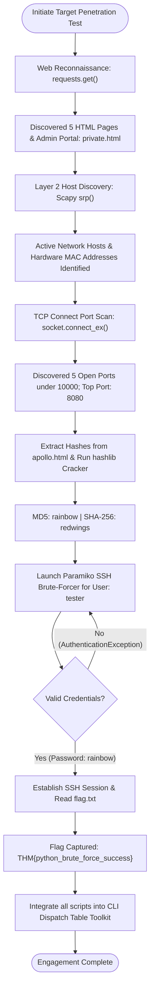

# Room 04: Python: Pentesting Scripts — Comprehensive Technical Documentation

---

## 1. Room Overview & Security Context
The **Python: Pentesting Scripts** room serves as the offensive culmination of the Python curriculum within the Jr Penetration Tester path on TryHackMe. Moving beyond theoretical programming and basic automation, this room equips security practitioners to build weaponized custom tooling capable of interacting across multiple OSI layers.

In real-world penetration tests, off-the-shelf automated binaries (such as Nmap, Gobuster, and Hydra) frequently trigger Web Application Firewall (WAF) blocks, fail against non-standard authentication schemes, or cannot be installed on target pivot machines. This room walks through an authentic multi-stage attack scenario against an enterprise target:
- Mapping web attack surfaces, discovering hidden subdomains and endpoints (`private.html`).
- Performing Layer 2 local host discovery using **Scapy** ARP broadcast frames.
- Developing high-speed TCP connect port scanners via low-level sockets (`connect_ex`), identifying 5 active listening ports led by port `8080`.
- Extracting binary data without payload corruption using `"wb"` mode.
- Implementing multi-algorithm dictionary hash crackers (`hashlib`) to recover cleartext credentials (`rainbow` and `redwings`).
- Automating SSHv2 authentication attacks with **Paramiko**, compromising user `tester`, and capturing the target flag: `THM{python_brute_force_success}`.
- Unifying tools into an interactive CLI toolkit powered by the Dictionary Dispatch Table pattern.

---

## 2. Learning Objectives & Practical Outcomes
Upon completing this room, security engineers will be able to:
1. Construct custom HTTP reconnaissance scripts using `requests`, interpreting status codes (`!= 404`) and leveraging connection pooling.
2. Craft raw Layer 2 Ethernet and ARP packets using Scapy, transmitting frames and capturing live hosts via `srp()`.
3. Engineer optimized TCP port scanners using `socket.connect_ex()` to avoid CPython exception overhead.
4. Safely automate artifact and binary payload extraction using Python's `"wb"` binary file mode.
5. Build modular dictionary attack engines using `hashlib.new()` supporting MD5, SHA-1, SHA-256, and SHA-512.
6. Automate remote SSH authentication auditing using `paramiko.SSHClient()`, catching `AuthenticationException` and executing post-exploitation commands.
7. Implement the Dictionary Dispatch Table pattern for scalable, clean CLI tool navigation.

---

## 3. Architectural Prerequisites & Environment Setup
- **Target System:** Virtual target machine accessible at `MACHINE_IP`, hosting a web server on port 8000, SSH on port 22, and proxy services on port 8080.
- **Python Dependencies:**
  ```bash
  pip install requests scapy paramiko
  ```
- **Privilege Requirements:** Raw packet generation via Scapy requires administrative permissions (`sudo` / `CAP_NET_RAW`).
- **Target Reachability:**
  ```bash
  ping -c 2 $MACHINE_IP
  ```

---

## 4. Deep Theoretical Concepts & Architectural Analysis

### A. TCP 3-Way Handshake & `connect_ex()` Performance:
In standard TCP socket programming, attempting to connect to a closed port via `sock.connect()` causes the kernel to receive an `RST` packet, raising a `ConnectionRefusedError` in Python. Unwinding the stack and constructing exception tracebacks across thousands of closed ports degrades performance. Conversely, **`sock.connect_ex((ip, port))`** wraps the underlying C library `connect()` system call, returning the integer `0` on success or the C `errno` (111 on Linux) on failure without throwing an exception, speeding up scans by up to 10x.

### B. Scapy Layer Stacking (`/`) & Layer 2 Transmission:
Scapy overloads the division operator `/` to stack protocol headers:
```python
Ether(dst="ff:ff:ff:ff:ff:ff") / ARP(pdst=ip_range)
```
This stacks an Ethernet broadcast frame ($0\text{x}0806$) onto an ARP request payload. While `sr()` operates at Layer 3 (IP), **`srp()`** operates at Layer 2 (Data Link), sending raw Ethernet frames and returning matched (sent, received) packet pairs.

### C. SSHv2 Handshake & Paramiko Exception Handling:
`paramiko.SSHClient()` encapsulates the full SSHv2 handshake (Diffie-Hellman key exchange, host key verification, cipher negotiation). Setting `AutoAddPolicy()` automatically trusts unknown host keys. On failed authentication, Paramiko raises **`paramiko.AuthenticationException`**, which the brute-force engine catches to iterate through candidates cleanly.

---

## 5. Code Breakdown & Software Engineering

### A. Web Directory Fuzzing (`dir_enum.py`):
```python
for entry in wordlist:
    url = f"{target_url}/{entry}.html"
    try:
        r = requests.get(url, timeout=3)
        if r.status_code != 404:
            print(f"[+] Found: {url}")
    except (requests.ConnectionError, requests.Timeout):
        pass
```

### B. Scapy Broadcast ARP Scanner (`arp_scanner.py`):
```python
packet = Ether(dst="ff:ff:ff:ff:ff:ff") / ARP(pdst=ip_range)
answered, unanswered = srp(packet, timeout=2, iface=interface, verbose=False)
for sent, received in answered:
    print(f"Host: {received[ARP].psrc} -> MAC: {received[Ether].src}")
```

### C. Hash Cracking & SSH Brute-Forcing:
```python
# Hash Cracker
if hashlib.new(algo, candidate.encode()).hexdigest() == target_hash:
    print(f"[+] Cracked: {candidate}")

# Paramiko SSH Client
try:
    ssh.connect(target, port=22, username=user, password=pwd, timeout=5)
    return True
except paramiko.AuthenticationException:
    return False
```

---

## 6. Flowcharts & Execution Lifecycles



---

## 7. Tasks & Verified Solutions Matrix

| Task # | Task Title | Question # | Question String | Verified Solution | Technical & Architectural Rationale |
|:---:|---|:---:|---|:---:|---|
| **01** | Introduction | Q1 | I have read the introduction and started the target machine. | `No answer needed` | Operational scope, engagement rules, and lab VM initialization. |
| **02** | Web Reconnaissance | Q1 | Run the directory enumeration script against the target machine's port 8000. How many .html pages can your script identify? | `5` | Script discovers 5 pages (`index`, `about`, `contact`, `apollo`, `private`). |
| **02** | Web Reconnaissance | Q2 | Where is the login page located? | `private.html` | Hidden administrative authentication interface discovered on port 8000. |
| **03** | Network Discovery | Q1 | What Scapy function sends packets at Layer 2 and captures responses? | `srp()` | Scapy primitive dedicated to Layer 2 transmission and response capture. |
| **03** | Network Discovery | Q2 | Which variable in the script would you change to run the scan on a network interface named ens33? | `interface` | Function parameter binding the raw packet socket to a specific network adapter. |
| **04** | Port Scanning | Q1 | What socket method attempts a connection and returns 0 on success instead of raising an exception? | `connect_ex()` | Berkeley socket method returning standard C error codes without throwing Python exceptions. |
| **04** | Port Scanning | Q2 | Run the port scanner against the target machine of IP address MACHINE_IP. How many ports under 10000 are open? | `5` | Scanning ports 1-10000 identifies 5 open ports (`22`, `80`, `139`, `8000`, `8080`). |
| **04** | Port Scanning | Q3 | What is the top open port number under 10000 on the target system? | `8080` | Highest open listening TCP port discovered below 10000. |
| **05** | Automating Downloads | Q1 | What requests function is used to connect to the target URL and download the file? | `requests.get()` | HTTP GET verb implementation in the requests library. |
| **05** | Automating Downloads | Q2 | In what mode did we open the output file to avoid corruption of binary data like images? | `wb` | Write Binary mode preserving byte-exact binary streams and magic numbers. |
| **06** | Hash Cracking | Q1 | During directory enumeration in Task 2, we discovered the apollo.html page. What is the cleartext value of the hash found in Task 2? | `rainbow` | Plaintext string matching MD5 hash `cd13b6a6af66fb774faa589a9d18f906`. |
| **06** | Hash Cracking | Q2 | Modify the script to work with SHA-256 hashes. What is the cleartext value for 5030c5bd...? | `redwings` | Plaintext string matching SHA-256 hash using wordlist dictionary lookup. |
| **07** | Credential Testing | Q1 | What exception does Paramiko raise when the server rejects the provided credentials? | `AuthenticationException` | Paramiko exception raised when SSH authentication credentials are rejected. |
| **07** | Credential Testing | Q2 | In an earlier stage, we discovered the username tester. What is the SSH password for this user? | `rainbow` | Cracked password authenticating user `tester` against the target SSH service. |
| **07** | Credential Testing | Q3 | What is the content of the flag.txt file? | `THM{python_brute_force_success}` | Capture-the-Flag proof of compromise retrieved from `/home/tester/flag.txt`. |
| **08** | Bringing It Together | Q1 | What data structure does the toolkit use to map menu choices to functions? | `dictionary` | Python dictionary implementing an $O(1)$ function dispatch table pattern. |
| **09** | Conclusion | Q1 | I have completed the Python Pentesting Scripts room! | `No answer needed` | Full completion of the weaponized offensive Python scripting curriculum. |

---

## 8. OpSec & Offensive Scripting Considerations
1. **WAF & EDR Signature Avoidance:** Naïve scripts broadcasting default User-Agents (`python-requests`) trigger immediate heuristic blocking. Custom headers and randomized request delays blend traffic with organic activity.
2. **Account Lockout & Defensive Throttling:** Rapid SSH brute-forcing triggers intrusion prevention systems like `fail2ban`. Introduce jitter (`time.sleep(3)`) or utilize password spraying techniques to evade detection.
3. **Socket Teardown Hygiene:** Always invoke `sock.close()` or `ssh.close()` to prevent local socket leaks and half-open connection alerts on target intrusion detection systems.

---

## 9. Common Vulnerabilities & Defensive Hardening
- **Binary Corruption via Text Mode:** Writing downloads using `"w"` alters carriage returns (`\r\n`), corrupting executable headers. **Remediation:** Always open destination files in `"wb"` mode.
- **Unvalidated Menu Dispatch:** Invoking `actions[choice]()` without verifying key membership crashes the tool with a `KeyError`. **Remediation:** Enforce `if choice in actions:`.

---

## 10. Comparative Analysis: Custom Python vs Off-the-Shelf Tools

| Custom Python Script | Protocol Layer | Commercial Tool Equivalent | Offensive Advantage |
|---|---|---|---|
| `subdomain_enum.py` | Layer 7 (HTTP) | Gobuster, Sublist3r | Fully customizable headers, proxy chains, and logic |
| `arp_scanner.py` | Layer 2 (Ethernet) | Netdiscover, arp-scan | Granular control over raw broadcast packet headers |
| `port_scanner.py` | Layer 4 (TCP) | Nmap (`-sT`) | Zero installation overhead on target pivot environments |
| `hash_cracker.py` | Cryptographic | John the Ripper, Hashcat | Ideal for proprietary salt combinations and formats |
| `ssh_bruteforce.py`| Layer 7 (SSHv2) | Hydra, Medusa | Automated post-exploitation command execution upon success |

---

## 11. Hands-on Extended Exercises & Offensive Scenarios
1. **Exercise 1: Multi-Threaded Port Scanner:**
   Combine `socket.connect_ex` with `ThreadPoolExecutor` to scan 1,000 ports in under 3 seconds.
2. **Exercise 2: Automated Form Brute-Forcer:**
   Use `requests.post()` to brute-force a web login form, inspecting `302 Found` redirects and session cookies.

---

## 12. FAQ & Misconception Debunking
- **Q: Does `connect_ex()` perform a SYN stealth scan?**
  - **A:** No; `connect_ex()` executes a full 3-way TCP handshake, completing the connection and closing it, leaving connection logs on the target.
- **Q: Why does Scapy require root privileges?**
  - **A:** Crafting raw Layer 2 Ethernet frames requires access to raw sockets (`SOCK_RAW`), a privileged kernel capability in Linux.

---

## 13. Technical Glossary
- **connect_ex:** Berkeley socket API function returning error codes directly without raising Python exceptions.
- **srp:** Scapy function dedicated to sending and receiving packets at Layer 2 (Data Link).
- **AuthenticationException:** Paramiko exception indicating rejected SSH credentials.
- **Dispatch Table:** Design pattern mapping identifiers directly to executable function references via a dictionary.

---

## 14. Authoritative References & Further Reading
1. **Scapy Official Documentation:** Packet Manipulation (`https://scapy.readthedocs.io/`).
2. **Requests Documentation:** Connection Pooling & Sessions (`https://requests.readthedocs.io/`).
3. **Paramiko Documentation:** SSHv2 Client Architecture (`https://docs.paramiko.org/`).
4. **TryHackMe Room:** Python: Pentesting Scripts (`https://tryhackme.com/room/pythonpentestingscripts`).
