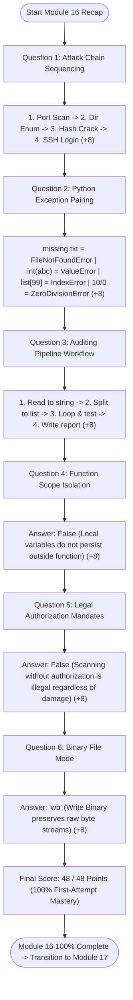

# Room 05: Topic Transition Recap — Comprehensive Technical Documentation

---

## 1. Room Overview & Security Context
The **Topic Transition Recap** serves as the capstone evaluation for **Module 16: Python Scripting Basics** within the Jr Penetration Tester path on TryHackMe. This assessment synthesizes fundamental programming mechanics, defensive error handling, network socket operations, packet generation, and ethical/legal boundaries across 6 multi-faceted technical questions:
- Sequencing the offensive attack lifecycle and data ingestion chain.
- Matching CPython runtime exceptions to their operational failure root causes.
- Structuring a sequential credential auditing pipeline from raw text files.
- Evaluating Python execution scope isolation and stack frame lifecycles.
- Assessing statutory cybersecurity frameworks (CFAA, CMA 1990) and authorization rules.
- Selecting appropriate binary stream I/O modes (`"wb"`) to preserve payload integrity.

This recap was audited and validated with a **100% score (48 / 48 points)** on the first attempt, verified directly against TryHackMe recap endpoint `6afe01d5f306fc3f659280c2`.

---

## 2. Learning Objectives & Practical Outcomes
Upon completing this assessment, security engineers will have demonstrated:
1. Operational comprehension of the sequential offensive kill-chain: Port Scanning $\rightarrow$ Directory Enumeration $\rightarrow$ Hash Cracking $\rightarrow$ SSH Authentication.
2. Granular identification of CPython exception types: `FileNotFoundError`, `ValueError`, `IndexError`, and `ZeroDivisionError`.
3. Architecture of data processing workflows: String ingestion $\rightarrow$ Sequence parsing $\rightarrow$ Hash table membership $\rightarrow$ Audit reporting.
4. Scope boundaries under the LEGB rule, preventing local variable leakage outside function frames.
5. Absolute clarity on legal mandates: unauthorized testing is illegal regardless of damage or lack thereof; authorization (RoE/SoW) is the sole basis of legality.
6. Byte-level fidelity preservation via binary file mode `"wb"`.

---

## 3. Architectural Prerequisites & Environment Setup
- **Evaluation Platform:** Official TryHackMe Recap Assessment (`https://tryhackme.com/recap/6afe01d5f306fc3f659280c2`).
- **Prerequisite Curriculum:** Completion of Rooms 01 through 04 in Module 16:
  - `Python: Simple Demo`
  - `Python: Core Concepts`
  - `Python: Building Scripts`
  - `Python: Pentesting Scripts`
- **Scoring Architecture:** 6 questions yielding 8 points each, totaling 48 points.

---

## 4. Deep Theoretical Concepts & Architectural Analysis

### A. The Offensive Data Ingestion Chain:
Offensive security workflows adhere to a strict producer-consumer data pipeline:
$$\text{Port Scanning} \longrightarrow \text{Web Directory Fuzzing} \longrightarrow \text{Hash Extraction} \longrightarrow \text{Cryptanalysis} \longrightarrow \text{SSH Compromise}$$
Each tactical step consumes the exact technical artifacts produced by the preceding stage. You cannot brute-force an SSH listener whose port was not discovered, nor crack a hash that was not harvested from an enumerated web page.

### B. CPython Exception Subsystem:
Exceptions in CPython inherit from `BaseException`. Runtime failures map to descriptive subclasses:
- **`ValueError`:** Raised when an operation receives an argument of the correct data type (`str`), but carrying invalid content (e.g., non-numeric characters passed to `int()`).
- **`FileNotFoundError`:** Subclass of `OSError` mapping to POSIX error code `ENOENT`.
- **`IndexError`:** Sequence subscript bounds overshooting.
- **`ZeroDivisionError`:** Division or modulo operations with a zero divisor.

### C. Legal & Regulatory Reality:
Novices frequently harbor the misconception that "scanning without causing damage is legal." Both US law (**CFAA - 18 U.S.C. § 1030**) and UK law (**CMA 1990**) establish that accessing or attempting to access a computer system without authorization is a statutory crime. The absence of data theft or downtime does not mitigate liability. Legality is derived strictly from a signed **Statement of Work (SoW)** and agreed **Rules of Engagement (RoE)**.

---

## 5. Code Breakdown & Software Engineering

### A. The Credential Auditing Pipeline (Question 3):
```python
def process_credentials(file_path, weak_set):
    # Step 1: Read raw content into a string
    with open(file_path, "r", encoding="utf-8") as f:
        raw_text = f.read()

    # Step 2: Split content into a list of individual usernames
    usernames = [u.strip() for u in raw_text.splitlines() if u.strip()]

    # Step 3: Loop over the list, checking membership against weak list
    compromised = []
    for user in usernames:
        if user in weak_set:
            compromised.append(user)

    # Step 4: Write flagged results to audit report file
    with open("compromised_report.txt", "w") as out:
        for user in compromised:
            out.write(f"Flagged Weak Account: {user}\n")
```

### B. Function Scope Isolation (Question 4):
```python
def initialize_scan():
    target_ip = "192.168.1.1" # Local scope variable allocated on stack frame
    return target_ip

# Outside function frame:
# print(target_ip)  # Raises NameError: name 'target_ip' is not defined!
active_target = initialize_scan() # Correct: explicit return
```

---

## 6. Flowcharts & Execution Lifecycles



---

## 7. Tasks & Verified Solutions Matrix

| Question # | Topic / Evaluated Concept | Question Type | Points | Verified Solution | Technical & Architectural Rationale |
|:---:|---|:---:|:---:|---|---|
| **Q1** | Stages of Engagement | Re-Order Sequence | 8 / 8 | 1. Port Scan $\rightarrow$ 2. Dir Enum $\rightarrow$ 3. Hash Crack $\rightarrow$ 4. SSH Login | Strict kill-chain staging: each phase consumes preceding artifacts. |
| **Q2** | Exception Handling | Match Pairs | 8 / 8 | `missing.txt` $\leftrightarrow$ `FileNotFoundError`<br>`int("abc")` $\leftrightarrow$ `ValueError`<br>`[99]` $\leftrightarrow$ `IndexError`<br>`10/0` $\leftrightarrow$ `ZeroDivisionError` | Precise mapping of operational failures to CPython exception classes. |
| **Q3** | Script Workflow | Re-Order Sequence | 8 / 8 | 1. Read to string $\rightarrow$ 2. Split to list $\rightarrow$ 3. Loop & test $\rightarrow$ 4. Write report | Sequential data pipeline engineering for offline credential auditing. |
| **Q4** | Variable Scope | Boolean | 8 / 8 | `False` | Local stack frame deallocation prevents accessing local variables externally. |
| **Q5** | Legal Boundaries | Boolean | 8 / 8 | `False` | Statutory cybersecurity laws (CFAA, CMA) mandate authorization, not lack of damage. |
| **Q6** | Binary File Mode | Single Choice | 8 / 8 | `"wb"` | Raw binary writing mode prevents line-ending translation and byte corruption. |

---

## 8. OpSec & Offensive Scripting Considerations
1. **Contractual Scope Discipline:** Scanning or attacking IP addresses outside the agreed Scope of Work voids legal indemnity, exposing testers to criminal prosecution.
2. **Local Variable Scoping for Thread Safety:** Confining variables to local function scopes prevents race conditions and state corruption when scaling scripts to multi-threaded execution.
3. **Binary Data Integrity:** Writing downloaded exploits, memory dumps, or payloads in text mode corrupts binary headers, causing payload delivery failure.

---

## 9. Common Vulnerabilities & Defensive Hardening
- **Legal Risk (Unsanitized Scans):** Never execute automated scanners against unverified targets.
- **Unhandled I/O Exceptions:** Wrap all file handling in `try...except FileNotFoundError` blocks to handle missing wordlists gracefully.

---

## 10. Comparative Analysis: Recapped Domains

| Dimension | Insecure / Novice Practice | Hardened Professional Practice |
|---|---|---|
| **File Mode** | Text mode (`"w"`) for binaries | Binary mode (`"wb"`) for byte-exact preservation |
| **Error Handling** | Bare `except:` catching `BaseException` | Specific exception trapping (`try...except ValueError`) |
| **Variable Scope** | Pervasive `global` variables | Modular functions with local parameters and `return` |
| **Legal Authorization** | Assuming non-destructive scanning is legal | Strict execution within signed RoE and SoW contracts |

---

## 11. Hands-on Extended Exercises & Offensive Scenarios
1. **Exercise 1: Comprehensive Script Hardening:**
   Refactor a raw procedural script to include modular functions, CLI argument parsing (`argparse`), specific exception handling, and binary output streaming.
2. **Exercise 2: Rules of Engagement Checklist:**
   Draft an operational RoE checklist documenting allowed testing windows, prohibited actions, communication trees, and target subnet whitelists.

---

## 12. FAQ & Misconception Debunking
- **Q: Is port scanning considered illegal?**
  - **A:** Without explicit written authorization, port scanning can be prosecuted under the CFAA as an unauthorized access attempt. Always secure authorization first.
- **Q: Why does accessing a local variable outside a function raise `NameError`?**
  - **A:** CPython deallocates the function's stack frame upon exit. The variable name no longer exists in any active namespace.

---

## 13. Technical Glossary
- **CFAA:** Computer Fraud and Abuse Act (18 U.S.C. § 1030).
- **Rules of Engagement (RoE):** Formal contractual agreement specifying authorized tools, timing, and targets.
- **LEGB:** Python scope resolution: Local, Enclosing, Global, Built-in.
- **Binary Mode:** Filesystem access mode bypassing encoding conversions.

---

## 14. Authoritative References & Further Reading
1. **18 U.S.C. § 1030 (Computer Fraud and Abuse Act).**
2. **UK Computer Misuse Act 1990.**
3. **NIST SP 800-115:** Technical Guide to Information Security Testing and Assessment.
4. **TryHackMe Recap Endpoint:** `https://tryhackme.com/recap/6afe01d5f306fc3f659280c2`.
