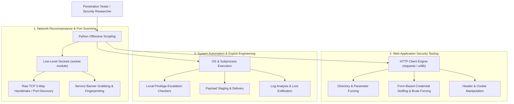

# Module 16: Python Scripting Basics — Technical Documentation

## Module Overview
Scripting and programming are core pillars of modern offensive security and penetration testing. While industry-standard automated tools (such as Nmap, Burp Suite, and Metasploit) provide wide coverage, real-world penetration tests frequently require custom tools to exploit unique vulnerabilities, automate bespoke multi-step attack chains, interact with proprietary network services, and process high-volume engagement data.

**Python** is the industry-standard programming language for cybersecurity practitioners, exploit developers, and reverse engineers. Its intuitive syntax, native low-level socket capabilities, robust package ecosystem (`requests`, `paramiko`, `scapy`, `pycryptodome`), and cross-platform compatibility make it the premier choice for rapid offensive development.

This module provides a rigorous, hands-on path from foundational programming concepts to building weaponized offensive tools:
1. **Python: Simple Demo (`pythonsimpledemo`):** Execution models, interactive REPL versus standalone scripts, variables, data types, and core I/O.
2. **Python: Core Concepts (`pythoncoreconcepts`):** Complex data structures (lists, tuples, dictionaries, sets), conditional logic, iterative loops, functions, variable scope, and structured exception handling.
3. **Python: Building Scripts (`pythonbuildingscripts`):** Script design patterns, filesystem manipulation, CLI argument handling via `argparse`, and operating system process execution via `os` and `subprocess`.
4. **Python: Pentesting Scripts (`pythonpentestingscripts`):** Building offensive tooling from scratch: raw network sockets, port scanning, banner grabbing, HTTP request automation, and web application brute-forcing.
5. **Topic Transition Recap (`recap`):** Comprehensive validation assessment testing practical scripting skills, socket mechanics, and offensive automation capabilities.

---

## Room Directory & Curriculum Mapping

| Room # | Directory Name | Canonical Slug | Type | Description |
|:---:|---|---|:---:|---|
| **01** | `01-PYTHON-SIMPLE-DEMO` | `pythonsimpledemo` | Walkthrough / Lab | Hands-on introduction to Python runtime, execution models, variables, and basic I/O. |
| **02** | `02-PYTHON-CORE-CONCEPTS` | `pythoncoreconcepts` | Walkthrough / Lab | Core data structures, control flow, modular functions, string processing, and exception handling. |
| **03** | `03-PYTHON-BUILDING-SCRIPTS` | `pythonbuildingscripts` | Walkthrough / Lab | Script architecture, filesystem I/O, robust CLI parsing, and system command execution. |
| **04** | `04-PYTHON-PENTESTING-SCRIPTS` | `pythonpentestingscripts` | Walkthrough / Lab | Offensive development: raw socket programming, banner grabbing, network scanners, and HTTP brute-forcers. |
| **05** | `05-TOPIC-TRANSITION-RECAP` | `recap` | Assessment | Practical assessment measuring offensive scripting and Python engineering mastery. |

---

## Offensive Python Architecture

---

## Engineering & Documentation Standards
All rooms within this module adhere strictly to:
- **14-Section Documentation Standard:** Dual-language technical guides (`README_AR.md`, `README_EN.md`), operational checklists, and MITRE ATT&CK alignments.
- **7-Stage Task Methodology (Stages A–G):** Deep technical deconstructions explaining underlying low-level mechanisms (network protocols, execution stacks, socket states) rather than merely providing answer strings.
- **Production-Grade, Commented Python Code:** Fully runnable, well-documented scripts with proper error handling and defensive coding principles.
